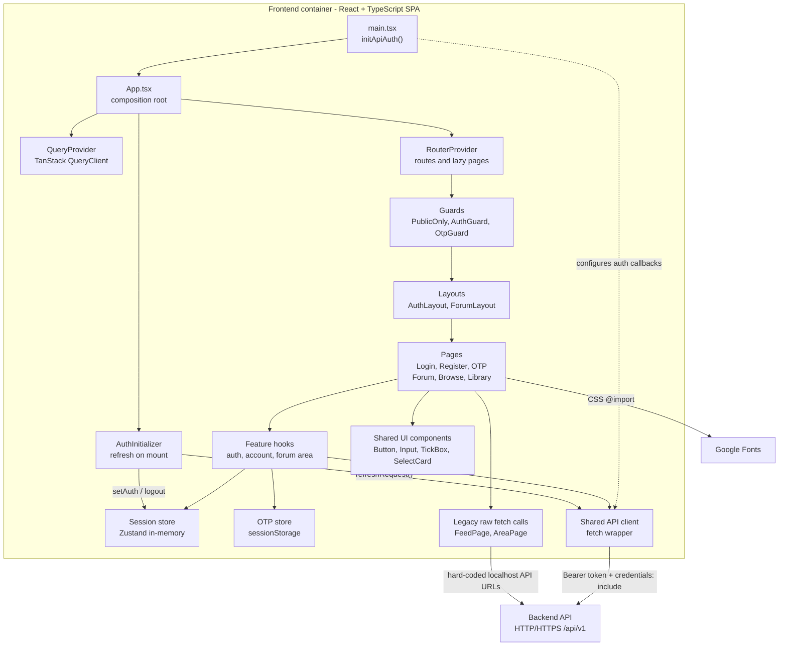
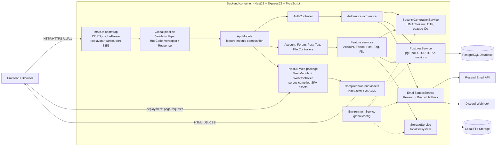

# Component Diagram (C4 Level 3)

**Version:** `1.1`

**Performed by:** [Nguyen Le Quoc Huy] | **Edited by:** []

## 1. Document Information

| Field | Value |
| --- | --- |
| Project | Studitopia |
| Document | Component Diagram - C4 Level 3 |
| Version | 1.1 |
| Date | 28/Nov/2026 |
| Scope | Frontend and backend components present in the current source tree |
| Diagram notation | Mermaid `flowchart` with C4-style labels |
| Companion documents | [System Context Diagram](system_context_diagram.md), [Container Diagram](container_diagram.md), [Deployment Diagram](deployment_diagram.md) |

### Revision History

| Date | Version | Description | Author |
| --- | --- | --- | --- |
| 28/Nov/2026 | 1.0 | Combined frontend and backend C4 Level 3 component diagrams into one level-specific document | Nguyen Le Quoc Huy |
| 28/Nov/2026 | 1.1 | Clarified development-only Vite hosting and production frontend hosting by the NestJS Web package | Nguyen Le Quoc Huy |

## 2. Purpose and Scope

This document zooms into the frontend and backend containers identified in the Level 2 Container Diagram. It shows the major components present in the current source tree, their responsibilities, and their relationships.

Vite hosts the SPA on port `8999` only during development. In deployment, the NestJS Web package (`WebModule`/`WebController`) serves the compiled frontend assets from the backend server, so there is no separate production frontend component. Planned features that are documented in requirements but not implemented in the source are intentionally excluded.

## 3. Frontend Container Component Diagram

This diagram zooms into the Web Browser / React SPA container.

### 3.1 Frontend Component Descriptions

| Component | Responsibility | Relationships |
| --- | --- | --- |
| `main.tsx` / `initApiAuth()` | Browser bootstrap. Uses `createRoot` on `#root`, configures API auth callbacks, and mounts `<App/>` in `StrictMode`. | Calls `configureApiAuth` on the API client and renders `App.tsx`. |
| `App.tsx` | Composition root. Mounts `QueryProvider`, `AuthInitializer`, and `RouterProvider`. | Provides context/providers for all other frontend components. |
| `QueryProvider` | Creates one stable TanStack `QueryClient` with `retry: 1`, `refetchOnWindowFocus: false`, and 60-second stale time. | Used by `useAccount`, `useArea`, and subject/tag queries. |
| `AuthInitializer` | Runs session refresh on mount and converts the response into session status (`AUTHENTICATED` or `PENDING_OTP`). | Calls `refreshRequest()` on the API client and writes to the Zustand session store; logs out on failure. |
| `RouterProvider` | Defines the route table with lazy-loaded pages and guard/layout grouping. | Sends matched routes through guards, then layouts, then pages. |
| Guards | `PublicOnly`, `AuthGuard`, and `OtpGuard` read authentication status and redirect between login, OTP verification, and forum pages. | Read the session store; render `LoadingPage`, redirect, or allow `<Outlet/>`. |
| Layouts | `AuthLayout` provides the split auth shell; `ForumLayout` provides authenticated navigation, search/top bar, account display, and logout. | Wrap pages; `ForumLayout` calls `useAccount()` and the logout feature. |
| Pages | Implement visible screens such as login, register, OTP, forum feed, browse, university/area/subject, and library. | Use feature hooks and shared UI; feed/area pages also contain direct raw `fetch` calls. |
| Feature hooks | Encapsulate API operations: `useLogin`, `useRegister`, OTP create/verify, logout, `useAccount`, and `useArea`. | Call the shared API client; update session/OTP stores; navigate through the router. |
| Session store | In-memory Zustand store containing `status`, `accessToken`, and `role`; not persisted to `localStorage`. | Read by guards/layouts; written by auth feature hooks and `AuthInitializer`. |
| OTP store | `sessionStorage` wrapper storing only `created_time` and `expired_time` under `otp_<type>`. | Written by OTP creation; read by `OtpPage` countdown and verification. |
| Shared API client | Typed `fetch` wrapper using `VITE_API_BASE_URL`, Bearer token, `credentials: "include"`, single-flight refresh, and one retry on 401. | Called by feature hooks; communicates with the backend API. |
| Legacy raw `fetch` calls | Current source-accurate direct calls in `FeedPage` and `AreaPage` to hard-coded localhost `/api/v1/tag` and `/api/v1/forum` URLs. | Call the backend directly instead of the shared API client. |
| Shared UI components | Presentational building blocks including `Button`, `Input`, `TickBox`, `SelectCard`, and `ToggleSwitch`. | Imported by pages/forms; do not call APIs directly. |

### 3.2 Frontend Source-Accurate Scope Notes

- Vite hosts the SPA on port `8999` only in development. In deployment, the NestJS Web package (`WebModule`/`WebController`) serves the compiled frontend assets from the backend server; there is no separate production frontend host.
- There are no current routes or components for friends, meeting rooms, create-post, notifications, or profile management.
- `LibraryPage` is static UI; `RecoverPasswordPage` only navigates to OTP, and `SetPasswordPage.resetPassword()` is empty.
- Successful auth flows navigate to `/`, but the router has no `/` route or catch-all route; guards redirect active users to `/forum`.
- The diagram intentionally excludes planned frontend features so it remains consistent with the source.

## 4. Backend Container Component Diagram

This diagram zooms into the Backend API Server container. It focuses on the active request pipeline, feature modules, and infrastructure components wired by `AppModule`.

### 4.1 Backend Component Descriptions

| Component | Responsibility | Relationships |
| --- | --- | --- |
| `main.ts` bootstrap | Creates the Nest application, enables CORS for `https://localhost:8999` with credentials for the development origin, installs `cookieParser`, installs `express.raw()` only for avatar upload, installs global validation/interceptor behavior, and listens on port `8353`. | Passes requests into the global pipeline and root module. |
| Global pipeline | `ValidationPipe` transforms and whitelists DTOs; `Response` + `HttpCodeInterceptor` set HTTP status, write cookies, and unwrap response data; numeric response codes are defined centrally. | Applied before controller handlers; used by all API controllers. |
| `AppModule` | Root composition module. Imports `AuthModule`, `EmailSenderModule`, `ForumModule`, `PostModule`, `TagModule`, `FileModule`, `AccountModule`, and `WebModule`. | Wires controllers and services into the Nest runtime. |
| NestJS Web package / `WebController` | Production frontend host. Serves compiled frontend assets from `./frontend`: `*.js`, `*.css`, and `index.html` SPA fallback. | Receives page/asset requests from the browser; does not call the database. |
| Compiled frontend assets | Deployed React SPA output made available to the backend Web package, including `index.html`, JavaScript, and CSS. | Read by `WebController` and returned to the browser. |
| API controllers | `AuthController`, `AccountController`, `ForumController`, `PostController`, `TagController`, and `FileController` map `/api/v1` routes to service calls. | Auth routes call `AuthenticationService`; other feature routes call their corresponding services. |
| Feature services | `AccountService`, `ForumService`, `PostService`, `TagService`, and `FileService` implement current domain reads, avatar/file handling, and ID-chain decoding. | Call `PostgresService`, `SecurityGenerationService`, and `StorageService` as needed. |
| `AuthenticationService` | Implements register, login by username/email, refresh, OTP creation/validation, and logout orchestration. | Calls `PostgresService`, `SecurityGenerationService`, and `EmailSenderService`. |
| `SecurityGenerationService` | Creates/verifies HMAC-SHA256 access, refresh, and OTP tokens; encrypts/decrypts opaque IDs; provides `@Authenticated()` guard and `@KeySession()` decorator. | Called by controllers and services; reads secrets from `EnvironmentService`. |
| `PostgresService` | Owns `pg.Pool`, calls `STUDITOPIA.*` SQL functions, maps SQLSTATE errors to response codes, and uses a bounded pool (`max: 20`). | Called by feature/auth services; connects to PostgreSQL. |
| `StorageService` | Saves, reads, deletes, and checks local files under a controlled storage root. | Called by `AccountService` and `FileService`; accesses local filesystem storage. |
| `EmailSenderService` | Sends OTP emails through Resend and falls back to a Discord webhook on failure. | Called by `AuthenticationService`; calls external Resend API and Discord webhook. |
| `EnvironmentService` | Global configuration provider reading `env`, process environment variables, and fallback values. | Supplies DB, HMAC secret, email, webhook, storage, and runtime settings to security/database/email/storage components. |

### 4.2 Backend Source-Accurate Scope Notes

- No `setGlobalPrefix()` is used. Controllers declare their own `api/v1/...` paths.
- Current HTTP endpoints are read-oriented for forum/post/tag/file plus a complete authentication subset. There are no HTTP routes for create post, create comment, vote, or full account management, although SQL wrappers or DTOs for some of those exist.
- `ReCaptchaModule`/`ReCaptchaService` and the `WebService` guard are present in source but unwired, so they are omitted from the active component diagram.
- Vite on port `8999` is development-only; the deployed frontend is covered by the NestJS Web package on the backend server.
- Source caveats that must be tracked: the token guard assigns unresolved promises from async verification helpers; logout requires a refresh cookie but the refresh parser only runs for `/auth/login?type=token`; email fallback currently reports success even when Resend fails; the OTP email text says 5 minutes while `OTP_DURATION` is 60 seconds.

## 5. Source References

- Frontend: `src/frontend/package.json`, `src/frontend/vite.config.ts`, `src/frontend/index.html`, `src/frontend/src/app/main.tsx`, `src/frontend/src/app/App.tsx`
- Frontend composition: `src/frontend/src/app/providers/`, `src/frontend/src/app/guard/`, `src/frontend/src/app/layouts/`
- Frontend feature/state: `src/frontend/src/features/`, `src/frontend/src/entities/session/`, `src/frontend/src/entities/otp/`, `src/frontend/src/pages/`
- Frontend API: `src/frontend/src/shared/api/client.ts`, `src/frontend/src/shared/api/error.ts`
- Backend: `src/backend/package.json`, `src/backend/src/main.ts`, `src/backend/src/app.module.ts`
- Backend cross-cutting: `src/backend/src/common/`, `src/backend/src/config/app.config.ts`
- Backend features: `src/backend/src/packages/authentication/`, `account/`, `forum/`, `post/`, `tag/`, `file/`, `web/`
- Backend infrastructure: `src/backend/src/packages/postgres/`, `security-generation/`, `email-sender/`, `storage/`, `environment/`
