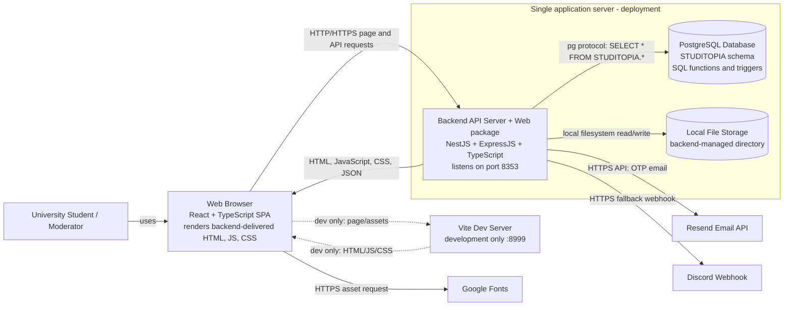

# Container Diagram (C4 Level 2)

**Version:** `1.1`

**Performed by:** [Nguyen Le Quoc Huy] | **Edited by:** []

## 1. Document Information

| Field | Value |
| --- | --- |
| Project | Studitopia |
| Document | Container Diagram - C4 Level 2 |
| Version | 1.1 |
| Date | 28/Nov/2026 |
| Scope | Major containers, technologies, and communication paths in the current implementation |
| Diagram notation | Mermaid `flowchart` with C4-style labels |
| Companion documents | [System Context Diagram](system_context_diagram.md), [Component Diagram](component_diagram.md), [Deployment Diagram](deployment_diagram.md) |

### Revision History

| Date | Version | Description | Author |
| --- | --- | --- | --- |
| 28/Nov/2026 | 1.0 | Extracted the C4 Level 2 Container diagram, tech stack, and container descriptions into their own document | Nguyen Le Quoc Huy |
| 28/Nov/2026 | 1.1 | Clarified that Vite on port 8999 is development-only and that the NestJS Web package serves the SPA in deployment | Nguyen Le Quoc Huy |

## 2. Purpose and Scope

This document zooms into the `Studitopia` system box from the Level 1 System Context diagram. It shows the major runnable containers, the technologies used by each, and how they communicate.

Backend, database, and local file storage are drawn inside one server boundary because they are hosted together. The compiled React frontend is returned by the backend NestJS Web package rather than served by a separate production frontend server. Vite hosts the SPA on port `8999` only during development.

## 3. Architecture Constraints and Hosting Model

- Studitopia is delivered as a browser-based web application. Users do not install a native client.
- The backend and PostgreSQL database are hosted on the same server.
- Vite hosts the frontend on port `8999` only during development; deployed frontend assets are served by the NestJS Web package from the backend server.
- The backend responds to frontend requests and returns compiled HTML, JavaScript, and CSS assets that the browser renders.
- The browser never connects directly to PostgreSQL. All application data passes through the NestJS backend API.
- Local filesystem storage is used for uploaded assets such as avatars; no cloud object-storage provider is currently configured.
- Email delivery uses an external Resend API, with a Discord webhook fallback for OTP delivery.
- Planned capabilities such as full AI matching, cloud file scanning, OAuth sign-in, voice/livestream collaboration, and push notifications are not current runtime dependencies.

## 4. Technology Stack

| Layer | Technology | Role in the architecture |
| --- | --- | --- |
| Client | React + TypeScript | Implements the browser UI, routing, forms, state, and API interaction. The compiled React bundle is served by the backend in deployment. |
| Client tooling | Vite, React Router, TanStack Query, Zustand | Builds the SPA, handles client routing, server-state caching, and local UI state. Vite's port `8999` server is development-only. |
| Server | NestJS + ExpressJS + TypeScript | Implements the HTTP API, controllers, DTO validation, guards/interceptors, authentication, and SPA delivery. NestJS runs on the Express platform adapter. |
| Server modules | Auth, Account, Forum, Post, Tag, File, Web, EmailSender, Postgres, SecurityGeneration, Storage, Environment | Organize backend responsibilities by feature and infrastructure concern. The Web module/package hosts compiled frontend assets in deployment. |
| Database | PostgreSQL with `citext` and `pgcrypto` | Stores accounts, sessions, forum data, tags, files, posts, comments, votes, and application logic in SQL functions and triggers. |
| Database access | `pg` PostgreSQL driver | Uses a connection pool and calls `STUDITOPIA` schema functions from the backend with direct SQL. |
| Database build/controller | Custom TypeScript compile and controller scripts | Compiles ordered SQL files using a filename-based dependency graph and applies database changes transactionally. |
| Authentication | Custom HMAC-SHA256 tokens, OTP, HTTP-only refresh cookie | Provides registration verification, login sessions, token refresh, and protected-route access without OAuth. |
| Email | Resend API | Sends OTP verification and recovery emails. |
| Fallback messaging | Discord webhook | Used when the primary email path fails; no credentials or URLs are exposed in this report. |
| Local storage | Filesystem directory managed by the backend | Stores uploaded files such as avatars on the same server as the backend/database. |
| External assets | Google Fonts | Loaded by the browser as a presentational external dependency. |

## 5. C4 Model - Level 2: Container Diagram

### 5.1 Container Descriptions

| Container | Responsibility and services provided | Technology / framework | Communication |
| --- | --- | --- | --- |
| Web Browser / React SPA | Renders the user interface, handles route transitions, collects form input, stores session state, and calls the backend API. It is not a separate deployed server in production; the compiled frontend is delivered by the backend NestJS Web package. | React 19, TypeScript 6, Vite-built bundle, React Router 8, TanStack Query 5, Zustand 5. | Sends HTTP/HTTPS requests to `/api/v1`; attaches Bearer access token and includes cookies; receives HTML, JS, CSS, and JSON; loads Google Fonts. |
| Vite Dev Server | Development-only host for the React SPA on port `8999`. It is not part of the deployed runtime. | Vite dev server configured in `vite.config.ts` with strict port `8999` and optional local HTTPS certificates. | Serves development HTML/JS/CSS to the browser; backend CORS allows `https://localhost:8999` for this development origin. |
| Backend API Server | Exposes the HTTP API, validates DTOs, applies response/status conventions, authenticates requests, creates OTPs, serves uploaded files, and serves the compiled SPA assets through the NestJS Web package in deployment. | NestJS 12 on `@nestjs/platform-express` (Express 5), TypeScript 6, `class-validator`, `cookie-parser`, `pg`, `resend`. Listens on port `8353`. | Receives HTTP/HTTPS from the browser; communicates with PostgreSQL through `pg.Pool`; reads/writes local files with Node `fs`; calls Resend and Discord over HTTPS; returns SPA assets. |
| PostgreSQL Database | Stores accounts, sessions, university tags, posts, comments, votes, and file metadata. Contains SQL functions and triggers under the `STUDITOPIA` schema. | PostgreSQL 14+, `citext`, `pgcrypto`, custom TypeScript-compiled SQL scripts. | Only the backend connects to it, using the PostgreSQL wire protocol through `pg.Pool`. |
| Local File Storage | Stores uploaded binary files such as avatars on the same server as the backend/database. | Backend-managed filesystem directory, default root `storage`, maximum avatar size 5 MB. | Read and written only by `StorageService`; file metadata is persisted in PostgreSQL. |
| Resend Email API | Delivers OTP verification and recovery emails. | External SaaS email API via the `resend` package. | Called by `EmailSenderService` over HTTPS. |
| Discord Webhook | Fallback channel used when Resend reports a failure. | External HTTP webhook. | Called by `EmailSenderService` over HTTPS; no URL or credential is documented here. |
| Google Fonts | Supplies web fonts used by the SPA presentation layer. | External static asset service. | Loaded directly by the browser through CSS `@import`. |

### 5.2 Container Communication Notes

- The browser never connects directly to PostgreSQL or the filesystem. All application data and file access pass through the backend API.
- There is no separate production frontend server. In deployment, the NestJS Web package's `WebController` reads the compiled frontend bundle and returns `index.html` for SPA fallback.
- Vite on port `8999` is used only for local development; it is not a deployment target and does not replace the backend Web package.
- Backend, database, and local file storage share one server; this is why they are drawn inside the same server boundary.
- Communication is synchronous HTTP/HTTPS for browser-to-backend and backend-to-external-service calls, the PostgreSQL wire protocol for backend-to-database calls, and local filesystem I/O for backend-to-storage calls.
- No WebSocket container or external real-time service is currently wired in the source, even though earlier phases discuss live collaboration.

## 6. Internal Architecture Overview

| Internal responsibility | Implementation approach |
| --- | --- |
| Frontend delivery | During deployment, the NestJS Web package serves the compiled frontend bundle from the backend and provides SPA fallback, so one backend server returns the HTML, JavaScript, and CSS needed by the browser. During development, Vite serves the SPA on port `8999`. |
| API layer | NestJS controllers under `api/v1` handle authentication, accounts, forum, posts, tags, files, and web delivery. Global validation, interceptors, and numeric response codes standardize requests and responses. |
| Security | Custom HMAC-SHA256 access/refresh tokens, OTP verification, password hashing through PostgreSQL `pgcrypto`, HTTP-only refresh cookies, and browser-side Bearer token handling. |
| Domain logic | Forum hierarchy, posts, comments, votes, tags, files, and account sessions are represented by PostgreSQL tables, SQL functions, and triggers in the `STUDITOPIA` schema. |
| File handling | `FileModule` and `StorageModule` manage uploads and local filesystem storage; file metadata is kept in PostgreSQL. |
| Database maintenance | Custom TypeScript scripts compile SQL sources by dependency order and execute them transactionally; the backend calls the resulting SQL functions through `pg.Pool`. |

## 7. Feature Coverage from PA1 to PA4

| Phase | Feature scope introduced or revised | Current source-accurate treatment |
| --- | --- | --- |
| PA1 | Study rooms, meeting spaces, shared notes/whiteboard/timers, study partner matching, documents, friends, notifications, and AI-assisted recommendations. | Only supporting ideas are retained in documentation and database/UI design; full spatial rooms, voice/livestream, and AI matching are not implemented. |
| PA2 | University forum, post types, comments/replies/votes, learning resource library, profiles, friends/groups, search, and safety features. | The backend currently implements authentication, account read/avatar, forum browse, post/tag/file read APIs, and local file storage. Create-post/comment/vote have SQL wrappers but no HTTP endpoints. |
| PA3 | Forum-first pivot, seven selected core use cases, reduced meeting-room scope, and stronger security/NFR expectations. | Authentication uses OTP + HMAC-SHA256 tokens; backend validation and PostgreSQL functions enforce domain rules; the NestJS Web package serves the SPA in deployment; meeting rooms remain a documented supporting feature only. |
| PA4 | 34 use cases and 241 functional requirements across authentication, profile, forum, posts, interaction, search/recommendation, library, friends, meeting rooms, notifications, and safety. | Requirements coverage is complete in the matrix, but the current runtime implements only the endpoint subset detailed in the Level 3 [Component Diagram](component_diagram.md). Friends, meeting rooms, notifications, profile editing, and full resource management remain roadmap items. |

## 8. Quality Attributes

| Quality attribute | Architectural response |
| --- | --- |
| Performance | Target forum/notification actions within 2 seconds and room tool synchronization within 1 second; backend uses a bounded PostgreSQL connection pool. |
| Scalability targets | Requirements target 10,000 users, 100,000 posts, 1,000,000 comments/answers/votes, 100,000 documents, 500 concurrent forum users, and 100 concurrent rooms. |
| Availability | Requirement target is 99.9%; single-server deployment is the current baseline, so redundancy is a future improvement. |
| Security | HMAC-SHA256 tokens, OTP verification, password hashing, HTTPS-oriented deployment, DTO whitelisting, cookie hardening, and privacy/moderation controls. |
| Maintainability | Feature-oriented backend modules, TypeScript across frontend/backend/database scripts, and SQL functions that keep domain rules close to the data. |

## 9. Assumptions and Deferred Capabilities

- The architecture documents describe the current implementation plus the documented PA1-PA4 product direction.
- Backend and database sharing one server is a deliberate deployment constraint; this is shown in the Level 2 diagram. Scaling would require a revised container design.
- Because the backend Web package serves the compiled React application in deployment, frontend and backend releases must be deployed together on the same server.
- Vite on port `8999` is a development-only host and is not part of the deployed system.
- External service credentials and webhook URLs are intentionally omitted.
- All four architecture documents must be updated whenever source code changes container boundaries, component responsibilities, endpoints, or external dependencies.

## 10. Source References

- `src/frontend/package.json`, `src/frontend/vite.config.ts`
- `src/backend/package.json`, `src/backend/src/app.module.ts`, `src/backend/src/main.ts`
- `src/backend/src/packages/web/web.controller.ts`, `src/backend/src/packages/postgres/pg.service.ts`
- `src/backend/src/packages/authentication/`, `src/backend/src/packages/email-sender/`, `src/backend/src/packages/storage/`
- `src/database/README.md`, `src/database/src/schemas/init.sql`, `src/database/scripts/compile.ts`, `src/database/scripts/sql.ts`
- `docs/requirements/PA1/features.md`
- `docs/requirements/proposals/functional_requirement.md`
- `docs/requirements/proposals/non_functional_requirement.md`
- `docs/requirements/PA4-Group05/use_cases/functional_requirement_coverage.md`
