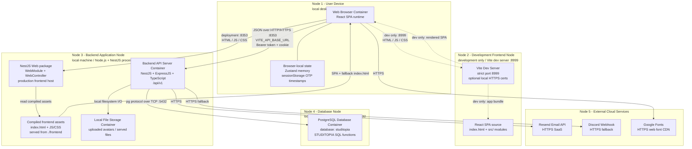

# C4 Deployment Diagram

**Version:** `1.1`

**Performed by:** [Nguyen Le Quoc Huy] | **Edited by:** []

## 1. Document Information

| Field | Value |
| --- | --- |
| Project | Studitopia |
| Document | C4 Deployment Diagram |
| Version | 1.1 |
| Date | 28/Nov/2026 |
| Scope | Current source-accurate deployment of the containers identified in Section C |
| Diagram notation | Mermaid `flowchart` with deployment-node subgraphs |
| Companion documents | [System Context Diagram](system_context_diagram.md), [Container Diagram](container_diagram.md), [Component Diagram](component_diagram.md) |

### Revision History

| Date | Version | Description | Author |
| --- | --- | --- | --- |
| 28/Nov/2026 | 1.0 | Added deployment view mapping containers to local logical nodes and external cloud services | Nguyen Le Quoc Huy |
| 28/Nov/2026 | 1.1 | Corrected frontend hosting: Vite on port 8999 is development-only; the NestJS Web package covers the compiled SPA in deployment | Nguyen Le Quoc Huy |

## 2. Purpose and Scope

This document maps the containers described in the Level 2 Container Diagram to the infrastructure that runs them. The current repository contains local-run scripts and service configuration, but no Dockerfile, Docker Compose file, or cloud deployment manifest. The deployment therefore describes a local-machine deployment with separate logical nodes, plus the external cloud services that the backend and browser call.

The backend and PostgreSQL are configured for the same local host by default, but they are drawn as separate logical nodes because they are separate runtime containers. Vite hosts the frontend on port `8999` only during development. In deployment, there is no separate frontend server: the NestJS Web package (`WebModule`/`WebController`) serves the compiled frontend assets from the backend API process on port `8353`.

## 3. Deployment Diagram

## 4. Container-to-Node Mapping

| Section C container | Deployed logical node | Runtime evidence |
| --- | --- | --- |
| Web Browser / React SPA | Node 1 - User Device | The browser executes the React 19 + TypeScript bundle. `main.tsx` bootstraps the SPA, `App.tsx` mounts providers/router, and browser-local state uses Zustand memory plus `sessionStorage`. |
| Vite Dev Server | Node 2 - Development Frontend Node | `vite.config.ts` sets strict port `8999` and optional local HTTPS certificates. This node is used only in development and is not part of deployment. |
| Compiled SPA assets | Node 3 - Backend Application Node | `npm run build` runs `tsc -b && vite build`; the compiled bundle is made available to the backend under `./frontend`, where the Web package serves it. |
| NestJS Web package | Node 3 - Backend Application Node | `WebModule` is imported by `AppModule`; `WebController` reads `./frontend/index.html`, `*.js`, and `*.css`. This is the production frontend host. |
| Backend API Server | Node 3 - Backend Application Node | `npm run start:prod` runs `node dist/main`. `main.ts` creates the NestJS application, enables CORS for `https://localhost:8999` for the development origin, installs cookie parsing/validation/interceptor behavior, and listens on `PORT` (`8353` by default). |
| Local File Storage | Node 3 - Backend Application Node | `StorageService` reads/writes/deletes local files; the backend exposes avatar and file endpoints. `web.controller.ts` reads from `./frontend`, and storage configuration controls upload size. |
| PostgreSQL Database | Node 4 - Database Node | `loadDatabaseConfig()` defaults to host `localhost`, port `5432`, database `studitopia`, user `studitopia`; `PostgresService` connects through a `pg.Pool` and calls `STUDITOPIA.*` SQL functions. |
| Resend Email API | Node 5 - External Cloud Services | `EmailSenderService` calls Resend over HTTPS to send OTP/recovery email. |
| Discord Webhook | Node 5 - External Cloud Services | `EmailSenderService` uses a Discord webhook as the fallback OTP delivery channel over HTTPS. |
| Google Fonts | Node 5 - External Cloud Services | The frontend CSS imports Google Fonts, which the browser fetches over HTTPS. |

## 5. Node Deployment Notes

### 5.1 Node 1 - User Device

- **Hardware or cloud service:** A local desktop, laptop, or mobile device running a modern web browser.
- **Containers/components running on the node:** The Web Browser container executes the React SPA. Browser-local state includes in-memory Zustand session state and `sessionStorage` OTP timestamps.
- **Communication protocols:** In development, HTTPS to the Vite dev server on port `8999`; in deployment, HTTP/HTTPS to the backend on port `8353` for both compiled SPA assets and JSON API responses; HTTPS to Google Fonts.

### 5.2 Node 2 - Development Frontend Node

- **Hardware or cloud service:** Local development machine running the Vite dev server; this node is not used in deployment.
- **Containers/components running on the node:** The Vite dev server and the React SPA source modules. Port `8999` is strict, and HTTPS can be enabled with local certificate files `certs/server.key` and `certs/server.crt`.
- **Communication protocols:** HTTPS on port `8999` for development page/assets; Vite hot-module replacement uses a development WebSocket when enabled by the dev server. The backend CORS policy allows `https://localhost:8999` with credentials for this development origin.

### 5.3 Node 3 - Backend Application Node

- **Hardware or cloud service:** Local machine running a Node.js process with NestJS 12 on Express 5.
- **Containers/components running on the node:** The Backend API Server container, the NestJS Web package as the production frontend host, compiled frontend assets under `./frontend`, all API controllers/services, and local file storage used for avatars and served files.
- **Communication protocols:** `app.listen(8353)` serves both JSON API traffic and compiled SPA assets; no separate production frontend server is present. The node uses TCP to PostgreSQL, local filesystem I/O for files, and HTTPS to Resend/Discord. No WebSocket endpoint is present in the deployed source.

### 5.4 Node 4 - Database Node

- **Hardware or cloud service:** Local PostgreSQL service on the same physical development machine as the backend, modeled as a separate logical database node.
- **Containers/components running on the node:** The `studitopia` PostgreSQL database, schema objects, and `STUDITOPIA.*` stored functions.
- **Communication protocols:** PostgreSQL wire protocol over TCP on default port `5432`, using host `localhost` and the configured database/user/password.

### 5.5 Node 5 - External Cloud Services

- **Hardware or cloud service:** Third-party SaaS endpoints: Resend for email delivery, Discord webhook for fallback delivery, and Google Fonts CDN.
- **Containers/components running on the node:** External Resend API, Discord webhook endpoint, and Google Fonts assets.
- **Communication protocols:** HTTPS from the backend to Resend/Discord and HTTPS from the browser to Google Fonts.

## 6. Source References

- Frontend development: `src/frontend/package.json`, `src/frontend/vite.config.ts`
- Backend bootstrap: `src/backend/package.json`, `src/backend/src/main.ts`, `src/backend/src/config/app.config.ts`, `src/backend/src/app.module.ts`
- Backend frontend hosting: `src/backend/src/packages/web/web.controller.ts`
- Database configuration: `src/database/config/database.config.ts`, `src/database/scripts/compile.ts`, `src/database/scripts/sql.ts`
- External services: `src/backend/src/packages/email-sender/`, `src/frontend/src/app/App.tsx`
