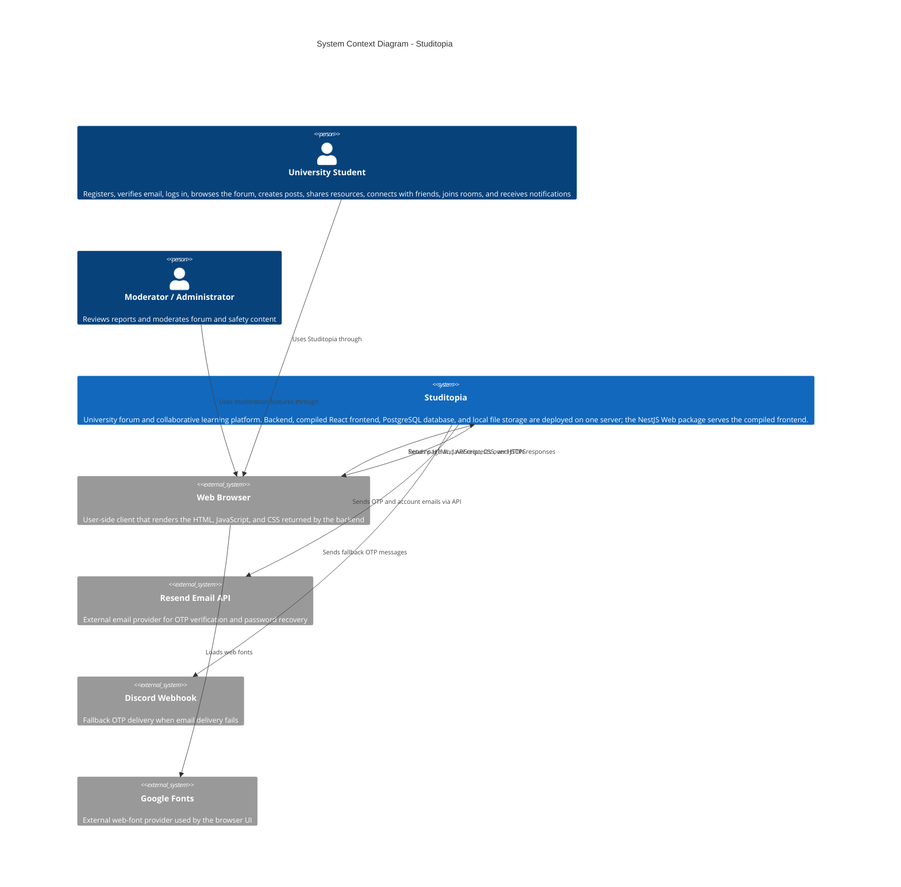

# System Context Diagram (C4 Level 1)

**Version:** `1.1`

**Performed by:** [Nguyen Le Quoc Huy] | **Edited by:** []

## 1. Document Information

| Field | Value |
| --- | --- |
| Project | Studitopia |
| Document | System Context Diagram - C4 Level 1 |
| Version | 1.1 |
| Date | 28/Nov/2026 |
| Scope | PA1 through PA4 product scope and source-accurate system boundary |
| Diagram notation | Mermaid `C4Context` |
| Companion documents | [Container Diagram](container_diagram.md), [Component Diagram](component_diagram.md), [Deployment Diagram](deployment_diagram.md) |

### Revision History

| Date | Version | Description | Author |
| --- | --- | --- | --- |
| 28/Nov/2026 | 1.0 | Extracted the C4 Level 1 System Context diagram and explanation into its own document | Nguyen Le Quoc Huy |
| 28/Nov/2026 | 1.1 | Clarified that port 8999 is the development-only Vite host and that the NestJS Web package serves the compiled SPA in deployment | Nguyen Le Quoc Huy |

## 2. Purpose and Scope

This document shows Studitopia as a whole, the human actors who interact with it, and the external systems it depends on. It describes the accumulated product direction from PA1 through PA4 while distinguishing documented requirements from the runtime behavior currently present in the source code.

### 2.1 Source-Accurate Implementation Status

- Implemented frontend routes are `/auth/login`, `/auth/register`, `/auth/recover_password`, `/auth/recover_otp`, `/auth/set_password`, `/auth/verify_otp`, and `/forum`.
- Implemented backend endpoints cover authentication/OTP, account read and avatar upload, forum browse, post/tag read, file read, and SPA asset delivery.
- Vite hosts the frontend on port `8999` only during development. In deployment, the NestJS Web package serves the compiled frontend, so there is no separate production frontend server.
- There are no implemented frontend or backend routes for friends, meeting rooms, notifications, profile editing beyond avatar upload, or full resource-library management; these remain documented product requirements and future work.
- `ReCaptchaService` is a stub and is not imported by `AppModule`; `WebService`/`WebBased()` are defined but not applied to routes.

## 3. C4 Model - Level 1: System Context Diagram

### 3.1 Explanation of the Diagram

**Studitopia** is the system at the center. At Level 1 it is intentionally shown as a single box, even though internally it contains a NestJS/Express backend, a compiled React+TypeScript frontend, PostgreSQL, and local file storage. The backend, database, and file storage are hosted on the same server. During development, Vite hosts the SPA on port `8999`; in deployment, the NestJS Web package serves the compiled frontend assets to the browser, so no separate production frontend host exists.

**University Student** is the primary actor. At the requirements level, students register and verify university email, log in, manage profiles and preferences, browse and search the university forum, create posts, comment and answer, vote, save posts, share resources, manage friends and groups, join or create meeting rooms, and receive notifications. The current source implements authentication/OTP, account display and avatar upload, forum browse, and partially static feed/library views.

**Moderator / Administrator** is the secondary requirements-level actor responsible for trust and safety. No moderator-specific routes or components are implemented in the current source.

**Web Browser** is the client software used by both human actors. It requests pages and API data from Studitopia. The backend returns the compiled React HTML, JavaScript, CSS, and JSON responses; the browser executes the frontend code and renders the UI. In development those assets come from Vite on port `8999`; in deployment they come from the backend Web package.

**Resend Email API** delivers OTP and recovery emails. **Discord Webhook** is the fallback OTP path. **Google Fonts** is a presentational external dependency loaded by the browser.

The browser does not access the database directly. The backend is the only runtime client of PostgreSQL and exposes the `api/v1` surface consumed by the React frontend.

### 3.2 Current External-System Boundary

| External system | Status | Purpose |
| --- | --- | --- |
| Resend Email API | Current | Sends OTP and account-related emails. |
| Discord Webhook | Current | Fallback OTP delivery path. |
| Google Fonts | Current | Supplies web fonts for the UI. |
| Google OAuth 2.0 | Planned / UI-only | Mentioned in earlier requirements, but no runtime OAuth integration exists. |
| Cloud object storage | Planned / not configured | Requirements discuss cloud storage; current implementation uses local disk. |
| File safety scanning service | Planned / not implemented | Uploaded files are expected to be validated and scanned, but no external scanner is configured. |
| AI recommendation/matching service | Planned / not implemented | PA1/PA2 proposed AI matching and recommendations; no AI SDK or model API is integrated. |
| Push notification provider | Planned / not implemented | Notifications are handled by the application; no external push provider is integrated. |

## 4. Source References

- `docs/requirements/PA1/features.md`
- `docs/requirements/proposals/functional_requirement.md`
- `docs/requirements/proposals/non_functional_requirement.md`
- `docs/requirements/PA4-Group05/use_cases/functional_requirement_coverage.md`
- `src/frontend/vite.config.ts`
- `src/backend/src/app.module.ts`
- `src/backend/src/packages/web/web.controller.ts`
