# CS300 PA1 — Existing App Survey

## Group information

- Group number: 5

- Team member:
    - Nguyễn Thanh An - 24125024
    - Nguyễn Chi Bao - 24125025
    - Trần Nguyễn Khánh Bình - 24135026
    - Trần Cảnh Anh Tuấn - 24125048
    - Nguyễn Lê Quốc Huy - 24125100

## Project description

- Name: Studitopia

- Purpose: Collaborative and study platform where users can learn with other people in meeting, share material, chat and ask question about learning.

- Feature:  
    - Learn with strange people
    - Find friends who will study together with us
    - Share documents, material with community
    - Ask and answer question for studying problems
    - Create group to learn with our friends

To understand more about the project we want to build, we investigated two following similar applications below:

## Focusmate
    
**Performed by:** [Bao] | **Reviewed by:** [Name] | **Edited by:** [Name]

- Focusmate is a virtual coworking platform that allows you to work alongside another person in real time, helping you stay focused, motivated, and accountable while improving your productivity.

- Link web: https://www.focusmate.com/

- Focusmate is organized around sessions with the following features:
    - **24/7 availability:** Sessions are available around the clock, with new sessions starting every 15 minutes
    - **Flexible durations:** Each session can last 25, 50, or 75 minutes
    - **Video calls and quiet mode:** Each session takes place over a video call, with the option to communicate via text and enable quiet mode
    - **Advance booking:** Users can schedule sessions in advance by specifying the time, duration, task, and quiet mode preference
    - **Calendar-based scheduling:** Users can select their preferred date and time directly from a calendar
    - **Favorite users:** Users can mark other participants as favorites and prioritize matching with them when booking future sessions

### Booking session

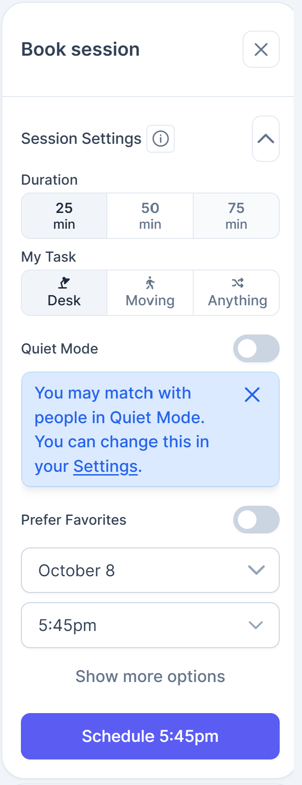

- To book a session, users follow these steps:
    1. Choose the session duration
    2. Specify the task they intend to work on
    3. Choose whether to enable quiet mode
    4. Choose whether to prioritize matching with favorite users
    5. Select a session date using the date bar or calendar
    6. Confirm the booking

- Users can also select a specific date and time directly from the calendar.
    - **Note:** When booking through the calendar, all other session settings remain consistent with the selections made in the session booking panel.

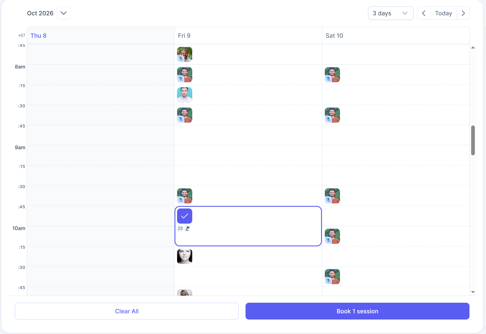

### Joining session:

- Once a session is ready, user can join it:

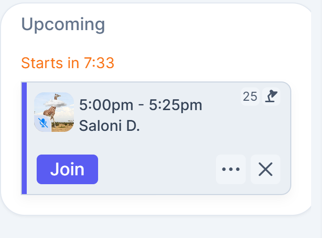

- Before joining the video call, users can configure their camera, microphone, speakers, and background effects.
    - Users can also turn off their camera or mute their microphone as needed.

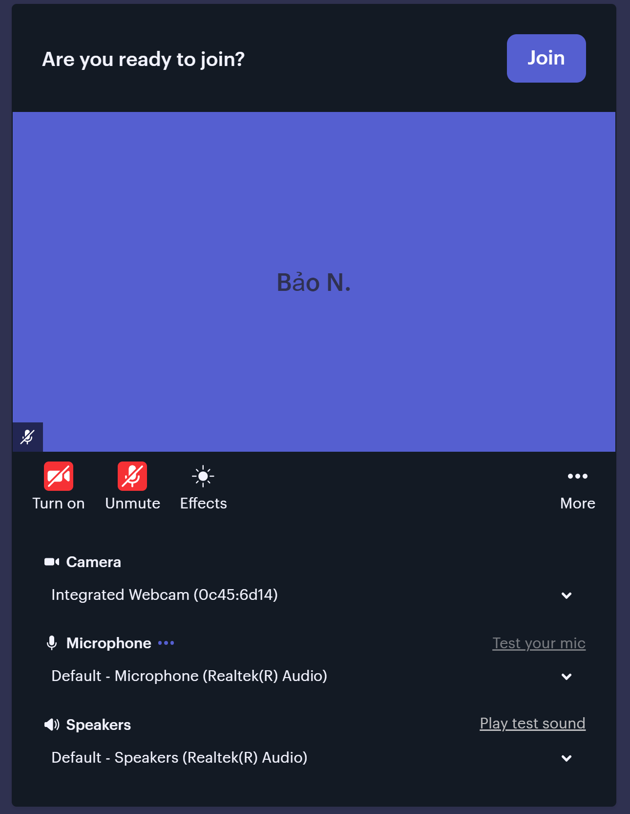

- After setup, users can join the video call:

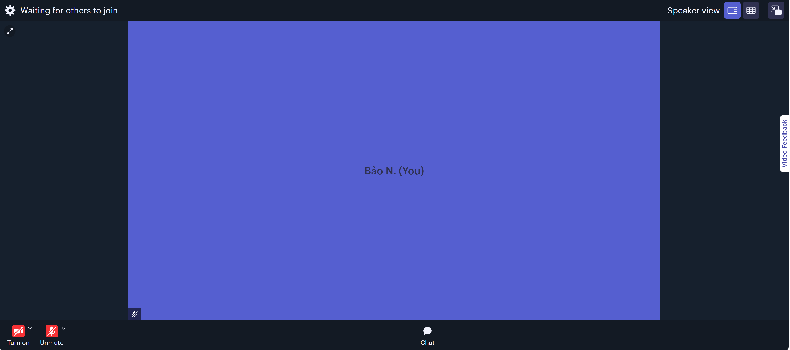

## Lifeat

**Performed by:** [An] | **Reviewed by:** [Name] | **Edited by:** [Name]

- Lifeat is a platform that focus on self-studying that allows user to customized their learning space, create, manage and schedule tasks and take notes. Besides, they also support learning with friends and study in large meeting with strange people

- Link web: https://lifeat.io/

- Lifeat has three modes:
    - Focus mode
    - Explore mode
    - Plan mode

### Focus mode

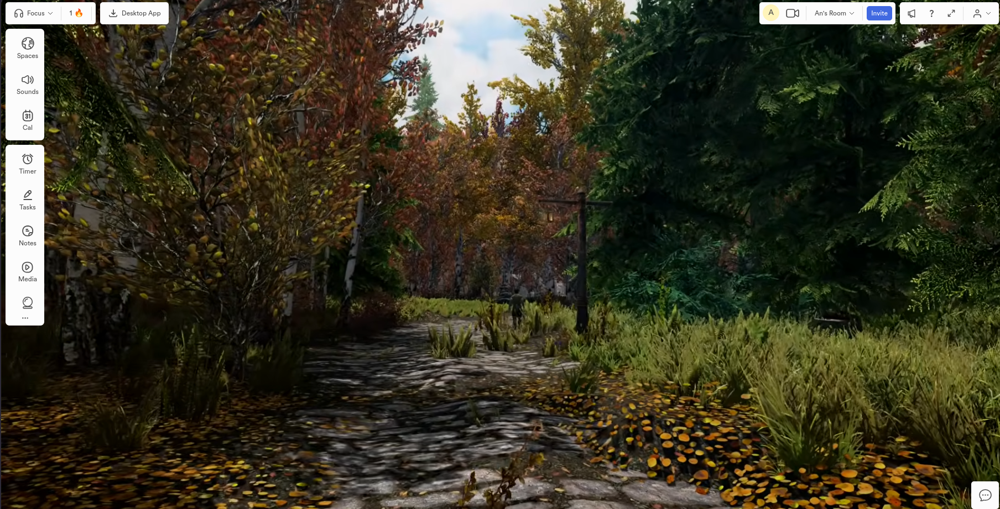

In this mode, each user move to their own virtual space (as the picture above). In this space, the platform provide these features:

- Customize the background:

    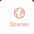

    - First, click on the spaces icon in the left bar in the focus screen

    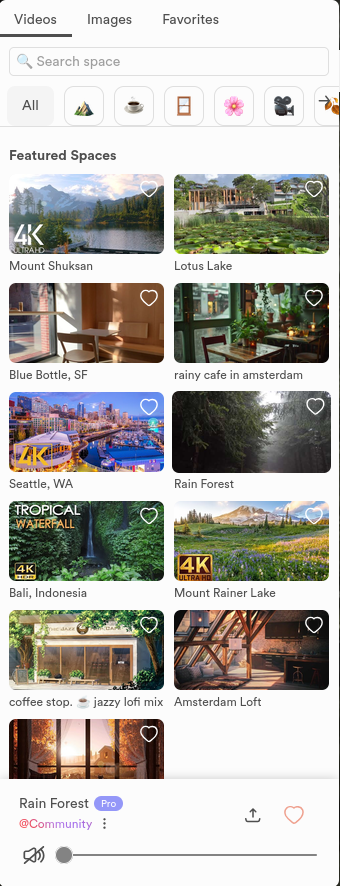

    - We have two kinds of background: Videos which have space musics while images don't 

    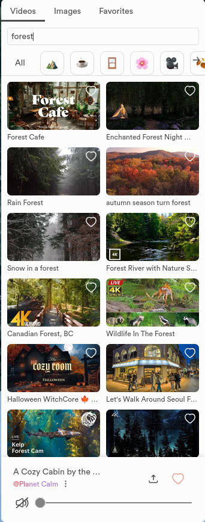

    - We can search the name of spaces that we want

    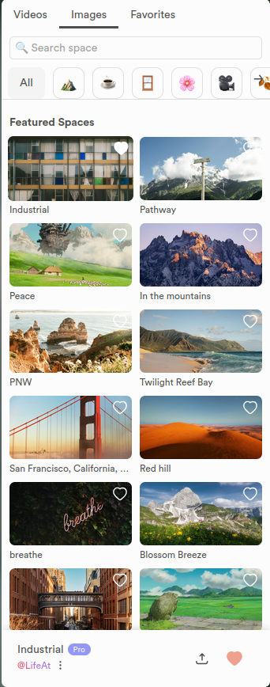

    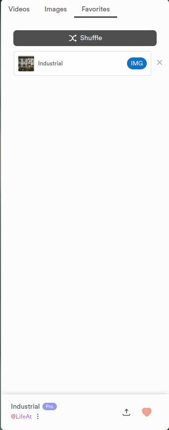

    - Besides, if we want to store our favorite background later, we can click the hear icon on the top of background, then it will appear in the Favorites tab 

- Customize the sound:

    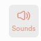

    - First, click on the sounds icon in the left bar in the focus screen

    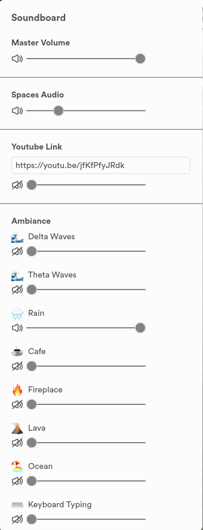

    - Then in the sound window, we can:

        - Adjust the total volume (Master volume)

        - Adjust the space volume 

        - Insert Youtube music video link and adjust it volume

        - Choose the available ambiance sounds and adjust their volumes 

- Integrate media:

    

    - First, click on the media icon in the left bar in the focus screen 

    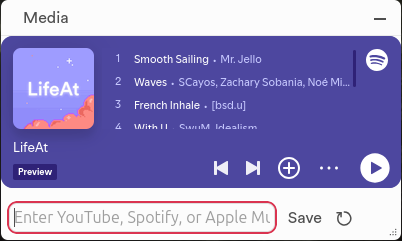

    

    - Then the media window appears

    - Insert link Youtube, Spotify or Apple Music to display our video or playlist

- Manage task:

    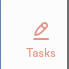

    - First, click on the task icon in the left bar in the focus screen

    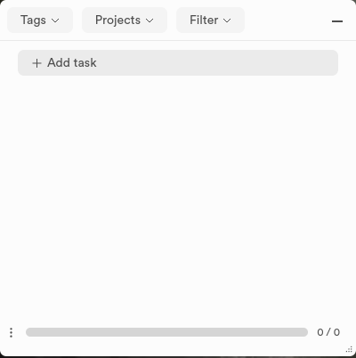

    - Then the task window appears

    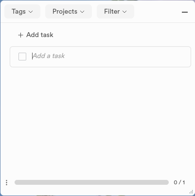

    - To create a task, click on add task button, the new task appears
    and we will name it

    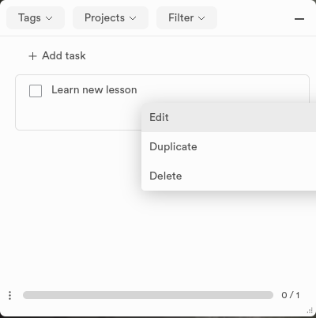

    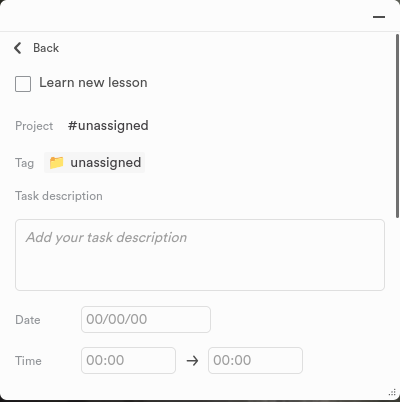

    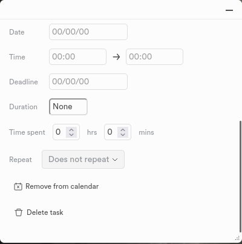

    - To provide further information for a task, we can do following:
        - Click right mouse to display the option 
        - Choose edit option 
        - Provide the necessary information for the task

    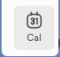

    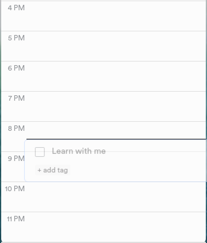

    - Beside, provide time information for the task, we can schedule a task by drag the task into the Calendar window by click calendar button

- Countdown timer

    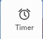

    - First, click on the timer icon in the left bar in the focus screen. We have three kind of countdown: Pomodoro (20 min), Short break(5 min), Long break (15 min) and three mode: Personal, Group, Task 

    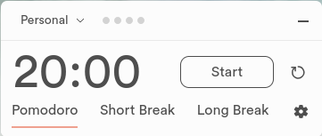

    - The personal task is used for only the user without specific task, this suits for those want to apply Pomodoro technique

    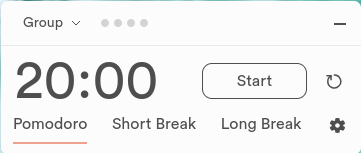

    - This mode is used when we learn with other people. When it is created, all people in the room can see this timer

    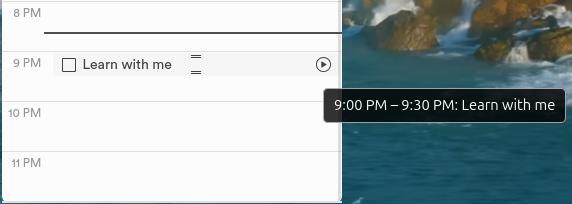 

    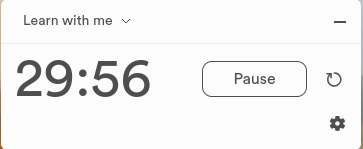

    - When we want to create a timer for a specific task, we can press player button in the task on Calendar window
    - Then the task timer countdown will appear

- Take notes

    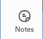

    - First, click on the notes icon in the left bar in the focus screen.

    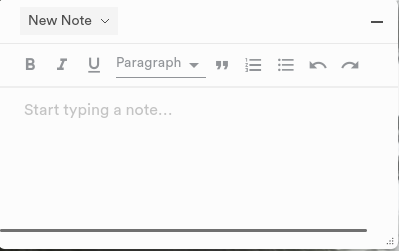

    - Then the Notes window appear, we can note and format the note such as bold, underline, ... by the function bar on the top

    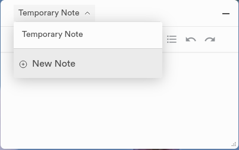

    - We can create a new note by click on the top left corner of the Notes window then, it will display a panel which has New Note button 

- Learning with friends

    

    - First, click the invite button on the top right corner of the focus screen button

    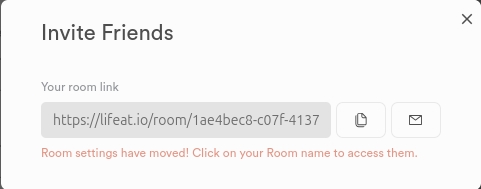

    - After that, there is a invite friends window appears, we can send this link to our friend to invite them joining the our virtual space

    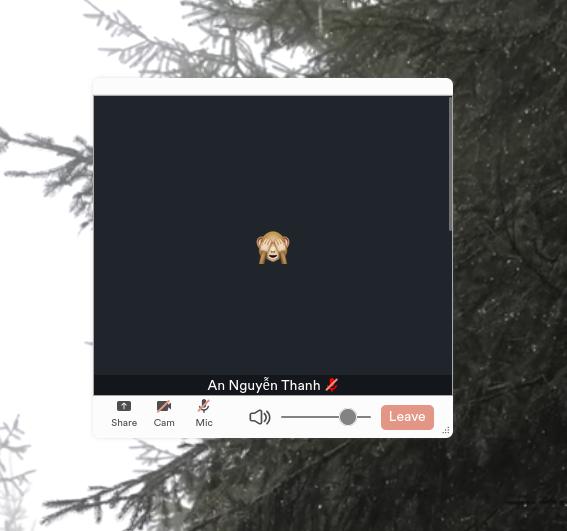

    - When our friend join the room, we can make video call by click on the camera icon on the invite bar. The platform also allow us to share the screen with other people

    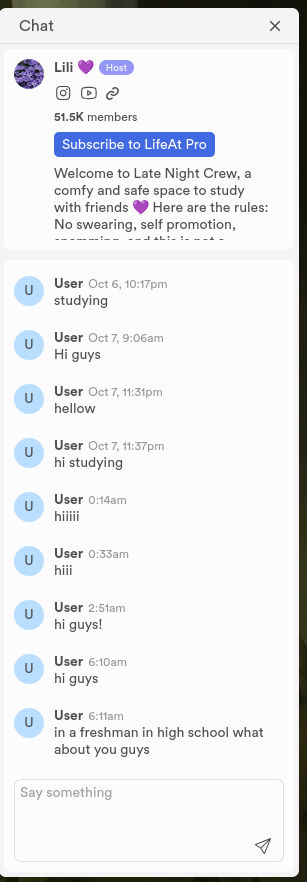

    - We can chat with other people by text in the room via clicking the chat button on the right bottom corner 

### Explore mode

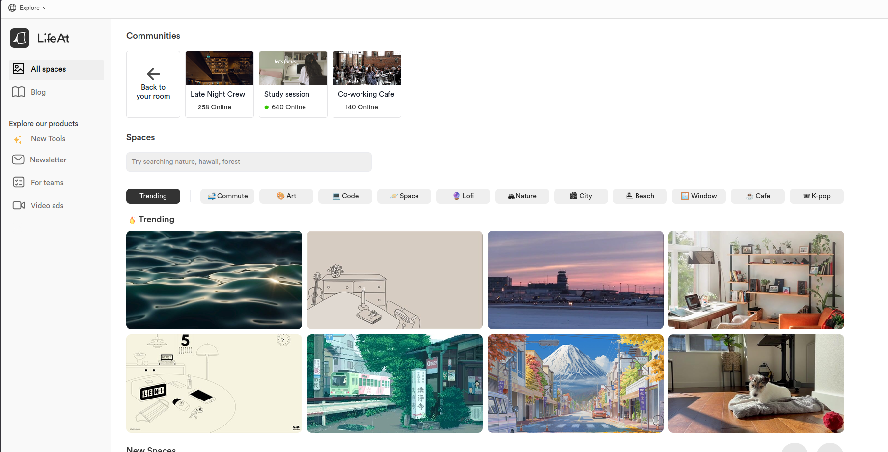

In this mode, instead of self-studying or with friends, we can learn with strange people

The platform has created some communities which are similar to our virtual space in focus mode but in this case, we learn with other people

### Plan mode

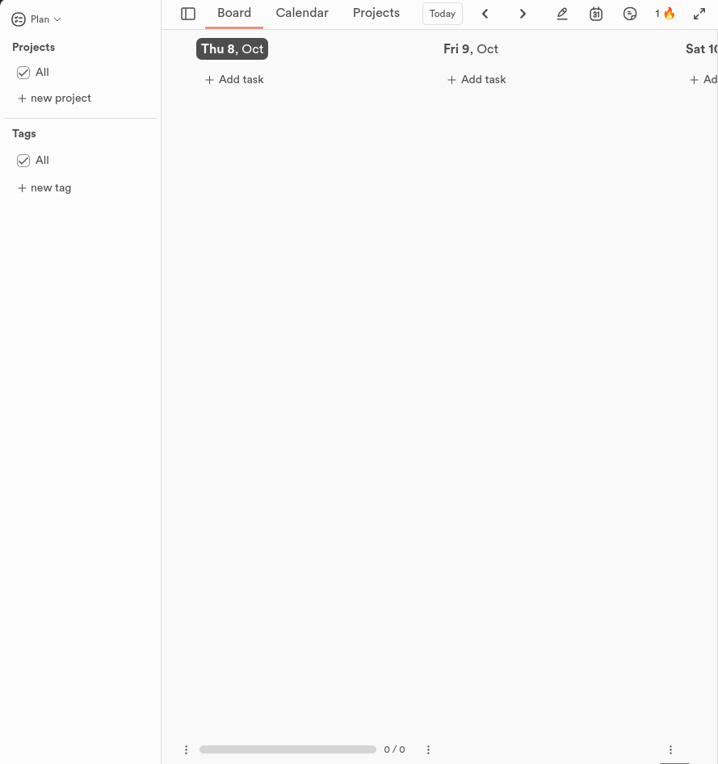

In this mode, we can create and manage task which is similar to in the focus mode. Moreover, we can create and manage task in a project.

- Create a project:

    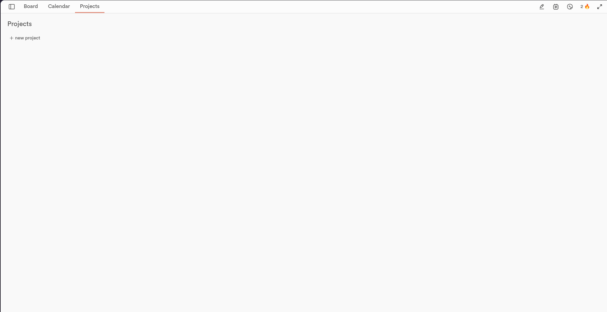

    - Click on the project tab on the Plan mode to see the Project tab

    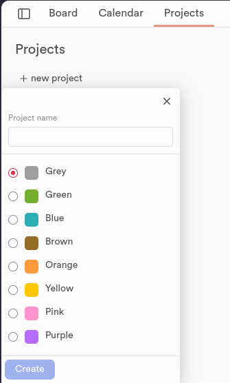

    - Click create project button to add a new one

    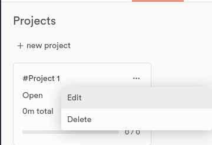

    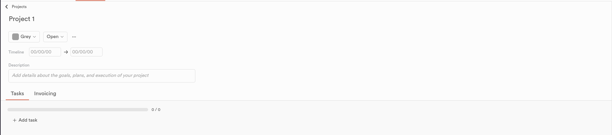

    - To add task, edit the description, ... we click right mouse on the project then press edit to display the project manager tab

    - Then we can adjust the information, manage task similar to focus mode

## Summary