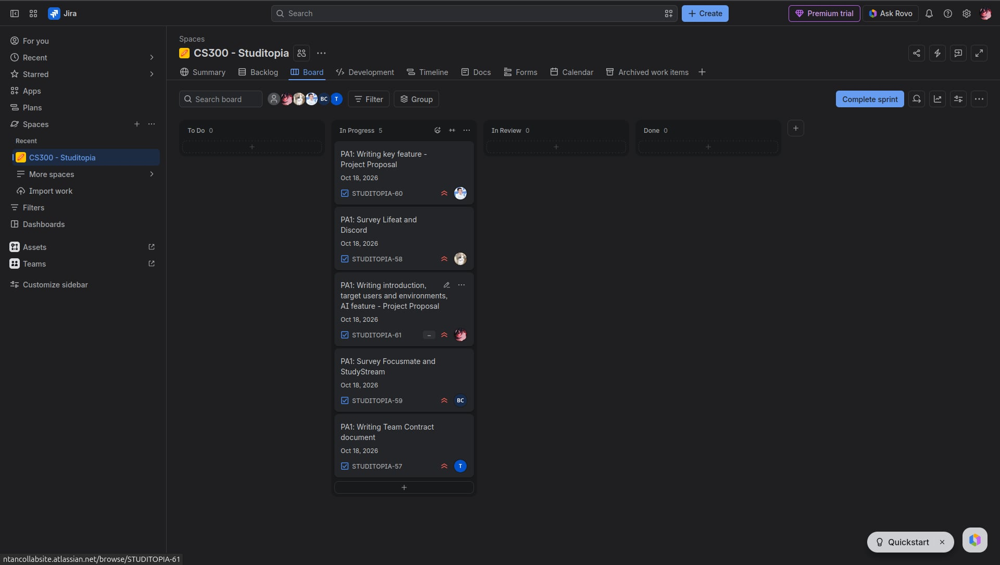

# 6/10, Sprint 1 - Meeting Report

## Team member represent

- Nguyen Thanh An
- Nguyen Chi Bao
- Tran Nguyen Khanh Binh
- Tran Canh Anh Tuan
- Nguyen Le Quoc Huy

## Team member absent

No member is absent

## Status reports

- Nguyen Thanh An

    - To-do tasks:
        - Create AI coding account (take screenshot)
        - Create Jira account and initialize space for our group
        - Find 2 similar apps (different from Bao) for our proposal app
        - Do the survey according requirement for Existing app survey
    
- Nguyen Chi Bao

    - To-do tasks:
        - Create AI coding account (take screenshot)
        - Create Jira account
        - Find 2 similar apps (different from An) for our proposal app
        - Do the survey according requirement for Existing app survey

- Tran Nguyen Khanh Binh

    - To-do tasks:
        - Create AI coding account (take screenshot)
        - Create Jira account
        - Write key feature for Project Proposal 
        

- Nguyen Le Quoc Huy

    - To-do tasks:
        - Create AI coding account (take screenshot)
        - Create Jira account
        - Initialize Github repo following requirement in PA1
        - Write introduction, target users and environments, AI features for Project Proposal 
        

- Tran Canh Anh Tuan

    - To-do tasks:
        - Create AI coding account (take screenshot)
        - Create Jira account
        - Document the part of Team Contract which is discussed in this meeting
 
## Summary of the meeting

### Work norm 

- Following Scrum methodology:
    - Divide development process into sprint corresponding each PA 
    - Each sprint (2,3 weeks) have at least 4 meetings: 1 Planning, 2 Scrum, 1 Review 
    - In each meeting, discuss about the progress of the project, the issues, obstacles and what next to do 

- All tasks are assigned on Jira (including development and document)
    - We must specify: created day, assigned day, completed day 
    - Only one member a task and another member review it 

- The documents must be controlled by version alongside the code in Github repository 
    - In each section, we must write the person who wrote, who reviewed and who edited

- The repository must be divide into 2 parts:
    - src: Contain frontend, backend, database repositories
    - docs: This folder structure is similar to PA1 and may adjusted later

### To-do task

- PA1:
    - Create AI accounts (take screenshot)
    - Initialize Github structure (take screenshot)
    - Create Jira space (take screenshot)
    - Proposal apps document
    - Existing app survey
    - Team contract 

- Moreover:
    - Continue to finish the project specification
    - Learn professional Github process

### Discussion about the key features

- The web applications are intended to include three main features:

    - The study room: There are 3 types:
        - The halls: Public, allow users to study with strangers, make friends, created by our team
        - The meeting room: Private, study with friends or other several people
        - The emergency room: Public, allow users to study and ask questions, categorize by subject, created by users

    - Library: The storage store the materials such as books, tests, ... shared by users

    - Forum: Users can ask questions, discussed about specific topics

### The tasks assigned after the meeting (screenshot)

