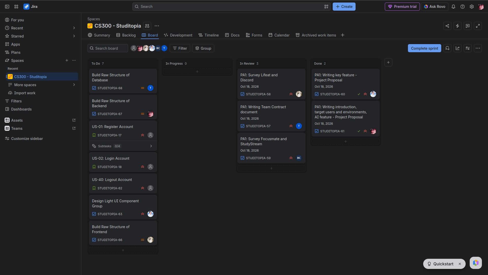

# 13/10, Sprint 1 - Meeting Report

## Team member represent

- Nguyen Thanh An
- Nguyen Chi Bao
- Tran Nguyen Khanh Binh
- Tran Canh Anh Tuan
- Nguyen Le Quoc Huy

## Team member absent

No member is absent

## Status reports

- Nguyen Thanh An

    - Completed tasks:
        - Create AI coding account (take screenshot)
        - Create Jira account and initialize space for our group
        - Find 2 similar apps (different from Bao) for our proposal app
        - Do the survey according requirement for Existing app survey 
    
    - Issues:
        - Need to discuss about future app feature to write the summary for Existing app survey
    
    - To-do tasks:
        - Continue writing the summary for Existing App Survey 
        - Initialize the raw structure of Frontend 
    
- Nguyen Chi Bao

    - Completed tasks:
        - Create AI coding account (take screenshot)
        - Create Jira account
        - Find 2 similar apps (different from An) for our proposal app
        - Do the survey according requirement for Existing app survey

    - To-do tasks:
        - Initialize the raw structure of AI feature in Hugging Face

- Tran Nguyen Khanh Binh

    - Completed tasks:
        - Create AI coding account (take screenshot)
        - Create Jira account
        - Write key feature for Project Proposal 

    - To-do tasks:
        - Initial the basic UI component group in Figma
        

- Nguyen Le Quoc Huy

    - Completed tasks:
        - Create AI coding account (take screenshot)
        - Create Jira account
        - Initialize Github repo following structure requirement in PA1
        - Write introduction, target users and environments, AI features for Project Proposal 

    - To-do tasks:
        - Initialize the raw structure of Backend
        

- Tran Canh Anh Tuan

    - To-do tasks:
        - Create AI coding account (take screenshot)
        - Create Jira account
    
    - Issues:
        - Need to update the team role discussed in this meeting in team contract
    
    - To-do tasks:
        - Update the team role in team contract
        - Initialize the raw structure of Database
 
## Summary of the meeting

### Team role 

- Product owner: Nguyễn Lê Quốc Huy

- Scrum master: Nguyễn Thanh An

- Project manager: Nguyễn Lê Quốc Huy 

- Development team: 

    - Nguyễn Thanh An: Frontend developer, 
    - Nguyễn Chí Bảo: AI developer, Tester
    - Trần Nguyễn Khánh Bình: UI/UX designer
    - Nguyễn Lê Quốc Huy: Backend developer
    - Trần Cảnh Anh Tuấn: Database designer 

### To-do task

- PA1:
    - Write summary of Existing App Survey
    - Update the team role in team contract
    - Refine app features based on teacher advices

- Project:
    - Initialize Speckit for project
    - Initialize the raw structure for:
        - UI Component group
        - Frontend
        - Backend
        - AI feature
        - Database

### The tasks assigned after the meeting (screenshot)

