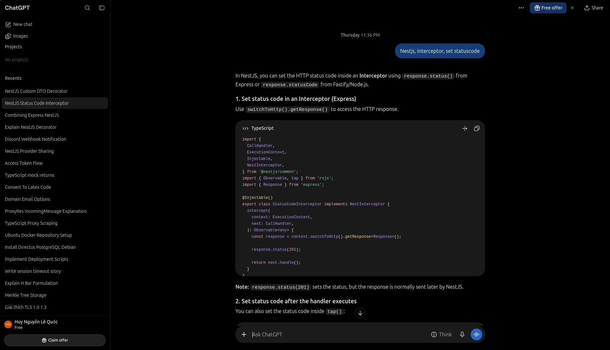
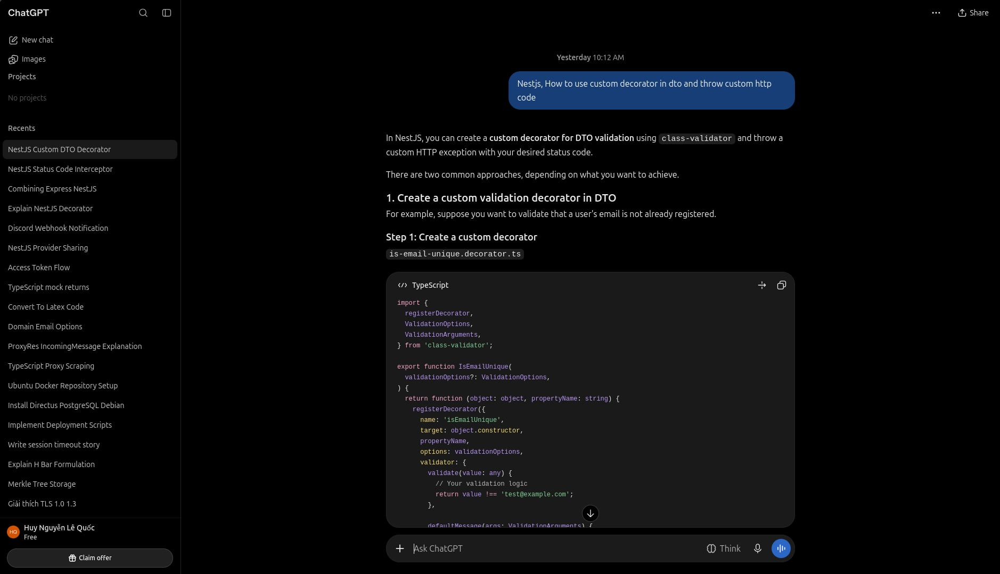
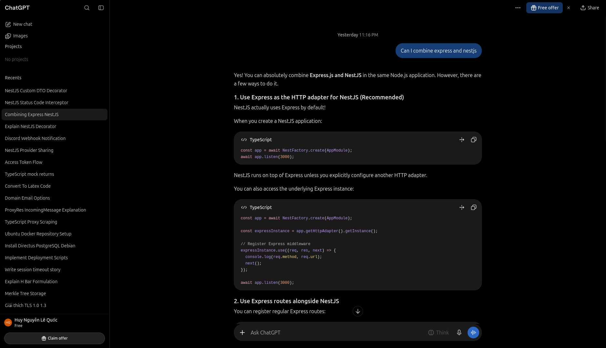
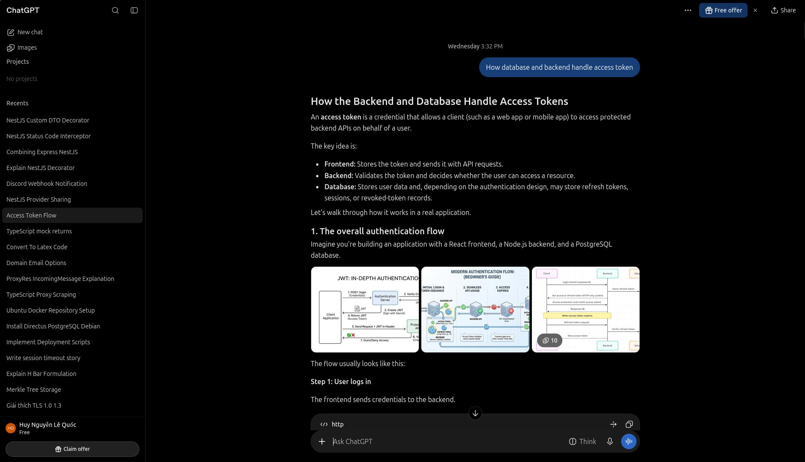
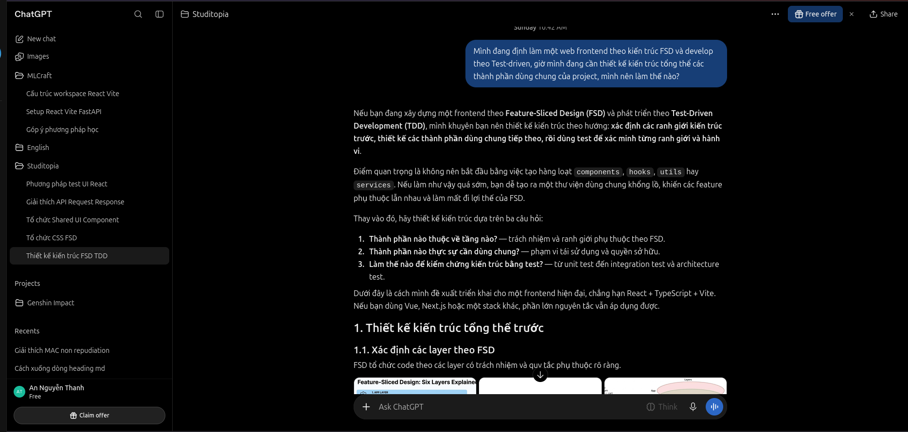
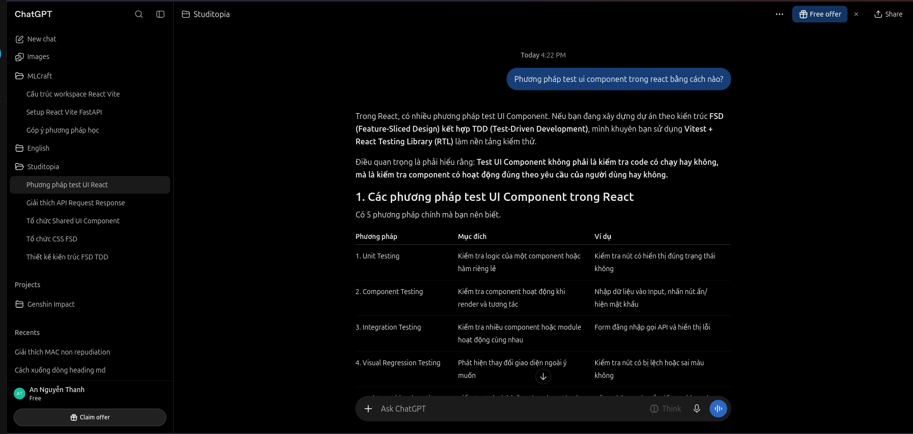
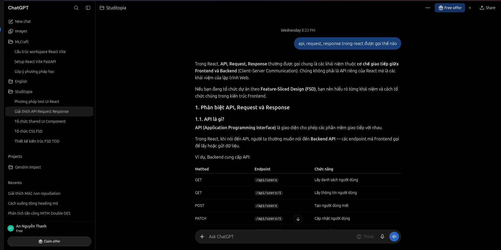

# AI Usage Notes

- ChatGPT. GPT6-Luna, OpenAI, chat.openai.com accessed 23:36 on Oct 29, 2026, prompt: "Nestjs, interceptor, set status code", used to know how to set status code in Interceptor in Nestjs; AI generated sample code, student revised and validated with Nestjs tutorial.

- ChatGPT. GPT6-Luna, OpenAI, chat.openai.com accessed 10:12 on Oct 30, 2026, prompt:
“Nestjs, how to use custom decorator in dto and throw custom http code”, used to know how to create and use custom decorator for dto and customize the http status code; AI generated description and sample code, student revised and validated
with Nestjs tutorial.

- ChatGPT. GPT6-Luna, OpenAI, chat.openai.com accessed on 23:16 Oct 30, 2026, prompt:
“Can I combine express and nestjs”, used to verify whether I can use a type in Express in Nestjs or not; AI generated sample code and description, student test it by testing with project.

- ChatGPT. GPT6-Luna, OpenAI, chat.openai.com accessed on 15:32 Oct 28, 2026, prompt: 
“How database and backend handle access token”, used to know how to generate, manage access token between database and backend; AI generated illustrated image and detailed description about the workflow, student revised and validated
with OWASP.

- ChatGPT. GPT6-Luna, OpenAI, chat.openai.com accessed 10:42 Oct 25, 2026, prompt:
“Mình đang định làm một web Frontend theo kiến trúc FSD và develop theo Test-driven, giờ mình cần thiết kế kiến trúc tổng thế của các thành phần dùng chung, mình nên làm thế nào?”, used to know how to design the structure of Frontend project accroding FSD architecture; AI generated illustrated architecture layers and description, student revised and validated at https://fsd.how.

- ChatGPT. GPT6-Luna, OpenAI, chat.openai.com accessed 16:22 Oct 31, 2026, prompt:
“Phương pháp test UI component trong React”, used to know how to test a UI component in React by Vitest; AI generated the guide, description and sample code, student revised and validated
with Vitest tutorial.

- ChatGPT. GPT6-Luna, OpenAI, chat.openai.com accessed 20:23 Oct 28, 2026, prompt:
“api, request, response trong react được gọi thế nào”, used to know how to call an API from backend in Frontend project; AI generated the detail description, student revised and validated
with TypeScript, React tutorial.