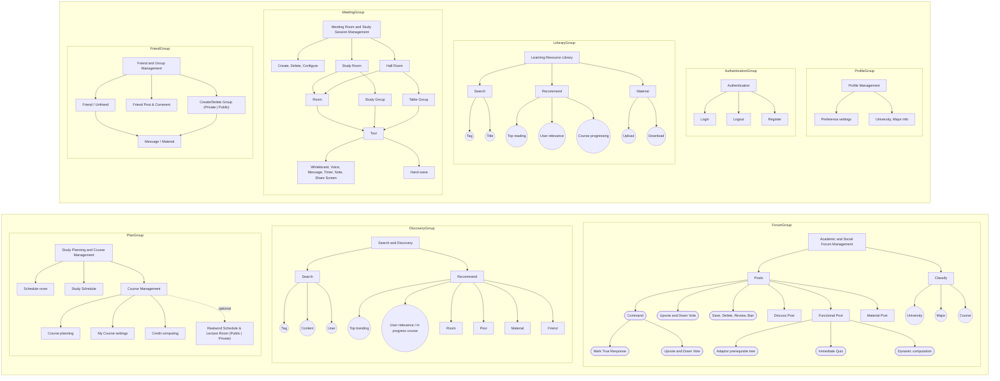

# Overview

## **1 Project Name**

Studitopia: representing an ideal world of learning. It describes a place where studying is inspiring, enjoyable, and meaningful, encouraging people to explore knowledge, grow their potential, and achieve their dreams.

## **2 Purpose**

Studitopia is a collaborative learning and social networking platform designed to enhance the university learning experience by connecting students with academic resources, learning communities, and like-minded peers. The platform provides a centralized environment where university students can join university-specific forums or general social forums to ask questions, discuss academic problems, share and retrieve study materials, and explore study plans for their degree programs. By combining academic collaboration, resource management, and social interaction, Studitopia aims to help students learn more effectively, organize their academic journeys, and build meaningful connections throughout their university life.

The platform's social features are built around a flexible post system that supports three main types of posts. **Normal Posts** allow users to share thoughts, ask questions, describe academic problems, and participate in discussions through text and images. **Material Posts** enable users to upload, share, and exchange learning resources, including documents and other study-related files. **Function Posts** provide interactive academic tools that go beyond conventional content sharing. 

To organize academic discussions and resources effectively, Studitopia supports post management at multiple levels, including universities, majors, and individual courses. This structure allows students to discover relevant discussions and learning materials based on their institutions, fields of study, or specific subjects. In addition, the platform provides a dedicated library management system that enables users to search, filter, and retrieve documents using various criteria. By organizing study materials into an accessible and searchable collection, the library helps students find the resources they need without having to navigate through unrelated posts or scattered files.

Beyond academic collaboration, Studitopia also emphasizes social interaction and community building. The platform supports multiple types of meeting rooms to accommodate different purposes, such as group study sessions, academic discussions, and casual conversations. An automatic room-matching feature helps users discover suitable rooms and connect with people who share similar interests, hobbies, or learning goals. Furthermore, the platform provides friend management features that allow students to make friends, create friend groups, and communicate through private messaging. Users can also share documents and other resources within smaller groups, making it easier to collaborate privately, exchange relevant materials, and maintain focused discussions.

Overall, Studitopia aims to integrate academic learning, study planning, resource sharing, and social networking into a unified platform tailored to university students. By combining structured academic forums, interactive study-planning tools, a searchable learning library, collaborative meeting rooms, and personal social networks, the platform seeks to create a supportive digital environment where students can access knowledge, manage their studies, collaborate with peers, and develop lasting connections within and beyond their university communities.

## **3 Target Users**

Studitopia is designed for university students and independent learners who want to enhance their learning experiences through a collaborative virtual environment. The platform serves a variety of users by providing accessible study materials, academic discussion spaces, study-planning tools, and social networking features.

- **University Students:** Access course materials shared by previous and current generations of students, prepare for examinations, complete assignments, discuss academic problems, and collaborate with peers. Students can also explore course prerequisites and plan their academic pathways more effectively.
- **Study Groups and Project Teams:** Collaborate on assignments and projects, exchange learning resources, share documents within private groups, and organize virtual meetings to discuss ideas and coordinate tasks.
- **University Communities:** Access and contribute to shared learning resources, participate in university-, major-, and course-specific discussions, and connect with students who share similar academic interests. Studitopia helps strengthen knowledge sharing and collaboration across different student generations.

Through these user groups, Studitopia aims to foster a collaborative learning community where knowledge can be shared across generations, academic resources are easier to access, and students can support one another throughout their learning journeys.

### **4 Product Scope**

The system consists of the following major modules:

1. Authentication Account
2. Account Management
3. Profile Management
4. Social Forum Management
5. Post Creation and Management
6. Study Planning
7. Course Management
8. Learning Resource Library
9. Meeting Room
10. Study Session Management
11. Friend and Group Management
12. Search and Discovery

### **5 Product Goals**

The specific goals of the platform are to:

- **Facilitate Knowledge Sharing:** Provide a centralized platform where students can share, discover, and reuse learning materials across different courses, majors, universities, and student generations.
- **Enhance Academic Collaboration:** Enable students to ask questions, discuss academic problems, exchange ideas, and collaborate on assignments and projects through dedicated forums and meeting rooms.
- **Support Study Planning:** Help students understand course prerequisites, visualize their academic pathways, and calculate credits to support more effective study planning.
- **Improve Resource Accessibility:** Provide a searchable learning library that allows students to efficiently find and retrieve relevant educational materials based on various criteria.
- **Strengthen Social Connections:** Help students discover like-minded peers, find study partners, join interest-based meeting rooms, and build meaningful relationships within the learning community.
- **Simplify Group Communication:** Support private messaging, friend groups, and document sharing to facilitate focused discussions and collaboration among classmates and project teams.
- **Build a Collaborative Learning Community:** Foster an environment where students can learn from one another, exchange experiences across generations, and support each other's academic and personal development.

Ultimately, Studitopia aims to bridge the gap between academic resource sharing and social interaction by bringing learning tools, educational communities, and peer connections together in one accessible platform.