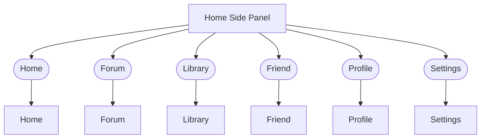
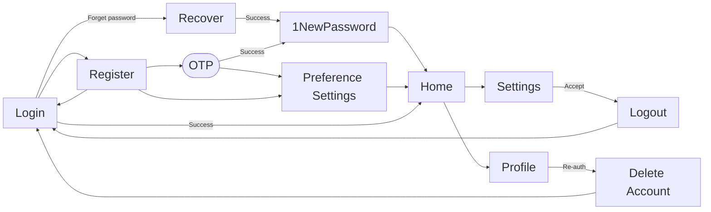
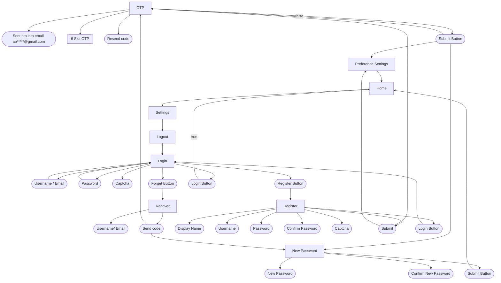
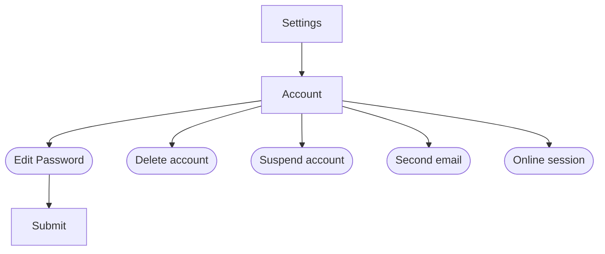
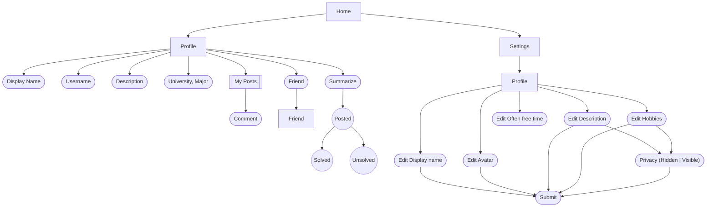
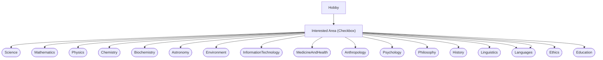
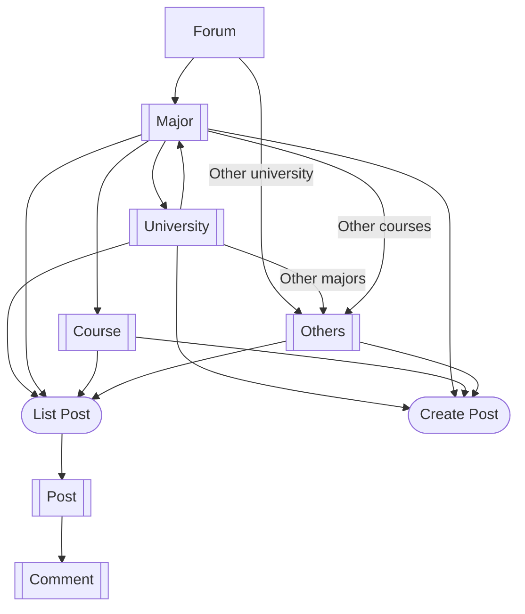
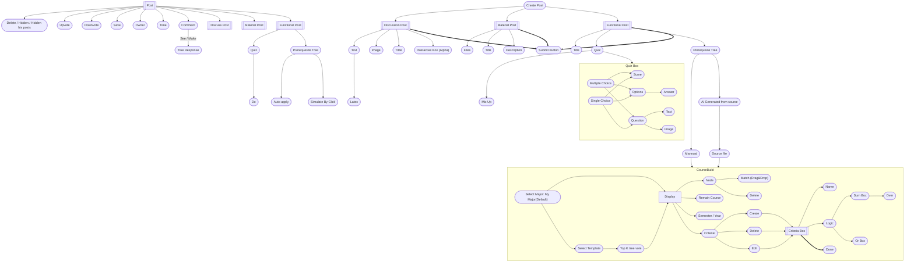

# User Story

[Authentication Account](User%20Story/Authentication%20Account%20401851420f6480de9beff3c53758e64a.md)

[Account Management](User%20Story/Account%20Management%20401851420f648092ac1cc79bbd9e1bbe.md)

[Profile management](User%20Story/Profile%20management%20401851420f6480b4b41affb7563e4ccd.md)

[Social Forum Management](User%20Story/Social%20Forum%20Management%20401851420f6480498124c5181aeca5f0.md)

[Post Management](User%20Story/Post%20Management%20403851420f6480deb5c6f40f473e72e1.md)

## **6 Authentication Account**

### **6.1 US-01: Register Account**

**As a** new user, **I want to** create an account, **so that** I can access the collaborative learning platform. 

| Criterion | Requirement |
| --- | --- |
| AC-01.1 (Parameter Requirement) | The system must require Display Name, Username, Email, Password, Confirm Password. |
| AC-01.2 (Email Validation) | The system must require a valid email address. |
| AC-01.3 (Username Validation) | The system must verify the username is unique and contains only alphanumeric characters. |
| AC-01.4 (Password Validation) | The password field must enforce minimum security rules (minimum 8 characters, at least 1 lowercase char, 1 uppercase char, 1 number, and 1 special character). |
| AC-01.5 (Confirmed Password Validation) | The confirmed field must be equal to password. |
| AC-01.6 (Password Visibility) | The password and confirmed password are hidden as default. Support visible button. |
| AC-01.7 (Email Verification) | The system must send a verification email with a link/code before enabling full account access. |
| AC-01.8 (Duplicate Check) | The system must display an error message if the email is already registered. |
| AC-01.9 (CAPTCHA Verification) | The system must require the user to successfully complete CAPTCHA verification before submitting the registration request. If CAPTCHA verification fails, the registration request must be rejected and an appropriate error message must be displayed. |
| AC-01.10 (Google Registration) | The system must allow users to register using their Google account through a “Continue with Google” button. |
| AC-01.11 (UI Validation) | Ensure that all UI appears exactly what designed |
| AC-01.12 (Navigation Validation) | Ensure that all navigation button work well |

### **6.2 US-02: Login**

**As a** registered user, **I want to** log in to my account, **so that** I can access my profile, rooms, and learning activities.

| Criterion | Requirement |
| --- | --- |
| AC-02.1 (Credential Validation) | Users can authenticate successfully using registered credentials (email/username and password). |
| AC-02.2 (Error Handling) | Clear error messaging is shown for invalid credential combinations without revealing which specific field was incorrect. |
| AC-02.3 (Session Persistence) | The system must support a "Remember Me" option to maintain the user session across browser restarts. |
| AC-02.4 (CAPTCHA Verification) | The system must require the user to successfully complete CAPTCHA verification before submitting the registration request. If CAPTCHA verification fails, the registration request must be rejected and an appropriate error message must be displayed. |
| AC-02.5 (Login by Google) | The system must allow users to login using their Google account through a “Continue with Google” button. |
| AC-02.11 (UI Validation) | Ensure that all UI appears exactly what designed |
| AC-02.12 (Navigation Validation) | Ensure that all navigation button work well |

### **6.2 US-03: Logout**

**As a** logged-in user, **I want to** log out of my account, **so that** I can protect my account security when I am done using the platform or on a shared device.

| Criterion | Requirement |
| --- | --- |
| AC-03.1 (Token & Cookie Cleanup) | Given the logged user
When this users click Logout button
Then system must clear all authentication tokens and temporary user data stored in local/session storage. |
| AC-03.2 (Logout Trigger) | Given the logged user
When this users click Logout button
Then the system must trigger the Logout notification (US-05) |
| AC-03.3 (UI Validation) | Ensure that all UI appears exactly what designed |
| AC-03.4 (Navigation Validation) | Ensure that all navigation button work well |

### 6.3 US-04: Automatic Logout

As a user, I want the system to automatically log me out after 15 minutes of inactivity, So that my account remains secure when I leave my session unattended.

| Criterion code | Given-When-Then / CheckList |
| --- | --- |
| AC-04.1 (**Automatic Logout After 15 Minutes of Inactivity)** | **Given** the user has successfully logged in. 
**When** the system receives no requests from the user for 15 consecutive minutes.
**Then** the system automatically terminates the user's session and logs the user out. |
| **AC-04.2 (Access After Session Expiration)** | **Given** the user's session has expired due to inactivity,
**When** the user attempts to access a protected page or API
**Then** the system denies access to the expired session and requires the user to log in again. |
| **AC-04.3: Session Reset on User Activity** | **Given** the user is logged in
**When** the system receives a new qualifying request from the user before the 15-minute timeout
**Then** the inactivity timer is reset. |
| AC-03.2 (Logout Trigger) | Given the logged user
When this users click Logout button
Then the system must trigger the Logout notification (US-05) |

## 6.4 US-05: Logout Trigger

As a user, I want the system to automatically notify to all my participated online session know my logout, so that, my account remains safe and secure when I leave my session

| Criterion code | Given-When-Then / CheckList |
| --- | --- |
| AC-05.1 (Token & Cookie Cleanup) | Given the logged in user
When this log out
Then system must clear all authentication tokens and temporary user data stored in local/session storage. |
| AC-04.2 (Logout system notification) | Given the logged user
When this users click Logout button
The system must notify to all joined online group component of this users |
| **AC-04.3 (Notification After Session Expiration)** | **Given** the user's log in session
**When** the user has expired due to inactivity
**Then** the system navigates to the login page and displays a message informing the user that their session has expired and they must log in again. |

### **6.3 US-06: Recover Password**

**As a** registered user, **I want to** recover or reset my password, **so that** I can regain access to my account if I forget my password.

| Criterion | Requirement |
| --- | --- |
| AC-03.1 (Parameter Requirement) | System must require email or username |
| AC-03.5 (Non-Enumeration Protection) | Requesting a reset for a non-existent email address must return the identical generic success message ("If this email exists, an OTP was sent") to prevent user enumeration attacks. |
| AC-03.6 (Session Invalidation) | Completing a password reset must automatically log out all active sessions across all devices. |
| AC-03.7 (New Password Validation) | The password field must enforce minimum security rules (minimum 8 characters, at least 1 lowercase char, 1 uppercase char, 1 number, and 1 special character). |
| AC-03.8 (New Confirmed Password Validation) | The confirmed field must be equal to password. |

### **6.4 US-07: Delete Account**

**As a** registered user, **I want to** permanently delete my account, **so that** my personal information, progress, and data are completely erased from the platform.

| Criterion | Requirement |
| --- | --- |
| AC-04.1 (Delete Account Confirmation) | When the user selects Delete Account, the system must display a confirmation dialog explaining that the account will be deleted. |
| AC-04.2 (Cancel Deletion) | The user must be able to cancel the deletion. When cancelled, the account must remain active and no account data must be deleted |
| AC-04.3 (Confirm Deletion) | When the user confirms account deletion, the system must proceed with the account deletion process. |
| AC-04.4 (Authentication Before Deletion) | The system must require the user to re-authenticate (send OTP to email and redirect to check OTP page) before permanently deleting the account. |
| AC-04.5 (Access Deleted account) | If the user attempts to access an account that has already been deleted, the system must reject the request. |
| AC-04.6 (Session Invalidation) | Deleting account must automatically log out all active sessions across all devices. |

### 6.5 US-08: OTP Validation

As a user, I want to receive a 6-digit One-Time Password (OTP) via email, So that I can verify my identity securely using a time-limited verification code.

| Criterion | Requirement |
| --- | --- |
| **AC-07.1 (Generate and Send OTP)** | **Given** the user initiates an action that requires email verification
**When** the system processes the request
**Then** the system generates a 6-digit numeric OTP and sends it to the user's registered email address. |
| **AC-07.2 (OTP Expiration)** | **Given** the system has generated and sent an OTP to the user
**When** 5 minutes have elapsed since the OTP was generated
**Then** the OTP expires and can no longer be used for verification. |
| **AC-07.3 (Verify Valid OTP)** | **Given** the user has received an OTP that has not expired
**When** the user submits the correct 6-digit OTP
**Then** the system successfully verifies the OTP and allows the user to proceed with the requested action. |
| **AC-07.4 (Reject Invalid OTP)** | **Given** the user has received an OTP
**When** the user submits an incorrect OTP
**Then** the system rejects the OTP and displays an appropriate error message. |
| **AC-07.5 (Reject Expired OTP)** | **Given** the OTP has expired after 5 minutes
**When** the user submits the expired OTP
**Then** the system rejects the OTP and informs the user that the OTP has expired. |
| **AC-07.6 (OTP Format Validation)** | **Given** the user is on the OTP verification screen,**When** the user enters an OTP,**Then** the system accepts only a 6-digit numeric code for verification |
| **AC-07.7 (Resend OTP)** | **Given** the user requests a new OTP
**When** the system processes the resend request
**Then** the system generates and sends a new 6-digit OTP to the user's registered email address, and the previous OTP becomes invalid. |
| **AC-07.8 (Prevent OTP Reuse)** | **Given** the user has successfully verified an OTP
**When** the user attempts to submit the same OTP again
**Then** the system rejects the OTP because it has already been used. |

## 7. Account Management:

### **7.1 US05: Manage Profile**

**As a** user, **I want to** create and update my profile, **so that** other users and the system can understand my learning background and interests.

| Criterion | Requirement |
| --- | --- |
| AC-04.1 (Profile Details) | Users can add and update an avatar picture, short bio, academic level, and background details. |
| AC-04.2 (Preview) | Users can preview how their profile appears to other platform members before saving changes. |
| AC-04.3 (Persistence) | Profile changes must save immediately and reflect across all active sessions. |
| AC-04.4 (Avatar Validation) | Avatar uploads must accept only valid image formats (PNG, JPG, WEBP), enforce a maximum size limit of 5MB, and auto-crop to a 1:1 aspect ratio. |
| AC-04.5 (Content Moderation) | Display names and bio text must pass automated profanity filters before changes are saved. |

## **8. Profile management**

#### **8.3 US-07: Manage Privacy**

**As a** user, **I want to** control the visibility of my personal information, **so that** I can protect my privacy while using the platform.

| Criterion | Requirement |
| --- | --- |
| AC-06.1 (Field-Level Controls) | Users can configure visibility (Visible, Hidden) for profile elements like study history, habits, and contact info. |
| AC-06.2 (Searchability) | Users can opt out of appearing in public discovery or partner search results. |
| AC-06.3 (Incognito Mode) | When active, users can browse rooms and profiles without updating their "Last Active" or online presence status. |

## 9. Social Forum Management

### US-FOR-01: Access the Forum

As a user, I want to access the Forum, So that I can explore discussions related to universities or others topic

### US-FOR-02: Browse Majors Under a University

As a user, I want to select major related to chosen university. So that I can find discussions relevant to that major at different universities.

### US-FOR-03: Browse Course Under a Major

As a user, I want to browse course associated with a major. So that I can find discussions related to specific course of study at that major.

### US-FOR-04: View the List of Posts

As a user, I want to view a list of posts within the selected forum category. So that I can discover discussions relevant to my interests.

## 10. Post Management

### US-POS-01: Create Discussion Post

As a user, I want to create discussion posts into selected forum. So that I can share my problem and ask for the solution. 

### US-POS-02: Display Post

As a user, I want to view posts and their details. So that I can read shared content and find information relevant to my interests.

### US-POS-03: Interact Post

As a user, I want to interact with posts by voting, saving, commenting, and managing post visibility.
So that I can engage with content and personalize my forum experience.

## **8 Room Discovery and Matching**

### **8.1 US-08: Receive Room Recommendations**

**As a** learner, **I want to** receive recommendations for suitable rooms, **so that** I can quickly find learning environments related to my subjects, interests, learning habits, or preferred study times.

| Criterion | Requirement |
| --- | --- |
| AC-08.1 (Match Score) | Recommended rooms display a clear relevance score or match tags highlighting shared interests/schedules. |
| AC-08.2 (Real-Time Availability) | Recommendations prioritize active rooms with available capacity. |
| AC-08.3 (Dismissal) | Learners can dismiss irrelevant room suggestions to improve future recommendations. |
| AC-08.4 (Recommendation Refresh) | Recommendation lists automatically update when a room reaches full capacity or closes down without requiring a manual page refresh. |

### **8.2 US-09: Search for a Room Manually**

**As a** learner, **I want to** browse and search for a room manually, **so that** I can choose a learning environment according to my preferences.

| Criterion | Requirement |
| --- | --- |
| AC-09.1 (Directory Search & Filter) | Users can filter the room directory by subject, room type, active tools, capacity, and current participant count. |
| AC-09.2 (Room Details Card) | Clicking a room displays room rules, current occupants, and active study topics before entering. |
| AC-09.3 (Empty Search State) | If no rooms match selected filters, the system offers a single-click shortcut to "Create Room with these Filters.” |

### **8.3 US-10: Automatically Match to a Room**

**As a** learner, **I want to** use automatic room matching, **so that** the system can find a suitable learning environment without requiring me to search manually.

| Criterion | Requirement |
| --- | --- |
| AC-10.1 (Quick Join Trigger) | Clicking "Auto-Match" places randomly the learner in the top highest-scoring available public room instantly. |
| AC-10.2 (Fallback Logic) | If no matching rooms exist with open slots, the system prompts the user to create a matching room automatically. |
| AC-10.3 (Match Timeout) | If auto-matching cannot find a suitable room within 15 seconds, the user is presented with a choice to broaden match criteria or enter a waiting queue. |
| AC-10.4 (Re-entry Protection) | Auto-match algorithm prioritizes rooms that the user has not recently exited within the last 10 minutes. |

### 8.4 US-41: View room detail

**As a** learner, I **want to** view a room's details and understand how well it matches my learning interests and preferences, **so that** I can choose a suitable room to join manually.

| Criterion | Requirement |
| --- | --- |
| AC-41.3 (Personalized Suitability) | The system shall highlight room characteristics that match the current learner's learning interests and preferences. |
| AC-41.4 (Suitability Indicator) | The system shall display personalized messages, such as "More than 10 learners in this room share your learning interests." |
| AC-41.5 (Room Capacity) | The system shall display the current number of participants and the room's maximum capacity. |
| AC-41.6 (Available Features) | The system shall display the learning tools and communication features available in the room. |

## **9 Room Participation**

### **9.1 US-11: Join a Public Room**

**As a** learner, **I want to** join an available public room without waiting for individual approval, **so that** I can immediately participate in a shared learning environment.

| Criterion | Requirement |
| --- | --- |
| AC-11.1 (Instant Entry) | Public rooms with open capacity permit immediate entry without moderator authorization. |
| AC-11.2 (Capacity Cap) | Attempting to join a full room blocks entry and notifies the user that capacity has been reached. |
| AC-11.3 (Concurrent Joining) | The system prevents a user from joining multiple live video/audio rooms simultaneously across different browser tabs. |

### **9.2 US-12: Select a Public Room Table**

**As a** learner in a public room, **I want to** select and join an available table, **so that** I can choose where and with whom I want to study.

| Criterion | Requirement |
| --- | --- |
| AC-12.1 (Visual Map) | Rooms display a visual table layout showing occupied seats, open seats, and seated participant avatars. |
| AC-12.2 (Seat Selection) | Clicking an empty seat assigns the user to that table and loads the local table workspace. |
| AC-12.3 (Race Condition Handling) | If two users attempt to sit in the last open table seat simultaneously, the first event received gets the seat, and the second receives a graceful "Seat Taken" alert. |

### **9.3 US-13: View Other Tables**

**As a** learner in a public room, **I want to** view other occupied tables and permitted information about their participants, **so that** I can discover other learners and potential interactions.

| Criterion | Requirement |
| --- | --- |
| AC-13.1 (Table Inspection) | Hovering over or selecting another table displays participant profiles (respecting privacy settings) and current active topics. |
| AC-13.2 (Non-Intrusive Observation) | Viewing another table does not grant audio/chat access to that table until explicitly joining. |

### **9.4 US-14: Request to Join a Custom Room**

**As a** learner, **I want to** request access to a custom room, **so that** I can participate in a room that requires approval.

| Criterion | Requirement |
| --- | --- |
| AC-14.1 (Join Request Submission) | Users can submit a join request along with an optional message to the room owner. |
| AC-14.2 (Status Tracking) | Requests show a "Pending Approval" state with real-time updates when accepted or rejected. |
| AC-14.4 (Invitation Code Bypass) | Users entering a valid custom room invite link/code skip the manual join request approval flow. |
|  |  |

### **9.5 US-15: Manage Room Join Requests**

**As a** custom room owner or manager, **I want to** accept or reject requests to join my room, **so that** I can control who participates in the learning environment.

| Criterion | Requirement |
| --- | --- |
| AC-15.1 (Pending Queue) | Room managers receive notifications and access a queue showing applicant profiles and join messages. |
| AC-15.2 (One-Click Decisions) | Managers can Accept or Reject requests; accepted applicants gain immediate room access. |
| AC-15.3 (Bulk Actions) | Room managers can perform "Approve All" or "Reject All" operations on the pending request queue. |

## **10 Room Creation and Management**

### **10.1 US-16: Create a Custom Room**

**As a** student or tutor, **I want to** create a custom learning room, **so that** I can organize a learning environment for a specific subject, activity, or group.

| Criterion | Requirement |
| --- | --- |
| AC-16.1 (Room Setup Wizard) | Creators can configure room name, description, subject tag, privacy level (Public, Custom/Private), and access controls. |
| AC-16.2 (Manager Permissions) | The creator automatically receives administrator rights for room governance. |
| AC-16.3 (Room Ownership Transfer) | If the room creator leaves a custom room permanently, ownership automatically transfers to the next designated moderator or longest-standing participant. |
| AC-16.4 (Room creation automated) | After settings room property, user can choose create now or schedule to create |

### **10.2 US-17: Configure Room Policies**

**As a** room owner or manager, **I want to** configure room capacity, duration, communication rules, supported tools, and other policies, **so that** the room operates according to its intended learning purpose.

| Criterion | Requirement |
| --- | --- |
| AC-17.1 (Limits Setup) | Managers can set participant capacity caps and overall room operational duration timers. |
| AC-17.2 (Feature Toggles) | Managers can turn specific capabilities (e.g., voice chat, shared whiteboard, file attachments) on or off for participants. |
| AC-17.3 (Dynamic Policy Update) | Policy updates made mid-session (e.g., turning off mic access) take effect immediately for all active participants without requiring a reconnect. |
| AC-17.4 (Session Auto-Teardown) | When a room is inactive for 30 minutes, participants receive a 5-minute shutdown warning to refresh before the room automatically closes. |

## **11 Learning Tools**

### **11.1 US-18: Use Shared Whiteboard**

**As a** learner, **I want to** use a shared whiteboard with other participants, **so that** we can visually explain and collaborate on learning topics.

| Criterion | Requirement |
| --- | --- |
| AC-18.1 (Real-Time Sync) | Whiteboard strokes, shapes, and text additions sync seamlessly across all table members in sub-second latency. |
| AC-18.2 (Basic Toolkit) | Includes pen tool, eraser, text blocks, basic geometric shapes, color picker, and image imports. |
| AC-18.3 (Export) | Users can export whiteboard contents as PNG or PDF files. |
| AC-18.4 (Undo/Redo History) | Supports multi-user action history allowing users to undo/redo their own contributions independently. |
| AC-18.5 (Board Canvas Bounds) | Provides an bounded canvas with pinch-to-zoom and pan navigation controls. |

### **11.2 US-19: Use Shared Notes**

**As a** learner, **I want to** create and edit shared notes, **so that** participants can collaboratively record learning information.

| Criterion | Requirement |
| --- | --- |
| AC-19.1 (Collaborative Text Editor) | Enables simultaneous rich-text editing with visible user cursors and line presence. |
| AC-19.2 (Auto-Save) | Notes auto-save continuously to prevent loss of shared work during network disruptions. |
| AC-19.3 (Offline Fallback) | If network connectivity drops mid-edit, note changes buffer locally in local storage and sync upon reconnection without data loss. |

### **11.3 US-20: Use Shared Timer**

**As a** learner, **I want to** use a shared timer, **so that** I can manage my study time with other participants.

| Criterion | Requirement |
| --- | --- |
| AC-20.1 (Synchronized Timer Modes) | Supports shared countdown, stopwatch, and Pomodoro cycles (e.g., 25m work / 5m break) visible to all table participants. |
| AC-20.2 (Audio/Visual Alerts) | Fires sync sound and visual pop-ups when timer sessions complete. |
| AC-20.3 (Timer Overrides) | Only room owners or table hosts have permission to pause, reset, or adjust an active shared timer once started. |
| AC-20.4 (Background Sync) | Timer calculations rely on server timestamp comparisons rather than client browser clocks to remain synchronized if client tabs sleep |

## **12 Room Communication**

### **12.1 US-21: Send a Hand Wave**

**As a** learner, **I want to** send a Hand Wave to another learner at a table, **so that** I can indicate that I am interested in communicating without immediately interrupting them.

| Criterion | Requirement |
| --- | --- |
| AC-21.1 (Non-Intrusive Ping) | Users can click a "Wave" button on a target user's avatar to send a light notification nudge. |
| AC-21.2 (Cooldown Control) | Restricts repeated waves to the same user (e.g., 60-second cooldown) to prevent spam. |

### **12.2 US-22: Respond to a Hand Wave**

**As a** learner, **I want to** accept or decline a Hand Wave, **so that** I can decide whether I want to communicate with another learner.

| Criterion | Requirement |
| --- | --- |
| AC-22.1 (Notification Banner) | Receiving a hand wave displays a discrete toast prompt with "Accept" and "Ignore/Decline" actions. |
| AC-22.2 (Accept Trigger) | Accepting a wave opens a direct communication option (chat window) with the sender. |

### **12.3 US-23: Start Message Communication**

**As a** learner, **I want to** request a message conversation with another learner, **so that** I can discuss a learning topic privately.

| Criterion | Requirement |
| --- | --- |
| AC-23.1 (Private Text Channel) | Accepts text messages, code snippets, and emojis in a direct 1-on-1 chat panel. |
| AC-23.2 (Opt-Out/Close) | Either party can close or leave the conversation at any time. |
| AC-23.3 (Unread Counter) | Displays an unread badge indicator showing exact message counts per active text conversation thread. |
| AC-23.4 (Link Previews & Safety) | External links shared in text chat generate safety warnings before navigating away from the platform. |

### **12.4 US-24: Start Voice Communication**

**As a** learner, **I want to** request voice communication with another learner, **so that** I can discuss a learning topic when text communication is insufficient.

| Criterion | Requirement |
| --- | --- |
| AC-24.1 (Voice Call Request) | Initiates a 1-on-1 audio connection request that must be accepted by the recipient before audio streams connect. |
| AC-24.2 (In-Call Controls) | Provides audio controls including Mute/Unmute input, speaker volume adjust, and End Call. |
| AC-24.3 (Audio Input Selection) | Users can select and test specific input (microphone) and output (speakers) hardware devices in real time during an active call. |
| AC-24.4 (Mute Indicator) | Visual audio meter displays speaking activity indicators around user avatars, including an explicit icon when a user is speaking while muted. |

## **13 Learning Help**

### **13.1 US-25: Request Learning Help from a Friend**

**As a** learner, **I want to** send a help request directly to a friend, **so that** I can get targeted assistance with a difficult learning problem from someone I already know and trust.

| Criterion | Requirement |
| --- | --- |
| AC-25.1 (Friend Selection & Details) | The requester can select one or more online/offline friends from their list, attach a problem title, subject tag, detailed description, and supporting images/files. |
| AC-25.2 (Direct Notification & Link) | The target friend receives a high-priority notification containing a direct link to view the problem details and join the requester's current room/workspace |
| AC-25.3 (Status & Tracking) | The requester can track the status of the request (e.g., *Pending*, *Accepted*, *Declined*, or *Resolved*) |
| AC-25.4 (Help Cancellation) | The requester can manually cancel or withdraw the help request before or after a friend responds. |
| AC-25.5 (Offline Friend Handling) | If a target friend is offline, the notification delivers as an asynchronous inbox message/push notification. |
| AC-25.6 (Throttling & Rate Limit) | To prevent spamming, a user can send a maximum of 3 direct help requests to the same friend per hour. |

### **13.2 US-26: Request Help from the Same Room**

**As a** learner, **I want to** send my help request to eligible learners in the same room, **so that** I can quickly receive assistance from people currently studying with me.

| Criterion | Requirement |
| --- | --- |
| AC-26.1 (In-Room Dispatch) | Sends an in-room alert banner with the subject of the problem (like a **“!”** above the avatar of the requester) to active participants sharing the current room/table context. |
| AC-26.2 (Quick Join Assist) | Other room members can click "Assist" to open a shared whiteboarding or chat session with the requester. |

### **13.3 US-27: Request Help from Concept Learners**

**As a** learner, **I want to** send my help request to learners who are studying or interested in the same concept, **so that** I can find someone who may have relevant knowledge.

| Criterion | Requirement |
| --- | --- |
| AC-27.1 (Targeted Broadcast) | Routes help requests to active users whose profiles list high proficiency or active study in the tagged concept. |
| AC-27.2 (Acceptance Queue) | Tracks which helper accepts the request first to avoid duplicate assistance sessions. |

### **13.4 US-28: Post a Learning Problem to the Forum**

**As a** learner, **I want to** publish my learning problem in the forum, **so that** other users can answer or discuss the problem asynchronously.

| Criterion | Requirement |
| --- | --- |
| AC-28.1 (Async Post Creation) | Converts active help requests or direct inputs into structured public forum threads. |
| AC-28.2 (Answers & Threading) | Supports nested replies, solution tagging, and upvoting useful answers. |
| AC-28.3 (Mark as Accepted Solution) | The post author can mark a specific answer as the "Accepted Solution," pinning it directly under the original problem post. |

## **14 Friends and Social Networking**

### **14.1 US-29: Find a Study Partner**

**As a** learner, **I want to** find users with similar learning interests or goals, **so that** I can establish useful learning connections.

| Criterion | Requirement |
| --- | --- |
| AC-29.1 (Search & Filter) | Users can search the member directory by target subjects, goals, learning pace, and language preferences. |
| AC-29.2 (Profile Summary) | Search results render concise profile cards showing mutual learning interests. |
| AC-29.3 (Mutual Connections Display) | Displays mutual friends or shared past study rooms on candidate study partner cards. |

### **14.2 US-30: Send Friend Request**

**As a** learner, **I want to** send a friend request to another user, **so that** we can maintain a social connection for future learning activities.

| Criterion | Requirement |
| --- | --- |
| AC-30.1 (Request Trigger) | Users can send a friend request directly from profile cards or room member lists. |
| AC-30.2 (Request Prevention) | Disables sending duplicate requests if a request is already pending between parties. |
| AC-30.3 (Custom Note attached) | Allows adding a personalized introductory note (up to 200 characters) when sending a friend request. |

### **14.3 US-31: Manage Friend Requests**

**As a** user, **I want to** accept or reject incoming friend requests, **so that** I can control my social connections.

| Criterion | Requirement |
| --- | --- |
| AC-31.1 (Request Center) | Centralized view displaying incoming friend requests with profile details. |
| AC-31.2 (Accept/Decline Actions) | Accepting adds the user to the active Friends List; declining removes the pending request. |
| AC-31.3 (Block on Decline Option) | When declining a friend request, the user can check an optional box to "Block future requests from this user.” |

## **15 Documents and Learning Resources**

### **15.1 US-32: Share Learning Documents in a Room**

**As a** learner, **I want to** upload and share learning documents in a room, **so that** participants can access relevant learning materials.

| Criterion | Requirement |
| --- | --- |
| AC-32.1 (File Upload) | Supports uploading common document formats (PDF, DOCX, PNG, JPG) up to a configurable file size limit (e.g., 25MB). |
| AC-32.2 (Room Library) | Uploaded files instantly appear in the designated "Room Resources" panel for all active members. |
| AC-32.3 (Malware & Virus Scan) | All uploaded document attachments undergo automated asynchronous virus/malware scanning before becoming downloadable. |
| AC-32.4 (Storage Cleanup): | Physical files associated with the room must be delete from storage within 5 minutes of room closure to free storage quotas and ensure data compliance. |
| AC-32.5 (Pre-Closure Warning) | The room interface must display a clear warning banner to active participants prior to closing (e.g., *"Warning: All shared documents in this room will be permanently deleted when the room closes"*) |

### **15.2 US-33: Access Shared Documents**

**As a** learner, **I want to** view or download documents shared with me, **so that** I can use them during my learning activities.

| Criterion | Requirement |
| --- | --- |
| AC-33.1 (Document Viewer) | Supports in-app preview for standard document types (PDFs/Images) without forced external downloads. |
| AC-33.2 (Secure Download) | Allows downloading attached files directly to local storage. |

## **16 Library and Forum**

### **16.1 US-34: Find Learning Resources**

**As a** learner, **I want to** search for books and learning resources, **so that** I can find materials related to my learning needs.

| Criterion | Requirement |
| --- | --- |
| AC-34.1 (Library Search) | Keywords search title, author, subject tags, and resource descriptions in the central platform repository. |
| AC-34.2 (Resource Filtering) | Results can be filtered by format (e.g., e-book, article, practice set) and subject field. |
| AC-34.3 (Resource Rating/Reviews) | Search results display aggregate star ratings and user review counts for learning materials. |

### **16.2 US-35: Receive Resource Recommendations**

**As a** learner, **I want to** receive recommendations for books or learning resources, **so that** I can discover useful materials related to my subjects and interests.

| Criterion | Requirement |
| --- | --- |
| AC-35.1 (Automated Suggestions) | Displays recommended reading materials on the dashboard based on active preferences and current room topics. |
| AC-35.2 (Bookmarking) | Allows saving recommended items directly to a personal "Saved Resources" list. |
| AC-35.3 (Cold Start Logic) | New users without historical activity receive curated top-rated foundational resources based on selected entry subjects. |

### **16.3 US-36: Participate in Forum Discussions**

**As a** learner, **I want to** create, answer, and discuss forum posts, **so that** I can share knowledge and learn from other users.

| Criterion | Requirement |
| --- | --- |
| AC-36.1 (Post Creation) | Users can format forum topics with Markdown/Rich Text and assign relevant subject tags. |
| AC-36.2 (Reply) | Users can reply |
| AC-36.3 (Comment) | Users can comment community posts and answers. |
| AC-36-4 (Upvote) | Users can upvote helpful community posts and answers. |

### 16.4 US-42: Shared Learning Resources

As a learner, I want to share books and learning resources, so that I can help others access useful learning materials and support collaborative learning.

| Criterion | Requirement |
| --- | --- |
| AC-42.1 (Publish Resources) | The book can be searched all storage after insert |
| AC-42.2 (Resource Information) | The system shall allow learners to provide resource details, including title, description, and subject tags. |
| AC-42.3 (Resource Access) | The system shall allow other learners to view and access published learning resources. |
| AC-42.4 () |  |

### 16.5 US-43: View my storage

As a learner, I want to see my published document, so that I can see how many view and access on my document.

### 16.6 US-44: Delete my published document

As a learner, I want to see my published document, so that I can see how many view and access on my document.

## **17 Notifications and Safety**

### **17.1 US-37: Receive Notifications**

**As a** user, **I want to** receive notifications about relevant activities, such as room invitations, messages, friend requests, and help requests, **so that** I do not miss important learning interactions.

| Criterion | Requirement |
| --- | --- |
| AC-37.1 (In-App Center) | Displays real-time toast pop-ups and a persistent notification tray with unread indicators. |
| AC-37.2 (Notification Granularity) | Users can toggle audio alerts and select which activity types trigger push/in-app notifications. |
| AC-37.3 (Mark All as Read) | Provides a single-click action to clear or mark all notification badges as read. |

### **17.2 US-38: Control Communication**

**As a** user, **I want to** control my communication and privacy settings, **so that** other users cannot interact with me in ways that I do not permit.

| Criterion | Requirement |
| --- | --- |
| AC-38.1 (Block & Mute Users) | Users can mute or permanently block specific members from sending direct messages, hand waves, or room invites. |
| AC-38.2 (Communication Limits) | Settings option to restrict direct messages exclusively to confirmed friends. |

### **17.3 US-39: Report Inappropriate Behavior**

**As a** user, **I want to** report inappropriate communication or behavior, **so that** the platform can maintain a safe and supportive learning environment.

| Criterion | Requirement |
| --- | --- |
| AC-39.1 (Report Flow) | Provides a "Report" action on user profiles, messages, whiteboards, and forum posts with category selection (e.g., Harassment, Spam, Inappropriate Content). |
| AC-39.2 (Moderation Queue Routing) | Submitted reports capture contextual context logs and route instantly to admin moderation dashboards for review. |