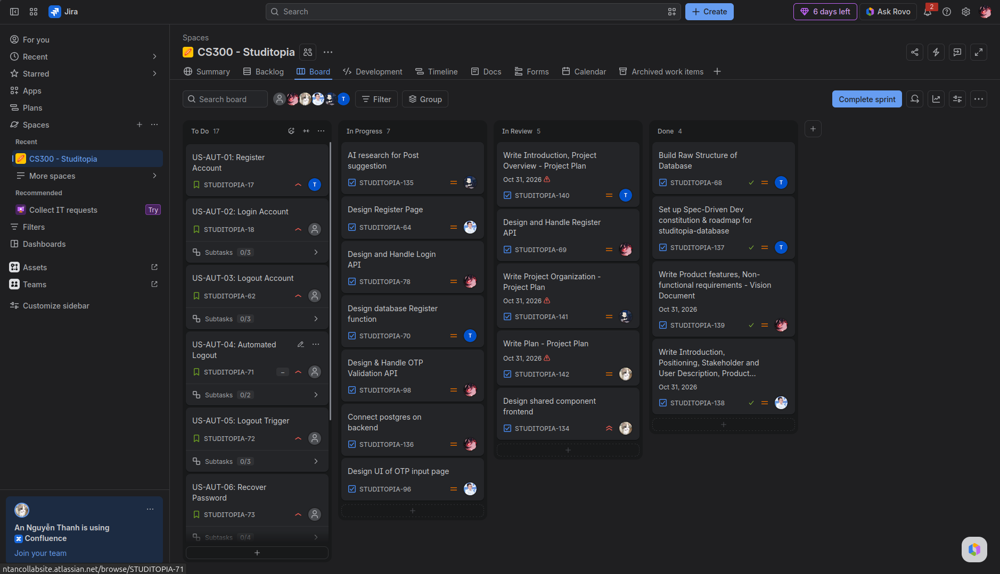

# 27/10, Sprint 2 - Meeting Report

## Team member represent

- Nguyen Thanh An
- Nguyen Chi Bao
- Tran Nguyen Khanh Binh
- Tran Canh Anh Tuan
- Nguyen Le Quoc Huy

## Team member absent

No member is absent

## Status reports

- Nguyen Thanh An

    - Completed tasks:
        - Render share UI components
        - Setup Github Speckit for Frontend 
    
    - Issues:
        - Need to integrate authentication API  
    
    - To-do tasks:
        - Integrate authentication API following API contracts between Frontend  
        - Learn Github Speckit training course (screenshot)
        - Write Manage Process - Software Project Plan
    
- Nguyen Chi Bao

    - Issues: 
        - Recommendation AI model needs to be optimized

    - To-do tasks:
        - Learn Github Speckit training course (screenshot)
        - Write Organizational Structure - Software Project Plan
        - Optimize the Recommendation AI model 

- Tran Nguyen Khanh Binh

    - Completed tasks:
        - Design authentication UI pages

    - To-do tasks:
        - Learn Github Speckit training course (screenshot)
        - Write Introduction, Positioning, Stakeholder and User Description, Product Overview - Vision Document 

- Nguyen Le Quoc Huy

    - Completed tasks:
        - Complete login and register API
        - Setup Github Speckit for Backend 

    - To-do tasks:
        - Implement OTP authentication API
        - Learn Github Speckit training course (screenshot)
        - Write Product features, Non-functional requirements - Vision Document 

- Tran Canh Anh Tuan

    - To-do tasks:
        - Setup Github Speckit for Database 
    
    - To-do tasks:
        - Learn Github Speckit training course (screenshot)
        - Write Introduction, Project Overview - Software Development Plan
 
## Summary of the meeting

### Evaluate completed tasks

- Frontend: 
    - Implement shared design components but don't implement test
    - Render Login, Register Page but don't integrate the corresponding API  
- AI: Recommendation API model can't process many requests at a time => Need to optimize
- Database: User and authentication-related schema need to be designed

### To-do task

- PA2:
    - Write Vision Document
    - Write Software Development Plan
    - Learn Github Speckit training course (take screenshot)

- Project:
    - Implement test for shared components
    - Integrate Backend API into Frontend
    - Implement OTP and password recovery API
    - Optimize the AI recommendation model 
    - Design user and authentication-related schema 

### The tasks assigned after the meeting (screenshot)

