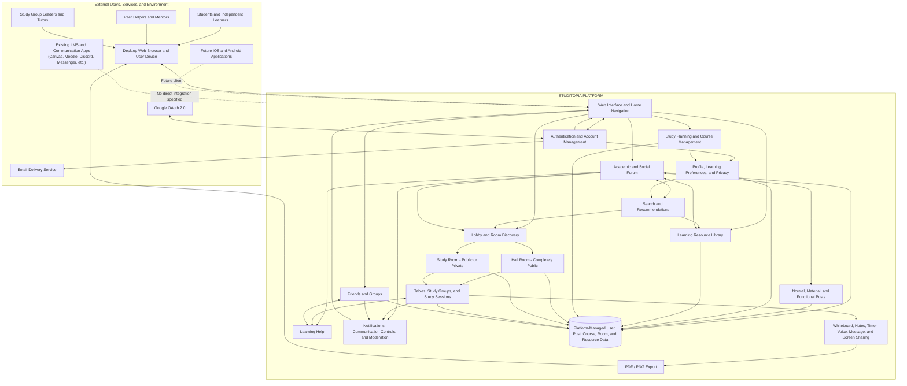

# 4. Product Overview
****Performed by:**** [Huy] | ****Reviewed by:**** [Binh]] | ****Edited by:**** []

Studitopia is a forum-centric collaborative learning and social networking platform that brings academic discussions, learning resources, study planning, virtual study environments, and social interaction into one environment.

## 4.1 Product Perspective

Studitopia is a standalone platform with its own user accounts, profiles, academic discussions, learning resource library, study-planning functions, meeting rooms, and social networking features. It is intended to coexist with university Learning Management Systems (LMS) and communication applications that learners may already use

The platform's main purpose is to connect activities that are often performed separately, allowing users to move between academic discussions, relevant resources, peer assistance, and collaborative study sessions while retaining the learning context.

The product consists of the following major functional components:

- **Authentication and Account Management:** Supports account registration, email OTP verification, login, logout, password recovery, account deletion, and session management. Google OAuth 2.0 is also identified as an optional authentication method. The confirmed inactivity timeout for an authenticated session is 30 minutes.
- **Profile, Learning Preferences, and Privacy:** Allows users to maintain profile information such as university, major, subjects, interests, learning habits, preferred study times, and learning goals. These details support personalized discovery and room recommendations. Users can also manage visibility, online status, audio/video availability, and communication or document-access preferences.
- **Academic and Social Forum:** Provides a space for users to publish and discuss learning topics. It supports Normal Posts, Material Posts, and Functional Posts. Posts support comments, replies, reactions, and accepted solutions, and academic content can be classified by university, major, and course.
- **Search and Discovery:** Allows users to search by tags, content, and users, and to discover relevant posts, materials, rooms, and friends. Recommendations may consider trending activity, user relevance, profile preferences, interests, and courses in progress.
- **Learning Resource Library:** Provides a centralized collection in which users can publish, search, access, and download learning resources. Resources can include descriptive information such as titles, descriptions, and subject tags.
- **Study Planning and Course Management:** Supports course planning, personal course settings, credit computation, study schedules, and academic pathway planning. The proposal also identifies prerequisite trees.
- **Lobby and Meeting Room Management:** Provides room discovery, room details, recommendations, manual search, automatic matching, room creation, and room configuration. Studitopia has two room categories: a **Hall Room**, which is completely public, and a **Study Room**, whose creator chooses whether it is public or private. Public Study Rooms can be joined subject to availability and capacity, Private Study Rooms require the applicable invitation or approval process.
- **Study Sessions and Collaborative Learning Tools:** Supports room participation and the smaller collaboration contexts represented by tables in Hall Rooms and study groups in Study Rooms. Available collaborative tools include shared whiteboards, shared notes, synchronized timers, voice communication, messaging, and screen sharing. Room owners or managers can configure room policies and the tools available to participants.
- **Learning Help and Social Networking:** Enables learners to request help from friends, eligible learners in the same room, or learners studying or interested in the same concept. Users can find study partners, send and manage friend requests, create public or private groups, exchange messages, and share documents. These capabilities support both individual learning connections and smaller collaborative communities.
- **Notifications, Privacy, and Trust and Safety:** Provides notifications for activities such as messages, friend requests, room invitations, and learning help requests. Users can control communication and privacy settings, block or mute other users, and report inappropriate behavior or content. Reports are routed for moderation to help maintain a safe learning community.

#### External interfaces and operating environment

Studitopia is initially intended to be accessed through desktop web browsers, including Google Chrome, Mozilla Firefox, Microsoft Edge, and Apple Safari. Native applications for iOS and Android are identified as future platform extensions, not as confirmed requirements for the initial version.

The main external interfaces and interactions are:

- **Google OAuth 2.0:** Provides an optional Google-based registration and authentication path.
- **Email delivery service:** Sends OTP codes for email verification and password recovery.
- **Web browsers and user devices:** Provide access to the platform's user interface, room tools, audio/video capabilities, screen sharing, and local storage used for supported buffering and synchronization behavior.
- **File export:** Supports exporting selected learning content, such as whiteboards and notes, to standard formats including PDF and PNG.
- **Existing LMS and communication applications:** Canvas, Moodle, Discord, Messenger, Notion, and Obsidian are identified as applications that users may already use. They are part of the surrounding user environment; direct integration with their APIs or institutional databases is not specified as a current requirement.

## 4.2 Assumptions and Dependencies

The development and operation of Studitopia depend on the assumptions and external conditions listed below. These assumptions describe the environment in which the proposed features are expected to operate. If an assumption changes or a dependency becomes unavailable, the product scope, requirements, or implementation plan may need to be revised.

| Assumption or Dependency | Description | Impact if Changed |
| --- | --- | --- |
| Desktop Web Browser Availability | The initial platform is expected to operate through desktop versions of Google Chrome, Mozilla Firefox, Microsoft Edge, and Apple Safari. | Changes in supported browsers may require compatibility testing, interface adjustments, or changes to supported features. |
| Internet Connectivity | Users are expected to have network access for online forums, resource retrieval, room participation, and real-time communication. The proposal expects supported text and note changes to be buffered locally and synchronized after reconnection where applicable. | Unreliable connectivity may interrupt live collaboration, messaging, and resource access; synchronization behavior may need further refinement. |
| Google OAuth 2.0 Availability | Google OAuth 2.0 is an optional external authentication service for users who choose Google-based registration or login. | Changes to Google's service or authentication policies may affect Google-based account access. The platform would still need to support its non-Google authentication path. |
| Email Delivery Service | An operational email delivery service is required to send OTP codes for email verification and password recovery. | Email delivery failures may prevent users from completing verification or recovering their accounts. |
| User Devices and Browser Capabilities | Collaborative activities may require compatible browser and device capabilities for audio, video, screen sharing, and local storage. | Unsupported hardware or browser capabilities may limit access to specific room tools or reduce the quality of collaboration. |
| File Storage and Processing | The platform requires storage and processing capabilities for uploaded room documents and published learning resources. The proposal identifies PDF, DOCX, PNG, and JPG as supported examples and gives 25 MB as an example configurable file-size limit. | Storage limits, file-processing failures, or changes to permitted formats may affect document sharing, previews, downloads, and Library publishing. |
| File Safety Scanning | Uploaded room documents are expected to undergo file validation and malware scanning before they become downloadable. | If scanning services are unavailable, the system may need to delay access to uploaded files or apply an alternative review process. |
| Community Participation and Moderation | The platform expects students, peer helpers, mentors, and study group leaders to contribute discussions, learning resources, and assistance. Trust and Safety activities are expected to review reported content and user behavior. | Low participation may reduce the usefulness of recommendations and peer assistance; insufficient moderation may reduce community safety and content quality. |
| System Capacity | The system architecture supports at least 10,000 registered users, 100,000 forum posts, 10, 000 requests per second, and 200 concurrent users in virtual study rooms. | Higher usage or larger room requirements may require additional infrastructure capacity and performance optimization. The capacity measures must be validated separately during testing. |
| External LMS and Communication Applications | Canvas, Moodle, Discord, Messenger, Notion, and Obsidian are identified as complementary applications used by the target users. Direct integration with their APIs or institutional databases is not currently specified. | Adding direct integrations later may require additional interfaces, authentication arrangements, data permissions, and agreements with external providers. |

---
