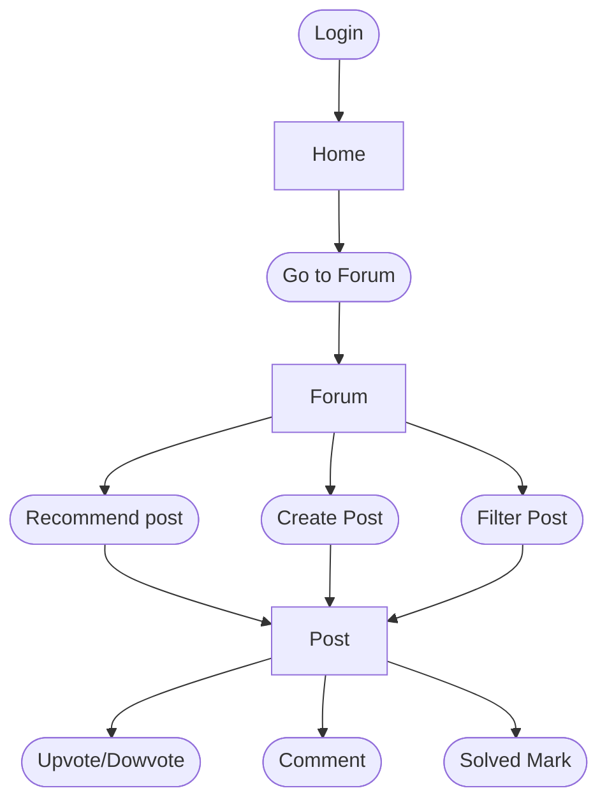
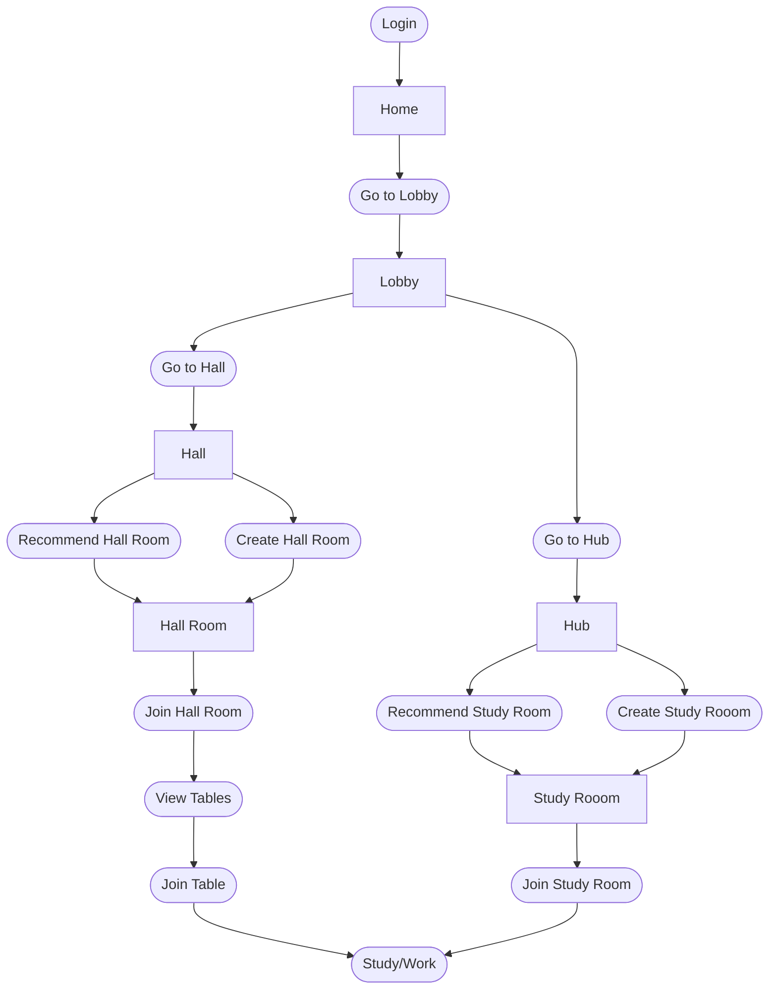
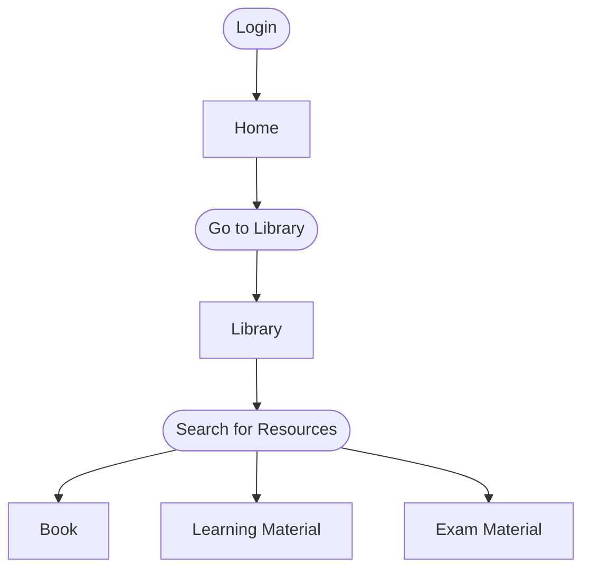

# 5. Product Features

****Performed by:**** [Huy] | ****Reviewed by:**** [Binh] | ****Edited by:**** []

| Feature ID | Feature Name | Description | Priority | Related Use Cases |
| --- | --- | --- | --- | --- |
| F-001 | Account Registration and Verification | New users create account and complete the required identity verification before accessing platform services. It provides a clear entry point for students and independent learners who want to participate in the learning community. | High | US-01 Register Account; US-08 OTP Validation |
| F-002 | Session Management | Registered users access their accounts and end their sessions when they finish using the platform. It manages inactive sessions so that access to personal information and learning activities is not left open indefinitely. It benefits all users by providing controlled and consistent access | High | US-02 Login; US-03 Logout; US-04 Automatic Logout; US-05 Logout Trigger |
| F-003 | Account Recovery and Deletion | Users regain access when they forget passwords and request permanent deletion of their accounts. It provides account-related actions for users who need to recover access or discontinue using the platform. It benefits users by giving them control over the continued use of their accounts. | High | US-06 Recover Password; US-07 Delete Account |
| F-004 | Learning Preferences | Users maintain personal and academic information, including their university, major, subjects, interests, learning habits, preferred study times, and learning goals. These details help represent each learner's background and study interests within the platform. It benefits learners by supporting relevant discovery, recommendations, and connections with other users. | High | Profile Management; Set Learning Preferences |
| F-005 | Communication Preferences | Users control the visibility of their profile information and manage how other users may contact or interact with them. It covers privacy choices such as online status, audio and video availability, and restrictions on communication. It benefits users by helping them participate in the community while maintaining control over their personal information and interactions. | High | Manage Privacy; US-38 Control Communication |
| F-006 | Academic Forum | System provides a shared space for users to publish and explore academic questions, learning problems, ideas, and general community discussions. It supports discussions relevant to universities, majors, courses, and broader learning interests. It benefits students, peer helpers, and university communities by making academic knowledge sharing available in one place. | High | US-36 Participate in Forum Discussions; Academic and Social Forum Management in Product Scope |
| F-007 | Post Creation | Users contribute different kinds of content through Discussion Posts, Material Posts, and Functional Posts. These post types support discussion, sharing learning materials, and presenting interactive academic content. It benefits contributors and readers by allowing information to be shared in a form suited to its purpose. | High | US-36 Participate in Forum Discussions; US-42 Shared Learning Resources; Post Creation and Management in Product Scope |
| F-008 | Academic Classification | Posts and learning content will be associated with relevant academic contexts, including universities, majors, courses, subjects, and tags. Tags can describe the purpose or topic of a post, with examples such as discussion, material, prerequisite tree, and quiz. It benefits users by helping them understand the context of content and find contributions relevant to their studies. | High | Academic and Social Forum Management in Product Scope; US-36 Participate in Forum Discussions; US-42 Shared Learning Resources |
| F-009 | Discussion Management | Users participate in discussions through comments, replies, and reactions to posts and answers. It also allows a post author to identify an answer as an accepted solution when a learning problem has been resolved. It benefits learners by making useful responses easier to recognize and by preserving answers that may help others with similar questions. | High | US-28 Post a Learning Problem to the Forum; US-36 Participate in Forum Discussions |
| F-010 | Search Engine | Users search for relevant platform content, including tags, posts, users, and learning resources. It helps users locate information across the academic and social areas without relying only on recommendations or browsing. It benefits learners and contributors by making existing discussions, materials, and community members easier to find. | High | Search and Discovery in Product Scope; US-09 Search for a Room Manually; US-29 Find a Study Partner; US-34 Find Learning Resources |
| F-011 | Personalized Recommendations | This feature presents users with suggested rooms, posts, learning materials, and potential friends that may be relevant to their interests and learning activities. Recommendations may take account of profile preferences, subjects, courses in progress, relevance, and community activity as described in the proposal. It benefits learners by helping them discover useful content and learning opportunities that they might not find through a general search. | High | US-08 Receive Room Recommendations; US-29 Find a Study Partner; US-35 Receive Resource Recommendations |
| F-012 | Learning Resource Library | This feature provides a central collection in which users can discover, access, and retrieve books and other learning resources. Resources can be explored using relevant information such as titles, descriptions, subjects, and tags, and users can receive suggestions related to their learning interests. It benefits students and independent learners by making educational materials easier to locate and reuse. | High | US-34 Find Learning Resources; US-35 Receive Resource Recommendations; Learning Resource Library in Product Scope |
| F-013 | Resource Contribution and Reuse | Users contribute learning resources and make useful academic content available to other learners. It supports the product vision of retaining valuable materials and solution explanations from community learning activities for broader discovery through the Library. It benefits contributors and future learners by helping useful knowledge remain accessible beyond the original discussion, the detailed curation and promotion rules are to be defined in the use-case model. | High | US-42 Shared Learning Resources; US-43 View My Storage; US-44 Delete My Published Document; Thread-to-Library Promotion in Vision Document |
| F-014 | Room Discovery | Learners discover available Hall Rooms and Study Rooms through browsing, search, and recommendations. It provides information that helps users understand a room's purpose, topic, capacity, participants, and available learning features before deciding to enter. It benefits learners by helping them select a suitable environment for their study interests and preferences. | High | US-08 Receive Room Recommendations; US-09 Search for a Room Manually; US-41 View Room Detail |
| F-015 | Automatic Room Matching | Learner request assistance in finding a suitable available public room without having to compare rooms individually. The matching capability considers the learner's relevant preferences and the availability and suitability of rooms. It benefits learners who want to enter a compatible study environment quickly, while the detailed matching rules are handled in the use-case model. | Medium | US-10 Automatically Match to a Room |
| F-016 | Hall Room Participation | This feature provides access to Hall Rooms, which are completely public environments where learners can enter and participate. Participants can choose tables within a hall and view permitted information about other tables before deciding to join them. It benefits learners who want an open study or social environment where they can encounter and interact with other members of the community. | High | US-11 Join a Public Room; US-12 Select a Public Room Table; US-13 View Other Tables; Hall Room clarification |
| F-017 | Study Room Creation and Access | Students and tutors create Study Rooms for a particular subject, activity, or group and choose whether each room is public or private. It supports participation in public Study Rooms and controlled access to private Study Rooms. It benefits study groups, tutors, and learners who need either an open study space or a more restricted environment. | High | US-14 Request to Join a Custom Room; US-15 Manage Room Join Requests; US-16 Create a Custom Room |
| F-018 | Room Management and Study Scheduling | Room owners or managers organize study environments and arrange when study sessions take place. It covers room policies such as capacity, duration, communication rules, and available tools, as well as the scheduling capabilities described in the proposal. It benefits study group leaders, tutors, and participants by helping them organize sessions according to their learning purposes. | Medium | US-17 Configure Room Policies; Schedule Room; Study Schedule in Product Scope |
| F-019 | Study Group Participation | Learners participate in the smaller collaborative spaces provided within Hall Rooms and Study Rooms. It supports choosing a table or joining a study group so that learners can work with others in a more focused setting. It benefits participants by giving them a way to organize their interaction within a larger room environment. | High | US-12 Select a Public Room Table; US-13 View Other Tables; Study Group and Table Group in Product Scope |
| F-020 | Room Document Sharing | Participants share learning documents with others in a room and access documents contributed by room members. It supports the exchange of materials needed for the current study activity. It benefits learners and study groups by keeping relevant resources available to participants in the shared learning environment. | High | US-32 Share Learning Documents in a Room; US-33 Access Shared Documents |
| F-021 | Shared Whiteboard | Participants in a collaborative learning environment explain ideas and work through problems on a shared whiteboard. It supports visual collaboration as part of group learning and problem solving. It benefits students, peer helpers, and tutors who need to communicate concepts visually with other participants. | High | US-18 Use Shared Whiteboard |
| F-022 | Shared Notes | Participants create and edit notes together during a study session. It supports the shared recording of explanations, important information, and outcomes from collaborative work. It benefits learners and study groups by helping them preserve the information developed during a session. | High | US-19 Use Shared Notes |
| F-023 | Shared Timer and Focus Support | This feature provides shared time-management activities for learners participating in the same study environment. It supports coordinated study periods and breaks, including the timer modes described in the proposal, and contributes to the product vision of focused co-presence. It benefits individuals and groups by helping them maintain a shared study rhythm and manage their study time. | Medium | US-20 Use Shared Timer; Silent Co-Presence and Focus Mechanics in Vision Document |
| F-024 | Learner Communication | Learners express interest in communicating and to communicate through private messages or voice conversations. It supports both lightweight interactions and more direct conversations between users who wish to discuss a learning topic. It benefits learners by enabling communication that can complement forum discussions and collaborative study activities. | High | US-21 Send a Hand Wave; US-22 Respond to a Hand Wave; US-23 Start Message Communication; US-24 Start Voice Communication |
| F-025 | Contextual Learning Assistance | Learners request academic help from friends, people in the same room, or learners who share an interest in the relevant concept. It connects a learning problem with people who may be able to provide assistance and supports continuing the problem as a forum discussion. It benefits learners seeking help and peer helpers or mentors who want to contribute their knowledge. | High | US-25 Request Learning Help from a Friend; US-26 Request Help from the Same Room; US-27 Request Help from Concept Learners; US-28 Post a Learning Problem to the Forum |
| F-026 | Study Partner Discovery | Users find other learners with similar subjects, interests, goals, or learning preferences. It presents relevant information about potential study partners so users can decide whom they may want to connect with. It benefits learners who want to build academic connections beyond their existing friends or current study rooms. | Medium | US-29 Find a Study Partner |
| F-027 | Friend Connection Management | Users establish and manage friendships with other members. It supports sending, receiving, accepting, and declining friend requests so that users can control their personal learning network. It benefits learners who want to maintain connections for future discussions, study sessions, and resource sharing. | Medium | US-30 Send Friend Request; US-31 Manage Friend Requests |
| F-028 | Group Collaboration | Users create, join, and manage public or private groups for ongoing collaboration. Group members can communicate, share documents, view membership, and manage participation according to their permissions. It benefits classmates, project teams, and other learning communities that need a shared space for continued coordination. | Medium | Friend and Group Management in Product Scope; Friend Group Flow |
| F-029 | Course and Study Planning | Learners organize their academic progress through course planning, course settings, credit calculation, and study scheduling. It supports understanding academic pathways and planning learning activities in relation to a student's university and major. It benefits students who need to manage their degree-related learning and coordinate their study commitments. | Medium | Course Management; Study Planning in Product Scope |
| F-030 | Interactive Academic Tools | This feature provides interactive academic content that helps learners explore or practice concepts rather than only read static explanations, include prerequisite trees and immediate quizzes, and the team's clarification includes interactive mathematical visualizations such as graphs whose parameters can be adjusted by learners. It benefits students and independent learners by supporting exploration, practice, and a more engaging understanding of academic topics. | Medium | Functional Posts in Product Scope; Adaptive Prerequisite Tree; Immediate Quiz; Dynamic Computation |
| F-031 | Notifications | This feature informs users about relevant activities, including messages, friend requests, room invitations, and learning help requests. It allows users to stay aware of interactions that may require their attention and to manage their notification preferences. It benefits all platform users by helping them remain connected to important learning and community activities. | High | US-37 Receive Notifications |
| F-032 | Trust, Safety and Moderation | This feature allows users to control unwanted interactions and report inappropriate behavior or content within the platform. It also supports the review of reports and the enforcement of community guidelines by responsible personnel. It benefits learners, mentors, group leaders, and the wider community by supporting a safe and respectful learning environment. | High | US-38 Control Communication; US-39 Report Inappropriate Behavior; Trust & Safety responsibilities in Vision Document |

### Representative User Workflows
#### Post Browsing Workflow

#### Room Workflow

#### Library Workflow
