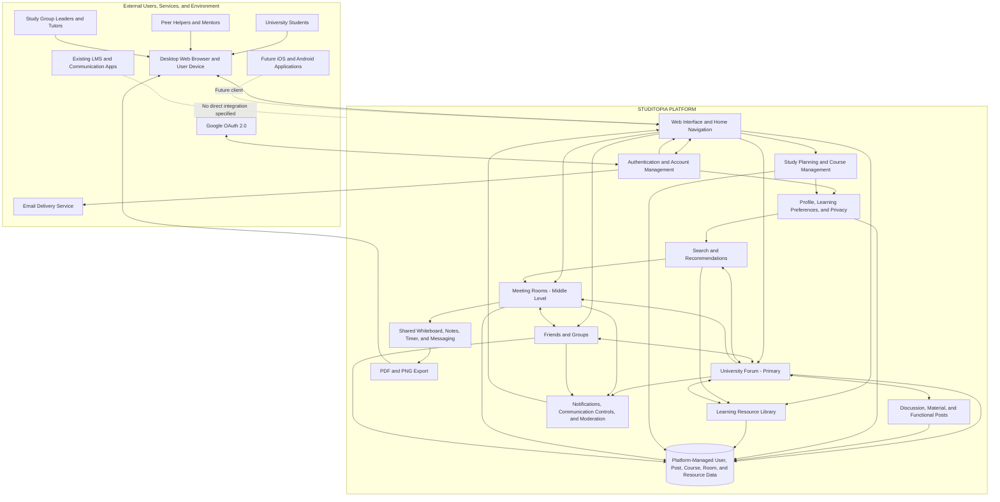
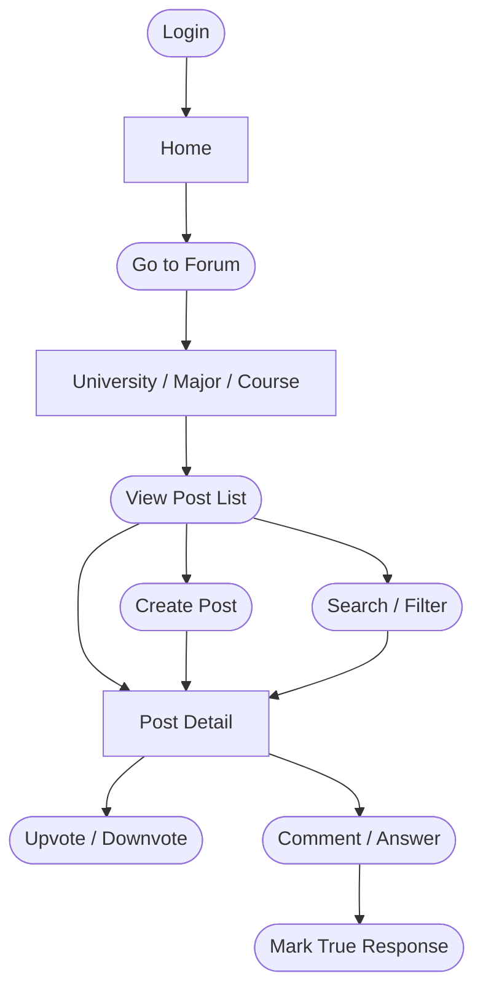
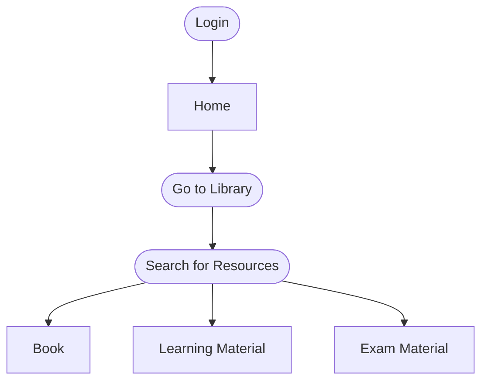
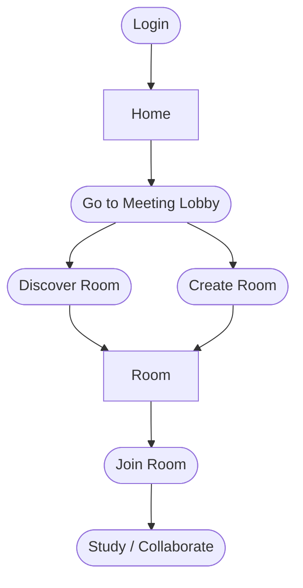

# Group 5 - Alien Force
## Document Overview

| Field | Value |
| --- | --- |
| Project | Studitopia |
| Group | Group 5 - Alien Force |
| Document | PA3 Changes: Development Plan and Vision Updates |
| Version | 2.0 |
| Date | 14/Nov/2026 |

### Revision History (Changes.md)

| Date  | Version | Description | Author |
| ---   | --- | --- | --- |
| 10/11 | 2.0 | Updated the development plan from Sprint 3| Nguyen Thanh An |
| 11/11 | 2.0 | Restored meeting rooms from Sprint 3| Tranh Nguyen Khanh Binh |

---

# Section A: Software Development Plan (Updated)

# Development Plan

### **Version:** <2.0>

## Revision History

| Date | Version | Description | Author |
| --- | --- | --- | --- |
| 29/10 | 1.0 | Initial draft | Tran Canh Anh Tuan |
| 30/10 | 1.1 | Plan the software development | Nguyen Thanh An |
| 10/11 | 2.0 | Authentication completion and partial Forum Post; remaining work re-prioritized | Nguyen Thanh An |

## 1. Introduction
**Performed by:** [Tuan] | **Reviewed by:** [An] | **Edited by:** [An]

This section provides an overview of the entire document. It includes the purpose, scope, definitions, acronyms, abbreviations, references, and overview of this plan.

### 1.1 Purpose

The purpose of this document is to gather all information necessary to control the project. It describes the approach to the development of the software and directs the development effort of the group.

The following people use the Software Development Plan:

- The product owner, scrum master, and project manager use it to plan the project schedule and resource needs and to track progress against the schedule.
- Project team members use it to understand what they need to do, when they need to do it, and what other activities they depend on.

### 1.2 Scope

This document describes the overall plan for the Studitopia project, including development, testing, and deployment of the product using small iterations. The details of individual iterations are described in the Iteration Objectives.

The plans in this document are based on the product requirements defined in the Vision Document. This version reflects the PA3 decision to prioritize the university forum and to restore meeting rooms.

### 1.3 Overview

The rest of this plan contains the following information:

- **Project Overview** describes the project's purpose, scope, objectives, assumptions, constraints, and deliverables.
- **Project Organization** describes the organizational structure of the project team.
- **Management Process** contains estimates, the project plan, schedule, resources, and achievement criteria.
- **Project Monitoring and Control** describes how the project will be monitored and controlled.
- **Project Close-out** describes the final acceptance and archiving activities.

## 2. Project Overview
**Performed by:** [Tuan] | **Reviewed by:** [An] | **Edited by:** [An]

### 2.1 Project Purpose, Scope, and Objectives

Studitopia is a collaborative academic forum and social learning platform focused mainly on undergraduate students across several partner universities. The platform is organized as a university forum with sub-forums by major, and each major contains course-level discussions. Users can join the forum to search for learning materials and past papers and to discuss the learning process, study tips, and related academic topics.

Users can share materials, interact with posts, manage academic profiles, and track their personal progress against their university syllabus by recording credits and grades to see completed coursework and remaining requirements. Meeting rooms are retained supporting feature for study groups that need live collaboration.

Objectives:

- Provide a course-centered university forum where undergraduate students can access materials and past papers by major and course.
- Enable discussion and knowledge sharing among students about the learning process and study tips.
- Allow users to create and interact with discussion, material, and functional posts.
- Restore basic meeting-room support for study groups that need live collaboration, without making meeting rooms the primary focus.
- Offer a progress tracking system tied to each university syllabus, where users input credits and grades to view their academic standing.

### 2.2 Assumptions and Constraints

Assumptions:

- Users are undergraduate students enrolled at one of the partner universities.
- Users have access to a modern web browser and a stable internet connection.
- Staff members from partner universities may manage forums, update learning materials, moderate discussions, respond to students' questions, and monitor user activity.
- The team will follow the Scrum process with five sprints lasting about 12 weeks.
- The current sprint is Sprint 3.
- Sprint 1 and Sprint 2 scope and schedule remain frozen and unchanged from version 1.1.
- Meeting rooms are a middle-level feature and are not expected to reach the depth described in the original PA2 vision.

Constraints:

- Budget: student project with no dedicated funding; reliance on free and open-source tools.
- Staff: five team members balancing coursework and project work.
- Schedule: the project must be completed by the end of the semester (12 weeks).
- Platform: web browser only (no native mobile application in this phase).
- Technology: React + TypeScript + Vite (frontend), NestJS (backend), PostgreSQL (database only).
- Sprint 3 capacity: only authentication function groups and part of Forum Post can be completed.
- Meeting rooms must remain middle-level in scope; they must not displace forum and post work.

### 2.3 Project Deliverables

| Deliverable | Description | Target |
| --- | --- | --- |
| Project proposal | The main ideas and features of the proposed application | Sprint 1 (frozen) |
| Existing app survey | The survey about similar existing applications in the same domain | Sprint 1 (frozen) |
| Vision Document | High-level needs, features, and non-functional requirements | Sprint 2 (frozen) |
| Software Development Plan | Project plan covering organization, schedule, and control | Sprint 2 (frozen) |
| Spec Kit Artifacts | Constitution and initialization files under /src | Sprint 2 (frozen) |
| AI Usage Report and Weekly Report | AI usage log and sprint meeting documentation | Each sprint |
| Use-case model and specification | User interaction with system objects | Sprint 3 |
| Architecture diagram | The structure of the application in detail | Sprint 4 |
| Test cases and test plans | The detailed plan of the testing process | Sprint 5 |
| Final Product Demo | Demonstration of all project features | Sprint 5 |

### 2.4 Change Summary from Sprint 3

| Area | Previous Plan | Updated Plan | Reason |
| --- | --- | --- | --- |
| Sprint 3 | Forum creation, posts, comments, interactions, friend management, real-time messaging, and notifications | Complete authentication function groups and part of Forum Post | Actual Sprint 3 capacity is limited |
| Sprint 4 | Document sharing, file search, and meeting integration | Complete Forum and post features, Learning Resource Library, and Friend and Group Management | Forum and posts are the main functions after authentication |
| Sprint 5 | Integration testing, performance testing, bug fixing, and deployment | Basic meeting rooms at middle level, notifications, study planning if capacity allows, integration testing, and deployment | Meeting rooms are restored but kept moderate |
| Meeting rooms | Reduced and de-emphasized | Restored as a middle-level feature in Sprint 5 | Product decision to bring meeting rooms back without making them primary |

## 3. Project Organization
**Performed by:** [Bao] | **Reviewed by:** [An] | **Edited by:** [Bao]

### 3.1 Organizational Structure

The project manager creates tasks in Jira and assigns them to team members. Another member reviews the work for each task. The review authorities for each task are also assigned by the project manager. All members work as full-stack developers, but each has a specialty in one aspect, including frontend, testing, AI, UI design, database, and backend. The member specialized in an aspect proposes the overall structure and methods for implementing tasks relating to that aspect. Then, all members discuss and validate the proposed ideas.

### 3.2 Roles and Responsibilities

| Person | Role |
| --- | --- |
| Nguyen Thanh An | Frontend Developer: Responsible for proposing methods to implement UI, designing UI components and their relations |
| Nguyen Chi Bao | Tester and AI Developer: Responsible for designing tests and architecture of the AI server, researching suitable AI models for available hardware, and designing processes to process data from multiple users concurrently |
| Tran Nguyen Khanh Binh | UI Designer: Responsible for designing the overall look of the UI, including its components, pages, and workflow |
| Tran Canh Anh Tuan | Database Manager: Responsible for determining the EER model and establishing the relational schema while ensuring appropriate normal form and usability |
| Nguyen Le Quoc Huy | Backend Developer: Responsible for designing the backend API, communication with the frontend, connection with the database, and AI server integration |

## 4. Management Process
**Performed by:** [An] | **Reviewed by:** [Huy] | **Edited by:** [An]

### 4.1 Project Estimates

#### Estimated Cost

The project reuses existing infrastructure and open-source technologies, so the estimated additional development cost is **0 VND**.

| Item | Estimated Cost | Explanation |
| --- | ---: | --- |
| Server / Hosting | 0 VND | Our group owns a server for hosting. |
| Domain | 0 VND | Domain has already been purchased. |
| File Storage | 0 VND | Existing storage is available on the server. |
| Database (PostgreSQL) | 0 VND | Open-source database. |
| Backend (NestJS) | 0 VND | Open-source framework. |
| Frontend (React + Vite) | 0 VND | Open-source technologies. |
| Real-time Communication | 0 VND | Implemented using WebSocket libraries. |
| Development and Testing Tools | 0 VND | Free or open-source tools will be used. |

Additional costs may arise if the existing server or storage cannot handle the expected workload or if paid third-party services are required. These expenses will be estimated separately when necessary.

#### Estimated Schedule

The project is expected to take **12 weeks**, divided into five sprints. Sprint 1 and Sprint 2 are frozen. Sprint 3 is the current sprint.

| Sprint | Duration | Main Activities |
| --- | --- | --- |
| Sprint 1 | Week 1-3 | **Frozen:** Requirement analysis, system architecture, database design, and project setup. |
| Sprint 2 | Week 4-5 | **Frozen:** Authentication, user profiles, and university management. |
| Sprint 3 | Week 6-8 | **Current:** Complete authentication function groups and part of Forum Post. |
| Sprint 4 | Week 9-10 | Complete Forum and post features, Learning Resource Library, and Friend and Group Management. |
| Sprint 5 | Week 11-12 | Basic meeting rooms at middle level, notifications, integration testing, performance testing, bug fixing, and deployment. |

#### Re-estimation Situation

Cost and schedule estimates should be reviewed at the end of each sprint and whenever significant changes occur.

Re-estimation is necessary in the following situations:

- **Scope changes:** New features or changes to existing requirements increase development effort.
- **Technical difficulties:** Unexpected problems with WebSocket, database performance, file sharing, or system integration delay implementation.
- **Infrastructure limitations:** Existing server or storage cannot satisfy performance or capacity requirements, requiring additional resources.
- **Schedule deviations:** Actual progress differs significantly from the planned milestones, such as a delay exceeding one week.
- **External dependencies:** Third-party services introduce additional fees, usage limits, or compatibility issues.
- **Priority changes:** Forum and post work must be protected from lower-priority work such as extended meeting-room features.

During re-estimation, the team will compare actual progress and expenses against the initial plan, estimate the remaining work, and adjust the schedule or budget accordingly.

### 4.2 Project Plan

#### 4.2.1 Phase Plan

The project is divided into the following major work packages:

- **Project Planning:** Requirement analysis, scope definition, project setup, and architecture design. (Sprint 1, frozen)
- **User Management:** Registration, authentication, user profiles, and university management. (Sprint 2, frozen)
- **Authentication Completion and Forum Post Foundation:** Finish authentication function groups and implement part of Forum Post. (Sprint 3, current)
- **Forum and Social Features:** Complete forum posts, comments, interactions, search, recommendations, friend requests, and friend management. (Sprint 4)
- **Document Management:** Document upload/download, sharing, public library, and file search. (Sprint 4)
- **Meeting and Administration:** Basic meeting-room discovery, participation, and core collaboration tools; content moderation. (Sprint 5)
- **Testing and Deployment:** Integration testing, performance testing, bug fixing, deployment, and documentation. (Sprint 5)

The project is planned for **12 weeks**, divided into five sprints. Sprint 1 and Sprint 2 are frozen.

| Activities | W1-3 | W4-5 | W6-8 | W9-10 | W11-12 |
| --- | :---: | :---: | :---: | :---: | :---: |
| Requirement Analysis and Architecture (frozen) | x | | | | |
| Database Design and Project Setup (frozen) | x | | | | |
| Authentication and User Profiles (frozen) | | x | | | |
| University Management (frozen) | | x | | | |
| Complete Authentication Function Groups | | | x | | |
| Partial Forum Post (post list, create post, post detail) | | | x | | |
| Complete Forum Posts and Interactions | | | | x | |
| Forum Search and Recommendations | | | | x | |
| Learning Resource Library and File Search | | | | x | |
| Friend and Group Management | | | | x | |
| Basic Meeting Rooms (middle level) | | | | | x |
| Notifications | | | | | x |
| Integration Testing | | | | | x |
| Performance Testing | | | | | x |
| Bug Fixing and Deployment | | | | | x |

After these sprints, the project must achieve the major milestones below with the following criteria:

- **Project foundation completion:** Requirements, architecture, database design, and development environment are ready. (Sprint 1, frozen)
- **User management completion:** Users can register, log in, manage profiles, and access university-related features. (Sprint 2, frozen)
- **Authentication and forum foundation completion:** Authentication function groups are complete, and the basic Forum Post workflow is available. (Sprint 3)
- **Core platform completion:** Forum posts, interactions, search, recommendations, library, and social features work correctly. (Sprint 4)
- **MVP completion:** Basic meeting rooms, notifications, integration testing, performance testing, bug fixing, and deployment are complete. (Sprint 5)

Corresponding with each milestone, the following demos must be released:

| Release | Target | Scope and Purpose |
| --- | --- | --- |
| User Management Demo | End of Week 5 | Demonstrate authentication, user profiles, and university management. (Frozen) |
| Forum Foundation Demo | End of Week 8 | Demonstrate completed authentication and the basic Forum Post workflow. |
| Core Platform Demo | End of Week 10 | Demonstrate completed forum, posts, library, search, recommendations, and social features. |
| Final Release: MVP | End of Week 12 | Demonstrate basic meeting rooms, notifications, and the complete user workflow. |

Each demo will be followed by feedback collection and backlog updates. The final release is accepted when all agreed MVP requirements are implemented, critical defects are resolved, and the application passes the required tests.

#### 4.2.2 Iteration Objectives

Each iteration focuses on delivering a specific set of functionalities and achieving measurable development objectives.

| Iteration | Duration | Objectives |
| --- | --- | --- |
| **Sprint 1** | Week 1-3 | **Frozen:** Analyze and finalize project requirements. Define the system architecture and technology stack. Design the database schema and main data relationships. Set up the development environment, project structure, and version control workflow. |
| **Sprint 2** | Week 4-5 | **Frozen:** Implement user registration, login, and authentication. Develop user profile management. Implement university management and associate users with their universities. Establish basic role-based access control. |
| **Sprint 3** | Week 6-8 | **Current sprint:** Complete the authentication function groups. Implement part of Forum Post: forum post list, discussion post creation, material post creation, basic post detail, and university-major-course navigation. Move comments, voting, true-response marking, moderation, search, recommendations, library, social features, meeting rooms, study planning, and notifications to later sprints. |
| **Sprint 4** | Week 9-10 | Complete Forum and post features: all post types, comments and answers, voting, true-response marking, save, report and moderation, search, recommendations, and post filters. Implement the Learning Resource Library, file upload and search, and Friend and Group Management. |
| **Sprint 5** | Week 11-12 | Implement basic meeting rooms at middle level: room discovery, create or join room, and core collaboration tools such as shared whiteboard, shared notes, and shared timer. Implement notifications and study planning if capacity allows. Perform integration testing, performance testing, bug fixing, and deployment. |

At the end of the project, the team expects to deliver a functional MVP that supports university-based communities, forum posts, social interactions, document sharing, and basic online meeting support. The application will be deployed and validated through the agreed testing activities.

#### 4.2.3 Releases

The project will follow an incremental release approach. Each release introduces additional functionality and allows stakeholders to review the system before the final deployment.

| Release | Target | Release Type | Description |
| --- | --- | --- | --- |
| **Release 0.1** | End of Week 5 | Alpha | **Frozen:** Introduces user registration, authentication, profile management, and university management. |
| **Release 0.2** | End of Week 8 | Alpha | Introduces completed authentication function groups and the basic Forum Post workflow. |
| **Release 0.3** | End of Week 10 | Beta | Adds completed forum posts, comments, voting, true-response marking, moderation, search, recommendations, library, and social features. |
| **Release 1.0** | End of Week 12 | Initial Production Release (MVP) | Provides basic meeting rooms at middle level, notifications, and the complete agreed MVP after integration testing, performance testing, and critical bug fixing. |

Each release will be reviewed through a demonstration. Feedback and identified issues will be recorded and prioritized for subsequent iterations.

#### 4.2.4 Project Schedule

The project is scheduled to be completed within **12 weeks**, consisting of five development iterations. The following table summarizes the target completion time for each iteration, release, demonstration, and major milestone.

| Week | Activity / Milestone | Deliverable / Release | Event Type |
| --- | --- | --- | --- |
| Week 1-3 | Requirement analysis, architecture design, database design, and project setup | System foundation | Sprint 1 Completion (frozen) |
| End of Week 3 | M1: Project Foundation Completed | Approved requirements, architecture, and database schema | Milestone and Demo 1 (frozen) |
| Week 4-5 | Authentication, user profiles, and university management | Release 0.1 - Alpha | Sprint 2 Completion (frozen) |
| End of Week 5 | M2: User Management Completed | Functional user and university management | Milestone and Demo 2 (frozen) |
| Week 6-8 | Complete authentication function groups and partial Forum Post | Release 0.2 - Alpha | Sprint 3 Completion (current) |
| End of Week 8 | M3: Authentication and Forum Foundation Completed | Working authentication and basic Forum Post workflow | Milestone and Demo 3 |
| Week 9-10 | Complete forum and post features, library, search, recommendations, and social features | Release 0.3 - Beta | Sprint 4 Completion |
| End of Week 10 | M4: Core Platform Completed | Functional forum, post, library, and social features | Milestone and Demo 4 |
| Week 11-12 | Basic meeting rooms, notifications, integration testing, performance testing, bug fixing, and deployment | Release 1.0 - MVP | Sprint 5 Completion |
| End of Week 12 | M5: MVP Released | Tested and deployed application | Final Release and Demo 5 |

Progress will be reviewed at the end of each iteration. Any significant deviation from the planned milestones will trigger a schedule review and necessary adjustments.

#### 4.2.5 Project Resourcing

The following table describes the required roles, estimated staffing, and necessary skills:

| Role | Number of Staff | Required Skills and Responsibilities |
| --- | ---: | --- |
| Project Manager | 1 | Project planning, progress tracking, risk management, documentation, and team coordination. |
| Backend Developer | 1-2 | NestJS, TypeScript, REST APIs, authentication, WebSocket, and backend architecture. |
| Frontend Developer | 1-2 | React, TypeScript, Vite, UI development, state management, and API integration. |
| Database Engineer | 1 | PostgreSQL, relational database design, SQL, query optimization, indexing, and data management. |
| AI Engineer | 1 | Python, machine learning fundamentals, model integration, AI APIs, and basic model evaluation. |
| QA and Testing Engineer | 1 | Test case design, functional testing, integration testing, bug reporting, and performance testing. |
| DevOps and Deployment Engineer | 1 | Linux server administration, environment configuration, deployment, and basic system monitoring. |

These roles represent the required areas of responsibility rather than separate full-time positions. Depending on the actual team size, members may take on multiple roles.

The role and responsibilities of team members will be assigned and distributed following these steps:

1. Identify each member's existing technical knowledge, practical experience, and areas of interest.
2. Evaluate their suitability for the required roles based on relevant skills and previous projects.
3. Assign roles according to individual strengths while ensuring that all required technical areas are covered.
4. Encourage knowledge sharing and collaboration to reduce dependency on individual members.
5. Review team capacity and role suitability throughout the project, adjusting responsibilities when necessary.

Team members may need additional training to ensure consistent development practices and sufficient technical knowledge.

| Training Topic | Target Participants | Target Completion |
| --- | --- | --- |
| Git workflow, branching strategy, and Pull Requests | All team members | Week 1 (frozen) |
| NestJS, React, TypeScript, and project architecture | Backend and frontend developers | Week 2 (frozen) |
| PostgreSQL, database design, indexing, and query optimization | Database and backend developers | Week 3 (frozen) |
| Machine learning fundamentals and AI model/API integration | AI Engineer | Week 4 (frozen) |
| WebSocket and real-time communication | Backend and frontend developers | Week 5 (frozen) |
| Forum post model, comments, voting, and moderation | All team members | Week 6 |
| File upload, storage, and access control | Backend and database developers | Week 9 |
| Functional, integration, and performance testing | All team members, especially QA | Week 11 |
| Linux deployment and server configuration | DevOps and Deployment Engineer | Week 11 |

Training will primarily use official documentation, online tutorials, and practical exercises. Team members are expected to complete the relevant training before starting tasks that depend on those skills.

### 4.3 Project Monitoring and Control

#### 4.3.1 Requirements Management

System requirements are documented in the Vision Document. Progress is reviewed at the end of each sprint based on the number of requirements implemented and verified. Any proposed changes, additions, or removals must be submitted as Change Requests and reviewed through the Configuration Management process. Their impact on project scope and schedule will be evaluated before approval. Approved changes will be reflected in the Vision Document and project backlog to ensure that all requirements remain consistent and traceable.

From Sprint 3 onward, requirements are prioritized as follows:

1. Authentication function groups.
2. Forum and related post features.
3. Learning Resource Library and social features.
4. Basic meeting rooms at middle level.
5. Study planning and notifications.
6. Optional enhancements.

This priority order protects the core forum experience and prevents middle-level meeting-room work from displacing forum work.

#### 4.3.2 Reporting and Measurement

The team will generate weekly progress reports to track completed tasks, ongoing activities, issues, and upcoming work. At the end of each sprint, a review report will be shared with team members and stakeholders to summarize deliverables, feedback, and project progress. A final project report will be prepared at the end of Week 12.

The following metrics will be collected to monitor project performance:

| Metric | Purpose |
| --- | --- |
| Completed Tasks | Measure development progress. |
| Requirements Implemented | Track progress against the project scope. |
| Open and Closed Defects | Monitor software quality and issue resolution. |
| Test Cases Passed | Evaluate system correctness and readiness. |
| Schedule Variance | Identify delays compared to the planned schedule. |
| Actual Expenses | Monitor project spending against the estimated budget. |
| Forum Post Progress | Track completion of the primary product feature. |
| Meeting Room Scope | Confirm that meeting-room work remains middle-level. |

Reports will be maintained in the shared project workspace and distributed to relevant team members and stakeholders.

#### 4.3.3 Risk Management

Project risks will be identified at the beginning of the project and reviewed at the end of each sprint. Each risk will be assessed based on its likelihood and potential impact, then prioritized as High, Medium, or Low. The Project Manager will maintain the risk register and monitor mitigation actions throughout the project.

| Risk Ranking | Risk Description and Impact | Mitigation Strategy and/or Contingency Plan |
| --- | --- | --- |
| High | **Sprint 3 capacity risk:** Authentication completion and partial Forum Post may take longer than expected. | Freeze lower-priority work, limit Sprint 3 to the defined scope, and move unfinished work to Sprint 4 or Sprint 5. |
| High | **Forum post complexity:** Functional posts, prerequisite trees, and moderation may be more complex than estimated. | Prioritize basic discussion and material posts first; defer advanced functional tools if necessary. |
| High | **Technical integration issues:** Backend, frontend, database, and AI components may not integrate correctly. | Define interfaces early and perform integration testing throughout development. |
| High | **Schedule compression:** Moving work to later sprints may overload Sprint 4 and Sprint 5. | Re-estimate at the end of Sprint 3 and defer optional features rather than core forum features. |
| Medium | **Meeting-room scope creep:** Restored meeting rooms may expand beyond the middle-level target. | Limit meeting rooms to discovery, create or join, and core tools; defer advanced room policies and matching. |
| Medium | **Security vulnerabilities:** Improper authentication or access control may expose user data. | Apply input validation, authentication, authorization, and security testing. |
| Medium | **Data loss:** Database or file storage failures may result in lost user data. | Perform regular backups and test data recovery procedures. |
| Medium | **Requirement changes:** New requirements may increase workload and delay development. | Review Change Requests and evaluate their impact before approval. |
| Low | **Team coordination issues:** Poor communication may reduce development efficiency. | Assign clear responsibilities and hold regular progress meetings. |

#### 4.3.4 Configuration Management

Git will be used for version control, while a shared issue-tracking system will be used to manage problems and change requests. All reported issues and proposed changes must be reviewed and approved before implementation. Approved changes will be developed in separate branches, tested, and merged through Pull Requests.

Project artifacts, including source code, database migrations, test scripts, documentation, and configuration files, will be organized using consistent naming conventions. Git tags will identify important versions and releases (for example, `v0.1.0` and `v1.0.0`). Dependencies will be tracked using package manifests and lock files.

Source code and documentation will be stored in the shared Git repository and cloud storage. Important project files and database data will be backed up periodically. In case of data loss, the team will restore files from the latest stable Git version or available backups. Final source code, documentation, test results, and release artifacts will be archived after project completion for future maintenance.

## Project Close-out

The project will be formally closed after the MVP has been deployed and the final deliverables have been reviewed and accepted.

The following activities will be performed to ensure an orderly project completion:

1. **Final Acceptance:** Verify that the completed system meets the agreed MVP requirements. Conduct a final demonstration and obtain confirmation from relevant stakeholders.

2. **Documentation and Archiving:** Complete technical documentation, user guides, database designs, API documentation, and deployment instructions. Archive the source code, project documents, test results, and reports in the shared project repository.

3. **Final Testing and Reporting:** Summarize testing results, completed features, unresolved issues, and any deviations from the original plan. Prepare a final project report covering project outcomes, schedule performance, and actual expenses.

4. **Post-mortem Review:** Hold a final meeting to evaluate what went well, what challenges occurred, and what could be improved in future projects. Record lessons learned for future development.

5. **Team Reassignment and Resource Release:** Since this is a student project, team members will be released from their assigned project responsibilities.

## Appendix A: Sprint 3 Onward Work Distribution

The following table records the priority-based distribution of work after Sprint 2.

| Priority | Work Item | Target Sprint | Notes |
| --- | --- | --- | --- |
| 1 | Complete authentication function groups | Sprint 3 | Registration, login, logout, session, OTP, password recovery, account deletion, and Google authentication. |
| 2 | Partial Forum Post | Sprint 3 | Forum navigation, post list, discussion post creation, material post creation, and basic post detail. |
| 3 | Complete Forum and post features | Sprint 4 | Comments, answers, voting, true-response marking, save, report, moderation, filters, search, and recommendations. |
| 4 | Learning Resource Library | Sprint 4 | Upload, search, access, download, and resource management. |
| 5 | Friend and Group Management | Sprint 4 | Friend requests, friend list, groups, messaging, and document sharing in groups. |
| 6 | Basic meeting rooms at middle level | Sprint 5 | Room discovery, create or join, and core collaboration tools. |
| 7 | Notifications | Sprint 5 | Forum, social, and basic room notifications. |
| 8 | Study planning | Sprint 5 if capacity allows | Course planning and credit tracking are retained but lower priority. |
| 9 | Integration, testing, and deployment | Sprint 5 | Final MVP verification and release. |

---

# Section B: Vision Document (Updated)

# PA3-Vision-Document

## Vision Document

**Version:** <2.0>

---

# Revision History

| Date | Version | Description | Author |
| --- | --- | --- | --- |
| 27/10 | 0.1 | Initial raw of document | Nguyen Le Quoc Huy |
| 28/10 | 0.2 | Added "2. Positioning" | Tran Nguyen Khanh Binh |
| 29/10 | 0.3 | Added "3. Stakeholder and User Descriptions" | Tran Nguyen Khanh Binh |
| 29/10 | 0.4 | Added "4. Product Overview" | Nguyen Le Quoc Huy |
| 29/10 | 0.5 | Added "5. Product Features" | Nguyen Le Quoc Huy |
| 30/10 | 0.6 | Revised stakeholder and product sections | Nguyen Le Quoc Huy |
| 11/11 | 2.0 | Updated for PA3: forum-first and university focus; meeting rooms restored at middle level | Nguyen Le Quoc Huy |

# 1. Introduction

**Performed by:** [Binh] | **Reviewed by:** [Huy] | **Edited by:** [Binh]

The purpose of this document is to collect, analyze, and define the high-level needs and features of **Studitopia**. It focuses on the capabilities needed by stakeholders and target users and explains why these needs exist. The details of how Studitopia fulfills these needs are described in the use-case and supplementary specifications.

The introduction provides an overview of the entire document, including its purpose and references.

## 1.1 References

This subsection provides a complete list of all documents referenced elsewhere in the Vision Document.

| Document Title | Report Number | Date | Publishing Organization | Source |
| --- | --- | --- | --- | --- |
| Studitopia Overview | 1 | 14/11/2026 | Round Floor | PA3 proposals/overview.md |
| Studitopia User Story | 2 | 14/11/2026 | Round Floor | PA3 proposals/userstory.md |
| Studitopia Functional Requirement | 3 | 14/11/2026 | Round Floor | PA3 proposals/functional_requirement.md |
| Studitopia Non-functional Requirement | 4 | 14/11/2026 | Round Floor | PA3 proposals/non_functional_requirement.md |
| Studitopia Screen Flow | 5 | 14/11/2026 | Round Floor | PA3 proposals/screen_flow.md |
| Studitopia Feature Flow | 6 | 14/11/2026 | Round Floor | PA3 proposals/feature_flow.md |
| Studitopia Changes | 7 | 14/11/2026 | Round Floor | PA3 Changes.md |

---

# 2. Positioning

**Performed by:** [Binh] | **Reviewed by:** [Huy] | **Edited by:** [Binh]

## 2.1 Problem Statement

**The problem of:**

Lack of an integrated, university-focused environment where academic discussions, course-based resource discovery, and optional live study collaboration are unified in a single workspace.

**Affects:**

University students, academic communities, study groups, and project teams who seek efficient peer collaboration, structured study materials, and focused study spaces.

**The impact of which is:**

Students suffer from study isolation, scattered learning resources across disconnected tools, fragmented study context, and difficulty finding instant peer help or matching study partners, leading to reduced learning productivity and lower study consistency.

**A successful solution would be:**

- A forum-centric knowledge ecosystem where every discussion thread is connected to a university, major, and course context.
- A seamless bridge between problem-solving threads and a curated, long-term searchable library.
- Structured focus environments that remain available as a middle-level option, with basic shared tools such as whiteboards, synchronized notes, and timers.

## 2.2 Product Position Statement

**For:**

University students and academic communities looking for an engaging, context-driven online study environment.

**Who:**

Need an all-in-one platform to solve academic problems asynchronously, access verified learning materials, and collaborate with study groups when live interaction is useful.

**"Studitopia" is a:**

Forum-centric collaborative learning and social platform for university students.

**That:**

Unifies asynchronous academic discussions, curated resource repositories, and optional live study rooms into a single study space.

**Unlike:**

Generic social messaging platforms such as Discord, which rely on unstructured, noisy text channels and lack native academic workflows, integrated focus tools, and structured resource indexing.

**Our product:**

Organizes the entire learning experience around university, major, and course forum threads. Users can attach context-specific resources, discuss academic problems, build a community-curated library, and use basic meeting rooms when live collaboration is needed.

---

# 3. Stakeholder and User Descriptions

**Performed by:** [Binh] | **Reviewed by:** [Huy] | **Edited by:** [Binh]

To effectively provide products and services that meet stakeholders' and users' real needs, it is necessary to identify and involve all stakeholders as part of the requirements modeling process.

This section provides a profile of the stakeholders and users involved in the project and the key problems they perceive to be addressed by the proposed solution.

## 3.1 Stakeholder Summary

| Name | Description | Responsibilities |
| --- | --- | --- |
| **Product Owner and Product Manager** | Leads the software vision and oversees the project roadmap, scope execution, and delivery milestones. | Define the product vision and prioritize the feature backlog. Monitor project progress and delivery schedules. Ensure alignment with market demand and unique selling points. |
| **Software Development Team** | The technical team responsible for writing, testing, and maintaining the application source code, databases, and APIs. | Implement application features, UI, and backend logic. Perform code reviews, unit testing, and bug fixes. Ensure code maintainability and structural scalability. |
| **Operations and Maintenance Team** | The group responsible for maintaining software stability, server infrastructure, bug fixes, optimization, and deployment pipelines. | Ensure high system availability and operational performance. Monitor server loads, connections, and database constraints. |
| **Trust and Safety Team** | The operations team responsible for enforcing community guidelines, reviewing reported content, and maintaining a safe learning space. | Review user reports on inappropriate posts, documents, or messages. Audit automated content filters. Issue warnings, suspensions, or permanent bans. |

## 3.2 User Summary

| Name | Description | Responsibilities | Stakeholder |
| --- | --- | --- | --- |
| **University Student** | Primary end user who uses the platform to study, ask questions, and collaborate with classmates. | Participate in university, major, and course forum discussions. Ask and answer academic questions. Share and retrieve learning materials. Optionally join basic meeting rooms. | Product Owner |
| **Peer Helper and Mentor** | Experienced student or subject expert who actively assists others by answering forum threads and providing study guidance. | Answer learning-problem posts on the forum. Mark useful answers and nominate high-quality documents for the Library. Optionally provide live help in meeting rooms. | Trust and Safety Team |
| **Study Group Leader and Tutor** | User who creates, structures, and manages study groups, schedules study sessions, and coordinates group learning. | Create and configure basic meeting rooms when needed. Approve or reject room join requests. Manage group resources and collaborative workspaces. | Product Owner |

## 3.3 User Environment

- **Primary Operating Environment (Forum):**
    - **Home Feed:** The core user landing page and primary interface is an interactive university forum feed where discussions, learning problems, attached resources, and optional room links are unified.
    - **Navigation by Context:** Users initiate primary learning activities, such as asking questions, searching for past solved problems, viewing attached study documents, or joining a basic meeting room, from specific forum threads.
- **Task Participation and Scale:**
    - **Asynchronous Forum Activity:** Individual learners create, reply to, and upvote academic discussion threads or search the community knowledge base.
    - **Optional Meeting Rooms:** Users can join basic live study rooms from a forum post or lobby when live collaboration is useful. Meeting rooms are a middle-level feature.
    - **System Capacity:** The system architecture supports at least 10,000 registered users, 100,000 forum posts, 1,000,000 comments and votes, 100,000 uploaded documents, 500 concurrent active forum users, and 100 concurrent optional meeting rooms.
- **Task Cycles and Activity Durations:**
    - **Short Cycle (5-15 minutes):** Browsing the forum feed, posting quick learning problems, uploading contextual problem attachments, or upvoting accepted solutions.
    - **Medium Cycle (25-50 minutes):** Joining a basic live study room attached to a forum thread for study sessions using synchronized timers and shared whiteboards.
    - **Long Cycle (1-3 hours):** In-depth collaborative problem solving, multi-topic forum discussions, and group study meetings.
- **Environmental Constraints:**
    - **Data Synchronization and Fallback:** Forum text inputs and shared notes require automatic local buffer saves to prevent data loss during network disruptions.
    - **Real-Time Latency Rules:** Forum notifications and basic meeting-room updates enforce short delivery latency to maintain smooth interaction.
- **System Platforms and Technical Ecosystem:**
    - **Current Platforms:** Desktop browsers (Google Chrome, Mozilla Firefox, Microsoft Edge, and Apple Safari).
    - **Future Expected Platforms:** Native mobile applications for iOS and Android for push notifications on forum replies and help requests.
    - **Complementary Applications in Use:** Personal note-taking tools (Notion and Obsidian), external chat applications (Discord and Messenger), and university LMS portals (Canvas and Moodle).
    - **Integration Requirements:** Google OAuth 2.0 for single-click registration and login. Email delivery for OTP verification and password recovery.

## 3.4 Summary of Key Stakeholder or User Needs

| Need | Priority | Concerns | Current Solution | Proposed Solutions |
| --- | --- | --- | --- | --- |
| **University Forum Discussion and Post Features** | Highest (Rank 1) | General messaging platforms rely on unstructured, noisy text channels where learning discussions and problem contexts quickly get buried and lost. | Using Discord servers or social group chats alongside separate cloud drive links, resulting in notification fatigue and lost study context. | A **University Forum Home Feed** where every academic discussion thread is organized by university, major, and course, with contextual resources and structured posts. |
| **Resource Management and Retention** | High (Rank 2) | Files and notes uploaded in casual chat feeds are temporary, unorganized, and often deleted or lost over time. | Manually saving files to personal storage or searching back through unstructured chat histories. | **Thread-to-Library Promotion**, allowing high-quality forum documents and solution breakdowns to be upvoted, verified, and permanently indexed in a searchable subject Library. |
| **Forum Interaction and Peer Assistance** | High (Rank 3) | Students get stuck on specific academic problems without an efficient, structured way to request help from qualified peers. | Posting static questions in general social channels or forums and waiting hours for text replies. | **Comments, Answers, Voting, and True-Response Marking** that make useful responses easier to find and recognize. |
| **Optional Live Study Collaboration** | Medium (Rank 4) | Some study groups need live interaction, but full meeting-room complexity is not the primary product focus. | Turning off microphones and cameras in standard voice channels or using third-party timers independently. | **Basic Meeting Rooms at Middle Level**, featuring room discovery, create or join, shared whiteboards, synchronized notes, and timers. |
| **Targeted Notifications** | Medium (Rank 5) | Notifications and room announcements get lost in standard chat feeds, causing users to miss study sessions or urgent help requests. | Relying on noisy mentions or separate calendar and chat applications, leading to notification spam and ignored alerts. | **Targeted In-App Notifications** filtered by user preferences, subject tags, and active forum context. |

## 3.5 Alternatives and Competition

| Alternative or Competitor | Description | Strengths | Weaknesses |
| --- | --- | --- | --- |
| Discord | Popular real-time voice, video, and text communication platform structured around servers and channels. | High existing user adoption and familiarity among students. Powerful, low-latency voice and video streaming. Large bot ecosystem for basic study timers and audio bots. | Unstructured text channels lead to noisy feeds and lost study attachments. Lacks native academic tools. Designed primarily for gaming and socializing, leading to high distraction potential. |
| Maintain the Status Quo (University LMS and Messenger or WhatsApp) | Using university Learning Management Systems such as Canvas or Moodle alongside standard messaging applications for group work. | Zero adoption barrier because students already use them. Official institutional compliance for coursework delivery and grading. | Highly fragmented study experience across multiple disconnected applications. LMS forums are static and clunky. Messaging applications lack study tools, structured forums, and privacy controls for meeting new peers. |
| Dedicated Focus Applications (Yeolpumta or Focusmate) | Virtual study camera rooms and focus tracker applications designed for solo study and body doubling. | Strong gamification, time tracking, and study streak statistics. High accountability for deep focus and solo study sessions. | Strictly limited to time tracking and camera feeds without integrated problem-solving forums. Lacks collaborative academic tools such as shared whiteboards, synchronized notes, or resource libraries. |
| Building an In-House University Study Portal | Custom-built web portals developed internally by academic institutions for their student bodies. | Tailored specifically to internal curriculum and single sign-on systems. High data privacy control and direct institutional moderation. | High initial development and ongoing maintenance costs. Typically features outdated UI and UX. Lacks interactive whiteboards and cross-institutional peer networks. |

---

# 4. Product Overview

**Performed by:** [Huy] | **Reviewed by:** [Binh] | **Edited by:** [Huy]

Studitopia is a forum-centric collaborative learning and social networking platform that brings academic discussions, learning resources, study planning, optional virtual study environments, and social interaction into one environment.

## 4.1 Product Perspective

Studitopia is a standalone platform with its own user accounts, profiles, academic discussions, learning resource library, study-planning functions, basic meeting rooms, and social networking features. It is intended to coexist with university Learning Management Systems and communication applications that learners may already use.

The platform's main purpose is to connect activities that are often performed separately, allowing users to move between academic discussions, relevant resources, peer assistance, and optional collaborative study sessions while retaining the learning context.

The product consists of the following major functional components:

- **Authentication and Account Management:** Supports account registration, email OTP verification, login, logout, password recovery, account deletion, and session management. Google OAuth 2.0 is an optional authentication method. The confirmed inactivity timeout for an authenticated session is 30 minutes.
- **Profile, Learning Preferences, and Privacy:** Allows users to maintain profile information such as university, major, subjects, interests, learning habits, preferred study times, and learning goals. These details support personalized discovery and recommendations. Users can also manage visibility, online status, and communication preferences.
- **Academic and Social Forum (Primary):** Provides a space for users to publish and discuss learning topics. It supports Discussion Posts, Material Posts, and Functional Posts. Posts support comments, replies, votes, saved posts, true-response marking, report and moderation, and academic classification by university, major, and course.
- **Search and Discovery:** Allows users to search by tags, content, users, and course context, and to discover relevant posts, materials, rooms, and friends. Recommendations may consider trending activity, user relevance, profile preferences, interests, and courses in progress.
- **Learning Resource Library:** Provides a centralized collection where users can publish, search, access, and download learning resources. Resources include descriptive information such as titles, descriptions, subject tags, and course tags.
- **Study Planning and Course Management:** Supports course planning, personal course settings, credit computation, study schedules, and academic pathway planning. The proposal also identifies prerequisite trees.
- **Meeting Rooms (Middle Level):** Provides basic room discovery, room details, create or join room, and core collaboration tools. Meeting rooms are intentionally kept at a middle level: they are available when live collaboration is useful, but they are not the primary product focus and do not include the full advanced room ecosystem described in the earlier vision.
- **Conversational Learning Tools (Middle Level):** Supports basic shared whiteboards, shared notes, synchronized timers, and messaging inside meeting rooms. Advanced room policies, automatic matching, and complex room management remain optional and may be deferred.
- **Learning Help and Social Networking:** Enables learners to request help from friends, eligible learners in the same forum, or learners studying or interested in the same concept. Users can find study partners, send and manage friend requests, create public or private groups, exchange messages, and share documents.
- **Notifications, Privacy, and Trust and Safety:** Provides notifications for activities such as forum replies, votes, true-response marks, messages, friend requests, room invitations, and learning help requests. Users can control communication and privacy settings, block or mute other users, and report inappropriate behavior or content. Reports are routed for moderation.

### External Interfaces and Operating Environment

Studitopia is initially intended to be accessed through desktop web browsers, including Google Chrome, Mozilla Firefox, Microsoft Edge, and Apple Safari. Native applications for iOS and Android are identified as future platform extensions, not as confirmed requirements for the initial version.

The main external interfaces and interactions are:

- **Google OAuth 2.0:** Provides an optional Google-based registration and authentication path.
- **Email delivery service:** Sends OTP codes for email verification and password recovery.
- **Web browsers and user devices:** Provide access to the platform's user interface, forum features, basic meeting-room tools, and local storage used for supported buffering and synchronization behavior.
- **File export:** Supports exporting selected learning content, such as whiteboards and notes, to standard formats including PDF and PNG.
- **Existing LMS and communication applications:** Canvas, Moodle, Discord, Messenger, Notion, and Obsidian are identified as applications that users may already use. Direct integration with their APIs or institutional databases is not specified as a current requirement.

## 4.2 Assumptions and Dependencies

The development and operation of Studitopia depend on the assumptions and external conditions listed below. These assumptions describe the environment in which the proposed features are expected to operate. If an assumption changes or a dependency becomes unavailable, the product scope, requirements, or implementation plan may need to be revised.

| Assumption or Dependency | Description | Impact if Changed |
| --- | --- | --- |
| Desktop Web Browser Availability | The initial platform is expected to operate through desktop versions of Google Chrome, Mozilla Firefox, Microsoft Edge, and Apple Safari. | Changes in supported browsers may require compatibility testing, interface adjustments, or changes to supported features. |
| Internet Connectivity | Users are expected to have network access for online forums, resource retrieval, optional room participation, and basic real-time communication. | Unreliable connectivity may interrupt live collaboration, messaging, and resource access; synchronization behavior may need further refinement. |
| Google OAuth 2.0 Availability | Google OAuth 2.0 is an optional external authentication service for users who choose Google-based registration or login. | Changes to Google's service or authentication policies may affect Google-based account access. The platform must still support its non-Google authentication path. |
| Email Delivery Service | An operational email delivery service is required to send OTP codes for email verification and password recovery. | Email delivery failures may prevent users from completing verification or recovering their accounts. |
| User Devices and Browser Capabilities | Collaborative activities may require compatible browser and device capabilities for audio, video, screen sharing, and local storage. | Unsupported hardware or browser capabilities may limit access to specific meeting-room tools or reduce collaboration quality. |
| File Storage and Processing | The platform requires storage and processing capabilities for uploaded forum documents and published learning resources. | Storage limits, file-processing failures, or changes to permitted formats may affect document sharing, previews, downloads, and Library publishing. |
| File Safety Scanning | Uploaded documents are expected to undergo file validation and malware scanning before they become downloadable. | If scanning services are unavailable, the system may delay access to uploaded files or apply an alternative review process. |
| Community Participation and Moderation | The platform expects university students, peer helpers, mentors, and study group leaders to contribute discussions, learning resources, and assistance. | Low participation may reduce the usefulness of recommendations and peer assistance; insufficient moderation may reduce community safety and content quality. |
| System Capacity | The system architecture supports at least 10,000 registered users, 100,000 forum posts, 1,000,000 comments and votes, 100,000 uploaded documents, 500 concurrent forum users, and 100 concurrent optional meeting rooms. | Higher usage or larger room requirements may require additional infrastructure capacity and performance optimization. Capacity measures must be validated during testing. |
| External LMS and Communication Applications | Canvas, Moodle, Discord, Messenger, Notion, and Obsidian are identified as complementary applications used by target users. Direct integration is not currently specified. | Adding direct integrations later may require additional interfaces, authentication arrangements, data permissions, and agreements with external providers. |
| Middle-Level Meeting Room Scope | Meeting rooms are expected to provide basic discovery, participation, and core collaboration tools only. | If meeting-room scope expands, forum and post work may be delayed. Advanced room features may be deferred to future releases. |

---

# 5. Product Features

**Performed by:** [Huy] | **Reviewed by:** [Binh] | **Edited by:** [Huy]

| Feature ID | Feature Name | Description | Priority | Related Use Cases |
| --- | --- | --- | --- | --- |
| F-001 | Account Registration and Verification | New users create an account and complete identity verification before accessing platform services. | High | US-01.1 to US-01.6; US-07 OTP Validation |
| F-002 | Session Management | Registered users access their accounts and end their sessions when they finish using the platform. | High | US-02 Login; US-03 Logout; US-04 Automatic Logout |
| F-003 | Account Recovery and Deletion | Users regain access when they forget passwords and request permanent deletion of their accounts. | High | US-05 Recover Password; US-06 Delete Account |
| F-004 | Profile and University Identity | Users maintain personal and academic information, including their university, major, and academic year. | High | US-08 Manage Profile |
| F-005 | Learning Preferences and Privacy | Users manage subjects, interests, learning goals, and privacy controls. | High | US-09 Set Learning Preferences; US-10 Manage Privacy |
| F-006 | University Forum | The system provides a shared forum organized by university, major, and course. | High | US-11 Access the University Forum; US-12 Browse University, Major, and Course Forums |
| F-007 | Post Creation and Management | Users create Discussion Posts, Material Posts, and Functional Posts and manage their own content. | High | US-13 View the List of Posts; US-14 Create Discussion Post; US-15 Create Material Post; US-16 Create Functional Post; US-17 View Post Detail |
| F-008 | Post Interaction and Discussion | Users comment, answer, vote, save posts, and mark true responses. | High | US-18 Comment and Answer; US-19 Vote on Posts and Comments; US-20 Mark True Response; US-21 Save Post |
| F-009 | Forum Moderation and Safety | Users report content and moderators review and act on reports. | High | US-22 Report and Moderate Forum Content |
| F-010 | Search and Discovery | Users search forum content by keyword, tag, author, university, major, and course. | High | US-23 Search the Forum |
| F-011 | Personalized Recommendations | Users receive recommended posts and materials based on their academic context and interests. | High | US-24 Receive Forum Recommendations; US-26 Receive Resource Recommendations |
| F-012 | Learning Resource Library | Users discover, access, and retrieve books and learning resources. | High | US-25 Find Learning Resources; US-27 Share Learning Resources; US-28 View My Storage; US-29 Delete My Published Resource |
| F-013 | Study Partner Discovery | Users find other university students with similar courses, subjects, or learning goals. | Medium | US-30 Find a Study Partner |
| F-014 | Friend Connection Management | Users send, receive, accept, and decline friend requests. | Medium | US-31 Send Friend Request; US-32 Manage Friend Requests |
| F-015 | Group Collaboration | Users create, join, and manage public or private groups for ongoing collaboration. | Medium | US-33 Create and Manage Friend Groups |
| F-016 | Course and Study Planning | Learners organize academic progress through course planning and credit calculation. | Medium | Study Planning and Course Management |
| F-017 | Meeting Room Discovery and Access | Learners discover basic meeting rooms, view details, and create or join rooms. | Medium | US-34 Receive Room Recommendations; US-35 Join or Create a Study Room |
| F-018 | Meeting Room Collaboration Tools | Participants use basic shared whiteboards, shared notes, and synchronized timers. | Medium | US-36 Use Shared Study Tools |
| F-019 | Contextual Learning Assistance | Learners request academic help from friends, forum users, or learners interested in the same concept. | Medium | US-37 Request Learning Help |
| F-020 | Notifications | Users receive notifications about forum activity, social interactions, help requests, and optional room invitations. | High | US-38 Receive Notifications |
| F-021 | Trust, Safety, and Moderation | Users control unwanted interactions and report inappropriate behavior or content. | High | US-39 Control Communication; US-40 Report Inappropriate Behavior |

### Representative User Workflows

#### Forum Post Workflow (Primary)

#### Library Workflow

#### Meeting Room Workflow (Middle Level)

---

# 6. Non-Functional Requirements

**Performed by:** [Huy] | **Reviewed by:** [Binh] | **Edited by:** [Huy]

| Requirement ID | Category | Requirement Description | Priority | Stability | Benefit | Effort | Risk |
| --- | --- | --- | --- | --- | --- | --- | --- |
| NFR-001 | Performance | The system shall provide a response time of no more than 2 seconds for standard user actions under normal operating conditions. | High | High | High | Medium | Medium |
| NFR-002 | Performance | The system shall load a forum post list within no more than 2 seconds under normal operating conditions. | High | High | High | Medium | Medium |
| NFR-003 | Performance | The system shall display a post detail page and its comments within no more than 2 seconds. | High | High | High | Medium | Medium |
| NFR-004 | Performance | The system shall deliver forum notifications with a latency of no more than 2 seconds under normal operating conditions. | High | High | High | Medium | Medium |
| NFR-005 | Performance | Optional meeting-room tools shall synchronize standard updates with a latency of no more than 1 second when a room is in use. | Medium | High | Medium | High | Medium |
| NFR-006 | Scalability | The system architecture shall support at least 10,000 registered university users. | High | High | High | Medium | Medium |
| NFR-007 | Scalability | The system architecture shall support at least 100,000 forum posts. | High | High | High | Medium | Medium |
| NFR-008 | Scalability | The system architecture shall support at least 1,000,000 comments, answers, and votes. | High | High | High | Medium | Medium |
| NFR-009 | Scalability | The system architecture shall support at least 100,000 uploaded documents and learning resources. | High | High | High | High | Medium |
| NFR-010 | Scalability | The system architecture shall support at least 500 concurrent active forum users. | High | High | High | High | Medium |
| NFR-011 | Scalability | The system architecture shall support at least 100 concurrent optional meeting rooms. | Medium | High | Medium | High | Medium |
| NFR-012 | Availability | The system shall maintain at least 99.9% monthly availability, excluding planned maintenance. | High | High | High | High | High |
| NFR-013 | Security | The system shall require successful authentication before granting access to protected user accounts, personal information, and restricted platform resources. | High | High | High | Medium | Medium |
| NFR-014 | Security | The system shall store user passwords using secure one-way password hashing rather than storing plaintext passwords. | High | High | High | Medium | Medium |
| NFR-015 | Security | The system shall encrypt sensitive communications using Transport Layer Security version 1.2 or higher. | High | High | High | Medium | Medium |
| NFR-016 | Security | The system shall validate uploaded files according to permitted file types and file size limits before accepting them. Uploaded documents shall undergo malware and virus scanning before becoming available for download. | High | High | High | High | High |
| NFR-017 | Security | The system shall automatically terminate authentication sessions after 30 minutes of user inactivity and require authentication before granting further access to protected resources. | High | High | High | Medium | Medium |
| NFR-018 | Security | The system shall protect against common web application vulnerabilities, including Cross-Site Scripting and Cross-Site Request Forgery. | High | High | High | High | High |
| NFR-019 | Privacy | The system shall provide configurable privacy controls, including at least two profile visibility levels: public and private. Users shall also manage online status, friend requests, and shared document access. | High | High | High | Medium | Medium |
| NFR-020 | Robustness | The system shall automatically buffer shared note changes locally when network connectivity is interrupted and synchronize the changes after reconnection without data loss. | Medium | High | Medium | High | High |
| NFR-021 | Robustness | The system shall preserve user-entered forum text and supported inputs through local buffering mechanisms to reduce data loss during temporary network interruptions. | High | Medium | High | Medium | Medium |
| NFR-022 | File Compatibility | The system shall support common learning document formats, including PDF, DOCX, PNG, and JPG, for forum document sharing and Library access. The file size limit shall be configurable. | High | Medium | High | Medium | Medium |
| NFR-023 | External Integration | The system shall support Google OAuth 2.0 for users who choose Google-based registration or authentication. | Medium | High | Medium | Medium | Medium |
| NFR-024 | External Integration | The system shall support email delivery of one-time passwords for account verification and password recovery. | High | High | High | Medium | Medium |
| NFR-025 | Usability | The system shall maintain consistent navigation and interaction patterns across university, major, and course forums. | High | High | High | Medium | Medium |

---

## Summary of Decisions

| Decision | Section | Result |
| --- | --- | --- |
| Focus the product on the university forum | Section A and B | Forum and post features are the highest priority after authentication. |
| Freeze Sprint 1 and Sprint 2 | Section A | Sprint 1 and Sprint 2 remain unchanged. |
| Limit Sprint 3 | Section A | Sprint 3 completes authentication groups and part of Forum Post only. |
| Re-prioritize remaining work | Section A | Forum and post work move to Sprint 4; basic meeting rooms, notifications, and final testing move to Sprint 5. |
| Restore meeting rooms | Section B | Meeting rooms return as a medium-priority feature with basic discovery, participation, and collaboration tools. |
