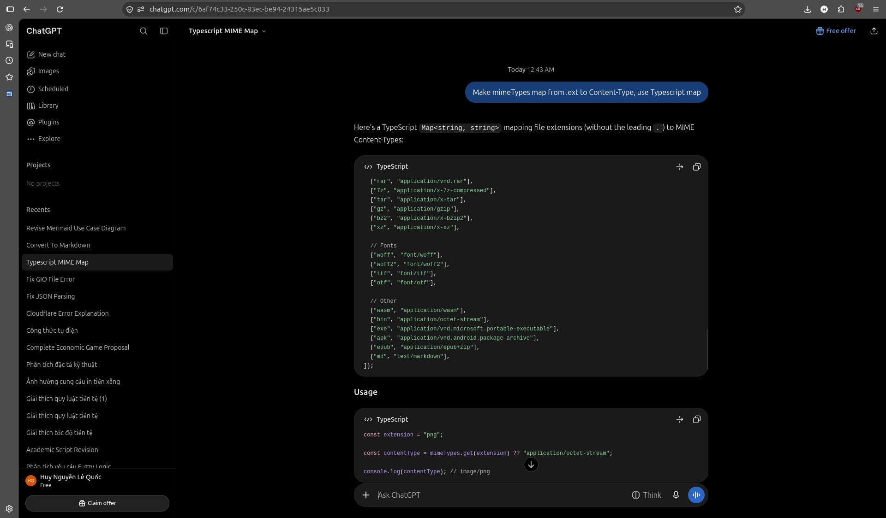
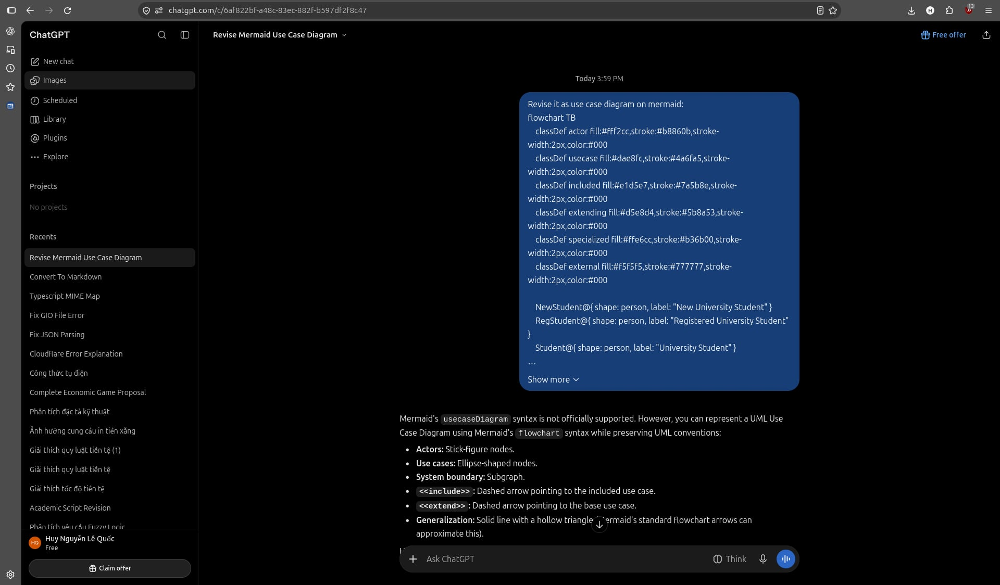
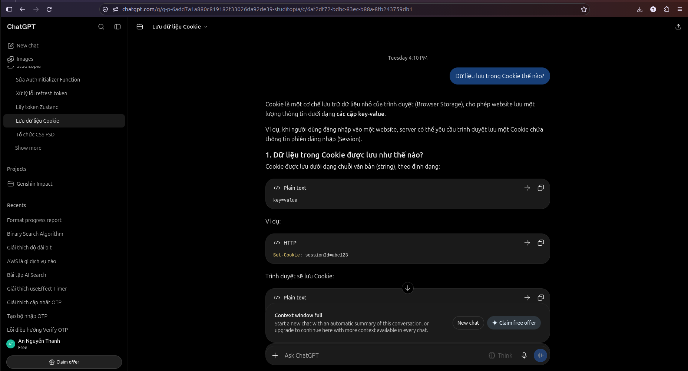
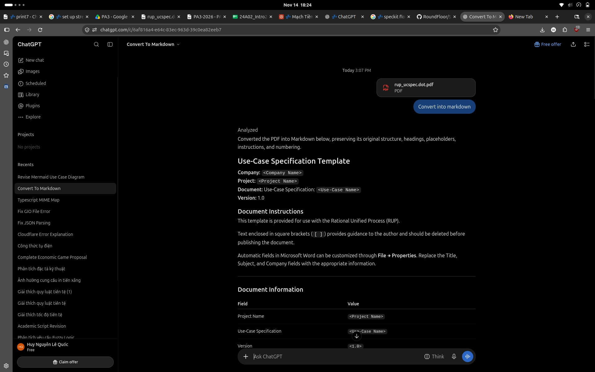
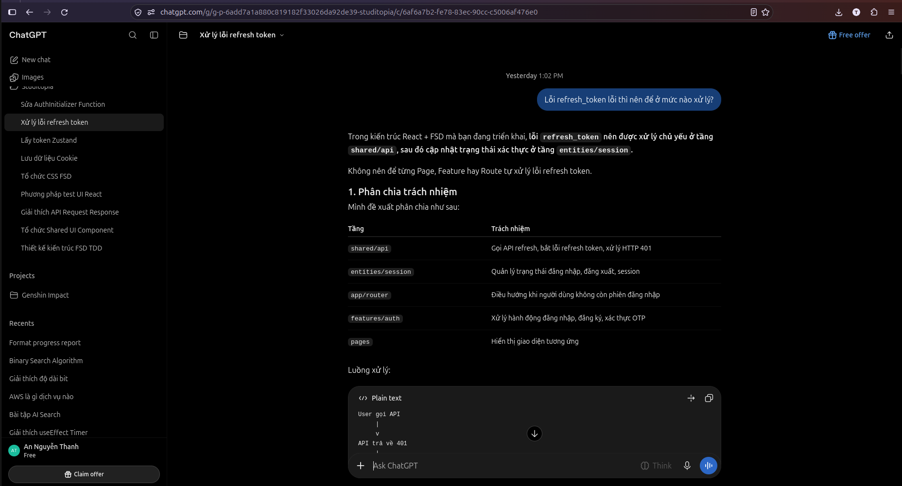
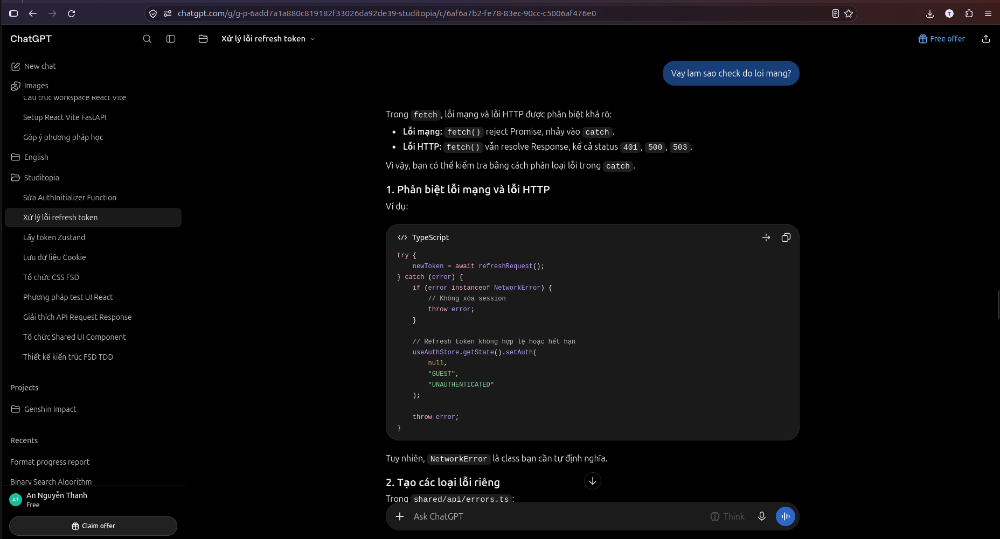

# AI Usage Notes

### Prompt 1

  

- **Tool:** ChatGPT (GPT6-Luna), OpenAI — chat.openai.com
- **Accessed:** 12:46, Nov 14, 2026
- **Prompt:** "Make mimeTypes from .ext to Content-Type, use TypeScript map"
- **Purpose:** To understand how to map file extensions to MIME types for the HTTP `Content-Type` header.
- **AI Output:** Generated a TypeScript map linking file extensions to their corresponding MIME types.

### Prompt 2

  

- **Tool:** ChatGPT (GPT6-Luna), OpenAI — chat.openai.com
- **Accessed:** 3:59, Nov 14, 2026
- **Prompt:** "Revise it as use case diagram on mermaid ... mermaid use-case diagram code..."
- **Purpose:** To revise the use-case diagram and check its correctness.
- **AI Output:** Suggested a way to represent a use-case diagram using Mermaid, which does not natively support use-case diagrams.

### Prompt 3

  

- **Tool:** ChatGPT (GPT6-Luna), OpenAI — chat.openai.com
- **Accessed:** 16:10, Nov 10, 2026
- **Prompt:** "Dữ liệu lưu trong Cookie như thế nào?"
- **Purpose:** To understand how the backend sets cookies on the client, particularly for storing refresh tokens.
- **AI Output:** Explained the syntax and configuration required to allow the backend to set cookies in the frontend.

### Prompt 4

  

- **Tool:** ChatGPT (GPT6-Luna), OpenAI — chat.openai.com
- **Accessed:** 15:07, Nov 14, 2026
- **Prompt:** "Convert into markdown. (Provide file rup_ucspec.dot.pdf)"
- **Purpose:** To convert the teacher's PDF template for use-case diagrams and specifications into Markdown.
- **AI Output:** Generated a Markdown template for use-case specifications.

### Prompt 5

  

- **Tool:** ChatGPT (GPT6-Luna), OpenAI — chat.openai.com
- **Accessed:** 13:02, Nov 13, 2026
- **Prompt:** "Lỗi refresh token thì để mức nào xử lý"
- **Purpose:** To determine which application layer should handle errors returned by the refresh-token API.
- **AI Output:** Generated a table describing the responsibilities of each application layer.

### Prompt 6

  

- **Tool:** ChatGPT (GPT6-Luna), OpenAI — chat.openai.com
- **Accessed:** 13:06, Nov 13, 2026
- **Prompt:** "Vậy làm sao check lỗi do mạng"
- **Purpose:** To understand how to identify errors caused by network connectivity.
- **AI Output:** Provided explanations, guidance, and sample code for distinguishing and handling network errors.