# Overview

## **1 Project Name**

Studitopia: representing an ideal world of learning. It describes a place where studying is inspiring, enjoyable, and meaningful, encouraging people to explore knowledge, grow their potential, and achieve their dreams.

## **2 Purpose**

Studitopia is a collaborative academic forum and social learning platform designed for university students. Its primary purpose is to give students a centralized place to discuss coursework, ask academic questions, share study materials, and collaborate with peers from their own university, major, and courses. The platform is built around a university-focused forum rather than a general-purpose social network, so every discussion can be organized around the academic context that matters to students.

The forum is structured at three academic levels: **University**, **Major**, and **Course**. This hierarchy lets students move from broad university-wide conversations to focused discussions about a specific major or course. Within each forum, students can publish three types of posts:

- **Discussion Posts** let students ask questions, describe academic problems, and discuss topics through text, images, and interactive content.
- **Material Posts** let students upload and share learning resources such as lecture notes, slides, past exams, and documents.
- **Functional Posts** provide interactive academic tools such as immediate quizzes, prerequisite trees, and dynamic computations.

Forum participation is supported by comments and answers, upvotes and downvotes, marking a true or accepted response, saving posts, reporting content, and moderation tools. Search and recommendation help students discover trending discussions, relevant posts, and materials connected to their university, major, courses, and interests.

The forum is reinforced by a learning resource library, study planning and course management tools, and friend and group messaging. Meeting rooms remain available as a secondary, optional collaboration space for study groups and project teams; they support the forum rather than define the platform. By prioritizing structured academic discussion, Studitopia helps university students learn from one another, reuse academic resources, and build meaningful academic connections.

## **3 Target Users**

Studitopia is designed primarily for university students who want to learn, discuss, and share academic knowledge within a collaborative virtual environment.

- **University Students (Primary):** Ask academic questions, discuss course content, share and retrieve study materials, prepare for examinations, and connect with peers who share the same university, major, or courses.
- **University Academic Communities:** Participate in university-, major-, and course-specific forums, contribute learning resources, and preserve knowledge across student generations.
- **Study Groups and Project Teams (Secondary):** Use forum discussions, shared materials, friend groups, and optional meeting rooms to coordinate coursework and collaborate on projects.

Studitopia focuses on the university context. Features such as university email domains, university and major profiles, course-based forums, and course-aware recommendations are designed to keep discussions relevant to each student's academic journey.

### **4 Product Scope**

The system consists of the following major modules, ordered by priority:

1. Authentication Account
2. Account and Profile Management
3. University Forum Management (Primary)
4. Post Creation and Management
5. Comment, Answer, and Voting
6. Forum Moderation and Safety
7. Search and Discovery
8. Learning Resource Library
9. Study Planning and Course Management
10. Friend and Group Management
11. Meeting Room (Supporting)
12. Notifications

```mermaid
flowchart TB
    subgraph ForumGroup["Forum - Primary Focus"]
        direction TB
        Forum["University Student Forum"]
        Forum --> ForumLevel["Academic Scope"]
        ForumLevel --> FUniversity(("University"))
        FUniversity --> FMajor(("Major"))
        FMajor --> FCourse(("Course"))

        Forum --> FPost["Post"]
        FPost --> FDiscuss["Discussion Post"]
        FPost --> FMaterial["Material Post"]
        FPost --> FFunctional["Functional Post"]

        FDiscuss --> FComment["Comment / Answer"]
        FComment --> FTrueResponse["Mark True Response"]
        FComment --> FCommentVote["Vote"]
        FPost --> FPostVote["Upvote / Downvote"]
        FPost --> FPostManage["Save / Delete / Report"]
        FPost --> FModeration["Moderation / Ban"]

        FFunctional --> FPrereq["Prerequisite Tree"]
        FFunctional --> FQuiz["Immediate Quiz"]
        FFunctional --> FCompute["Dynamic Computation"]
    end

    subgraph DiscoveryGroup["Search and Discovery"]
        direction TB
        Discovery["Search and Discovery"]
        Discovery --> DSearch["Search"]
        DSearch --> DTag(("Tag"))
        DSearch --> DContent(("Content"))
        DSearch --> DUser(("User"))

        Discovery --> DRecommend["Recommend"]
        DRecommend --> DTrend(("Top trending"))
        DRecommend --> DUserInfo(("University / major / course relevance"))
        DRecommend --> RecommendPost["Post"]
        DRecommend --> RecommendMaterial["Material"]
        DRecommend --> RecommendFriend["Friend"]
        DRecommend --> RecommendRoom["Room (secondary)"]
    end

    subgraph PlanGroup["Study Planning and Course Management"]
        direction TB
        Plan["Study Planning"]
        Plan --> PlanningSchedule["Study Schedule"]
        Plan --> CourseManage["Course Management"]
        CourseManage --> CoursePlanning["Course planning"]
        CourseManage --> CourseSetting["My Course settings"]
        CourseManage --> CourseCredit["Credit computing"]
    end

    subgraph LibraryGroup["Learning Resource Library"]
        direction TB
        Library["Learning Resource Library"]
        Library --> LibSearch["Search"]
        LibSearch --> LibTag(("Tag"))
        LibSearch --> LibTitle(("Title"))

        Library --> LibRecommend["Recommend"]
        LibRecommend --> LibTrend(("Top reading"))
        LibRecommend --> LibUserInfo(("User relevance"))
        LibRecommend --> LibUserProgress(("Course progressing"))

        Library --> LibMaterials["Material"]
        LibMaterials --> LibUpload(("Upload"))
        LibMaterials --> LibDownload(("Download"))
    end

    subgraph FriendGroup["Friend and Group Management"]
        direction TB
        Friend["Friend and Group Management"]
        Friend --> ManageFriend["Friend / Unfriend"]
        Friend --> FriendPosts["Friend Post and Comment"]
        Friend --> ManageGroup["Create / Delete Group (Private | Public)"]
        ManageFriend --> FriendMessage["Message / Material"]
        ManageGroup --> FriendMessage
    end

    subgraph ProfileGroup["Profile Management"]
        direction TB
        Profile["Profile Management"]
        Profile --> Preference["Preference settings"]
        Profile --> IndividualInfo["University, Major info"]
    end

    subgraph AuthenticationGroup["Authentication"]
        direction TB
        Authentication["Authentication"]
        Authentication --> Login
        Authentication --> Logout
        Authentication --> Register
    end

    subgraph MeetingGroup["Meeting Room - Supporting"]
        direction TB
        Meetings["Meeting Room and Study Session"]
        Meetings --> ManageRoom["Create / Delete / Configure"]
        Meetings --> StudyRoom["Study Room"]
        Meetings --> HallRoom["Hall Room"]
        StudyRoom --> MRoom["Room"]
        HallRoom --> MRoom
        MRoom --> MTools["Tool"]
        MTools --> MCommonTools["Whiteboard, Voice, Message, Timer, Note, Share Screen"]
        MTools --> MBehavior["Hand wave"]
    end
```

### **5 Product Goals**

The specific goals of the platform are to:

- **Make Academic Discussion Central:** Provide a university-focused forum where students can ask questions, discuss coursework, and exchange knowledge at university, major, and course levels.
- **Facilitate Knowledge Sharing:** Let students share, discover, and reuse learning materials across courses, majors, universities, and student generations.
- **Support University Study Planning:** Help students understand course prerequisites, visualize their academic pathways, and calculate credits to plan their studies effectively.
- **Improve Resource Accessibility:** Provide a searchable learning library that allows students to efficiently find and retrieve relevant educational materials.
- **Strengthen Academic Connections:** Help university students discover peers with similar courses and interests, find study partners, and build meaningful academic relationships.
- **Support Focused Collaboration:** Use friend groups, private messaging, and optional meeting rooms to help study groups and project teams coordinate when forum discussion is not enough.
- **Build a University Learning Community:** Foster an environment where university students learn from one another, exchange experiences across generations, and support each other's academic development.

Ultimately, Studitopia aims to make structured academic collaboration the core of university student life by bringing forum discussion, educational resources, peer connections, and optional live collaboration together in one accessible platform.
