# User Story

> The Forum is the primary product focus of Studitopia. Meeting-room user stories are supporting capabilities and are placed after the forum, library, and friend stories.

## 1. Navigation

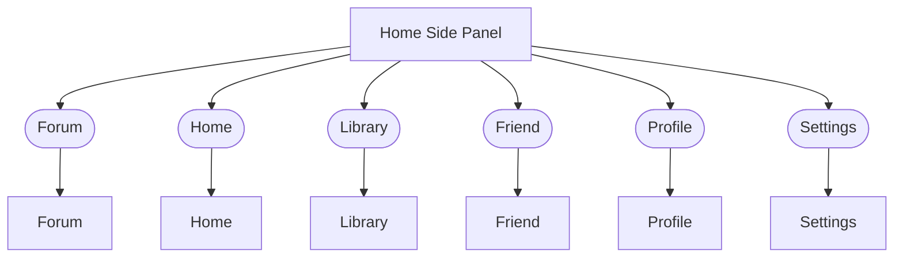

## 2. Authentication Account

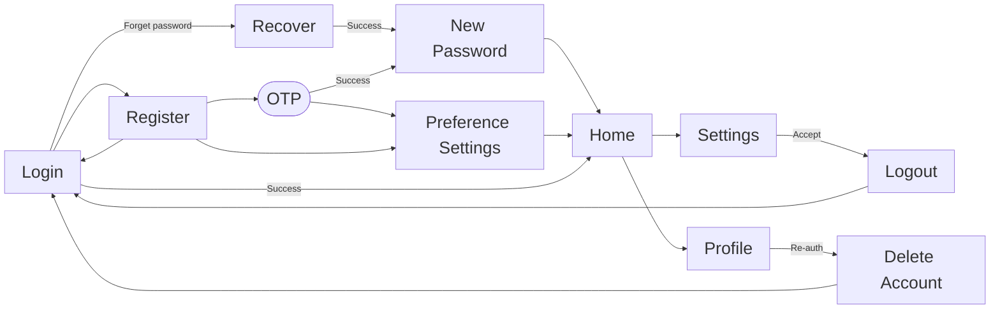

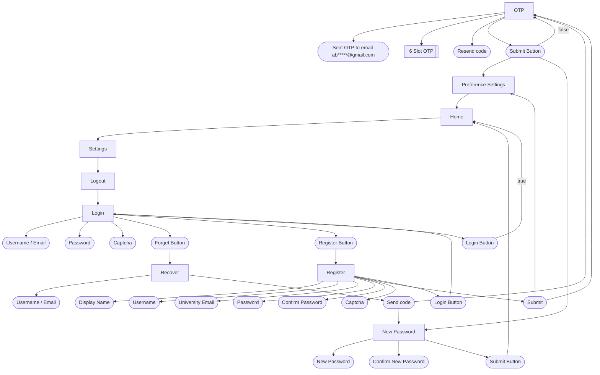

### 2.1 US-01: Register Account

**As a** new university student, **I want to** create an account, **so that** I can access the university forum and collaborative learning platform.

| Criterion | Requirement |
| --- | --- |
| AC-01.1 (Parameter Requirement) | The system must require Display Name, Username, Email, Password, and Confirm Password. |
| AC-01.2 (Email Validation) | The system must require a valid university email address. |
| AC-01.3 (Username Validation) | The system must verify that the username is unique and contains only alphanumeric characters. |
| AC-01.4 (Password Validation) | The password must contain at least 8 characters, including at least 1 lowercase letter, 1 uppercase letter, 1 number, and 1 special character. |
| AC-01.5 (Confirmed Password Validation) | The Confirm Password field must match the Password field. |
| AC-01.6 (Password Visibility) | The Password and Confirm Password fields are hidden by default and support a visibility toggle. |
| AC-01.7 (Email Verification) | The system must send a verification OTP to the university email before enabling full account access. |
| AC-01.8 (Duplicate Check) | The system must display an error message if the email or username is already registered. |
| AC-01.9 (CAPTCHA Verification) | The system must require successful CAPTCHA verification before submitting the registration request. |
| AC-01.10 (University Domain) | The system must validate that the email domain belongs to a supported university or faculty when university email registration is used. |
| AC-01.11 (Google Registration) | The system must allow users to register using their Google account through a "Continue with Google" button. |
| AC-01.12 (UI Validation) | Ensure that all UI appears exactly as designed. |
| AC-01.13 (Navigation Validation) | Ensure that all navigation buttons work correctly. |

### 2.2 US-02: Login

**As a** registered university student, **I want to** log in to my account, **so that** I can access my profile, university forum, posts, and learning activities.

| Criterion | Requirement |
| --- | --- |
| AC-02.1 (Credential Validation) | Users can authenticate successfully using registered credentials (email/username and password). |
| AC-02.2 (Error Handling) | Clear error messaging is shown for invalid credential combinations without revealing which specific field was incorrect. |
| AC-02.3 (Session Persistence) | The system must support a "Remember Me" option to maintain the user session across browser restarts. |
| AC-02.4 (CAPTCHA Verification) | The system must require successful CAPTCHA verification before submitting the login request. |
| AC-02.5 (Login by Google) | The system must allow users to log in using their Google account through a "Continue with Google" button. |
| AC-02.6 (UI Validation) | Ensure that all UI appears exactly as designed. |
| AC-02.7 (Navigation Validation) | Ensure that all navigation buttons work correctly. |

### 2.3 US-03: Logout

**As a** logged-in user, **I want to** log out of my account, **so that** I can protect my account security when I am done using the platform or on a shared device.

| Criterion | Requirement |
| --- | --- |
| AC-03.1 (Token and Cookie Cleanup) | On logout, the system must clear all authentication tokens and temporary user data stored in local and session storage. |
| AC-03.2 (Session Invalidation) | On logout, the system must invalidate the user's active session on the backend. |
| AC-03.3 (UI Validation) | Ensure that all UI appears exactly as designed. |
| AC-03.4 (Navigation Validation) | Ensure that all navigation buttons work correctly. |

### 2.4 US-04: Automatic Logout

**As a** user, **I want** the system to automatically log me out after 15 minutes of inactivity, **so that** my account remains secure when I leave my session unattended.

| Criterion | Requirement |
| --- | --- |
| AC-04.1 (Automatic Logout) | Given the user has successfully logged in, when the system receives no requests from the user for 15 consecutive minutes, the system automatically terminates the session and logs the user out. |
| AC-04.2 (Access After Session Expiration) | Given the user's session has expired, when the user attempts to access a protected page or API, the system denies access and requires the user to log in again. |
| AC-04.3 (Session Reset on Activity) | Given the user is logged in, when a new qualifying request is received before the timeout, the inactivity timer is reset. |
| AC-04.4 (Session Expiration Message) | Given the user's session has expired, when the user is redirected to the login page, the system displays a message informing them that the session expired. |

### 2.5 US-05: Recover Password

**As a** registered user, **I want to** recover or reset my password, **so that** I can regain access to my account if I forget my password.

| Criterion | Requirement |
| --- | --- |
| AC-05.1 (Parameter Requirement) | The system must accept a registered email address or username. |
| AC-05.2 (OTP Delivery) | The system must send a time-limited OTP to the registered email address. |
| AC-05.3 (Non-Enumeration Protection) | Requesting a reset for a non-existent account must return the identical generic success message to prevent user enumeration. |
| AC-05.4 (New Password Validation) | The new password must satisfy the password security policy. |
| AC-05.5 (Confirmed Password Validation) | The Confirm New Password field must match the New Password field. |
| AC-05.6 (Session Invalidation) | Completing a password reset must automatically log out all active sessions across all devices. |

### 2.6 US-06: Delete Account

**As a** registered user, **I want to** permanently delete my account, **so that** my personal information, posts, and data are erased from the platform.

| Criterion | Requirement |
| --- | --- |
| AC-06.1 (Delete Account Confirmation) | When the user selects Delete Account, the system must display a confirmation dialog explaining the consequences of deletion. |
| AC-06.2 (Cancel Deletion) | The user must be able to cancel deletion, and the account must remain active. |
| AC-06.3 (Confirm Deletion) | When the user confirms deletion, the system must proceed with the account deletion process. |
| AC-06.4 (Authentication Before Deletion) | The system must require the user to re-authenticate through email OTP before permanently deleting the account. |
| AC-06.5 (Access Deleted Account) | If the user attempts to access a deleted account, the system must reject the request. |
| AC-06.6 (Session Invalidation) | Deleting an account must automatically log out all active sessions across all devices. |

### 2.7 US-07: OTP Validation

**As a** user, **I want to** receive a 6-digit One-Time Password (OTP) via email, **so that** I can verify my identity securely using a time-limited verification code.

| Criterion | Requirement |
| --- | --- |
| AC-07.1 (Generate and Send OTP) | The system generates a 6-digit numeric OTP and sends it to the user's registered email address. |
| AC-07.2 (OTP Expiration) | The OTP expires 5 minutes after it is generated. |
| AC-07.3 (Verify Valid OTP) | The system accepts a correct, unexpired OTP and allows the user to proceed. |
| AC-07.4 (Reject Invalid OTP) | The system rejects an incorrect OTP and displays an appropriate error message. |
| AC-07.5 (Reject Expired OTP) | The system rejects an expired OTP and informs the user that it has expired. |
| AC-07.6 (OTP Format Validation) | The system accepts only a 6-digit numeric code. |
| AC-07.7 (Resend OTP) | The system can generate and send a new OTP, and the previous OTP becomes invalid. |
| AC-07.8 (Prevent OTP Reuse) | The system rejects an OTP that has already been used. |

## 3. Profile Management

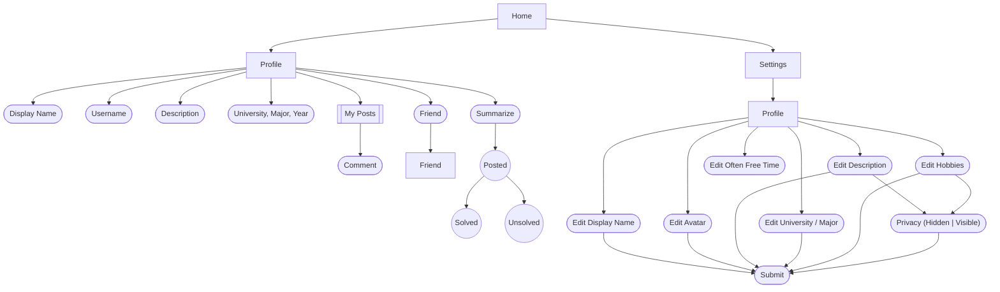

### 3.1 US-08: Manage Profile

**As a** university student, **I want to** create and update my profile, **so that** other users can understand my academic background and interests.

| Criterion | Requirement |
| --- | --- |
| AC-08.1 (Profile Details) | Users can add and update an avatar, short bio, display name, university, major, and academic year. |
| AC-08.2 (University Selection) | Users can select their university and major from the supported catalog. |
| AC-08.3 (Preview) | Users can preview how their profile appears to other platform members before saving changes. |
| AC-08.4 (Persistence) | Profile changes must save immediately and reflect across all active sessions. |
| AC-08.5 (Avatar Validation) | Avatar uploads must accept only valid image formats (PNG, JPG, WEBP), enforce a maximum size of 5MB, and auto-crop to a 1:1 aspect ratio. |
| AC-08.6 (Content Moderation) | Display names and bio text must pass automated profanity filters before changes are saved. |

### 3.2 US-09: Set Learning Preferences

**As a** university student, **I want to** specify my courses, subjects, interests, and learning goals, **so that** the platform can recommend relevant forum discussions and resources.

| Criterion | Requirement |
| --- | --- |
| AC-09.1 (Course Selection) | Users can select their current courses from the supported course catalog. |
| AC-09.2 (Subject Selection) | Users can select subjects and topics of interest as checkboxes or tags. |
| AC-09.3 (Learning Goals) | Users can specify learning goals and preferred study times. |
| AC-09.4 (Recommendation Use) | The system must use these preferences to recommend forum posts, materials, study partners, and optional rooms. |
| AC-09.5 (Update Preferences) | Users can update their preferences at any time. |

### 3.3 US-10: Manage Privacy

**As a** user, **I want to** control the visibility of my personal information, **so that** I can protect my privacy while using the platform.

| Criterion | Requirement |
| --- | --- |
| AC-10.1 (Field-Level Controls) | Users can configure visibility (Visible, Hidden) for profile elements such as study history, habits, and contact information. |
| AC-10.2 (Searchability) | Users can opt out of appearing in public discovery or study-partner search results. |
| AC-10.3 (Online Status) | Users can show or hide their online status and last-active time. |
| AC-10.4 (Forum Privacy) | Privacy settings must be respected when displaying user information in posts, comments, and member lists. |

## 4. Social Forum Management (Primary)

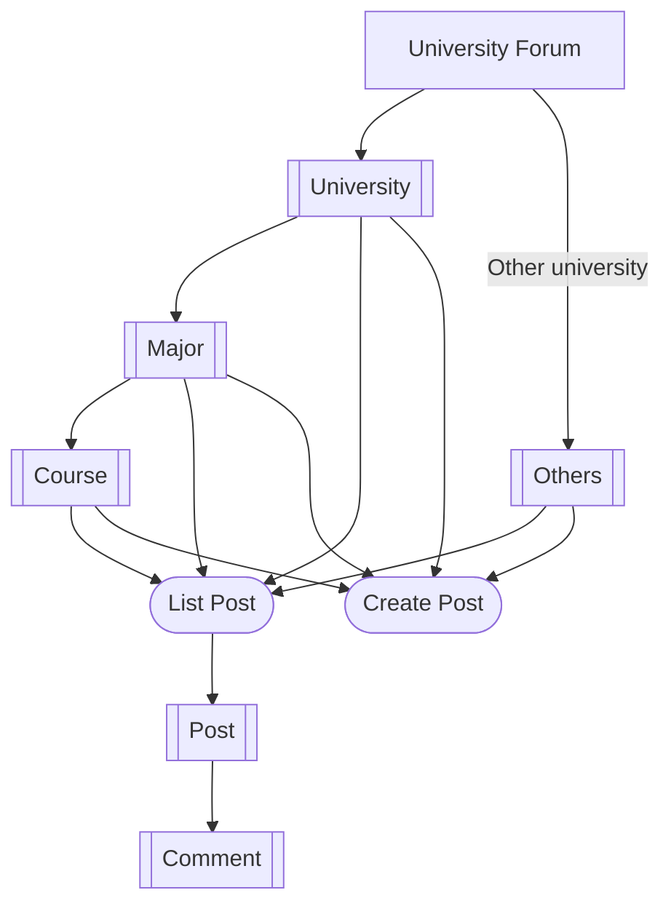

### 4.1 US-11: Access the University Forum

**As a** university student, **I want to** access the university forum, **so that** I can explore academic discussions related to my university and courses.

| Criterion | Requirement |
| --- | --- |
| AC-11.1 (Default Forum) | After login, the user's university forum is available as the primary destination. |
| AC-11.2 (Forum Entry) | The system must display a visible Forum entry in the main navigation. |
| AC-11.3 (Other Universities) | Users can browse other university forums when permitted. |
| AC-11.4 (Forum Context) | The system must keep the selected university as the default forum context. |

### 4.2 US-12: Browse University, Major, and Course Forums

**As a** university student, **I want to** browse forums by university, major, and course, **so that** I can find discussions relevant to my academic program.

| Criterion | Requirement |
| --- | --- |
| AC-12.1 (University to Major) | Selecting a university displays the majors offered by that university. |
| AC-12.2 (Major to Course) | Selecting a major displays the courses associated with that major. |
| AC-12.3 (Course Forum) | Selecting a course opens the course forum and its posts. |
| AC-12.4 (Context Switching) | Users can switch between university, major, and course forums easily. |
| AC-12.5 (Relevant Content) | Each forum level displays only posts and materials relevant to that level. |

### 4.3 US-13: View the List of Posts

**As a** university student, **I want to** view a list of posts within the selected forum, **so that** I can discover discussions relevant to my interests.

| Criterion | Requirement |
| --- | --- |
| AC-13.1 (Post List) | The system displays posts for the selected university, major, or course forum. |
| AC-13.2 (Post Summary) | Each item displays title, author, post type, timestamp, vote score, comment count, and solved status. |
| AC-13.3 (Filtering) | Users can filter by My Post, area, university, major, course, tags, and post type. |
| AC-13.4 (Sorting) | Users can sort by newest, top trending, most voted, and most discussed. |
| AC-13.5 (Empty State) | If no posts match the filters, the system displays an appropriate empty state and offers to clear filters. |

## 5. Post Management

```mermaid
flowchart TD
	Posts[["Post"]]
	Posts --> Delete(["Delete / Hide"])
	Posts --> Upvote(["Upvote"])
	Posts --> Downvote(["Downvote"])
	Posts --> Save(["Save"])
	Posts --> Owner(["Owner"])
	Posts --> Time(["Time"])
	Posts --> Comment(["Comment"]) --> |See / Make| TrueResponse(["True Response"])

	Posts --> DiscussPost[["Discussion Post"]]
	Posts --> MaterialPost[["Material Post"]]
	Posts --> FunctionalPost[["Functional Post"]]

	FunctionalPost --> Quiz(["Quiz"]) --> DoQuiz(["Do"])
	FunctionalPost --> PrerequisiteTree(["Prerequisite Tree"])
	PrerequisiteTree --> AutoApply(["Auto Apply"])
	PrerequisiteTree --> Simulate(["Simulate by Click"])

	CreatePost(["Create Post"]) --> CDiscussPost[["Discussion Post"]]
	CDiscussPost --> CText(["Text"]) --> CLatex(["Latex"])
	CDiscussPost --> CImage(["Image"])
	CDiscussPost --> CTitle(["Title"])
	CDiscussPost --> InteractiveBox(["Interactive Box"])

	CreatePost --> CMaterial[["Material Post"]]
	CMaterial --> CFiles(["Files"])
	CMaterial --> CMTitle(["Title"])
	CMaterial --> Description(["Description"])

	CreatePost --> CFunctional[["Functional Post"]]
	CFunctional --> FTitle(["Title"])
	CFunctional --> CQuiz(["Quiz"])
	CFunctional --> CPrerequisiteTree(["Prerequisite Tree"])

	CDiscussPost & CMaterial & CFunctional ==> SubmitButton(["Submit"])
```

### 5.1 US-14: Create Discussion Post

**As a** university student, **I want to** create a discussion post in a selected forum, **so that** I can share my academic problem and ask for solutions.

| Criterion | Requirement |
| --- | --- |
| AC-14.1 (Post Content) | The post supports a title, text, LaTeX, images, and tags. |
| AC-14.2 (Post Type) | The user can mark the post as a question or a general discussion. |
| AC-14.3 (Forum Context) | The post is associated with the selected university, major, and course. |
| AC-14.4 (Validation) | The system validates the post content before submission. |
| AC-14.5 (Publication) | After submission, the post appears in the corresponding forum post list. |

### 5.2 US-15: Create Material Post

**As a** university student, **I want to** create a material post, **so that** I can share learning resources with other students in my forum.

| Criterion | Requirement |
| --- | --- |
| AC-15.1 (Material Content) | The post supports a title, description, files, and subject tags. |
| AC-15.2 (File Validation) | Uploaded files are validated for type and size before acceptance. |
| AC-15.3 (Forum Context) | The material is associated with the selected university, major, and course. |
| AC-15.4 (Access) | Published materials are accessible to users who can view the forum. |
| AC-15.5 (Library Listing) | The material may also appear in the learning resource library when applicable. |

### 5.3 US-16: Create Functional Post

**As a** university student, **I want to** create a functional post with an interactive academic tool, **so that** I can help others practice or understand course content.

| Criterion | Requirement |
| --- | --- |
| AC-16.1 (Functional Tool) | The post supports an immediate quiz, prerequisite tree, or dynamic computation. |
| AC-16.2 (Quiz Builder) | Quizzes support multiple-choice or single-choice questions, options, answers, and scores. |
| AC-16.3 (Prerequisite Tree) | Prerequisite trees can be created manually or generated from a source file. |
| AC-16.4 (Interaction) | Other users can interact with the published functional tool. |
| AC-16.5 (Forum Context) | The functional post is associated with the selected forum context. |

### 5.4 US-17: View Post Detail

**As a** university student, **I want to** view posts and their details, **so that** I can read shared content and find information relevant to my interests.

| Criterion | Requirement |
| --- | --- |
| AC-17.1 (Full Content) | The system displays the full content of the selected post. |
| AC-17.2 (Metadata) | The system displays the author, post type, forum context, timestamp, vote score, and tags. |
| AC-17.3 (Discussion) | The system displays comments, answers, and the marked true response. |
| AC-17.4 (Actions) | Available actions are displayed according to the user's permissions. |
| AC-17.5 (Attachments and Tools) | Material attachments and functional tools are displayed when present. |

## 6. Forum Interaction

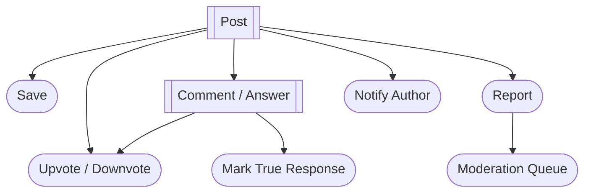

### 6.1 US-18: Comment and Answer

**As a** university student, **I want to** comment on posts and answer questions, **so that** I can discuss ideas and help other students.

| Criterion | Requirement |
| --- | --- |
| AC-18.1 (Comment) | Users can comment on a discussion post. |
| AC-18.2 (Answer) | Users can answer a question post. |
| AC-18.3 (Replies) | The system supports nested replies where applicable. |
| AC-18.4 (Own Content) | Users can edit or delete their own comments and answers. |
| AC-18.5 (Notification) | The post author is notified when a new comment or answer is added. |

### 6.2 US-19: Vote on Posts and Comments

**As a** university student, **I want to** vote on posts and comments, **so that** useful academic content is easier to discover.

| Criterion | Requirement |
| --- | --- |
| AC-19.1 (Post Vote) | Users can upvote or downvote a post. |
| AC-19.2 (Comment Vote) | Users can upvote or downvote a comment or answer. |
| AC-19.3 (Single Vote) | A user cannot vote more than once on the same post or comment. |
| AC-19.4 (Change Vote) | Users can change or remove their vote. |
| AC-19.5 (Score Update) | The vote score and ranking update after a vote is recorded. |

### 6.3 US-20: Mark True Response

**As a** post author, **I want to** mark a comment or answer as the true response, **so that** other students can quickly find the accepted solution.

| Criterion | Requirement |
| --- | --- |
| AC-20.1 (Mark Response) | The post author can mark one comment or answer as the true response. |
| AC-20.2 (Solved Status) | The post is marked as solved when a true response is selected. |
| AC-20.3 (Prominent Display) | The true response is displayed prominently under the post. |
| AC-20.4 (Change Response) | The author can change the true response when necessary. |
| AC-20.5 (Notification) | The author of the selected answer is notified that their answer was accepted. |

### 6.4 US-21: Save Post

**As a** university student, **I want to** save posts, **so that** I can return to useful discussions and materials later.

| Criterion | Requirement |
| --- | --- |
| AC-21.1 (Save) | Users can save a post. |
| AC-21.2 (Saved List) | The system provides a list of the user's saved posts. |
| AC-21.3 (Remove) | Users can remove a post from their saved list. |
| AC-21.4 (Persistence) | Saved posts remain available regardless of the current forum context. |

### 6.5 US-22: Report and Moderate Forum Content

**As a** university student or moderator, **I want to** report and moderate inappropriate forum content, **so that** the forum remains safe and academically useful.

| Criterion | Requirement |
| --- | --- |
| AC-22.1 (Report Flow) | Users can report a post, comment, or answer with a category such as spam, harassment, inappropriate content, or academic dishonesty. |
| AC-22.2 (Moderation Queue) | Reports are routed to a moderation queue with contextual information. |
| AC-22.3 (Moderator Actions) | Moderators can hide, delete, restore, or ban content and users according to forum policy. |
| AC-22.4 (Action Record) | Moderation actions are recorded and affected users are notified when appropriate. |
| AC-22.5 (Restriction Enforcement) | Moderated users cannot bypass restrictions through new posts or comments. |

## 7. Forum Search and Recommendation

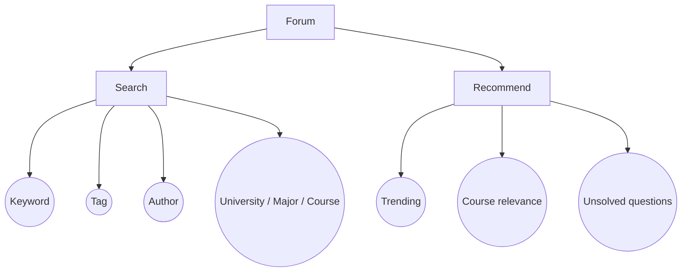

### 7.1 US-23: Search the Forum

**As a** university student, **I want to** search the forum, **so that** I can find discussions and materials related to my academic needs.

| Criterion | Requirement |
| --- | --- |
| AC-23.1 (Keyword Search) | Users can search posts by keyword. |
| AC-23.2 (Search Fields) | Search supports tags, title, content, author, university, major, and course. |
| AC-23.3 (Filtering) | Results can be filtered by post type, solved status, and time range. |
| AC-23.4 (Ranking) | Results are ranked by relevance and engagement. |
| AC-23.5 (Empty State) | The system displays an appropriate empty state when no results match. |

### 7.2 US-24: Receive Forum Recommendations

**As a** university student, **I want to** receive forum recommendations, **so that** I can discover discussions that matter to my courses and interests.

| Criterion | Requirement |
| --- | --- |
| AC-24.1 (Relevant Posts) | The system recommends posts relevant to the user's university, major, courses, and interests. |
| AC-24.2 (Trending) | The system recommends trending posts within the user's academic context. |
| AC-24.3 (Unsolved Questions) | The system recommends unsolved questions where the user may be able to help. |
| AC-24.4 (Dismissal) | Users can dismiss irrelevant recommendations. |
| AC-24.5 (Refresh) | Recommendations refresh when the user's preferences or forum context change. |

## 8. Learning Resource Library

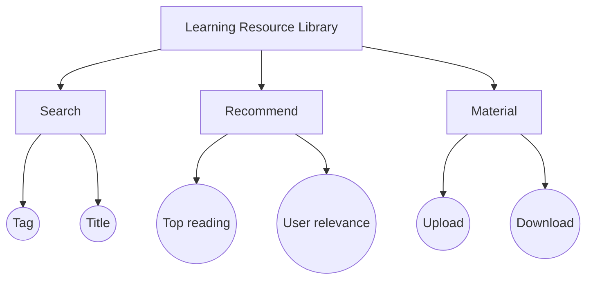

### 8.1 US-25: Find Learning Resources

**As a** university student, **I want to** search for books and learning resources, **so that** I can find materials related to my courses.

| Criterion | Requirement |
| --- | --- |
| AC-25.1 (Library Search) | Keywords search title, author, subject tags, and descriptions. |
| AC-25.2 (Filtering) | Results can be filtered by format and subject field. |
| AC-25.3 (Ratings) | Search results display aggregate ratings and review counts when available. |
| AC-25.4 (Academic Relevance) | The library displays resources related to the user's university, major, and courses. |

### 8.2 US-26: Receive Resource Recommendations

**As a** university student, **I want to** receive recommendations for books and learning resources, **so that** I can discover useful materials related to my subjects.

| Criterion | Requirement |
| --- | --- |
| AC-26.1 (Suggestions) | The system displays recommended materials based on the user's preferences and courses. |
| AC-26.2 (Bookmarking) | Users can save recommended items to a personal list. |
| AC-26.3 (Cold Start) | New users receive curated foundational resources based on their selected subjects. |

### 8.3 US-27: Share Learning Resources

**As a** university student, **I want to** share learning resources, **so that** I can help others access useful materials.

| Criterion | Requirement |
| --- | --- |
| AC-27.1 (Publish) | The resource becomes searchable in the library after publication. |
| AC-27.2 (Details) | Users can provide a title, description, subject tags, and course tags. |
| AC-27.3 (Access) | Other users can view and access published resources according to privacy settings. |

### 8.4 US-28: View My Storage

**As a** university student, **I want to** see my published resources, **so that** I can track how many views and accesses they receive.

| Criterion | Requirement |
| --- | --- |
| AC-28.1 (Storage View) | The system provides a personal storage view for published resources. |
| AC-28.2 (Statistics) | The system displays view and access counts for each resource. |
| AC-28.3 (Status) | The system displays publication status and date. |

### 8.5 US-29: Delete My Published Resource

**As a** university student, **I want to** delete a resource I published, **so that** I can remove content I no longer want to share.

| Criterion | Requirement |
| --- | --- |
| AC-29.1 (Delete) | Users can delete their own published resources. |
| AC-29.2 (Confirmation) | The system requires confirmation before deletion. |
| AC-29.3 (Removal) | The deleted resource is removed from search and library listings. |
| AC-29.4 (Access Restriction) | Other users cannot access a deleted resource. |

## 9. Friends and Social Networking

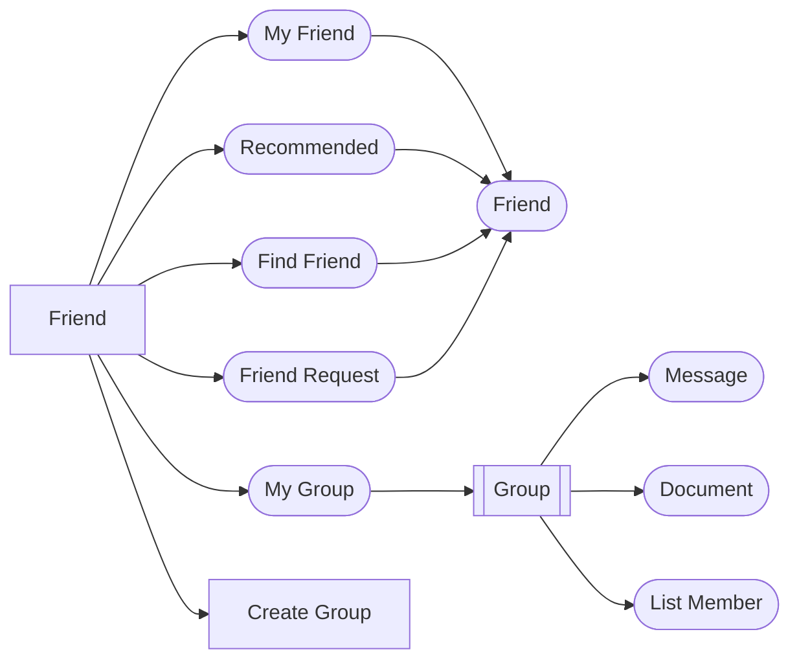

### 9.1 US-30: Find a Study Partner

**As a** university student, **I want to** find users with similar courses and learning goals, **so that** I can establish useful academic connections.

| Criterion | Requirement |
| --- | --- |
| AC-30.1 (Search and Filter) | Users can search the member directory by subjects, goals, learning pace, and language. |
| AC-30.2 (Profile Summary) | Search results display concise profile cards with mutual academic interests. |
| AC-30.3 (Mutual Connections) | The system displays mutual friends or shared forum contexts when available. |

### 9.2 US-31: Send Friend Request

**As a** university student, **I want to** send a friend request, **so that** we can maintain a connection for future learning activities.

| Criterion | Requirement |
| --- | --- |
| AC-31.1 (Request Trigger) | Users can send a friend request from profile cards or member lists. |
| AC-31.2 (Duplicate Prevention) | Duplicate requests between the same users are prevented. |
| AC-31.3 (Custom Note) | Users can attach an introductory note of up to 200 characters. |
| AC-31.4 (Notification) | The recipient is notified of the friend request. |

### 9.3 US-32: Manage Friend Requests

**As a** user, **I want to** accept or reject incoming friend requests, **so that** I can control my social connections.

| Criterion | Requirement |
| --- | --- |
| AC-32.1 (Request Center) | A centralized view displays incoming friend requests with profile details. |
| AC-32.2 (Accept/Decline) | Accepting adds the user to the friend list; declining removes the pending request. |
| AC-32.3 (Block Option) | When declining, the user can block future requests from the sender. |

### 9.4 US-33: Create and Manage Friend Groups

**As a** university student, **I want to** create and manage friend groups, **so that** I can collaborate privately with classmates and project teams.

| Criterion | Requirement |
| --- | --- |
| AC-33.1 (Group Creation) | Users can create a private or public group with a name and initial members. |
| AC-33.2 (Group Sharing) | Group members can send messages and share documents within the group. |
| AC-33.3 (Member Management) | Members can view the member list and invite new members. |
| AC-33.4 (Owner Controls) | The group owner can remove members when necessary. |
| AC-33.5 (Leave Group) | Members can leave the group. |

## 10. Supporting Meeting Rooms (Secondary)

> Meeting rooms are optional supporting features. The forum remains the primary collaboration space.

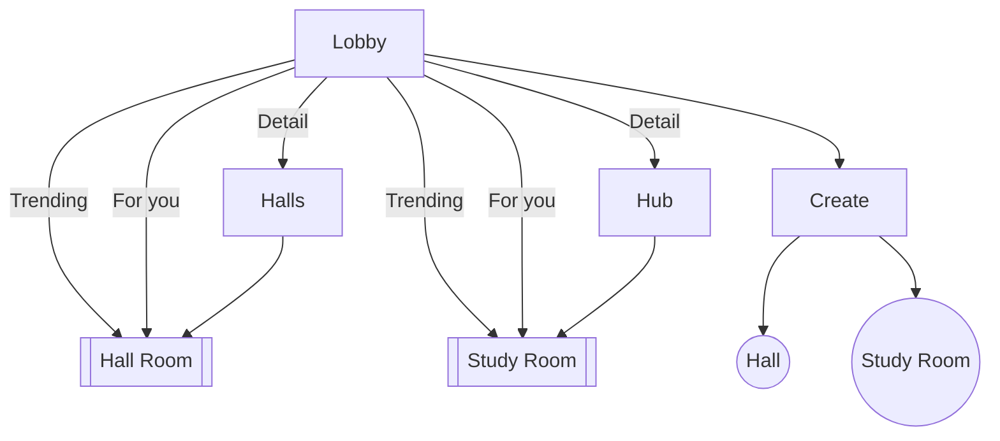

### 10.1 US-34: Receive Room Recommendations

**As a** university student, **I want to** receive optional study-room recommendations, **so that** I can find a room when I need live collaboration.

| Criterion | Requirement |
| --- | --- |
| AC-34.1 (Recommendations) | The system recommends study rooms based on courses, interests, and preferred study times. |
| AC-34.2 (Availability) | Recommendations display room availability and capacity. |
| AC-34.3 (Dismissal) | Users can dismiss irrelevant room suggestions. |

### 10.2 US-35: Join or Create a Study Room

**As a** university student, **I want to** join or create a study room, **so that** I can collaborate with classmates in real time when needed.

| Criterion | Requirement |
| --- | --- |
| AC-35.1 (Public Room) | Users can join a public room with available capacity. |
| AC-35.2 (Private Room) | Users can request access to a private or custom room. |
| AC-35.3 (Request Management) | Room owners or managers can accept or reject join requests. |
| AC-35.4 (Creation) | Users can create a room with a name, description, privacy level, and supported tools. |
| AC-35.5 (Configuration) | Managers can configure capacity, duration, and communication rules. |

### 10.3 US-36: Use Shared Study Tools

**As a** university student, **I want to** use shared study tools in a room, **so that** I can collaborate on academic problems with other participants.

| Criterion | Requirement |
| --- | --- |
| AC-36.1 (Whiteboard) | The room provides a shared whiteboard. |
| AC-36.2 (Notes) | The room provides shared notes. |
| AC-36.3 (Timer) | The room provides a shared timer. |
| AC-36.4 (Synchronization) | Shared tool updates are synchronized for all room participants. |
| AC-36.5 (Export) | Users can export whiteboard content when supported. |
| AC-36.6 (Reconnection) | Shared notes handle reconnection without data loss. |

### 10.4 US-37: Request Learning Help

**As a** university student, **I want to** request learning help, **so that** I can receive assistance from friends, room participants, or concept learners.

| Criterion | Requirement |
| --- | --- |
| AC-37.1 (Help Request) | Users can create a help request with a title, subject, description, and attachments. |
| AC-37.2 (Recipients) | Users can send the request to friends, room participants, or concept learners. |
| AC-37.3 (Response) | Other learners can accept or decline the help request. |
| AC-37.4 (Cancellation) | The requester can cancel the help request. |
| AC-37.5 (Forum Conversion) | A help request can be converted into a forum post for asynchronous discussion. |
| AC-37.6 (Rate Limit) | The system rate-limits help requests to prevent spam. |

## 11. Notifications and Safety

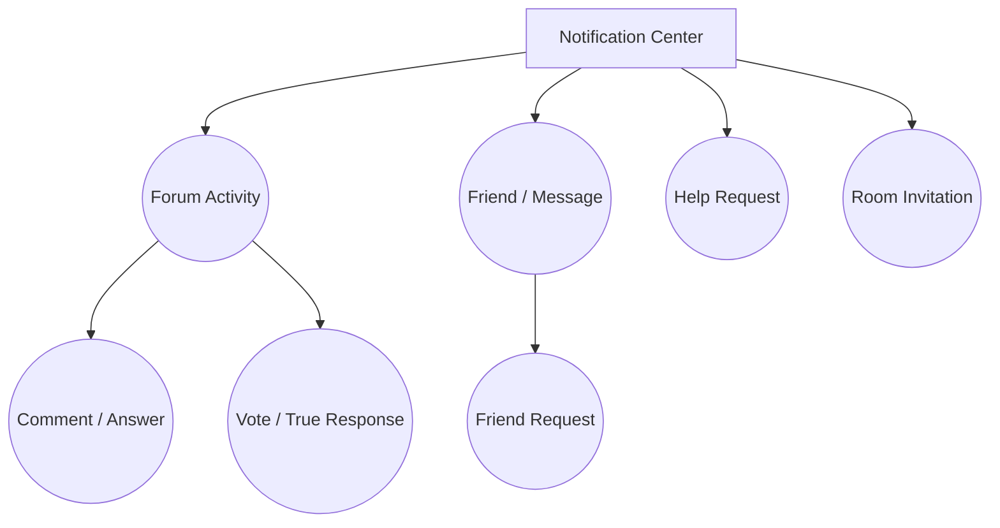

### 11.1 US-38: Receive Notifications

**As a** user, **I want to** receive notifications about relevant activities, **so that** I do not miss important academic interactions.

| Criterion | Requirement |
| --- | --- |
| AC-38.1 (In-App Center) | The system displays real-time toasts and a persistent notification tray with unread indicators. |
| AC-38.2 (Forum Notifications) | Notifications include comments, answers, votes, true-response marks, and mentions. |
| AC-38.3 (Social Notifications) | Notifications include friend requests, messages, group invitations, and help requests. |
| AC-38.4 (Room Notifications) | Room invitations are shown only when the user enables room notifications. |
| AC-38.5 (Granularity) | Users can choose which notification types trigger alerts and whether audio alerts are enabled. |
| AC-38.6 (Mark as Read) | Users can mark notifications as read. |

### 11.2 US-39: Control Communication

**As a** user, **I want to** control my communication and privacy settings, **so that** other users cannot interact with me in ways I do not permit.

| Criterion | Requirement |
| --- | --- |
| AC-39.1 (Block and Mute) | Users can mute or permanently block specific members from messaging, friend requests, or room invitations. |
| AC-39.2 (Communication Limits) | Users can restrict direct messages to confirmed friends. |
| AC-39.3 (Privacy Settings) | Users can control their communication and privacy settings at any time. |

### 11.3 US-40: Report Inappropriate Behavior

**As a** user, **I want to** report inappropriate communication or behavior, **so that** the platform can maintain a safe and supportive learning environment.

| Criterion | Requirement |
| --- | --- |
| AC-40.1 (Report Flow) | Users can report profiles, posts, comments, messages, and other users. |
| AC-40.2 (Categories) | Reports support categories such as harassment, spam, and inappropriate content. |
| AC-40.3 (Moderation Routing) | Reports capture contextual information and route to the moderation queue. |
| AC-40.4 (Review) | Moderators can review and act on reports according to platform policy. |
