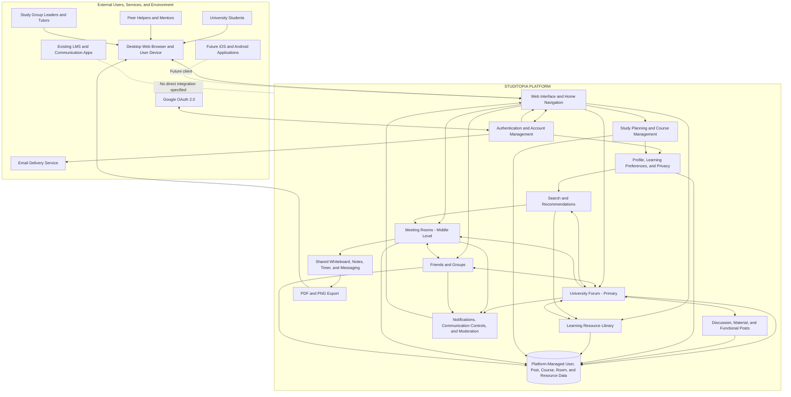
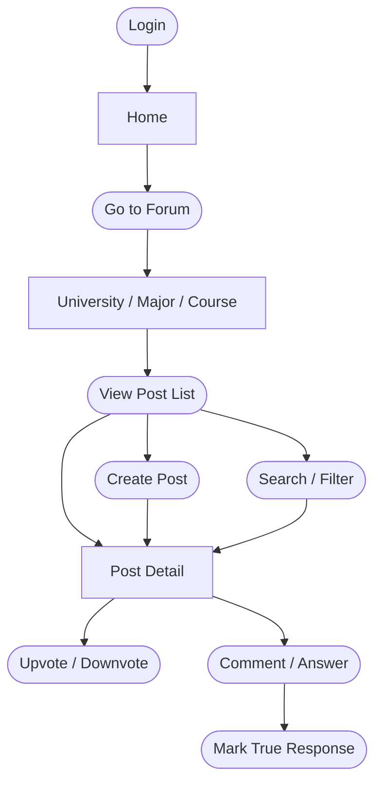
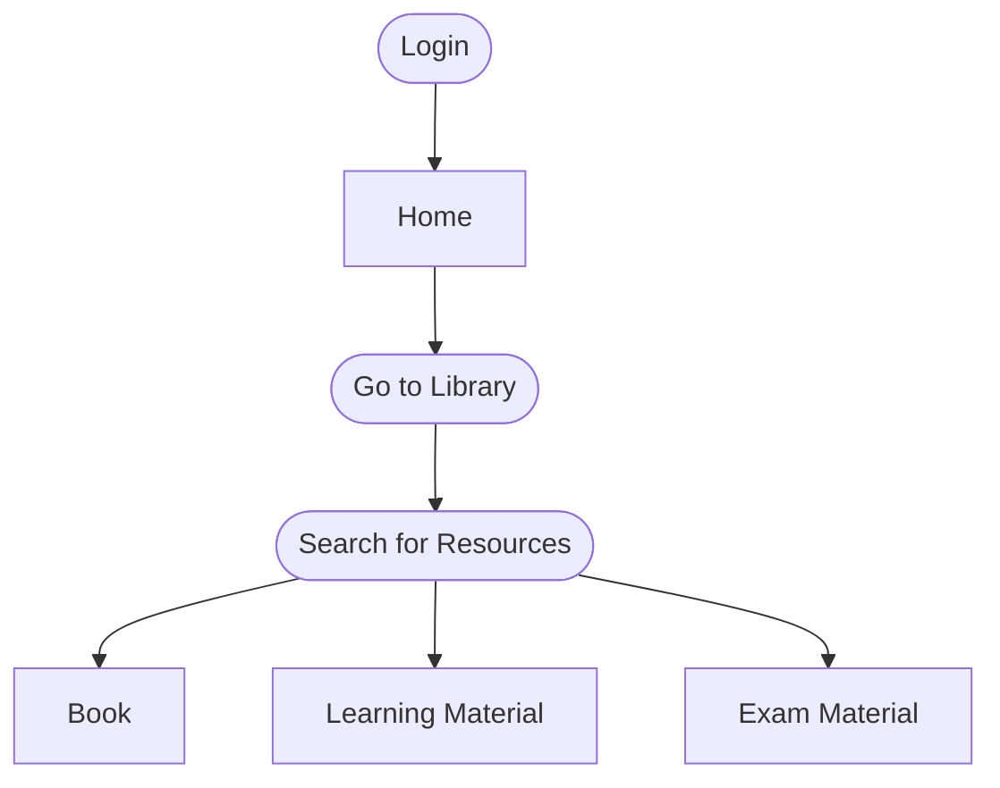
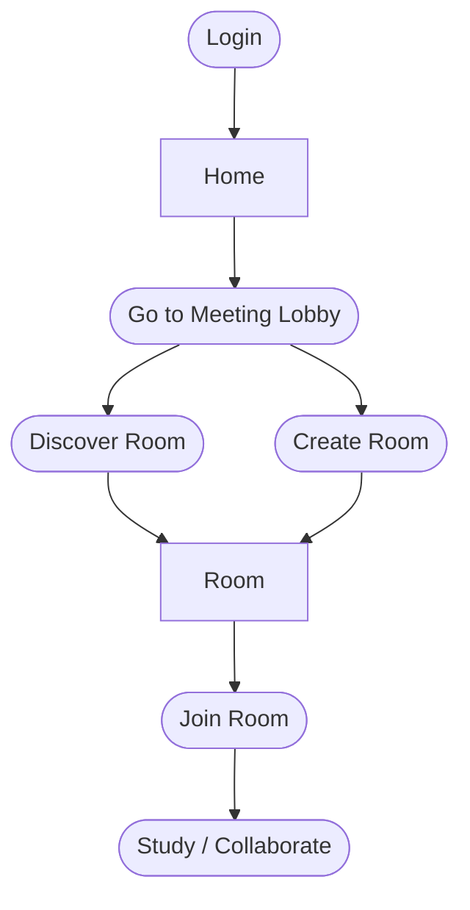

# Vision Document

### **Version:** <2.2>

---

## Revision History

| Date | Version | Description | Author |
| --- | --- | --- | --- |
| 27/10 | 0.1 | Initial raw of document | Nguyen Le Quoc Huy |
| 28/10 | 0.2 | Added "2. Positioning" | Tran Nguyen Khanh Binh |
| 29/10 | 0.3 | Added "3. Stakeholder and User Descriptions" | Tran Nguyen Khanh Binh |
| 29/10 | 0.4 | Added "4. Product Overview" | Nguyen Le Quoc Huy |
| 29/10 | 1.0 | Added "5. Product Features" | Nguyen Le Quoc Huy |
| 30/10 | 1.1 | Revised stakeholder and product sections | Nguyen Le Quoc Huy |
| 11/11 | 2.0 | Updated for PA3: Forum-first and university focus; meeting rooms restored at middle level | Nguyen Le Quoc Huy |
| 12/11 | 2.1 | Updated for PA3: Added additional authentication-related NFRs | Tran Nguyen Khanh Binh |
| 12/11 | 2.2 | Updated for PA3: Added some environmental constraints | Tran Nguyen Khanh Binh |

## 1. Introduction

**Performed by:** [Binh] | **Reviewed by:** [Huy] | **Edited by:** [Binh]

The purpose of this document is to collect, analyze, and define the high-level needs and features of **Studitopia**. It focuses on the capabilities needed by stakeholders and target users and explains why these needs exist. The details of how Studitopia fulfills these needs are described in the use-case and supplementary specifications.

The introduction provides an overview of the entire document, including its purpose and references.

### 1.1 References

This subsection provides a complete list of all documents referenced elsewhere in the Vision Document.

| Document Title | Report Number | Date | Publishing Organization | Source |
| --- | --- | --- | --- | --- |
| Studitopia Overview | 1 | 14/11/2026 | Round Floor | PA3 proposals/overview.md |
| Studitopia User Story | 2 | 14/11/2026 | Round Floor | PA3 proposals/userstory.md |
| Studitopia Functional Requirement | 3 | 14/11/2026 | Round Floor | PA3 proposals/functional_requirement.md |
| Studitopia Non-functional Requirement | 4 | 14/11/2026 | Round Floor | PA3 proposals/non_functional_requirement.md |
| Studitopia Screen Flow | 5 | 14/11/2026 | Round Floor | PA3 proposals/screen_flow.md |
| Studitopia Feature Flow | 6 | 14/11/2026 | Round Floor | PA3 proposals/feature_flow.md |
| Studitopia Changes | 7 | 14/11/2026 | Round Floor | PA3 Changes.md |

---

## 2. Positioning

**Performed by:** [Binh] | **Reviewed by:** [Huy] | **Edited by:** [Binh]

### 2.1 Problem Statement

**The problem of:**

Lack of an integrated, university-focused environment where academic discussions, course-based resource discovery, and optional live study collaboration are unified in a single workspace.

**Affects:**

University students, academic communities, study groups, and project teams who seek efficient peer collaboration, structured study materials, and focused study spaces.

**The impact of which is:**

Students suffer from study isolation, scattered learning resources across disconnected tools, fragmented study context, and difficulty finding instant peer help or matching study partners, leading to reduced learning productivity and lower study consistency.

**A successful solution would be:**

- A forum-centric knowledge ecosystem where every discussion thread is connected to a university, major, and course context.
- A seamless bridge between problem-solving threads and a curated, long-term searchable library.
- Structured focus environments that remain available as a middle-level option, with basic shared tools such as whiteboards, synchronized notes, and timers.

### 2.2 Product Position Statement

**For:**

University students and academic communities looking for an engaging, context-driven online study environment.

**Who:**

Need an all-in-one platform to solve academic problems asynchronously, access verified learning materials, and collaborate with study groups when live interaction is useful.

**"Studitopia" is a:**

Forum-centric collaborative learning and social platform for university students.

**That:**

Unifies asynchronous academic discussions, curated resource repositories, and optional live study rooms into a single study space.

**Unlike:**

Generic social messaging platforms such as Discord, which rely on unstructured, noisy text channels and lack native academic workflows, integrated focus tools, and structured resource indexing.

**Our product:**

Organizes the entire learning experience around university, major, and course forum threads. Users can attach context-specific resources, discuss academic problems, build a community-curated library, and use basic meeting rooms when live collaboration is needed.

---

## 3. Stakeholder and User Descriptions

**Performed by:** [Binh] | **Reviewed by:** [Huy] | **Edited by:** [Binh]

To effectively provide products and services that meet stakeholders' and users' real needs, it is necessary to identify and involve all stakeholders as part of the requirements modeling process.

This section provides a profile of the stakeholders and users involved in the project and the key problems they perceive to be addressed by the proposed solution.

### 3.1 Stakeholder Summary

| Name | Description | Responsibilities |
| --- | --- | --- |
| **Product Owner and Product Manager** | Leads the software vision and oversees the project roadmap, scope execution, and delivery milestones. | Define the product vision and prioritize the feature backlog. Monitor project progress and delivery schedules. Ensure alignment with market demand and unique selling points. |
| **Software Development Team** | The technical team responsible for writing, testing, and maintaining the application source code, databases, and APIs. | Implement application features, UI, and backend logic. Perform code reviews, unit testing, and bug fixes. Ensure code maintainability and structural scalability. |
| **Operations and Maintenance Team** | The group responsible for maintaining software stability, server infrastructure, bug fixes, optimization, and deployment pipelines. | Ensure high system availability and operational performance. Monitor server loads, connections, and database constraints. |
| **Trust and Safety Team** | The operations team responsible for enforcing community guidelines, reviewing reported content, and maintaining a safe learning space. | Review user reports on inappropriate posts, documents, or messages. Audit automated content filters. Issue warnings, suspensions, or permanent bans. |

### 3.2 User Summary

| Name | Description | Responsibilities | Stakeholder |
| --- | --- | --- | --- |
| **University Student** | Primary end user who uses the platform to study, ask questions, and collaborate with classmates. | Participate in university, major, and course forum discussions. Ask and answer academic questions. Share and retrieve learning materials. Optionally join basic meeting rooms. | Product Owner |
| **Peer Helper and Mentor** | Experienced student or subject expert who actively assists others by answering forum threads and providing study guidance. | Answer learning-problem posts on the forum. Mark useful answers and nominate high-quality documents for the Library. Optionally provide live help in meeting rooms. | Trust and Safety Team |
| **Study Group Leader and Tutor** | User who creates, structures, and manages study groups, schedules study sessions, and coordinates group learning. | Create and configure basic meeting rooms when needed. Approve or reject room join requests. Manage group resources and collaborative workspaces. | Product Owner |

### 3.3 User Environment

- **Primary Operating Environment (Forum):**
    - **Home Feed:** The core user landing page and primary interface is an interactive university forum feed where discussions, learning problems, attached resources, and optional room links are unified.
    - **Navigation by Context:** Users initiate primary learning activities, such as asking questions, searching for past solved problems, viewing attached study documents, or joining a basic meeting room, from specific forum threads.
- **Task Participation and Scale:**
    - **Asynchronous Forum Activity:** Individual learners create, reply to, and upvote academic discussion threads or search the community knowledge base.
    - **Optional Meeting Rooms:** Users can join basic live study rooms from a forum post or lobby when live collaboration is useful. Meeting rooms are a middle-level feature.
    - **System Capacity:** The system architecture supports at least 10,000 registered users, 100,000 forum posts, 1,000,000 comments and votes, 100,000 uploaded documents, 500 concurrent active forum users, and 100 concurrent optional meeting rooms.
- **Task Cycles and Activity Durations:**
    - **Short Cycle (5-15 minutes):** Browsing the forum feed, posting quick learning problems, uploading contextual problem attachments, or upvoting accepted solutions.
    - **Medium Cycle (25-50 minutes):** Joining a basic live study room attached to a forum thread for study sessions using synchronized timers and shared whiteboards.
    - **Long Cycle (1-3 hours):** In-depth collaborative problem solving, multi-topic forum discussions, and group study meetings.
- **Environmental Constraints:**
    - **Data Synchronization and Fallback:** Forum text inputs and shared notes require automatic local buffer saves to prevent data loss during network disruptions.
    - **Strict Latency & Response Standards:** Unattended sessions automatically expire after 15 minutes of inactivity. Shared files in temporary meeting rooms are permanently deleted from storage within 5 minutes of room closure.
    - **Session & Data Lifecycle Rules**: Unattended sessions automatically expire after 15 minutes of inactivity. Shared files in temporary meeting rooms are permanently deleted from storage within 5 minutes of room closure
- **System Platforms and Technical Ecosystem:**
    - **Current Platforms:** Standard Desktop browsers (Google Chrome, Mozilla Firefox, Microsoft Edge, and Apple Safari).
    - **Future Expected Platforms:** Native mobile applications for iOS and Android for push notifications on forum replies and help requests.
    - **Complementary Applications in Use:** Personal note-taking tools (Notion and Obsidian), external chat applications (Discord and Messenger), and university LMS portals (Canvas and Moodle).
    - **Integration Requirements:** Google OAuth 2.0 for single-click registration and login. Email delivery for OTP verification and password recovery.

### 3.4 Summary of Key Stakeholder or User Needs

| Need | Priority | Concerns | Current Solution | Proposed Solutions |
| --- | --- | --- | --- | --- |
| **University Forum Discussion and Post Features** | Highest (Rank 1) | General messaging platforms rely on unstructured, noisy text channels where learning discussions and problem contexts quickly get buried and lost. | Using Discord servers or social group chats alongside separate cloud drive links, resulting in notification fatigue and lost study context. | A **University Forum Home Feed** where every academic discussion thread is organized by university, major, and course, with contextual resources and structured posts. |
| **Resource Management and Retention** | High (Rank 2) | Files and notes uploaded in casual chat feeds are temporary, unorganized, and often deleted or lost over time. | Manually saving files to personal storage or searching back through unstructured chat histories. | **Thread-to-Library Promotion**, allowing high-quality forum documents and solution breakdowns to be upvoted, verified, and permanently indexed in a searchable subject Library. |
| **Forum Interaction and Peer Assistance** | High (Rank 3) | Students get stuck on specific academic problems without an efficient, structured way to request help from qualified peers. | Posting static questions in general social channels or forums and waiting hours for text replies. | **Comments, Answers, Voting, and True-Response Marking** that make useful responses easier to find and recognize. |
| **Optional Live Study Collaboration** | Medium (Rank 4) | Some study groups need live interaction, but full meeting-room complexity is not the primary product focus. | Turning off microphones and cameras in standard voice channels or using third-party timers independently. | **Basic Meeting Rooms at Middle Level**, featuring room discovery, create or join, shared whiteboards, synchronized notes, and timers. |
| **Targeted Notifications** | Medium (Rank 5) | Notifications and room announcements get lost in standard chat feeds, causing users to miss study sessions or urgent help requests. | Relying on noisy mentions or separate calendar and chat applications, leading to notification spam and ignored alerts. | **Targeted In-App Notifications** filtered by user preferences, subject tags, and active forum context. |

### 3.5 Alternatives and Competition

| Alternative or Competitor | Description | Strengths | Weaknesses |
| --- | --- | --- | --- |
| Discord | Popular real-time voice, video, and text communication platform structured around servers and channels. | High existing user adoption and familiarity among students. Powerful, low-latency voice and video streaming. Large bot ecosystem for basic study timers and audio bots. | Unstructured text channels lead to noisy feeds and lost study attachments. Lacks native academic tools. Designed primarily for gaming and socializing, leading to high distraction potential. |
| Maintain the Status Quo (University LMS and Messenger or WhatsApp) | Using university Learning Management Systems such as Canvas or Moodle alongside standard messaging applications for group work. | Zero adoption barrier because students already use them. Official institutional compliance for coursework delivery and grading. | Highly fragmented study experience across multiple disconnected applications. LMS forums are static and clunky. Messaging applications lack study tools, structured forums, and privacy controls for meeting new peers. |
| Dedicated Focus Applications (Yeolpumta or Focusmate) | Virtual study camera rooms and focus tracker applications designed for solo study and body doubling. | Strong gamification, time tracking, and study streak statistics. High accountability for deep focus and solo study sessions. | Strictly limited to time tracking and camera feeds without integrated problem-solving forums. Lacks collaborative academic tools such as shared whiteboards, synchronized notes, or resource libraries. |
| Building an In-House University Study Portal | Custom-built web portals developed internally by academic institutions for their student bodies. | Tailored specifically to internal curriculum and single sign-on systems. High data privacy control and direct institutional moderation. | High initial development and ongoing maintenance costs. Typically features outdated UI and UX. Lacks interactive whiteboards and cross-institutional peer networks. |

---

## 4. Product Overview

**Performed by:** [Huy] | **Reviewed by:** [Binh] | **Edited by:** [Huy]

Studitopia is a forum-centric collaborative learning and social networking platform that brings academic discussions, learning resources, study planning, optional virtual study environments, and social interaction into one environment.

### 4.1 Product Perspective

Studitopia is a standalone platform with its own user accounts, profiles, academic discussions, learning resource library, study-planning functions, basic meeting rooms, and social networking features. It is intended to coexist with university Learning Management Systems and communication applications that learners may already use.

The platform's main purpose is to connect activities that are often performed separately, allowing users to move between academic discussions, relevant resources, peer assistance, and optional collaborative study sessions while retaining the learning context.

The product consists of the following major functional components:

- **Authentication and Account Management:** Supports account registration, email OTP verification, login, logout, password recovery, account deletion, and session management. Google OAuth 2.0 is an optional authentication method. The confirmed inactivity timeout for an authenticated session is 30 minutes.
- **Profile, Learning Preferences, and Privacy:** Allows users to maintain profile information such as university, major, subjects, interests, learning habits, preferred study times, and learning goals. These details support personalized discovery and recommendations. Users can also manage visibility, online status, and communication preferences.
- **Academic and Social Forum (Primary):** Provides a space for users to publish and discuss learning topics. It supports Discussion Posts, Material Posts, and Functional Posts. Posts support comments, replies, votes, saved posts, true-response marking, report and moderation, and academic classification by university, major, and course.
- **Search and Discovery:** Allows users to search by tags, content, users, and course context, and to discover relevant posts, materials, rooms, and friends. Recommendations may consider trending activity, user relevance, profile preferences, interests, and courses in progress.
- **Learning Resource Library:** Provides a centralized collection where users can publish, search, access, and download learning resources. Resources include descriptive information such as titles, descriptions, subject tags, and course tags.
- **Study Planning and Course Management:** Supports course planning, personal course settings, credit computation, study schedules, and academic pathway planning. The proposal also identifies prerequisite trees.
- **Meeting Rooms (Middle Level):** Provides basic room discovery, room details, create or join room, and core collaboration tools. Meeting rooms are intentionally kept at a middle level: they are available when live collaboration is useful, but they are not the primary product focus and do not include the full advanced room ecosystem described in the earlier vision.
- **Conversational Learning Tools (Middle Level):** Supports basic shared whiteboards, shared notes, synchronized timers, and messaging inside meeting rooms. Advanced room policies, automatic matching, and complex room management remain optional and may be deferred.
- **Learning Help and Social Networking:** Enables learners to request help from friends, eligible learners in the same forum, or learners studying or interested in the same concept. Users can find study partners, send and manage friend requests, create public or private groups, exchange messages, and share documents.
- **Notifications, Privacy, and Trust and Safety:** Provides notifications for activities such as forum replies, votes, true-response marks, messages, friend requests, room invitations, and learning help requests. Users can control communication and privacy settings, block or mute other users, and report inappropriate behavior or content. Reports are routed for moderation.

### External Interfaces and Operating Environment

Studitopia is initially intended to be accessed through desktop web browsers, including Google Chrome, Mozilla Firefox, Microsoft Edge, and Apple Safari. Native applications for iOS and Android are identified as future platform extensions, not as confirmed requirements for the initial version.

The main external interfaces and interactions are:

- **Google OAuth 2.0:** Provides an optional Google-based registration and authentication path.
- **Email delivery service:** Sends OTP codes for email verification and password recovery.
- **Web browsers and user devices:** Provide access to the platform's user interface, forum features, basic meeting-room tools, and local storage used for supported buffering and synchronization behavior.
- **File export:** Supports exporting selected learning content, such as whiteboards and notes, to standard formats including PDF and PNG.
- **Existing LMS and communication applications:** Canvas, Moodle, Discord, Messenger, Notion, and Obsidian are identified as applications that users may already use. Direct integration with their APIs or institutional databases is not specified as a current requirement.

### 4.2 Assumptions and Dependencies

The development and operation of Studitopia depend on the assumptions and external conditions listed below. These assumptions describe the environment in which the proposed features are expected to operate. If an assumption changes or a dependency becomes unavailable, the product scope, requirements, or implementation plan may need to be revised.

| Assumption or Dependency | Description | Impact if Changed |
| --- | --- | --- |
| Desktop Web Browser Availability | The initial platform is expected to operate through desktop versions of Google Chrome, Mozilla Firefox, Microsoft Edge, and Apple Safari. | Changes in supported browsers may require compatibility testing, interface adjustments, or changes to supported features. |
| Internet Connectivity | Users are expected to have network access for online forums, resource retrieval, optional room participation, and basic real-time communication. | Unreliable connectivity may interrupt live collaboration, messaging, and resource access; synchronization behavior may need further refinement. |
| Google OAuth 2.0 Availability | Google OAuth 2.0 is an optional external authentication service for users who choose Google-based registration or login. | Changes to Google's service or authentication policies may affect Google-based account access. The platform must still support its non-Google authentication path. |
| Email Delivery Service | An operational email delivery service is required to send OTP codes for email verification and password recovery. | Email delivery failures may prevent users from completing verification or recovering their accounts. |
| User Devices and Browser Capabilities | Collaborative activities may require compatible browser and device capabilities for audio, video, screen sharing, and local storage. | Unsupported hardware or browser capabilities may limit access to specific meeting-room tools or reduce collaboration quality. |
| File Storage and Processing | The platform requires storage and processing capabilities for uploaded forum documents and published learning resources. | Storage limits, file-processing failures, or changes to permitted formats may affect document sharing, previews, downloads, and Library publishing. |
| File Safety Scanning | Uploaded documents are expected to undergo file validation and malware scanning before they become downloadable. | If scanning services are unavailable, the system may delay access to uploaded files or apply an alternative review process. |
| Community Participation and Moderation | The platform expects university students, peer helpers, mentors, and study group leaders to contribute discussions, learning resources, and assistance. | Low participation may reduce the usefulness of recommendations and peer assistance; insufficient moderation may reduce community safety and content quality. |
| System Capacity | The system architecture supports at least 10,000 registered users, 100,000 forum posts, 1,000,000 comments and votes, 100,000 uploaded documents, 500 concurrent forum users, and 100 concurrent optional meeting rooms. | Higher usage or larger room requirements may require additional infrastructure capacity and performance optimization. Capacity measures must be validated during testing. |
| External LMS and Communication Applications | Canvas, Moodle, Discord, Messenger, Notion, and Obsidian are identified as complementary applications used by target users. Direct integration is not currently specified. | Adding direct integrations later may require additional interfaces, authentication arrangements, data permissions, and agreements with external providers. |
| Middle-Level Meeting Room Scope | Meeting rooms are expected to provide basic discovery, participation, and core collaboration tools only. | If meeting-room scope expands, forum and post work may be delayed. Advanced room features may be deferred to future releases. |

---

## 5. Product Features

**Performed by:** [Huy] | **Reviewed by:** [Binh] | **Edited by:** [Huy]

| Feature ID | Feature Name | Description | Priority | Related Use Cases |
| --- | --- | --- | --- | --- |
| F-001 | Account Registration and Verification | New users create an account and complete identity verification before accessing platform services. | High | US-01.1 to US-01.6; US-07 OTP Validation |
| F-002 | Session Management | Registered users access their accounts and end their sessions when they finish using the platform. | High | US-02 Login; US-03 Logout; US-04 Automatic Logout |
| F-003 | Account Recovery and Deletion | Users regain access when they forget passwords and request permanent deletion of their accounts. | High | US-05 Recover Password; US-06 Delete Account |
| F-004 | Profile and University Identity | Users maintain personal and academic information, including their university, major, and academic year. | High | US-08 Manage Profile |
| F-005 | Learning Preferences and Privacy | Users manage subjects, interests, learning goals, and privacy controls. | High | US-09 Set Learning Preferences; US-10 Manage Privacy |
| F-006 | University Forum | The system provides a shared forum organized by university, major, and course. | High | US-11 Access the University Forum; US-12 Browse University, Major, and Course Forums |
| F-007 | Post Creation and Management | Users create Discussion Posts, Material Posts, and Functional Posts and manage their own content. | High | US-13 View the List of Posts; US-14 Create Discussion Post; US-15 Create Material Post; US-16 Create Functional Post; US-17 View Post Detail |
| F-008 | Post Interaction and Discussion | Users comment, answer, vote, save posts, and mark true responses. | High | US-18 Comment and Answer; US-19 Vote on Posts and Comments; US-20 Mark True Response; US-21 Save Post |
| F-009 | Forum Moderation and Safety | Users report content and moderators review and act on reports. | High | US-22 Report and Moderate Forum Content |
| F-010 | Search and Discovery | Users search forum content by keyword, tag, author, university, major, and course. | High | US-23 Search the Forum |
| F-011 | Personalized Recommendations | Users receive recommended posts and materials based on their academic context and interests. | High | US-24 Receive Forum Recommendations; US-26 Receive Resource Recommendations |
| F-012 | Learning Resource Library | Users discover, access, and retrieve books and learning resources. | High | US-25 Find Learning Resources; US-27 Share Learning Resources; US-28 View My Storage; US-29 Delete My Published Resource |
| F-013 | Study Partner Discovery | Users find other university students with similar courses, subjects, or learning goals. | Medium | US-30 Find a Study Partner |
| F-014 | Friend Connection Management | Users send, receive, accept, and decline friend requests. | Medium | US-31 Send Friend Request; US-32 Manage Friend Requests |
| F-015 | Group Collaboration | Users create, join, and manage public or private groups for ongoing collaboration. | Medium | US-33 Create and Manage Friend Groups |
| F-016 | Course and Study Planning | Learners organize academic progress through course planning and credit calculation. | Medium | Study Planning and Course Management |
| F-017 | Meeting Room Discovery and Access | Learners discover basic meeting rooms, view details, and create or join rooms. | Medium | US-34 Receive Room Recommendations; US-35 Join or Create a Study Room |
| F-018 | Meeting Room Collaboration Tools | Participants use basic shared whiteboards, shared notes, and synchronized timers. | Medium | US-36 Use Shared Study Tools |
| F-019 | Contextual Learning Assistance | Learners request academic help from friends, forum users, or learners interested in the same concept. | Medium | US-37 Request Learning Help |
| F-020 | Notifications | Users receive notifications about forum activity, social interactions, help requests, and optional room invitations. | High | US-38 Receive Notifications |
| F-021 | Trust, Safety, and Moderation | Users control unwanted interactions and report inappropriate behavior or content. | High | US-39 Control Communication; US-40 Report Inappropriate Behavior |

### Representative User Workflows

#### Forum Post Workflow (Primary)

#### Library Workflow

#### Meeting Room Workflow (Middle Level)

---

## 6. Non-Functional Requirements

**Performed by:** [Huy] | **Reviewed by:** [Binh] | **Edited by:** [Huy]

| Requirement ID | Category | Requirement Description | Priority | Stability | Benefit | Effort | Risk |
| --- | --- | --- | --- | --- | --- | --- | --- |
| NFR-001 | Performance | The system shall provide a response time of no more than 2 seconds for standard user actions under normal operating conditions. | High | High | High | Medium | Medium |
| NFR-002 | Performance | The system shall load a forum post list within no more than 2 seconds under normal operating conditions. | High | High | High | Medium | Medium |
| NFR-003 | Performance | The system shall display a post detail page and its comments within no more than 2 seconds. | High | High | High | Medium | Medium |
| NFR-004 | Performance | The system shall deliver forum notifications with a latency of no more than 2 seconds under normal operating conditions. | High | High | High | Medium | Medium |
| NFR-005 | Performance | Optional meeting-room tools shall synchronize standard updates with a latency of no more than 1 second when a room is in use. | Medium | High | Medium | High | Medium |
| NFR-006 | Scalability | The system architecture shall support at least 10,000 registered university users. | High | High | High | Medium | Medium |
| NFR-007 | Scalability | The system architecture shall support at least 100,000 forum posts. | High | High | High | Medium | Medium |
| NFR-008 | Scalability | The system architecture shall support at least 1,000,000 comments, answers, and votes. | High | High | High | Medium | Medium |
| NFR-009 | Scalability | The system architecture shall support at least 100,000 uploaded documents and learning resources. | High | High | High | High | Medium |
| NFR-010 | Scalability | The system architecture shall support at least 500 concurrent active forum users. | High | High | High | High | Medium |
| NFR-011 | Scalability | The system architecture shall support at least 100 concurrent optional meeting rooms. | Medium | High | Medium | High | Medium |
| NFR-012 | Availability | The system shall maintain at least 99.9% monthly availability, excluding planned maintenance. | High | High | High | High | High |
| NFR-013 | Security | The system shall require successful authentication before granting access to protected user accounts, personal information, and restricted platform resources. | High | High | High | Medium | Medium |
| NFR-014 | Security | The system shall store user passwords using secure one-way password hashing rather than storing plaintext passwords. | High | High | High | Medium | Medium |
| NFR-015 | Security | The system shall encrypt sensitive communications using Transport Layer Security version 1.2 or higher. | High | High | High | Medium | Medium |
| NFR-016 | Security | The system shall validate uploaded files according to permitted file types and file size limits before accepting them. Uploaded documents shall undergo malware and virus scanning before becoming available for download. | High | High | High | High | High |
| NFR-017 | Security | The system shall automatically terminate authentication sessions after 30 minutes of user inactivity and require authentication before granting further access to protected resources. | High | High | High | Medium | Medium |
| NFR-018 | Security | The system shall protect against common web application vulnerabilities, including Cross-Site Scripting and Cross-Site Request Forgery. | High | High | High | High | High |
| NFR-019 | Privacy | The system shall provide configurable privacy controls, including at least two profile visibility levels: public and private. Users shall also manage online status, friend requests, and shared document access. | High | High | High | Medium | Medium |
| NFR-020 | Robustness | The system shall automatically buffer shared note changes locally when network connectivity is interrupted and synchronize the changes after reconnection without data loss. | Medium | High | Medium | High | High |
| NFR-021 | Robustness | The system shall preserve user-entered forum text and supported inputs through local buffering mechanisms to reduce data loss during temporary network interruptions. | High | Medium | High | Medium | Medium |
| NFR-022 | File Compatibility | The system shall support common learning document formats, including PDF, DOCX, PNG, and JPG, for forum document sharing and Library access. The file size limit shall be configurable. | High | Medium | High | Medium | Medium |
| NFR-023 | External Integration | The system shall support Google OAuth 2.0 for users who choose Google-based registration or authentication. | Medium | High | Medium | Medium | Medium |
| NFR-024 | External Integration | The system shall support email delivery of one-time passwords for account verification and password recovery. | High | High | High | Medium | Medium |
| NFR-025 | Usability | The system shall maintain consistent navigation and interaction patterns across university, major, and course forums. | High | High | High | Medium | Medium |
| NFR-026 | Security | Passwords must enforce a minimum length of 8 characters, containing at least 1 lowercase letter, 1 uppercase letter, 1 number, and 1 special character. | High | High | High | Medium | High |
| NFR-027 | Security | Registration and login interfaces must require successful CAPTCHA verification before processing submissions to protect against brute-force and bot attacks. | Medium | High | High | Medium | High |
| NFR-028 | Security | Issued access and refresh tokens must use secure HMAC-SHA256 cryptographic signatures. | High | High | High | Medium | High |
| NFR-029 | Security | Verification codes for email validation, password recovery, or account actions must be 6-digit numeric OTPs that expire exactly 5 minutes after generation. | High | High | High | Medium | High |
| NFR-030 | Security | OTPs must be strictly single-use; verified codes cannot be reused, and requesting a new OTP must immediately invalidate all previously issued codes. | High | High | High | High | High |
| NFR-031 | Security | Failed login attempts must display generic error messages without revealing whether the username or the password was incorrect. | High | High | High | Medium | High |

---

### Summary of Decisions

| Decision | Section | Result |
| --- | --- | --- |
| Focus the product on the university forum | Section A and B | Forum and post features are the highest priority after authentication. |
| Freeze Sprint 1 and Sprint 2 | Section A | Sprint 1 and Sprint 2 remain unchanged. |
| Limit Sprint 3 | Section A | Sprint 3 completes authentication groups and part of Forum Post only. |
| Re-prioritize remaining work | Section A | Forum and post work move to Sprint 4; basic meeting rooms, notifications, and final testing move to Sprint 5. |
| Restore meeting rooms | Section B | Meeting rooms return as a medium-priority feature with basic discovery, participation, and collaboration tools. |
