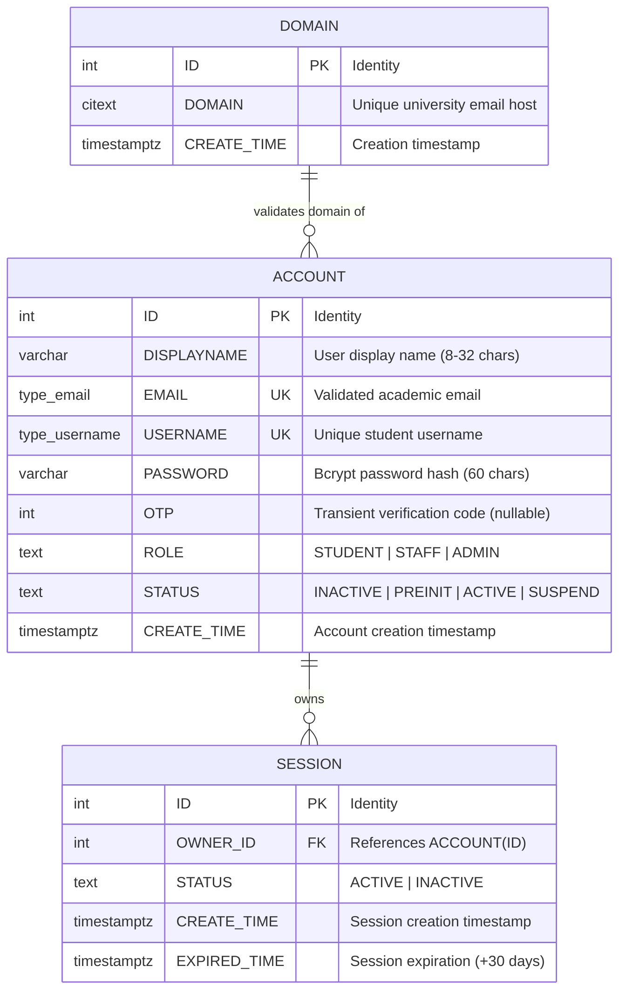
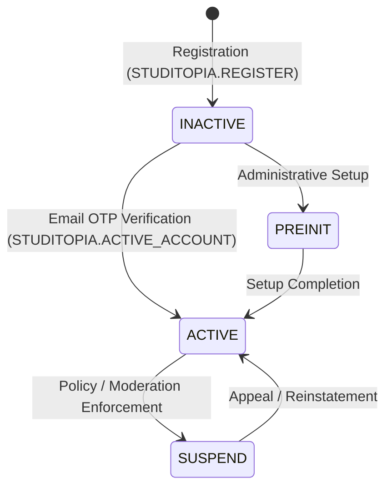
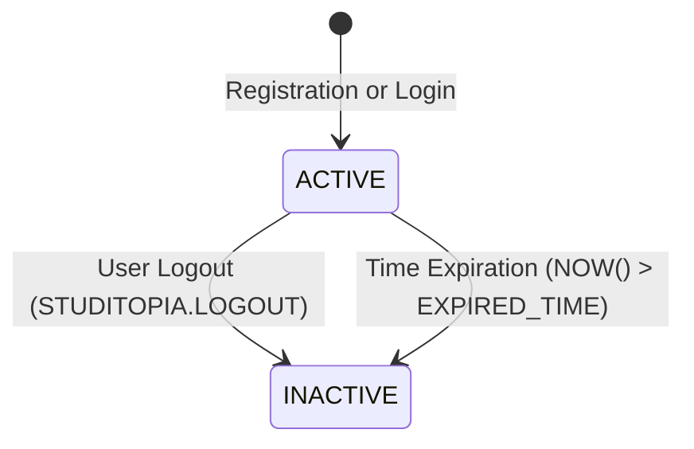

# Data Model: Authentication Schema

**Feature Branch**: `001-auth-schema`
**Feature Spec**: `specs/001-auth-schema/spec.md`
**Date**: 2026-11-14

## Conceptual Data Model

The authentication domain manages user identities, institutional domain eligibility, credentials, multi-session state, and email verification tokens within the `STUDITOPIA` PostgreSQL schema.



---

## Detailed Entity Definitions

### 1. `STUDITOPIA.DOMAIN`

Stores authorized university and collegiate domains for student registration.

| Column | Type | Nullable | Default | Description & Constraints |
|---|---|---|---|---|
| `ID` | `INT` | No | `GENERATED ALWAYS AS IDENTITY` | Primary key |
| `DOMAIN` | `STUDITOPIA.CITEXT` | No | - | Case-insensitive university domain (e.g. `student.hcmus.edu.vn`) |
| `CREATE_TIME` | `TIMESTAMPTZ` | No | `NOW()` | Timestamp when domain was whitelisted |

**Indexes & Constraints**:
- `PRIMARY KEY (ID)`
- `UNIQUE INDEX IDX_DOMAIN ON STUDITOPIA.DOMAIN(DOMAIN)`

---

### 2. `STUDITOPIA.ACCOUNT`

Canonical identity record for platform members.

| Column | Type | Nullable | Default | Description & Constraints |
|---|---|---|---|---|
| `ID` | `INT` | No | `GENERATED ALWAYS AS IDENTITY` | Primary key |
| `DISPLAYNAME` | `VARCHAR(32)` | Yes | `NULL` | Formatted user name; validated 8-32 chars alphanumeric and single spaces |
| `EMAIL` | `STUDITOPIA.TYPE_EMAIL` | No | - | Institutional email; must match whitelisted domain in `STUDITOPIA.DOMAIN` |
| `USERNAME` | `STUDITOPIA.TYPE_USERNAME` | No | - | Unique login identifier; 8-32 lowercase alphanumeric and dot characters |
| `PASSWORD` | `VARCHAR(60)` | No | - | Blowfish salted hash computed via `STUDITOPIA.CRYPT(..., GEN_SALT('bf', 10))` |
| `OTP` | `INT` | Yes | `NULL` | Temporary numerical verification passcode for email activation |
| `ROLE` | `TEXT` | No | `'STUDENT'` | Access tier: `STUDENT`, `STAFF`, `ADMIN` |
| `STATUS` | `TEXT` | No | `'INACTIVE'` | Lifecycle state: `INACTIVE`, `PREINIT`, `ACTIVE`, `SUSPEND` |
| `CREATE_TIME` | `TIMESTAMPTZ` | Yes | `NOW()` | Timestamp of registration |

**Indexes & Constraints**:
- `PRIMARY KEY (ID)`
- `UNIQUE INDEX IDX_UNIQUE_EMAIL ON STUDITOPIA.ACCOUNT(EMAIL)`
- `UNIQUE INDEX IDX_UNIQUE_USERNAME ON STUDITOPIA.ACCOUNT(USERNAME)`
- `CONSTRAINT CK_ACCOUNT_STATUS CHECK (STATUS IN ('INACTIVE', 'PREINIT', 'ACTIVE', 'SUSPEND'))`
- `CONSTRAINT CK_ACCOUNT_ROLE CHECK (ROLE IN ('STUDENT', 'STAFF', 'ADMIN'))`

---

### 3. `STUDITOPIA.SESSION`

Manages authenticated active sessions and expiration tracking.

| Column | Type | Nullable | Default | Description & Constraints |
|---|---|---|---|---|
| `ID` | `INT` | No | `GENERATED ALWAYS AS IDENTITY` | Primary key (Session ID) |
| `OWNER_ID` | `INT` | No | - | Foreign key referencing `STUDITOPIA.ACCOUNT(ID)` |
| `CREATE_TIME` | `TIMESTAMPTZ` | Yes | `NOW()` | Timestamp of session issuance |
| `EXPIRED_TIME` | `TIMESTAMPTZ` | Yes | `NOW() + INTERVAL '30d'` | Timestamp when session expires |
| `STATUS` | `TEXT` | Yes | `'ACTIVE'` | Session state: `ACTIVE`, `INACTIVE` |

**Indexes & Constraints**:
- `PRIMARY KEY (ID)`
- `FOREIGN KEY (OWNER_ID) REFERENCES STUDITOPIA.ACCOUNT(ID)`
- `CONSTRAINT CK_SESSION_STATUS CHECK (STATUS IN ('ACTIVE', 'INACTIVE'))`
- `UNIQUE INDEX IDX_SESSION_OWNER ON STUDITOPIA.SESSION(ID, OWNER_ID) WHERE STATUS = 'ACTIVE'`

---

## Domain Types & Custom Types

### `STUDITOPIA.TYPE_EMAIL`
- **Base Type**: `STUDITOPIA.CITEXT`
- **Constraint**:
  ```sql
  CHECK (
    VALUE ~ '^[a-zA-Z][a-zA-Z0-9]*([._-][a-zA-Z0-9]+)*([%+][a-zA-Z0-9]+)?@([a-zA-Z0-9]+[-]*[a-zA-Z0-9]*\.)+[a-zA-Z]{2,}$'
    AND LENGTH(VALUE) BETWEEN 8 AND 254
  )
  ```

### `STUDITOPIA.TYPE_USERNAME`
- **Base Type**: `STUDITOPIA.CITEXT`
- **Constraint**:
  ```sql
  CHECK (
    VALUE ~ '^[a-z][a-z0-9]*([.][a-z0-9]+)*$'
    AND LENGTH(VALUE) BETWEEN 8 AND 32
  )
  ```

---

## Lifecycle State Machines

### Account Lifecycle Transitions



1. **`INACTIVE`**: Default state upon registration. User possesses valid credentials and an initial onboarding session, but can only perform verification operations.
2. **`PREINIT`**: Reserved for staging or profile onboarding before full platform release.
3. **`ACTIVE`**: Full operational status. Student can join rooms, participate in forums, and access resources.
4. **`SUSPEND`**: Administrative revocation. Credentials remain intact, but platform interactions are blocked.

### Session Lifecycle Transitions



1. **`ACTIVE`**: Granted immediately on `REGISTER`, `LOGIN_BY_USERNAME`, or `LOGIN_BY_EMAIL`. Valid for 30 days unless revoked.
2. **`INACTIVE`**: Triggered immediately when `LOGOUT` is invoked (`STATUS = 'INACTIVE', EXPIRED_TIME = NOW()`). Subsequent queries via `SESSION_CHECK` fail immediately.
