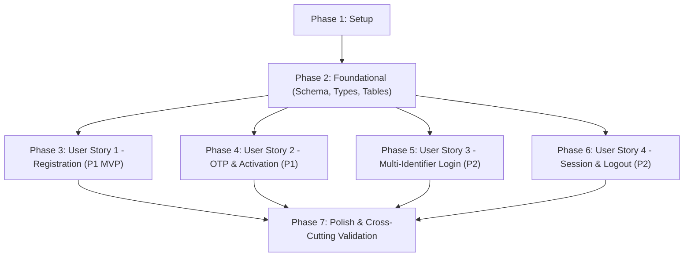

# Tasks: Authentication Schema Implementation

**Input**: Design documents from `specs/001-auth-schema/` (`spec.md`, `plan.md`, `research.md`, `data-model.md`, `contracts/`, `quickstart.md`)

**Prerequisites**: [plan.md](./plan.md) (required), [spec.md](./spec.md) (required), [data-model.md](./data-model.md), [contracts/authentication-functions.md](./contracts/authentication-functions.md), [quickstart.md](./quickstart.md)

**Tests**: Required by [Constitution Principle VI](file:///home/wanderer2414/Studitopia/src/database/.specify/memory/constitution.md) (Strict TDD). Unit and end-to-end integration tests MUST be authored before corresponding SQL implementations.

**Organization**: Tasks are grouped by user story to enable independent implementation, testing, and delivery of each story.

## Format: `- [X] [TaskID] [P?] [Story?] Description with file path`

- **[P]**: Can run in parallel (different files, no dependencies)
- **[Story]**: Which user story this task belongs to (`[US1]`, `[US2]`, `[US3]`, `[US4]`)
- Exact file paths are specified in every task description.

---

## Phase 1: Setup (Shared Infrastructure)

**Purpose**: Test database client utilities, environment configuration, and centralized runners.

- [X] T001 Configure database connection settings and runner credentials in config/database.config.ts and build/env.json
- [X] T002 [P] Define test database client helper utilities and database reset functions in tests/functions/authentication/helpers.ts

---

## Phase 2: Foundational (Blocking Prerequisites)

**Purpose**: Core schema bootstrap, PostgreSQL extensions, domain types, and canonical database tables.

**⚠️ CRITICAL**: Must complete before any user story functions can be registered.

- [X] T003 Bootstrap STUDITOPIA schema and install extensions citext and pgcrypto in src/schemas/init.sql and reverse script in src/schemas/_init.sql
- [X] T004 [P] Define domain type STUDITOPIA.TYPE_EMAIL as STUDITOPIA.CITEXT with constraint CHECK (VALUE ~ '^[a-zA-Z][a-zA-Z0-9]*([._-][a-zA-Z0-9]+)*([%+][a-zA-Z0-9]+)?@([a-zA-Z0-9]+[-]*[a-zA-Z0-9]*\.)+[a-zA-Z]{2,}$' AND LENGTH(VALUE) BETWEEN 8 AND 254) in src/definitions/email.init.sql
- [X] T005 [P] Define domain type STUDITOPIA.TYPE_USERNAME as STUDITOPIA.CITEXT with constraint CHECK (VALUE ~ '^[a-z][a-z0-9]*([.][a-z0-9]+)*$' AND LENGTH(VALUE) >= 8 AND LENGTH(VALUE) <= 32) in src/definitions/username.init.sql
- [X] T006 Create STUDITOPIA.DOMAIN table with columns ID INT GENERATED ALWAYS AS IDENTITY PRIMARY KEY, DOMAIN STUDITOPIA.CITEXT NOT NULL, CREATE_TIME TIMESTAMPTZ NOT NULL DEFAULT NOW(), unique index IDX_DOMAIN, and seed 11 university domains in src/tables/domain.init.sql
- [X] T007 Create STUDITOPIA.ACCOUNT table with columns ID INT GENERATED ALWAYS AS IDENTITY PRIMARY KEY, DISPLAYNAME VARCHAR(32), EMAIL STUDITOPIA.TYPE_EMAIL NOT NULL, USERNAME STUDITOPIA.TYPE_USERNAME NOT NULL, PASSWORD VARCHAR(60) NOT NULL, CREATE_TIME TIMESTAMPTZ DEFAULT NOW(), OTP INT DEFAULT NULL, ROLE TEXT NOT NULL DEFAULT 'STUDENT', STATUS TEXT NOT NULL DEFAULT 'INACTIVE', constraints CK_ACCOUNT_STATUS CHECK (STATUS IN ('INACTIVE', 'PREINIT', 'ACTIVE', 'SUSPEND')), CK_ACCOUNT_ROLE CHECK (ROLE IN ('STUDENT', 'STAFF', 'ADMIN')), and unique indexes IDX_UNIQUE_EMAIL, IDX_UNIQUE_USERNAME in src/tables/account.email_username.sql
- [X] T008 Create STUDITOPIA.SESSION table with columns ID INT GENERATED ALWAYS AS IDENTITY PRIMARY KEY, OWNER_ID INT NOT NULL REFERENCES STUDITOPIA.ACCOUNT(ID), CREATE_TIME TIMESTAMPTZ DEFAULT NOW(), EXPIRED_TIME TIMESTAMPTZ DEFAULT NOW() + INTERVAL '30d', STATUS TEXT DEFAULT 'ACTIVE' CHECK (STATUS IN ('ACTIVE', 'INACTIVE')), unique partial index IDX_SESSION_OWNER ON STUDITOPIA.SESSION(ID, OWNER_ID) WHERE STATUS = 'ACTIVE', and helper function REGISTER_SESSION in src/tables/session.account.sql
- [X] T009 Validate schema bootstrap, table constraints, and initial domain seeding by authoring migration test in tests/migrations/init.spec.ts

**Checkpoint**: Foundational schema, types, and tables deployed and verified. User story implementation can now begin.

---

## Phase 3: User Story 1 - University Student Registration with Academic Verification (Priority: P1) 🎯 MVP

**Goal**: Prospective students can register with display name (8-32 chars), institutional email, unique username, and salted hashed password, receiving an onboarding session and rejecting unauthorized email domains.

**Independent Test**: Register with an approved university email (e.g. `student.hcmus.edu.vn`); verify account is created in `INACTIVE` state with `STUDENT` role, initial session is active, password is stored as Blowfish hash, and unauthorized domains (e.g. `gmail.com`) fail with error code `46001`.

### Tests for User Story 1 (TDD First)

- [X] T010 [P] [US1] Author data-driven test cases for valid emails, invalid formats, unapproved domains, and duplicate emails in tests/functions/authentication/pg.email-validation.testcases.ts
- [X] T011 [P] [US1] Author email validation unit test suite verifying format, whitelist domain check (error 46001), and uniqueness (error 47001) in tests/functions/authentication/email-validation.spec.ts
- [X] T012 [P] [US1] Author data-driven test cases for valid usernames, regex boundaries, length constraints, and duplicates in tests/functions/authentication/pg.username-validation.testcases.ts
- [X] T013 [P] [US1] Author username validation unit test suite verifying lowercase regex, length bounds, and uniqueness (error 47002) in tests/functions/authentication/username-validation.spec.ts
- [X] T014 [P] [US1] Author data-driven registration test cases verifying valid inputs, display name rules, and conflict handling in tests/functions/authentication/pg.register.testcases.ts
- [X] T015 [US1] Author registration unit test suite asserting display name validation (error 45001), Blowfish password hashing, initial INACTIVE/STUDENT state, and onboarding session issuance in tests/functions/authentication/register.spec.ts

### Implementation for User Story 1

- [X] T016 [P] [US1] Implement STUDITOPIA.EMAIL_VALIDATION(PEMAIL TEXT) checking length (8-254), regex, domain existence in STUDITOPIA.DOMAIN (raising 46001), and email duplicate in ACCOUNT (raising 47001) in src/functions/authentication/email-validation.ev.account_domain.sql
- [X] T017 [P] [US1] Implement STUDITOPIA.USERNAME_VALIDATION(PUSERNAME TEXT) checking length (8-32), lowercase dot regex, and username duplicate in ACCOUNT (raising 47002) in src/functions/authentication/username-validation.uv.account.sql
- [X] T018 [US1] Implement STUDITOPIA.REGISTER(PDISPLAYNAME TEXT, PEMAIL TEXT, PUSERNAME TEXT, PPASSWORD TEXT) validating display name (8-32 chars, regex ^[a-zA-Z0-9]+([X][a-zA-Z0-9]+)*$), delegating to email/username validators, hashing password via STUDITOPIA.CRYPT(PPASSWORD, GEN_SALT('bf', 10)), inserting ACCOUNT record, registering session via REGISTER_SESSION, and returning (USER_ID, SESSION_ID, ACCOUNT_ROLE, ACCOUNT_STATUS) in src/functions/authentication/register.ev_uv_session.sql
- [X] T019 [P] [US1] Author reverse rollback script dropping STUDITOPIA.REGISTER in src/functions/authentication/_register.sql

**Checkpoint**: User Story 1 (MVP) is fully functional and independently testable. Students can register and receive onboarding sessions.

---

## Phase 4: User Story 2 - Account Verification and Activation via One-Time Passcode (Priority: P1)

**Goal**: Provide secure one-time passcode (OTP) storage and retrieval for email verification, transitioning accounts from `INACTIVE`/`PREINIT` to `ACTIVE` and purging the OTP upon activation.

**Independent Test**: Take an inactive registered account with an active session, assign a numerical OTP, verify `ACTIVE_ACCOUNT` updates account status to `ACTIVE` and clears `ACCOUNT.OTP` to `NULL`.

### Tests for User Story 2 (TDD First)

- [X] T020 [P] [US2] Author unit tests for OTP saving and retrieval asserting valid session authentication in tests/functions/authentication/save-otp.spec.ts and tests/functions/authentication/get-otp.spec.ts
- [X] T021 [P] [US2] Author unit tests for OTP removal asserting OTP is cleared to NULL in tests/functions/authentication/remove-otp.spec.ts
- [X] T022 [US2] Author account activation unit tests asserting status transition to ACTIVE and OTP clearance in tests/functions/authentication/active-account.spec.ts

### Implementation for User Story 2

- [X] T023 [P] [US2] Implement STUDITOPIA.SAVE_OTP(SESSION_ID INT, USER_ID INT, POTP INT) asserting SESSION_CHECK and recording OTP on ACCOUNT in src/functions/authentication/save-otp.session.sql
- [X] T024 [P] [US2] Implement STUDITOPIA.GET_OTP(PSESSION_ID INT, PUSER_ID INT) asserting SESSION_CHECK and returning OTP from ACCOUNT in src/functions/authentication/get-otp.session.sql
- [X] T025 [P] [US2] Implement STUDITOPIA.REMOVE_OTP(PSESSION_ID INT, PUSER_ID INT) asserting SESSION_CHECK and resetting OTP to NULL in src/functions/authentication/remove-otp.session.sql
- [X] T026 [US2] Implement STUDITOPIA.ACTIVE_ACCOUNT(SESSION_ID INT, USER_ID INT) asserting SESSION_CHECK, updating ACCOUNT status to ACTIVE, and setting OTP = NULL for INACTIVE or PREINIT accounts in src/functions/authentication/activate-account.session-check.sql

**Checkpoint**: User Story 2 is complete. Inactive accounts can be verified via OTP and activated.

---

## Phase 5: User Story 3 - Multi-Identifier User Authentication (Login) (Priority: P2)

**Goal**: Allow registered users to authenticate using either their username or institutional email alongside their password, creating a new 30-day session and returning role and status while leaving other sessions active.

**Independent Test**: Execute login with valid username-password and email-password combinations; verify a distinct active session is issued each time, previous sessions remain active, and invalid credentials fail with error code `45007`.

### Tests for User Story 3 (TDD First)

- [X] T027 [P] [US3] Author data-driven login test cases for username and email authentication in tests/functions/authentication/pg.login.testcases.ts
- [X] T028 [US3] Author login unit test suite asserting LOGIN_BY_USERNAME and LOGIN_BY_EMAIL issue active sessions, return role/status, and raise error 45007 on invalid credentials in tests/functions/authentication/login.spec.ts

### Implementation for User Story 3

- [X] T029 [US3] Implement STUDITOPIA.LOGIN_BY_USERNAME(PUSERNAME TEXT, PPASSWORD TEXT) and STUDITOPIA.LOGIN_BY_EMAIL(PEMAIL TEXT, PPASSWORD TEXT) verifying password via STUDITOPIA.CRYPT, creating session via REGISTER_SESSION, returning TABLE (SESSION_ID INT, USER_ID INT, ROLE TEXT, STATUS TEXT), and raising error 45007 on invalid credentials in src/functions/authentication/login.session.sql

**Checkpoint**: User Story 3 is complete. Users can log in via username or email with multi-session support.

---

## Phase 6: User Story 4 - Session Validation and Explicit Logout (Priority: P2)

**Goal**: Guard protected operations with session validity checks, allow authenticated profile email retrieval, and permit users to explicitly terminate (log out) their current session without terminating sessions on other devices.

**Independent Test**: Check active session validity, retrieve email with `GET_EMAIL`, invoke `LOGOUT` on one session, and verify subsequent calls with that session fail with error `45005` while a concurrent session for the same user remains active.

### Tests for User Story 4 (TDD First)

- [X] T030 [P] [US4] Author session validation unit tests verifying unexpired, active, owner-matching sessions in tests/functions/authentication/session-check.spec.ts
- [X] T031 [P] [US4] Author session logout unit tests verifying session status changes to INACTIVE and EXPIRED_TIME is set to NOW() in tests/functions/authentication/logout.spec.ts
- [X] T032 [P] [US4] Author protected email retrieval unit tests verifying email return for valid sessions in tests/functions/authentication/get-email.spec.ts
- [X] T033 [P] [US4] Author data-driven test cases for full authentication lifecycle in tests/functions/authentication/pg.full-flow.testcases.ts
- [X] T034 [US4] Author comprehensive full-flow integration test covering registration, login, OTP activation, logout, and multi-device concurrency in tests/functions/authentication/full-flow.spec.ts

### Implementation for User Story 4

- [X] T035 [P] [US4] Implement STUDITOPIA.SESSION_CHECK(SESSION_ID INT, USER_ID INT) asserting session is ACTIVE, owner matches USER_ID, and EXPIRED_TIME > NOW(), raising error 45005 if not found, in src/functions/authentication/session-check.session.sql
- [X] T036 [P] [US4] Implement STUDITOPIA.LOGOUT(PSESSION_ID INT, PUSER_ID INT) asserting SESSION_CHECK, setting STATUS = 'INACTIVE' and EXPIRED_TIME = NOW(), in src/functions/authentication/logout.session.sql
- [X] T037 [US4] Implement STUDITOPIA.GET_EMAIL(SESSION_ID INT, USER_ID INT) asserting SESSION_CHECK and returning EMAIL from ACCOUNT in src/functions/authentication/get-email.account.sql

**Checkpoint**: All user stories are complete and independently verified.

---

## Phase 7: Polish & Cross-Cutting Concerns

**Purpose**: Dependency graph verification, migration reversibility, and full regression testing.

- [X] T038 [P] Compile dependency graph and verify acyclic execution order via npm run compile in build/tree.md and build/mermaid.md
- [X] T039 Execute clean database teardown and rebuild idempotency test (npm run restore init && npm run all) per specs/001-auth-schema/quickstart.md
- [X] T040 Run full authentication test suite via npx vitest run tests/functions/authentication/ and verify 100% pass rate

---

## Dependencies & Execution Order

### Phase Dependencies



- **Setup (Phase 1)**: Can start immediately.
- **Foundational (Phase 2)**: Depends on Phase 1. Blocks all user stories.
- **User Stories (Phases 3-6)**: All depend on Foundational (Phase 2).
  - Can proceed sequentially in priority order: US1 (P1) → US2 (P1) → US3 (P2) → US4 (P2).
  - Or in parallel across independent developers once Phase 2 is complete.
- **Polish (Phase 7)**: Depends on all user stories completing.

### Within Each User Story

1. Write tests first and confirm failure (Red).
2. Implement SQL function nodes (Green).
3. Validate reverse scripts and naming conventions (Refactor).

### Parallel Opportunities

- **Setup**: `T002` can run alongside `T001`.
- **Foundational**: `T004` (`email.init.sql`) and `T005` (`username.init.sql`) can be authored in parallel.
- **User Story 1**: Tests `T010`, `T011`, `T012`, `T013`, `T014` can be authored in parallel. Implementation tasks `T016` (`email-validation`) and `T017` (`username-validation`) can be authored in parallel before `T018` (`register`).
- **User Story 2**: Tests `T020`, `T021` can run in parallel. Implementations `T023`, `T024`, `T025` can run in parallel.
- **User Story 4**: Tests `T030`, `T031`, `T032`, `T033` can run in parallel. Implementations `T035`, `T036` can run in parallel.

---

## Parallel Example: User Story 1

```bash
# Author tests in parallel:
Task: "Author email validation unit test suite in tests/functions/authentication/email-validation.spec.ts"
Task: "Author username validation unit test suite in tests/functions/authentication/username-validation.spec.ts"

# Implement validators in parallel:
Task: "Implement STUDITOPIA.EMAIL_VALIDATION in src/functions/authentication/email-validation.ev.account_domain.sql"
Task: "Implement STUDITOPIA.USERNAME_VALIDATION in src/functions/authentication/username-validation.uv.account.sql"
```

---

## Implementation Strategy

### MVP First (User Story 1 Only)

1. Complete Phase 1: Setup (`T001`-`T002`).
2. Complete Phase 2: Foundational (`T003`-`T009`) - **Critical baseline**.
3. Complete Phase 3: User Story 1 (`T010`-`T019`).
4. **STOP and VALIDATE**: Run `npx vitest run tests/functions/authentication/register.spec.ts` to confirm working student registration and domain validation.

### Incremental Delivery

1. Setup + Foundational → Database schema, extensions, and tables ready.
2. User Story 1 (P1) → Registration, domain whitelist, password hashing functional (MVP).
3. User Story 2 (P1) → OTP storage and account activation functional.
4. User Story 3 (P2) → Multi-identifier login (email or username) functional.
5. User Story 4 (P2) → Session verification, email retrieval, and explicit logout functional.
6. Polish → Full lifecycle end-to-end regression validation.
