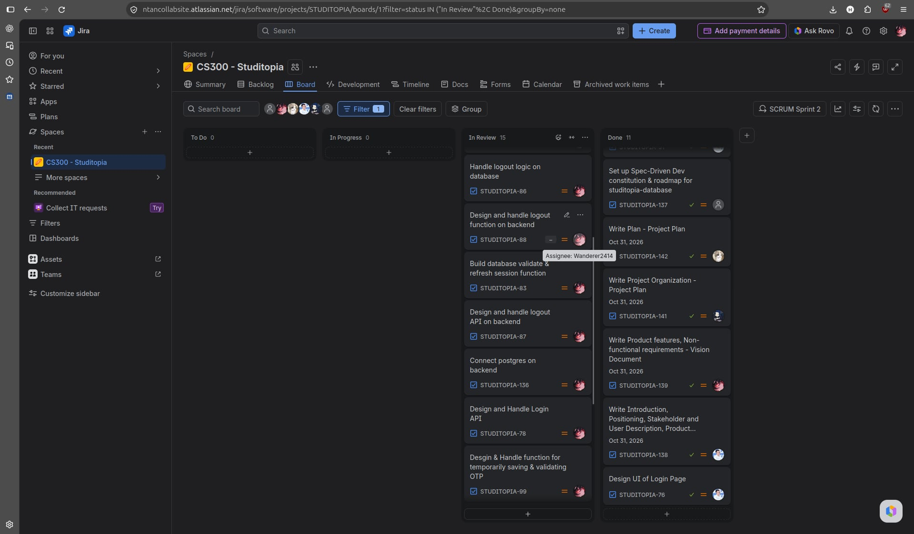

# 3/11, Sprint 3 - Meeting Report

## 1. Team members present

- Nguyen Thanh An
- Nguyen Chi Bao
- Tran Nguyen Khanh Binh
- Nguyen Le Quoc Huy
- Tran Canh Anh Tuan

No member is absent.

## 2. Status reports

| Member | Completed Tasks | Issues | To-do Tasks |
|:---|:---|:---|:---|
| **Nguyen Thanh An** | - Integrate authentication API following the API contracts between Frontend and Backend. - Learn GitHub Spec Kit training course (screenshot). - Write Manage Process – Software Project Plan. | N/A | - Integrate Login and Register APIs into the Login and Register pages. - Implement tests for shared UI components developed in Sprint 1. - Write weekly report. |
| **Nguyen Chi Bao** | - Learn GitHub Spec Kit training course (screenshot). - Write Organizational Structure – Software Project Plan. | - Cannot optimize the selected AI model. | - Find alternative AI recommendation models. |
| **Tran Nguyen Khanh Binh** | - Learn GitHub Spec Kit training course (screenshot). - Write Introduction, Positioning, Stakeholder and User Description, and Product Overview – Vision Document. | N/A | - Design OTP Verification and Password Recovery Page UI. - Design Loading Page UI. |
| **Nguyen Le Quoc Huy** | - Implement OTP authentication API. - Learn GitHub Spec Kit training course (screenshot). - Write Product Features and Non-functional Requirements – Vision Document. | - The OTP verification API returns errors incorrectly. | - Fix OTP verification API. - Deploy the Backend to the server. |
| **Tran Canh Anh Tuan** | - Learn GitHub Spec Kit training course (screenshot). - Write Introduction and Project Overview – Software Development Plan. | - Directus is not suitable for configuration and integration with the project. | - Render Reference Page UI. - Remove Directus and adjust the database design. |

## 3. Summary of the meeting

### 3.1 Chosen user story

- Considered user story: (Forums) View Post, Create Post, Browse universities, faculties, courses

- Because the user story above represents the most important features, which mainly attract and are used by users

### 3.2 To-do task

- Fix the errors and finish some uncompleted tasks from the previous sprint:
    - Bao: Cannot optimize the found AI model
    - Huy: The OTP verification API throws errors incorrectly
    - An: Integrate Login and Register API into UI

- Divide and assign tasks for the Forum user story:
    - Design Forum Page, Post and Comment design, Course list: Binh
    - Render OTP Authentication and Recovery Password Page: An
    - Find other AI models to integrate into the system: Bao
    - Fix OTP and Recovery Password API: Huy
    - Remove Directus and adjust the DB design: Tuan

### 3.3 The tasks assigned after the meeting (screenshot)

