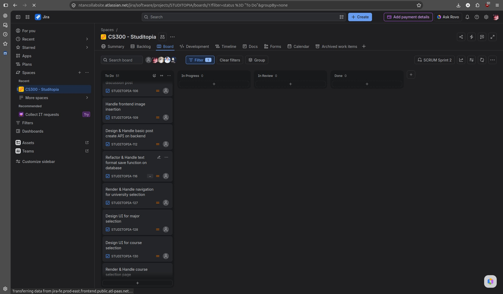

# 13/11, Sprint 3 - Meeting Report

## 1. Team members present

- Nguyen Thanh An
- Nguyen Chi Bao
- Tran Nguyen Khanh Binh
- Nguyen Le Quoc Huy
- Tran Canh Anh Tuan

No member is absent.

## 2. Status reports

| Member | Completed Tasks | Issues | To-do Tasks |
|:---|:---|:---|:---|
| **Nguyen Thanh An** | - Render the OTP Verification Page and Password Recovery UI. - Integrate the Login and Register APIs into the Frontend. | - Need to restrict access to authenticated pages when users have not logged in or verified their email. - Login and Register pages need to allow users to retry after API errors that are not caused by incorrect credentials. | - Fix Login and Register Page errors. - Build redirect mechanisms when login, registration, or email verification succeeds. - Create guards to protect authenticated pages from unauthorized access. - Write weekly report. - Write use case specifications for UC-01 Register Account and Verify University Email and UC-07 Join or Create a Study Room. - Review UC-05 Comment and Answer. |
| **Nguyen Chi Bao** | N/A | - The recommendation AI model cannot handle multiple requests simultaneously and needs optimization. | - Revise Organizational Structure – Software Project Plan. - Continue researching AI models for post recommendation. - Write the use case specification for UC-03 Browse and Search the University Forum. - Review UC-01 Register Account and Verify University Email and UC-06 Share Learning Resource. |
| **Tran Nguyen Khanh Binh** | - Design OTP Verification and Password Recovery Page UI. - Design Loading Page. | N/A | - Design Home Page. - Design Major Selection Page. - Design Course Selection Page. - Design Top Trending UI. - Design Post and Comments UI. - Design Post Search UI. - Write use case specifications for UC-05 Comment and Answer and UC-06 Share Learning Resource. - Review UC-04 Create Discussion Post. - Add authentication-related NFRs and environmental constraints to the Vision Document. |
| **Nguyen Le Quoc Huy** | - Fix OTP verification API. - Deploy the Backend to the server. | - Login API does not set cookies for the refresh token, preventing the application from properly handling refresh token revocation. - Backend blocks requests from the Frontend when additional headers are included. | - Fix Login API errors. - Allow the Frontend to send specified headers. - Deploy the Frontend server. - Render Forum Home Page UI. - Update the PA3 Vision Document to reflect the forum-first direction and restore the middle-level meeting rooms. - Write the use case specification for UC-02 Log In. - Review UC-03 Browse and Search the University Forum. - Compile and refine the use case specifications. |
| **Tran Canh Anh Tuan** | N/A | N/A | - Revise the EER model and relational schema for Sprint 3 features. - Update the Software Development Plan for Sprint 3. - Design schemas for forums, posts, comments, and courses. |

## 3. Summary of the meeting

### 3.1 Evaluate completed tasks

- Frontend:
    - Implemented shared design components but did not implement tests
    - Rendered Login and Register pages but did not integrate the corresponding API
- Database: Forum-related schema needs to be designed
- Backend: Fix errors for the Login API and additional headers

### 3.2 To-do task

- PA3:
    - Finalize and revise the Use Case Specification
    - Continue documenting PA3 changes in the Vision Document and Software Development Plan

- Project:
    - Fix Login and Register Page errors and add route guard
    - Optimize the AI recommendation model
    - Design forum-related schema
    - Design remaining forum and post UI pages

### 3.3 The tasks assigned after the meeting (screenshot)

