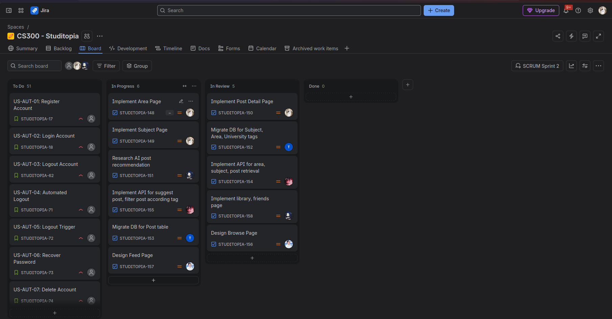

# 17/11, Sprint 4 - Meeting Report

## 1. Team members present

- Nguyen Thanh An
- Nguyen Chi Bao
- Tran Nguyen Khanh Binh
- Nguyen Le Quoc Huy
- Tran Canh Anh Tuan

No member is absent.

## 2. Status reports

| Member | Completed Tasks | Issues | To-do Tasks |
|:---|:---|:---|:---|
| **Nguyen Thanh An** | - Render the Forum Home, area, subject and post page. - Integrate the forum browsing and post search APIs into the frontend. - Revise Verify university email features which loading infinitely in certain cases. | - Searched and filtered subject doesn't update when the data changes. - Forum page router is inconsistent. | - Implement the post detail view, area page and subject page. - Handle search/filter subjects consistently when the data changes. - Fix the email verification features to avoid long-time loading. |
| **Nguyen Chi Bao** | - Write initial test cases for forum browsing, keyword search and tag filtering. | - Search relevance for AI-assisted recommendations is not deterministic yet. - Tag-filter acceptance criteria need to be agreed before testing. | - Implement library, friend pages. - Continue researching post recommendation input for the AI component. |
| **Tran Nguyen Khanh Binh** | - Design the Forum Home, post detail, tag filter, search result and interaction UI. | - Some card render the unnecessary information. | - Design the different cards for the unnecessary ones. - Prepare the UI workflow and screen references for the PA4 document. |
| **Nguyen Le Quoc Huy** | - Implement APIs for forum browsing, area, subject and post retrieval. | - Search query parameters and pagination format are not yet consistent with the frontend.  | Implement APIs for post viewing, keyword search and tag filtering. - Write the API contract section for recommend post, tag.  |
| **Tran Canh Anh Tuan** | - Revise the forum/post/comment/tag schema. | | - Add migrations for area, subject and post tables. - Validate query plans for forum and post search. - Update the relational schema section for post searching, relevant post retrieval. |

## 3. Summary of the meeting

### 3.1 Evaluate completed tasks

- **Schema/Design foundation**: Tuan revised the forum/post/comment/tag schema; Binh completed UI designs for Forum Home, post detail, tag filter, search result, and interaction screens.
- **API**: Huy implemented initial APIs for forum browsing, area, subject, and post retrieval.
- **Frontend integration**: An rendered Forum Home, area, subject, and post pages, and integrated forum browsing and post search APIs; he also revised university email verification.
- **Testing**: Bao wrote initial test cases for forum browsing, keyword search, and tag filtering.
- **Outstanding issues**: forum router/search-filter refresh inconsistency, inconsistent search/pagination API contracts, unsettled tag-filter acceptance criteria, non-deterministic AI recommendation relevance, and some UI cards showing unnecessary information.

### 3.2 To-do task

- **Schema/Database**: add area/subject/post migrations, validate forum/post search query plans, and update relational schema for post search and relevant post retrieval (Tuan).
- **API/Backend**: implement post viewing, keyword search, and tag filtering APIs; write recommend post/tag API contracts (Huy).
- **Frontend integration**: implement post detail, area, and subject pages; fix search/filter data refresh and email verification loading; handle inconsistent forum routing (An). implement library, friends page (Bao)
- **Testing/Validation**: validate API contracts with Huy before integration testing; continue AI recommendation research and expand test coverage (Bao).
- **PA4 preparation**: Binh prepares UI workflow/screen references and missing card variants; team drafts System, Container, Component, and Deployment diagrams/use-case materials.

### 3.3 The tasks assigned after the meeting

