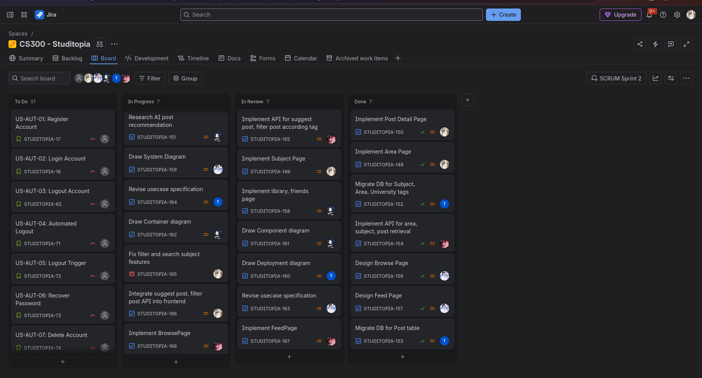

# 24/11, Sprint 4 - Meeting Report

## 1. Team members present

- Nguyen Thanh An
- Nguyen Chi Bao
- Tran Nguyen Khanh Binh
- Nguyen Le Quoc Huy
- Tran Canh Anh Tuan

No member is absent.

## 2. Status reports

| Member | Completed Tasks | Issues | To-do Tasks |
|:---|:---|:---|:---|
| **Nguyen Thanh An** | - Implement the post detail view, area page and subject page. - Handle search/filter subjects consistently when the data changes. - Fix the email verification feature to avoid long-time loading. - Handle the inconsistent forum page routing. | - The updated search/filter flow needs to be re-checked after Huy finishes the remaining API work. - The post detail view still depends on the final post viewing API response format. | - Continue implementing the remaining frontend functions from the previous round. - Integrate the updated APIs from Huy into the frontend and re-check the search/filter flow. |
| **Nguyen Chi Bao** |- Continue researching post recommendation input for the AI component. - Expand test coverage for forum browsing, keyword search and tag filtering. | - The recommendation input is not stable enough to finalize the diagrams yet. - The library and friends interface doesn't complete| - Draw the Component diagram. - Draw the Context diagram. |
| **Tran Nguyen Khanh Binh** | - Design different card variants for the screens with unnecessary information. - Prepare the UI workflow and screen references for the PA4 document. | - Some post-interaction flows still need screen references before the diagrams are finalized. | - Draw the System diagram. - Write the use case specification. |
| **Nguyen Le Quoc Huy** | - Implement APIs for post viewing, keyword search and tag filtering. - Write the API contract section for recommend post and tag. | - Search query parameters and pagination format are still not fully consistent with the frontend. - The recommend post/tag contract still needs to be confirmed with Bao. | - Continue implementing the remaining APIs from the previous round. - Align the search and pagination format with the frontend and confirm the recommendation contract with Bao. |
| **Tran Canh Anh Tuan** | - Add migrations for area, subject and post tables. - Validate query plans for forum and post search. - Update the relational schema section for post searching and relevant post retrieval. | - The deployment configuration has not been documented yet. - The use case specification needs to reflect the revised relational schema. | - Draw the Deployment diagram. - Revise the use case specification. |

## 3. Summary of the meeting

### 3.1 Evaluate completed tasks

- **Schema/Database**: Tuan added the area/subject/post migrations, validated forum and post search query plans, and updated the relational schema for post searching and relevant post retrieval.
- **API**: Huy implemented post viewing, keyword search and tag filtering APIs, and wrote the recommend post/tag API contracts.
- **Frontend integration**: An implemented the post detail, area and subject pages, fixed the search/filter refresh issue, the email verification loading issue, and the inconsistent forum routing.
- **Testing**: Bao validated the API contracts with Huy, continued AI recommendation research and expanded test coverage for search and tag filtering.
- **Design/PA4 preparation**: Binh designed the additional card variants and prepared the UI workflow and screen references for the PA4 document.
- **Outstanding issues**: search/pagination contract is still not fully aligned between frontend and backend, recommendation input is not stable enough for the diagrams, post detail view is waiting on the final API response format, some interaction flows lack screen references, and the deployment configuration is not documented yet.

### 3.2 To-do task

- **PA4 documentation**: Bao draws the Component diagram and the Context diagram; Binh draws the System diagram and writes the use case specification; Tuan draws the Deployment diagram and revises the use case specification.
- **Frontend integration**: An continues the remaining frontend functions from the previous round and integrates the updated APIs into the frontend.
- **API/Backend**: Huy continues the remaining APIs from the previous round, aligns the search and pagination format with the frontend, and confirms the recommendation contract with Bao.

### 3.3 The tasks assigned after the meeting

