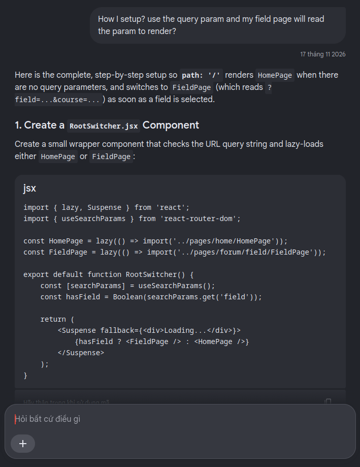
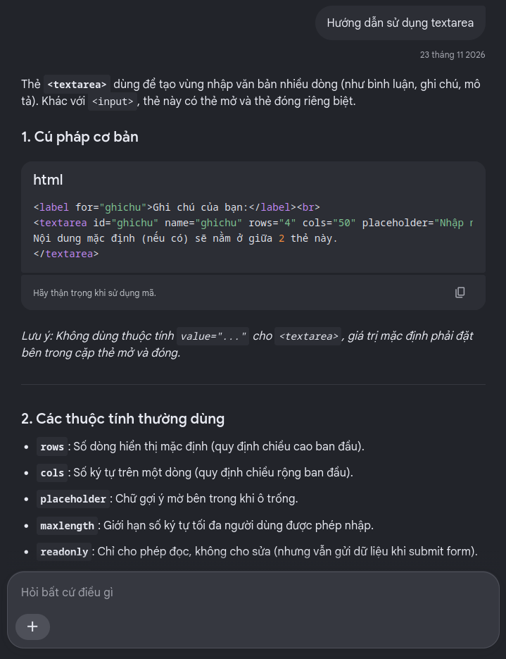
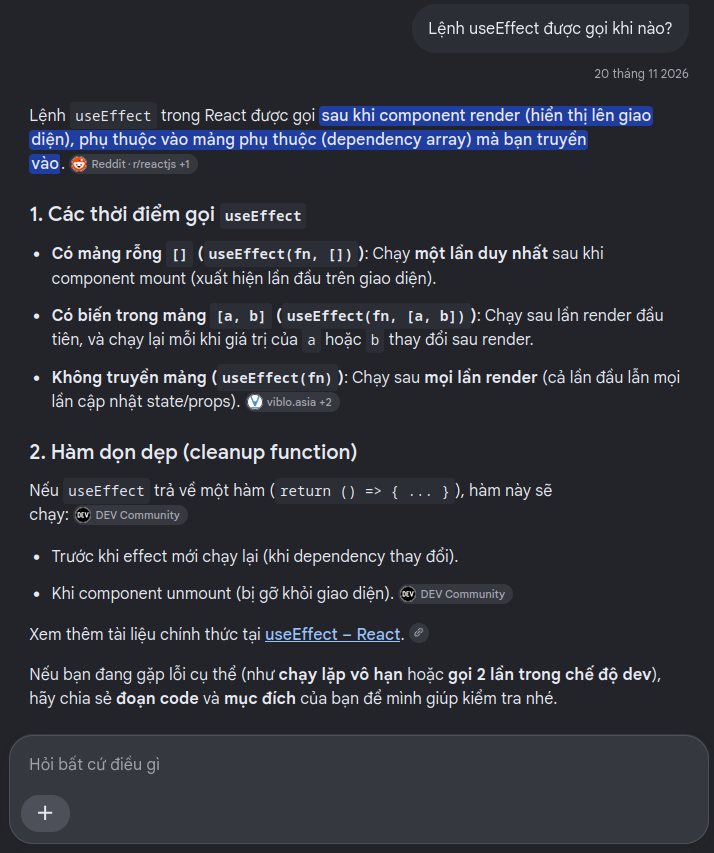
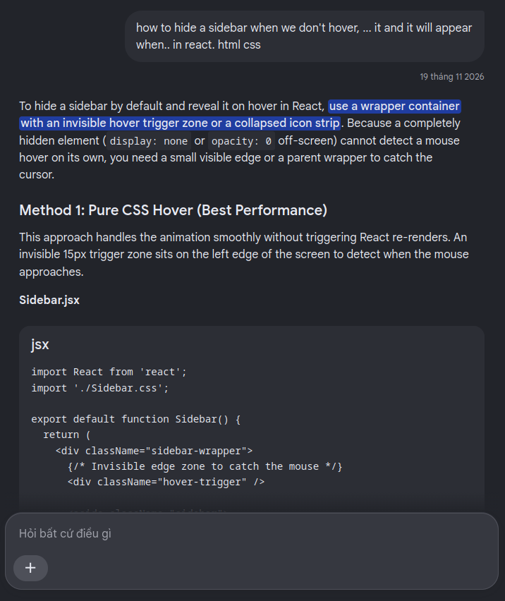
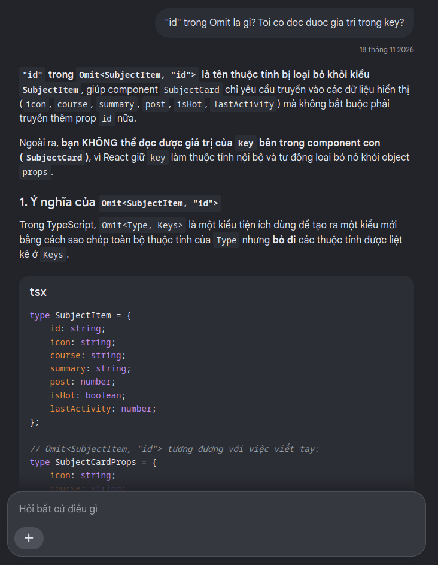
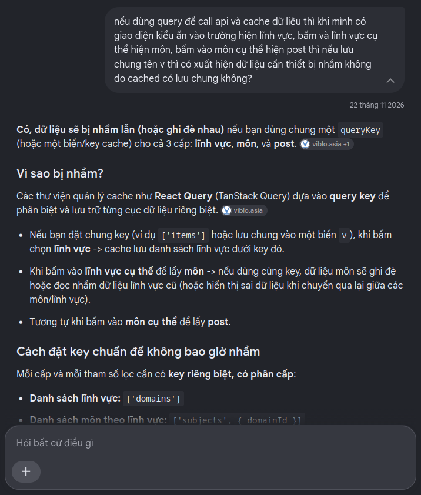

# AI Usage Notes

### Prompt 1

  

- **Tool:** Gemini (Hydrogen 4), Google — gemini.google.com
- **Accessed:** Nov 17, 2026
- **Prompt:** "How I setup `?` to use the query param and my field page will read the param to render?"
- **Purpose:** To know how to create the URL have query parameters and use this mechanism to transfer the information to pages.
- **AI Output:** Generate code to build a switcher to route pages bases on their URL and guide how page read the information in query parameters.
- **Validation:** Students read React tutorials to check the confidence of the code (https://react.dev/learn)

### Prompt 2

  

- **Tool:** Gemini (Hydrogen 4), Google — gemini.google.com
- **Accessed:** Nov 22, 2026
- **Prompt:** "Hướng dẫn sủ dụng textarea"
- **Purpose:** To know how to use textarea tag in HTML to build comment input.
- **AI Output:** Introduce the basic syntax, fields of textarea tag.
- **Validation:** Students check the validity of the syntax by Mozilla HTML documents (https://developer.mozilla.org/en-US/docs)

### Prompt 3

  

- **Tool:** Gemini (Hydrogen 4), Google — gemini.google.com
- **Accessed:** Nov 20, 2026
- **Prompt:** "Lệnh useEffect được gọi khi nào?"
- **Purpose:** To understand when the useEffect callback is triggers to manage when the side-effects in useEffect are called.
- **AI Output:** List the time when useEffect is called corresponding to the array and the variables inside this array.
- **Validation:** Students read React tutorials to check the confidence of the code (https://react.dev/learn) 

### Prompt 4

  

- **Tool:** Gemini (Hydrogen 4), Google — gemini.google.com
- **Accessed:** Nov 19, 2026
- **Prompt:** "How to hide a sidebar when we don't hover, click it and it will appear when otherwise in react, html, css"
- **Purpose:** To know how to build the sidebar in forum that have automatic hiding mechanism when we don't hover it.
- **AI Output:** Generate code to suggest many way to build the sidebar satisfying the conditions.
- **Validation:** Students read React tutorials to check the confidence of the code (https://react.dev/learn)

### Prompt 5

  

- **Tool:** Gemini (Hydrogen 4), Google — gemini.google.com
- **Accessed:** Nov 18, 2026
- **Prompt:** "`ID` trong Omit là gì? Tôi có đọc được giá trị trong key?"
- **Purpose:** To know the how Omit works and what the role of `ID` field in Omit and whether we can read the key field props.
- **AI Output:** Explain the role of "ID" field and the inability to read the key field props
- **Validation:** Students read React tutorials to check the confidence of the code (https://react.dev/learn)

### Prompt 6

  

- **Tool:** Gemini (Hydrogen 4), Google — gemini.google.com
- **Accessed:** Nov 22, 2026
- **Prompt:** "Nếu dùng query để call api và cache dữ liệu thì khi mình có giao diện kiểu ấn vào trường hiện lĩnh vực, bấm và lĩnh vực cụ thể hiện môn, bấm vào môn cụ thể hiện post thì nếu lưu chung tên v thì có xuất hiện dữ liệu cần thiết bị nhầm không do cached có lưu chung không?"
- **Purpose:** To know whether conflicts exists when we use the same queryKey for the same subject of different area.
- **AI Output:** Guide how to set the key to prevent conflict if we have the same id for the same subject in the same area but we don't want to overwrite them in cache.
- **Validation:** Students read React tutorials to check the confidence of the code (https://react.dev/learn)