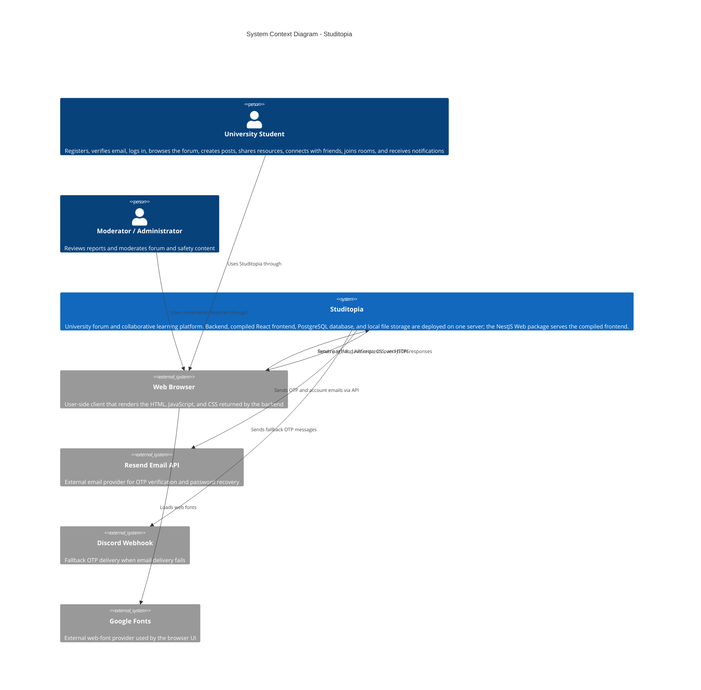

# System Context Diagram (C4 Level 1)

**Version:** `1.1`

**Performed by:** [Nguyen Le Quoc Huy] | **Edited by:** [Nguyen Chi Bao]

## 1. Document Information

| Field | Value |
| --- | --- |
| Project | Studitopia |
| Document | System Context Diagram - C4 Level 1 |
| Version | 1.1 |
| Date | 28/Nov/2026 |
| Scope | PA1 through PA4 product scope and source-accurate system boundary |
| Diagram notation | Mermaid `C4Context` |
| Companion documents | [Container Diagram](container_diagram.md), [Component Diagram](component_diagram.md), [Deployment Diagram](deployment_diagram.md) |

### Revision History

| Date | Version | Description | Author |
| --- | --- | --- | --- |
| 28/Nov/2026 | 1.0 | Extracted the C4 Level 1 System Context diagram and explanation into its own document | Nguyen Le Quoc Huy |
| 28/Nov/2026 | 1.1 | Clarified that port 8999 is the development-only Vite host and that the NestJS Web package serves the compiled SPA in deployment | Nguyen Le Quoc Huy |

## 2. Purpose and Scope

This document shows Studitopia as a whole, the human actors who interact with it, and the external systems it depends on. It describes the accumulated product direction from PA1 through PA4 while distinguishing documented requirements from the runtime behavior currently present in the source code.

### 2.1 Source-Accurate Implementation Status

- **Implemented frontend routes:** The current frontend provides the following routes: `/auth/login`, `/auth/register`, `/auth/recover_password`, `/auth/recover_otp`, `/auth/set_password`, `/auth/verify_otp`, and `/forum`.
- **Implemented backend functionality:** The backend currently supports authentication and OTP operations, account retrieval and avatar uploads, forum browsing, post and tag retrieval, file access, and SPA asset delivery.
- **Frontend deployment architecture:** During development, Vite serves the frontend on port `8999`. In production, the NestJS Web package serves the compiled frontend directly, eliminating the need for a separate frontend server.
- **Unimplemented features:** No frontend routes or backend endpoints currently exist for friend management, meeting rooms, notifications, profile editing beyond avatar uploads, or comprehensive resource-library management. These features remain part of the documented product requirements and are planned for future development.
- **Incomplete service integration:** `ReCaptchaService` is currently a stub and is not registered in `AppModule`. Similarly, although `WebService` and `WebBased()` are defined, they have not yet been integrated into the application routes.

## 3. C4 Model - Level 1: System Context Diagram

### 3.1 Explanation of the Diagram

**Studitopia** is the central system in the architecture. At Level 1, it is represented as a single system boundary, abstracting away its internal implementation, which consists of a NestJS/Express backend, a compiled React + TypeScript frontend, PostgreSQL, and local file storage. The backend, database, and file storage are hosted on the same server. During development, Vite serves the frontend SPA on port `8999`. In production, the NestJS Web package delivers the compiled frontend assets directly to the browser, removing the need for a separate frontend host.

**University Student** is the primary actor interacting with Studitopia. According to the product requirements, students should be able to register and verify their university email addresses, log in, manage profiles and preferences, browse and search the university forum, create posts, comment and answer, vote, save posts, share resources, manage friends and groups, create or join meeting rooms, and receive notifications. However, the current implementation only covers authentication and OTP verification, account information retrieval and avatar uploads, forum browsing, and partially static feed and library views.

**Moderator / Administrator** is a secondary actor defined at the requirements level, responsible for maintaining platform trust and safety. However, the current source code does not contain any dedicated moderator or administrator routes or components.

**Web Browser** serves as the client application through which both human actors access Studitopia. It sends page requests and API calls to the system. The backend delivers the compiled React frontend assets, including HTML, JavaScript, and CSS, alongside JSON responses for data requests. The browser executes the frontend code and renders the user interface. During development, frontend assets are served by Vite on port `8999`, whereas in production they are delivered by the backend Web package.

**Resend Email API** is an external service used to deliver OTP and password-recovery emails. **Discord Webhook** provides an alternative delivery mechanism for OTP messages. **Google Fonts** is another external dependency, supplying typography resources directly to the browser for presentation purposes.

The browser has no direct access to PostgreSQL. All database interactions are handled exclusively by the backend, which exposes the `api/v1` API surface consumed by the React frontend. This ensures that database access and application logic remain centralized within the backend.

### 3.2 Current External-System Boundary

| External system | Status | Purpose |
| --- | --- | --- |
| Resend Email API | Current | Sends OTP and account-related emails. |
| Discord Webhook | Current | Fallback OTP delivery path. |
| Google Fonts | Current | Supplies web fonts for the UI. |
| Google OAuth 2.0 | Planned / UI-only | Mentioned in earlier requirements, but no runtime OAuth integration exists. |
| Cloud object storage | Planned / not configured | Requirements discuss cloud storage; current implementation uses local disk. |
| File safety scanning service | Planned / not implemented | Uploaded files are expected to be validated and scanned, but no external scanner is configured. |
| AI recommendation/matching service | Planned / not implemented | PA1/PA2 proposed AI matching and recommendations; no AI SDK or model API is integrated. |
| Push notification provider | Planned / not implemented | Notifications are handled by the application; no external push provider is integrated. |

## 4. Source References

- `docs/requirements/PA1/features.md`
- `docs/requirements/proposals/functional_requirement.md`
- `docs/requirements/proposals/non_functional_requirement.md`
- `docs/requirements/PA4-Group05/use_cases/functional_requirement_coverage.md`
- `src/frontend/vite.config.ts`
- `src/backend/src/app.module.ts`
- `src/backend/src/packages/web/web.controller.ts`
