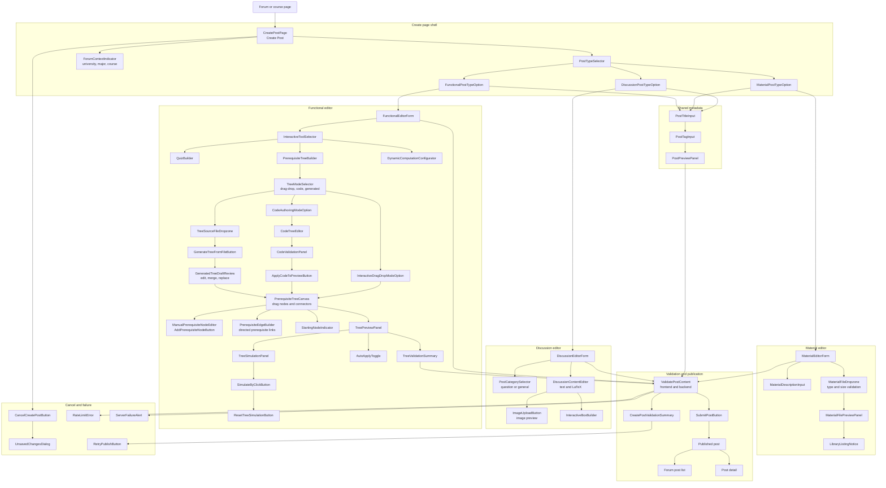

# Create Post Page Specification

**Version:** `1.0`

**Performed by:** [Nguyen Thanh An] | **Edited by:** [Nguyen Thanh An]
>
> **Main sources:** [`screen_flow.md`](screen_flow.md), [`feature_flow.md`](feature_flow.md), [`overview.md`](overview.md), [`functional_requirement.md`](functional_requirement.md), [`userstory.md`](userstory.md), [`use_cases_description.md`](use_cases_description.md), [`use_cases_model/UC-04-create-discussion-post.md`](use_cases_model/UC-04-create-discussion-post.md), [`API.md`](API.md).
>
> **Note:** UC-04 describes the discussion-post path in detail. Material-post and functional-post requirements come from `US-15`, `US-16`, and the post-creation flows in `feature_flow.md`.

---

## 1. Purpose of the Create Post Page

The **Create Post** page is the main contribution flow of the University Forum. Its purpose is to let an authenticated student publish an academic post in a selected **University → Major → Course** forum context. The student can create one of three post types:

- **Discussion Post** — a question or general discussion with text, LaTeX, images, tags, and optional interactive boxes.
- **Material Post** — a title, description, subject tags, and uploaded learning files.
- **Functional Post** — an interactive academic tool such as an immediate quiz, prerequisite tree, or dynamic computation.

After publication, the post must appear in the corresponding forum post list and be openable in post detail.

### 1.1 Core purposes

| Purpose | What the user achieves | Requirement basis |
| --- | --- | --- |
| Choose a post type | Select Discussion, Material, or Functional post before editing. | `feature_flow.md`, `overview.md` |
| Set academic context | Associate the new post with the selected university, major, and course. | `FR-14.4`, `FR-15.4`, `AC-16.5`, `UC-04` step 3 |
| Create a discussion | Write a title/text post with LaTeX, images, tags, and question/general category. | `US-14`, `FR-14.1`–`FR-14.6`, `AC-14.1`–`AC-14.5`, `UC-04` |
| Create a material post | Share files with a title, description, subject tags, and validated uploads. | `US-15`, `FR-15.1`–`FR-15.6`, `AC-15.1`–`AC-15.5` |
| Create a functional post | Build an immediate quiz, prerequisite tree, or dynamic computation. | `US-16`, `FR-16.1`–`FR-16.6`, `AC-16.1`–`AC-16.5` |
| Validate before publishing | Prevent incomplete/invalid posts and reject unsupported files or images. | `FR-14.5`, `FR-15.3`, `UC-04` `E1`–`E5` |
| Publish and surface the post | Make the validated post visible in the relevant forum list and detail page. | `FR-14.6`, `FR-15.6`, `FR-16.6`, `UC-04` postcondition |
| Recover from failure | Keep entered content where supported and offer retry for server/database failures. | `UC-04` `E5` |
| Cancel safely | Leave the editor without publishing. | `UC-04` `A4` |

### 1.2 Place in the screen and feature flows

`screen_flow.md` defines:

```text
Forum -> University -> Major -> Course -> Post
Forum -> Create Post -> Post
```

`feature_flow.md` defines:

```text
Create Post -> Discussion Post / Material Post / Functional Post
Discussion Post -> Text / LaTeX / Image / Interactive Box / Title
Material Post -> Files / Title / Description
Functional Post -> Title / Quiz / Prerequisite Tree / Dynamic Computation
Prerequisite Tree -> Drag and drop / Code / Generate from file
Prerequisite Tree -> Auto apply / Simulate by click
All post types -> Submit
```

`UC-04` confirms the detailed discussion path:

```text
Select Create Post -> choose discussion editor -> show forum context ->
enter title/text/LaTeX/images/tags -> choose Question or General Discussion ->
validate -> submit -> backend checks -> store -> publish -> show in forum list
```

---

## 2. Recommended page identity and naming

| Item | Suggested name | Notes |
| --- | --- | --- |
| Page group | `CreatePostPage` | Matches the flow label **Create Post**. |
| Main page | `CreateForumPostPage` | Clearer implementation name. |
| Suggested route | `/forum/posts/new` or `/forum/:forumId/posts/new` | Recommended route; not specified in the proposal. |
| Page title | **Create Post** | Matches the proposal label. |
| Primary action | **Submit Post** or **Publish Post** | `feature_flow.md` uses **Submit**; requirements use publish language. |
| Main object | `ForumPost` | Covers discussion, material, and functional types. |
| Editor objects | `DiscussionPostDraft`, `MaterialPostDraft`, `FunctionalPostDraft` | Recommended draft models for the active form. |

### 2.1 Naming convention recommendation

- Prefix shared creation components with `Post` or `CreatePost`.
- Prefix type-specific editors with `Discussion`, `Material`, or `Functional`.
- Prefix validation/feedback components with `CreatePost`.
- Use PascalCase, e.g. `MaterialFileDropzone`, `QuizBuilder`, `SubmitPostButton`.

---

## 3. Target users and user goals

| User type | Main goal on Create Post | Components used most |
| --- | --- | --- |
| Student asking an academic question | Create a question post with clear title, text/LaTeX, images, and tags. | `DiscussionEditorForm`, `PostCategorySelector`, `DiscussionContentEditor` |
| Student starting a general discussion | Share an academic idea or problem without marking it as a question. | `PostCategorySelector`, `DiscussionContentEditor` |
| Student sharing learning material | Upload notes, slides, exams, or documents with description and subject tags. | `MaterialEditorForm`, `MaterialFileDropzone`, `MaterialDescriptionInput` |
| Student building an interactive tool | Create a quiz, prerequisite tree, or dynamic computation for classmates. | `FunctionalEditorForm`, `InteractiveToolSelector`, builders |
| Student who prefers precise configuration | Define prerequisite-tree nodes and edges through structured code instead of drag and drop. | `CodeTreeEditor`, `ApplyCodeToPreviewButton`, `CodeValidationPanel` |
| Forum contributor | Confirm academic context, validate content, and publish. | `ForumContextIndicator`, `SubmitPostButton`, `CreatePostValidationSummary` |
| Moderated or rate-limited user | Understand why publication failed and retry later. | `RateLimitError`, `ForumAccessDeniedPanel`, `RetryPublishButton` |

---

## 4. Recommended information architecture

| Area | Suggested state/section | Purpose | Main components |
| --- | --- | --- | --- |
| Entry | From Forum, University, Major, or Course page | Starts the creation flow in the current forum context. | `CreatePostButton`, `CreatePostPage` |
| Post-type selection | Top of the page | Lets the user choose Discussion, Material, or Functional. | `PostTypeSelector` |
| Academic context | Context panel | Shows the active university, major, and course for the new post. | `ForumContextIndicator`, `ChangeForumContextButton` |
| Shared metadata | Metadata area | Captures title and tags used by all post types. | `PostTitleInput`, `PostTagInput` |
| Discussion editor | Discussion state | Provides text/LaTeX/image/interactive-box editing. | `DiscussionEditorForm`, `DiscussionContentEditor` |
| Material editor | Material state | Provides description and file upload. | `MaterialEditorForm`, `MaterialFileDropzone` |
| Functional editor | Functional state | Provides quiz/tree/computation builders. | `FunctionalEditorForm`, `InteractiveToolSelector` |
| Preview | Preview panel | Shows how the post will appear before submission. | `PostPreviewPanel` |
| Validation and publish | Bottom action bar | Shows validation errors and submits the post. | `CreatePostValidationSummary`, `SubmitPostButton` |

---

## 5. Recommended UI components

### 5.1 Page shell and navigation

| Suggested component name | UI component type | Information shown | Meaning / user action | Requirement basis |
| --- | --- | --- | --- | --- |
| `CreatePostPage` | Page container | Heading **Create Post**, post-type selector, editor, preview, submit/cancel actions. | Root container for the creation flow. | `screen_flow.md`, `feature_flow.md` |
| `CreatePostButton` | Primary button | Label **Create Post** with plus icon. | Opens the creation flow from the selected forum. | `screen_flow.md`, `UC-04` step 1 |
| `ForumBreadcrumb` | Breadcrumb | `Forum > University > Major > Course > Create Post`. | Shows where the post will be published. | `FR-12.4`, `UC-04` step 3 |
| `PostTypeSelector` | Segmented control/card selector | **Discussion Post**, **Material Post**, **Functional Post** with short descriptions. | User chooses the post type and switches the editor. | `feature_flow.md`, `overview.md` |
| `DiscussionPostTypeOption` | Selectable card/radio | Label **Discussion Post**, description “Ask a question or start a discussion.” | Opens the discussion editor. | `FR-14.1`, `AC-14.2` |
| `MaterialPostTypeOption` | Selectable card/radio | Label **Material Post**, description “Share files and learning resources.” | Opens the material editor. | `FR-15.1` |
| `FunctionalPostTypeOption` | Selectable card/radio | Label **Functional Post**, description “Create an interactive academic tool.” | Opens the functional editor. | `FR-16.1` |
| `CancelCreatePostButton` | Secondary button | Label **Cancel**. | Leaves the editor without publishing. | `UC-04` `A4` |
| `SubmitPostButton` | Primary submit button | Label **Submit Post** or **Publish Post**. | Submits the post after validation. | `feature_flow.md`, `FR-14.6` |
| `RetryPublishButton` | Button shown on failure | Label **Retry**. | Retries publication while preserving content where supported. | `UC-04` `E5` |

---

### 5.2 Forum context components

| Suggested component name | UI component type | Information shown | Meaning / user action | Requirement basis |
| --- | --- | --- | --- | --- |
| `ForumContextIndicator` | Context card/header | Active university, major, and course; forum level; optional “Other university” label. | Confirms where the post will appear. | `FR-14.4`, `FR-15.4`, `AC-14.3`, `AC-15.3` |
| `UniversityContextDisplay` | Text/badge | Selected university name. | Shows the university forum association. | `FR-12.1`, `AC-14.3` |
| `MajorContextDisplay` | Text/badge | Selected major name. | Shows the major forum association. | `FR-12.2`, `AC-14.3` |
| `CourseContextDisplay` | Text/badge | Selected course name/code. | Shows the course forum association. | `FR-12.3`, `AC-14.3` |
| `ChangeForumContextButton` | Link/button | Label **Change context**. | Lets the user select a different valid forum before publishing. | Recommendation based on `FR-12.6` |
| `ForumContextSelector` | Cascading select/modal | University, Major, Course selection. | Used when the user changes context before submission. | `FR-12.4`, `AC-12.4` |
| `ForumAccessDeniedPanel` | Error state | “You do not have permission to post in this forum.” | Explains loss of forum access or posting permission. | `UC-04` `E3` |

---

### 5.3 Shared post metadata components

| Suggested component name | UI component type | Information shown | Meaning / user action | Requirement basis |
| --- | --- | --- | --- | --- |
| `PostTitleInput` | Required textbox | Label **Title**, helper “Required”. | User enters the post title; used in list and search. | `FR-14.2`, `FR-15.2`, `FR-16.2`, `API.md` |
| `PostTagInput` | Tag input | Tag chips and input field; e.g. `Calculus`, `Midterm`, `Database`. | User adds searchable tags. | `FR-14.2`, `AC-14.1`, `API.md` |
| `PostTagChipList` | Chip list | Selected tags with remove buttons. | Lets the user review/remove tags before submitting. | Recommendation |
| `PostPreviewPanel` | Preview card | Rendered title, type, tags, summary, and rich content. | Lets the user verify how the post will appear. | `UC-04` `A3` |
| `PostMetadataValidationText` | Inline error text | Missing title, empty tags where required, invalid metadata. | Shows field-level validation problems. | `FR-14.5`, `UC-04` `E1` |

---

### 5.4 Discussion post editor components

| Suggested component name | UI component type | Information shown | Meaning / user action | Requirement basis |
| --- | --- | --- | --- | --- |
| `DiscussionEditorForm` | Form section | Title, category, content editor, media tools, tags. | Contains all discussion-specific inputs. | `US-14`, `FR-14.1`–`FR-14.6` |
| `PostCategorySelector` | Radio group/segmented control | **Question** and **General Discussion**. | User marks the post as a question awaiting answers or a general discussion. | `FR-14.3`, `AC-14.2`, `UC-04` `A1`–`A2` |
| `DiscussionContentEditor` | Rich text editor | Text content with formatting controls and LaTeX support. | User writes the main academic content. | `FR-14.2`, `AC-14.1` |
| `LatexInsertButton` | Toolbar button | Label **Insert LaTeX**. | Inserts an inline or block LaTeX expression. | `feature_flow.md`, `E-05` |
| `LatexPreviewPane` | Preview pane | Rendered mathematical expression. | Lets the user verify LaTeX before publishing. | Recommendation based on `E-05` |
| `ImageUploadButton` | Button/file picker | Label **Add image**. | Adds images to the discussion post. | `FR-14.2`, `AC-14.1`, `E-05` |
| `ImagePreviewPanel` | Image preview list | Uploaded image thumbnails, file names, remove buttons. | Lets the user confirm or remove images. | `UC-04` `A3` |
| `InteractiveBoxBuilder` | Optional builder | Configurable interactive box content. | Adds optional interactive content listed in the feature flow. | `feature_flow.md` |
| `DiscussionValidationSummary` | Validation alert | Missing title/content, unsupported image type, oversized image. | Prevents invalid discussion publication. | `UC-04` `E1`, `E2` |

---

### 5.5 Material post editor components

| Suggested component name | UI component type | Information shown | Meaning / user action | Requirement basis |
| --- | --- | --- | --- | --- |
| `MaterialEditorForm` | Form section | Title, description, subject tags, file upload. | Contains all material-specific inputs. | `US-15`, `FR-15.1`–`FR-15.6` |
| `MaterialDescriptionInput` | Textarea | Label **Description**. | User explains what the material contains and how it helps. | `FR-15.2`, `AC-15.1` |
| `SubjectTagInput` | Tag input/multi-select | Subject tags such as `Statistics`, `Linear Algebra`. | User tags the material by subject. | `FR-15.2`, `AC-15.1` |
| `MaterialFileDropzone` | File upload/dropzone | “Choose files or drag them here”, accepted types, maximum size. | User selects one or more learning-resource files. | `FR-15.3`, `AC-15.2` |
| `MaterialFilePreviewPanel` | File list | File names, sizes, types, remove/replace actions. | Lets the user verify the files before publishing. | `FR-15.3` |
| `FileValidationErrorText` | Inline validation text | Unsupported file type or oversized file. | Identifies the exact upload constraint violated. | `FR-15.3`, `AC-15.2` |
| `MaterialAccessNotice` | Informational alert | “Published materials are accessible to users who can view this forum.” | Explains access behavior. | `FR-15.5`, `AC-15.4` |
| `LibraryListingNotice` | Informational alert | “This material may also appear in the Learning Resource Library.” | Explains the optional library listing behavior. | `FR-15.6`, `AC-15.5` |

---

### 5.6 Functional post editor components

| Suggested component name | UI component type | Information shown | Meaning / user action | Requirement basis |
| --- | --- | --- | --- | --- |
| `FunctionalEditorForm` | Form section | Title, tool selector, tool configuration, preview, validation. | Contains all functional-specific inputs. | `US-16`, `FR-16.1`–`FR-16.6` |
| `InteractiveToolSelector` | Radio/card selector | **Immediate Quiz**, **Prerequisite Tree**, **Dynamic Computation**. | User chooses which interactive tool to attach. | `FR-16.2`, `FR-16.3`–`FR-16.5`, `AC-16.1` |
| `QuizBuilder` | Form builder | Question list, question type, options, answer key, scores. | User creates an immediate quiz. | `FR-16.3`, `AC-16.2` |
| `QuizQuestionEditor` | Form card | Question text, multiple-choice or single-choice selector. | User adds/edits one quiz question. | `FR-16.3`, `AC-16.2` |
| `QuizOptionInput` | Text input list | Answer options with add/remove controls. | User defines possible answers. | `AC-16.2` |
| `QuizCorrectAnswerToggle` | Checkbox/radio | Correct-answer marker. | User marks the correct option(s). | `AC-16.2` |
| `QuizScoreInput` | Number input | Score/point value for a question. | User assigns scoring. | `AC-16.2` |
| `QuizPreviewPanel` | Interactive preview | Preview quiz with answer submission. | Lets the author test the quiz before publishing. | `FR-16.6`, `AC-16.4` |
| `PrerequisiteTreeBuilder` | Visual editor | Nodes, labels, edges, prerequisites, course items. | User builds a prerequisite tree through drag and drop, code, or a generated draft. | `FR-16.4`, `AC-16.3` |
| `ManualPrerequisiteNodeEditor` | Form/panel | Node name, course/concept, description. | User adds or edits a tree node. | `FR-16.4` |
| `GenerateTreeFromFileButton` | Button/file picker | Label **Generate from file**. | User uploads a source file to generate a prerequisite tree. | `FR-16.4`, `AC-16.3` |
| `TreePreviewPanel` | Diagram preview | Rendered prerequisite tree. | Lets the user verify relationships before publishing. | `FR-16.4`, `feature_flow.md` |
| `AutoApplyToggle` | Toggle | Label **Auto apply prerequisites**. | Enables automatic application behavior where supported. | `feature_flow.md` |
| `SimulateByClickButton` | Button | Label **Simulate by click**. | Lets the author test tree interaction. | `feature_flow.md`, `AC-16.4` |
| `DynamicComputationConfigurator` | Config form | Inputs, formula/configuration, outputs. | User configures dynamic computation content. | `FR-16.5`, `AC-16.1` |
| `DynamicComputationPreview` | Interactive preview | Input controls and computed result. | Lets the author verify computation behavior. | `FR-16.5`, `AC-16.4` |
| `FunctionalValidationSummary` | Validation alert | Invalid quiz answers, incomplete tree, invalid computation config. | Prevents incomplete functional posts from publishing. | `FR-16.6` |

#### 5.6.1 Prerequisite Tree feature detail

The **Prerequisite Tree** tool lets the author describe an academic dependency path as a visual graph. Each **node** represents a course, topic, skill, or milestone, and each **directed edge** means that one node is a prerequisite for another. A published tree should let other students explore the path interactively, including click simulation and auto-apply behavior where configured (`FR-16.4`, `FR-16.6`, `AC-16.3`, `AC-16.4`, `feature_flow.md`).

The current proposal explicitly requires that a prerequisite tree can be **created manually or generated from a source file** (`FR-16.4`, `AC-16.3`). It also shows that a published tree supports **Auto apply** and **Simulate by click** (`feature_flow.md`, `userstory.md`). The user further specifies that the author should be able to create this post through an **interactive drag-and-drop UI** or by **coding**. Therefore, manual creation is interpreted as two equivalent authoring modes: a drag-and-drop visual canvas and a code/config editor. Generated-from-file remains a separate requirement-backed source mode.

The detailed node schema, edge schema, code syntax, source-file formats, generation algorithm, and numeric limits are not specified in the proposal, so the following UI details are recommendations that make the explicit feature usable. The coding mode should compile into the same `treeConfig` used by the drag-and-drop mode so preview, validation, publication, and the published `PrerequisiteTreeViewer` remain consistent.

##### Meaning of the tree

| Concept | Meaning in the editor | Meaning after publication |
| --- | --- | --- |
| `PrerequisiteNode` | A course, topic, concept, skill, or milestone that the author places on the canvas. | A selectable item in the interactive tree viewer. |
| `PrerequisiteEdge` | A directed link from a prerequisite node to a dependent node. | Tells the viewer which nodes must be understood/completed before another node becomes available. |
| `StartingNode` | A node with no incoming prerequisite edges. Recommended as the default entry point for simulation. | The first available node or group of nodes in the reader's view. |
| `PrerequisitePath` | A chain of edges from a starting node toward a target node. | The learning path a reader can explore by clicking nodes. |
| `GeneratedDraft` | A tree proposed from an uploaded source file. | Not published directly; the author must review and confirm the generated nodes/edges. |
| `AuthoringMode` | How the author creates the tree: drag-and-drop, code/config, or generated from file. | Not exposed to readers; determines the editor shown while drafting. |

##### Prerequisite tree authoring components

| Suggested component name | UI component type | Information shown | Meaning / user action | Requirement basis |
| --- | --- | --- | --- | --- |
| `TreeModeSelector` | Radio/card selector | **Drag and drop**, **Code**, and **Generate from file**. | Chooses how the tree will be created. | `FR-16.4`, `AC-16.3`; drag-and-drop/code from user direction |
| `InteractiveDragDropModeOption` | Selectable card | Label **Drag and drop**, description “Place nodes and connect prerequisites visually.” | Opens the interactive prerequisite-tree canvas. | `FR-16.4`, `AC-16.3`; UI interpretation is a recommendation |
| `CodeAuthoringModeOption` | Selectable card | Label **Code**, description “Define nodes and prerequisites in structured code.” | Opens the code/config editor. | User-requested mode; recommendation |
| `GeneratedTreeModeOption` | Selectable card | Label **Generate from file**, description “Create a draft tree from a source file.” | Opens the source-file upload and generation flow. | `FR-16.4`, `AC-16.3` |
| `PrerequisiteTreeCanvas` | Visual graph canvas | Nodes, edges, arrows, labels, zoom/pan controls. | Main workspace for arranging and reviewing the tree. | `FR-16.4`, `feature_flow.md` |
| `AddPrerequisiteNodeButton` | Button | Label **Add node**. | Creates a new node for editing. | Recommendation for `FR-16.4` |
| `ManualPrerequisiteNodeEditor` | Side form/panel | Node title, type, short description, optional display order/position. | Edits the selected node. | `FR-16.4` |
| `PrerequisiteNodeTypeSelect` | Dropdown | Course, topic, concept, skill, milestone. | Classifies the node for clearer learning-path display. | Recommendation; no node types specified in proposal |
| `PrerequisiteEdgeBuilder` | Connection tool | Source node selector, target node selector, optional relationship label. | Creates a directed prerequisite edge from prerequisite to dependent node. | Recommendation for `FR-16.4` |
| `PrerequisiteEdgeList` | List/table | Prerequisite → dependent pairs, labels, remove action. | Lets the author audit and delete relationships. | Recommendation for `FR-16.4` |
| `CodeTreeEditor` | Code editor | Structured nodes/edges definition with line numbers and syntax highlighting. | Lets the author write the tree definition directly. | User-requested mode; recommendation |
| `CodeSyntaxHintPanel` | Informational panel | Supported fields, example node, example edge, and code format notes. | Helps the author use the code editor without guessing the schema. | Recommendation |
| `ApplyCodeToPreviewButton` | Secondary button | Label **Apply to preview**. | Parses the code and updates `TreePreviewPanel` without publishing. | Recommendation |
| `SyncCodeFromCanvasButton` | Secondary button | Label **Sync code from canvas**. | Converts the current drag-and-drop tree into editable code. | Recommendation |
| `CodeValidationPanel` | Error/list panel | Line number, problem description, and suggested correction. | Shows parse/schema errors before preview or submission. | Recommendation |
| `StartingNodeIndicator` | Badge/marker | **Start** badge on nodes without prerequisites. | Shows likely entry points for simulation. | Recommendation derived from prerequisite-tree behavior |
| `TreeSourceFileDropzone` | Upload/dropzone | Selected file name, size, type, upload progress. | Uploads the source file used to generate a tree. | `FR-16.4`, `AC-16.3`; allowed formats/size unspecified |
| `GenerateTreeFromFileButton` | Primary/secondary button | Label **Generate from file**. | Requests generation of a draft tree from the uploaded file. | `FR-16.4`, `AC-16.3` |
| `GeneratedTreeDraftReview` | Review panel | Generated nodes, generated edges, warnings, edit actions. | Lets the author accept, edit, regenerate, or discard the generated draft. | Recommendation for `FR-16.4`, `AC-16.3` |
| `MergeGeneratedTreeButton` | Secondary button | Label **Merge into current tree**. | Adds generated nodes/edges to an existing draft where supported. | Recommendation |
| `ReplaceWithGeneratedTreeButton` | Destructive/secondary button | Label **Replace current tree**. | Replaces the current draft with the generated draft after confirmation. | Recommendation |
| `TreeValidationSummary` | Validation alert/list | Missing node titles, missing edges, self-dependencies, cycles, invalid source file. | Prevents publishing an incomplete or confusing tree. | `FR-16.4`, `FR-16.6` |
| `TreePreviewPanel` | Diagram preview | Rendered nodes/edges with author preview controls. | Verifies the tree before publishing. | `FR-16.4`, `feature_flow.md` |
| `AutoApplyToggle` | Toggle | Label **Auto apply prerequisites**. | Enables automatic application behavior where supported. | `feature_flow.md` |
| `TreeSimulationPanel` | Test panel | Current node, unlocked nodes, locked nodes, click instructions. | Lets the author test the reader experience. | `feature_flow.md`, `AC-16.4` |
| `SimulateByClickButton` | Button | Label **Simulate by click**. | Starts interactive simulation from a starting node. | `feature_flow.md`, `AC-16.4` |
| `ResetTreeSimulationButton` | Secondary button | Label **Reset simulation**. | Returns the preview to its initial state. | Recommendation |
| `TreePublishReadinessBadge` | Status badge | **Ready**, **Incomplete**, or **Needs review**. | Shows whether the tree can be submitted. | Recommendation; no explicit status enum in API |

##### Manual authoring behavior via interactive drag and drop

1. The author selects **Drag and drop** in `TreeModeSelector`.
2. The author drags node cards onto `PrerequisiteTreeCanvas` or clicks `AddPrerequisiteNodeButton`.
3. For each node, `ManualPrerequisiteNodeEditor` captures a clear title, optional classification, and optional short description.
4. The author draws or selects a connection with `PrerequisiteEdgeBuilder` to create a directed edge from prerequisite node to dependent node.
5. `PrerequisiteTreeCanvas` renders arrows so the author can verify prerequisite direction.
6. Nodes without incoming edges are marked as starting nodes by `StartingNodeIndicator`.
7. The author may drag to reposition, edit, reconnect, disconnect, or delete nodes/edges before submitting.
8. The canvas writes the same `treeConfig` used by the code and generated-file modes.
9. `TreePreviewPanel` and `TreeSimulationPanel` use that configuration for preview and testing.

##### Code authoring behavior

1. The author selects **Code** in `TreeModeSelector`.
2. `CodeTreeEditor` opens with a structured tree definition, line numbers, and syntax highlighting.
3. `CodeSyntaxHintPanel` explains the supported node fields, edge fields, and example format; the exact syntax is implementation-defined because the proposal does not specify one.
4. The author writes nodes, edges, optional simulation settings, and optional generation metadata.
5. `ApplyCodeToPreviewButton` parses the code and renders the result in `TreePreviewPanel`.
6. `CodeValidationPanel` reports parse errors, unknown fields, missing required fields, invalid node references, and duplicate IDs with line numbers where possible.
7. If the author previously used drag and drop, `SyncCodeFromCanvasButton` converts the current canvas tree into code so the author can continue in code mode without losing work.
8. If code changes are applied successfully, `TreePreviewPanel` and `TreeSimulationPanel` use the compiled `treeConfig`.
9. If code changes are not applied, submission is blocked so the published tree cannot differ from the reviewed code.

##### Generate-from-file behavior

1. The author selects **Generate from file** in `TreeModeSelector`.
2. The author uploads a source file through `TreeSourceFileDropzone`.
3. The system validates that a file was selected and that the upload is permitted; exact allowed formats, size limits, and parsing rules are not specified in the proposal.
4. The system generates a draft containing candidate nodes and edges.
5. `GeneratedTreeDraftReview` displays the generated tree and any warnings.
6. The author can edit the generated draft, regenerate it, discard it, merge it into an existing tree, or replace the current tree after confirmation.
7. The generated draft must not be published until the author reviews it and the normal functional-post validation succeeds.

##### Simulation and auto-apply behavior

- **Simulate by click** is an authoring test mode. The author clicks a node to preview how a reader would move through the tree.
- In the recommended simulation state, a node is **available** when it has no prerequisites or all of its prerequisites have been satisfied in the simulation.
- When `AutoApplyToggle` is enabled, completing/selecting a node automatically unlocks dependent nodes whose prerequisites are satisfied. This behavior comes from `feature_flow.md`; the exact rule is a recommendation.
- When `AutoApplyToggle` is disabled, the preview should not automatically change dependent-node availability; readers would follow the tree visually. This is a recommendation because the proposal only names the auto-apply behavior, not its off-state semantics.
- `TreeSimulationPanel` should clearly distinguish **available**, **locked**, and **completed/selected** nodes during testing.
- `ResetTreeSimulationButton` returns the preview to its initial state.

##### Prerequisite tree validation and states

| Rule / state | Recommended UI behavior | Requirement basis |
| --- | --- | --- |
| Tree tool selected but no node exists. | Show `TreeValidationSummary` and block publish. | `FR-16.2`, `FR-16.4`, `FR-16.6` |
| Node title is empty. | Highlight the node in `ManualPrerequisiteNodeEditor` and block publish. | Recommendation for `FR-16.4` |
| Code has a syntax error. | Show the line number and message in `CodeValidationPanel`; block preview/submission until fixed. | User-requested code mode; recommendation |
| Code references an unknown node ID. | Highlight the affected line and suggest valid node IDs. | Recommendation for code mode |
| Code was edited but not applied to preview. | Keep the post unsubmittable and show **Apply to preview** guidance. | Recommendation |
| Edge references a missing node. | Remove or flag the edge in `PrerequisiteEdgeList`. | Recommendation for `FR-16.4` |
| Self-dependency is created. | Block the edge and show “A node cannot be its own prerequisite.” | Recommendation |
| Prerequisite cycle is detected. | Show `TreeValidationSummary`; ask the author to remove or reorder edges. | Recommendation; no cycle rule in proposal |
| Source file is missing or generation fails. | Show a clear upload/generation error and keep the editor open. | `FR-16.4`, `AC-16.3` |
| Generated tree contains uncertain nodes/edges. | Mark the draft **Needs review** and require author confirmation. | Recommendation for `FR-16.4` |
| Auto apply is enabled. | Simulation automatically unlocks satisfied dependent nodes. | `feature_flow.md` |
| Preview differs from draft. | Refresh `TreePreviewPanel` from the current `treeConfig`. | Recommendation |
| Tree is ready to publish. | Show `TreePublishReadinessBadge` as **Ready** and allow normal submission. | `FR-16.6` |
| API has no tree-specific error contract. | Map invalid tree content through generic `INVALID_POST_CONTENT`/validation feedback; do not invent a tree error code. | `API.md` `create_forum_post` |

---

### 5.7 Feedback and state components

| Suggested component name | UI component type | Information shown | Meaning / user action | Requirement basis |
| --- | --- | --- | --- | --- |
| `CreatePostValidationSummary` | Alert/list | All invalid or missing fields across the active editor. | Gives one clear place to fix errors before submission. | `FR-14.5`, `UC-04` `E1` |
| `CreatePostLoadingState` | Skeleton/loader | Placeholder editor and context panels. | Shows that forum context or editor config is loading. | Recommendation |
| `UnsavedChangesDialog` | Confirmation dialog | “Discard unsaved changes?” with Cancel/Discard. | Prevents accidental loss when leaving an edited form. | `UC-04` `A4` |
| `RateLimitError` | Alert | “Too many posts. Please retry later.” | Explains rate-limit rejection. | `UC-04` `E4`, business rule 7 |
| `ServerFailureAlert` | Alert | “Post could not be published.” with retry. | Handles server/database failure without publishing partial content. | `UC-04` `E5` |
| `CreatePostSuccessToast` | Toast | “Post published.” with link to list/detail. | Confirms publication and provides next step. | `UC-04` step 11 |
| `DraftRestoreNotice` | Info banner | “A saved draft was restored.” | Explains retained draft behavior where supported. | `UC-04` `A4` |

---

## 6. Recommended post draft information

| Field | Suggested label | Applies to | Purpose |
| --- | --- | --- | --- |
| `postId` | Hidden/internal | After publish | Identifies the published post. |
| `postType` | **Post type** | All | Discussion, Material, or Functional. |
| `title` | **Title** | All | Required primary title used in list/detail/search. |
| `tags` | **Tags** | All | Searchable academic tags. |
| `universityId` | **University** | All | Forum context association. |
| `majorId` | **Major** | All | Forum context association. |
| `courseId` | **Course** | All | Forum context association. |
| `category` | **Category** | Discussion | Question or General Discussion. |
| `content` | **Content** | Discussion | Main text/LaTeX content. |
| `images` | **Images** | Discussion | Optional image attachments. |
| `interactiveBoxes` | **Interactive boxes** | Discussion | Optional rich interactions. |
| `description` | **Description** | Material | Explains the shared resource. |
| `subjectTags` | **Subject tags** | Material | Subject classification. |
| `files` | **Files** | Material | Uploaded learning-resource files. |
| `toolType` | **Tool type** | Functional | Quiz, Prerequisite Tree, or Dynamic Computation. |
| `quizConfig` | **Quiz** | Functional | Questions, options, answers, and scores. |
| `treeConfig` | **Prerequisite tree** | Functional | Nodes, edges, and generation source. |
| `computationConfig` | **Dynamic computation** | Functional | Inputs, formula/config, and outputs. |
| `createdAt` | **Created** | After publish | Publication timestamp. |
| `status` | **Status** | After publish | Published or failed draft state. |

### 6.1 Prerequisite tree configuration (`treeConfig`)

`treeConfig` is the recommended draft structure for the Prerequisite Tree tool. The proposal requires the tool and its manual/generated creation modes (`FR-16.4`, `AC-16.3`) but does not define a concrete schema. `API.md` accepts generic post `content` and `files` fields and has no tree-specific payload field, so the following structure is a UI recommendation that must be agreed with backend design.

| Field | Suggested label | Needed before publish | Meaning | Requirement basis |
| --- | --- | --- | --- | --- |
| `treeConfig.authoringMode` | **Authoring mode** | Yes | `dragDrop`, `code`, or `generatedFromFile`; indicates how the draft was created. | `FR-16.4`, `AC-16.3`; drag-drop/code values are user-requested recommendations |
| `treeConfig.sourceCode` | **Tree code** | If code mode | Raw structured definition entered in `CodeTreeEditor`, retained for editing/history where supported. | User-requested code mode; recommendation |
| `treeConfig.nodes[]` | **Nodes** | Yes | Collection of courses/topics/concepts/milestones in the tree. | `FR-16.4`; detailed fields are recommendations |
| `nodes[].nodeId` | Hidden/internal | Yes | Stable identifier used by edges and simulation state. | Recommendation |
| `nodes[].label` | **Node title** | Yes | Text shown on the node in editor and published viewer. | Recommendation for `FR-16.4` |
| `nodes[].nodeType` | **Type** | No | Course, topic, concept, skill, or milestone classification. | Recommendation |
| `nodes[].description` | **Description** | No | Short explanation shown when the node is selected. | Recommendation |
| `nodes[].position` | Hidden/internal | Recommended | Canvas coordinates or layout hint for consistent rendering. | Recommendation |
| `treeConfig.edges[]` | **Prerequisites** | If multiple nodes are used | Directed dependency links between nodes. | Recommendation for `FR-16.4` |
| `edges[].edgeId` | Hidden/internal | Yes | Stable identifier for the edge. | Recommendation |
| `edges[].fromNodeId` | **Prerequisite** | Yes | Node that must be completed/understood first. | Recommendation |
| `edges[].toNodeId` | **Dependent node** | Yes | Node that depends on the prerequisite. | Recommendation |
| `edges[].label` | **Relationship label** | No | Optional text such as “required before”. | Recommendation |
| `edges[].requirementType` | **Requirement rule** | No | Recommended values: `allOf` or `anyOf`; not specified in proposal. | Recommendation |
| `treeConfig.generationSource` | **Generation source** | Only for generated trees | Records how the tree draft was produced. | `FR-16.4`, `AC-16.3` |
| `generationSource.mode` | **Creation mode** | Yes | `manual` or `generatedFromFile`. | `FR-16.4`, `AC-16.3` |
| `generationSource.fileName` | **Source file** | If generated | Name of the uploaded source file. | Recommendation for `AC-16.3` |
| `generationSource.generatedAt` | **Generated** | If generated | Timestamp for the generated draft. | Recommendation |
| `treeConfig.simulation` | **Simulation settings** | No | Controls preview behavior such as auto-apply and initial state. | `feature_flow.md` |
| `simulation.autoApply` | **Auto apply prerequisites** | No | When enabled, satisfied dependent nodes unlock automatically in preview. | `feature_flow.md` |
| `simulation.initialCompletedNodeIds` | **Starting completed nodes** | No | Recommended authoring option for test setup; no requirement defines this field. | Recommendation |
| `treeConfig.validationState` | Validation state | Internal | `Incomplete`, `NeedsReview`, or `Ready` for UI gating. | Recommendation |

---

## 7. Recommended interaction flows

### 7.1 Create a discussion post

1. User selects `CreatePostButton` from the selected forum/course.
2. `CreatePostPage` opens and shows the active forum context.
3. User selects `DiscussionPostTypeOption`.
4. User enters title, tags, category, text/LaTeX, images, and optional interactive boxes.
5. `PostPreviewPanel` updates as the user edits.
6. User clicks `SubmitPostButton`.
7. Frontend validates title, content, category, tags, and images.
8. Backend verifies authentication, forum access, permissions, content, and rate limits.
9. On success, the post is stored and published; `CreatePostSuccessToast` appears and the post can be opened from the forum list/detail.
10. On failure, the appropriate validation, permission, rate-limit, or retry message is shown.

### 7.2 Create a material post

1. User selects `MaterialPostTypeOption`.
2. User enters title, description, subject tags, and selects files through `MaterialFileDropzone`.
3. The system validates file type and size.
4. User reviews `MaterialAccessNotice` and `LibraryListingNotice`.
5. User submits the post.
6. Backend validates and publishes the material.
7. The post appears in the forum list; the material may also appear in the learning resource library.

### 7.3 Create a functional post

1. User selects `FunctionalPostTypeOption`.
2. User enters title and selects an `InteractiveToolSelector` option.
3. User builds quiz questions, a prerequisite tree, or a dynamic computation.
4. User previews/interacts with the tool.
5. User submits the post.
6. Backend validates and publishes the functional post.
7. Other users can interact with the published tool from post detail.

### 7.3.1 Build a prerequisite tree

1. User selects **Prerequisite Tree** in `InteractiveToolSelector`.
2. User chooses **Drag and drop**, **Code**, or **Generate from file** in `TreeModeSelector`.
3. In **Drag and drop** mode:
   1. User drags node cards onto `PrerequisiteTreeCanvas` or uses `AddPrerequisiteNodeButton`.
   2. User edits each node title, type, and optional description in `ManualPrerequisiteNodeEditor`.
   3. User draws or selects a prerequisite/dependent pair in `PrerequisiteEdgeBuilder`.
   4. The system adds a directed edge to `PrerequisiteTreeCanvas` and `PrerequisiteEdgeList`.
   5. User continues adding/repositioning nodes and edges until the dependency path is represented.
4. In **Code** mode:
   1. User writes or edits the structured tree definition in `CodeTreeEditor`.
   2. User clicks `ApplyCodeToPreviewButton`.
   3. `CodeValidationPanel` reports syntax/schema/reference errors with line numbers where possible.
   4. On successful parse, the code is compiled to `treeConfig` and rendered in `TreePreviewPanel`.
   5. User may click `SyncCodeFromCanvasButton` to convert a drag-and-drop draft into code.
5. In **Generate from file** mode:
   1. User selects a source file through `TreeSourceFileDropzone`.
   2. User clicks `GenerateTreeFromFileButton`.
   3. The system generates a draft tree and shows it in `GeneratedTreeDraftReview`.
   4. User reviews warnings, edits the draft, regenerates it, merges it, replaces the current tree, or discards it.
   5. The draft cannot be published until the author confirms it and validation succeeds.
6. `StartingNodeIndicator` marks nodes that have no incoming prerequisites.
7. User optionally enables `AutoApplyToggle`.
8. User clicks `SimulateByClickButton` and tests the tree:
   1. The system highlights available, locked, and completed/selected nodes in `TreeSimulationPanel`.
   2. Clicking a node previews prerequisite satisfaction and dependent-node availability.
   3. With auto-apply enabled, satisfied dependent nodes unlock automatically.
   4. `ResetTreeSimulationButton` returns the preview to the initial state.
9. `TreeValidationSummary` checks for missing node titles, invalid edges, self-dependencies, cycles, code errors, and generation failures.
10. On successful submission, `treeConfig` is persisted with the functional post and readers can interact with the published tree from post detail.

### 7.4 Cancel, validation failure, or server failure

1. User clicks `CancelCreatePostButton`.
2. If content was entered, `UnsavedChangesDialog` asks whether to discard it.
3. If validation fails, `CreatePostValidationSummary` lists the fields to correct.
4. If publishing fails due to server/database error, `ServerFailureAlert` offers `RetryPublishButton` and preserves content where supported.
5. No post is published until the flow succeeds.

---

## 8. Business rules and UI states

| Rule/state | Recommended UI behavior |
| --- | --- |
| Only authenticated and authorized students may create posts. | Hide/disable `CreatePostButton` and show `ForumAccessDeniedPanel` when permission is absent. |
| A valid university, major, and course context is required. | Show `ForumContextIndicator` and block publish if context is invalid. |
| Discussion posts require a title and content. | Highlight missing fields in `CreatePostValidationSummary`. |
| The author must choose Question or General Discussion. | Require `PostCategorySelector`; Question posts become eligible for answers and true-response marking. |
| Discussion posts support LaTeX and images. | Provide `LatexInsertButton`, `LatexPreviewPane`, `ImageUploadButton`, and `ImagePreviewPanel`. |
| Material files must pass type and size validation. | Show `FileValidationErrorText` and keep the editor open. |
| Functional posts require a configured interactive tool. | Require a tool choice and validate the selected builder configuration. |
| A prerequisite tree must have at least one node before publish. | Show `TreeValidationSummary` and disable submission until a node exists. |
| The author may create the tree by drag and drop or code. | Offer both modes in `TreeModeSelector`; keep the same validation and publish path. |
| Drag-and-drop and code modes must produce the same `treeConfig`. | Render both through `TreePreviewPanel` and block publish if the reviewed preview is stale. |
| Code must be applied successfully before preview/submission. | Show `CodeValidationPanel` and keep `ApplyCodeToPreviewButton` available. |
| Each prerequisite edge must reference existing nodes. | Validate `fromNodeId` and `toNodeId` before preview and submission. |
| A node cannot be its own prerequisite. | Block self-edge creation in `PrerequisiteEdgeBuilder`. |
| A prerequisite cycle should be flagged before publish. | Show a clear cycle warning and ask the author to remove or reorder edges. This is a recommendation; no explicit cycle rule appears in the proposal. |
| A generated prerequisite tree remains an editable draft. | Require author review in `GeneratedTreeDraftReview` before merge, replace, or publish. |
| Source-file formats, size limits, and generation rules are not specified. | Do not promise specific formats; show generic upload/generation errors and keep the editor open. |
| Auto apply is flow-derived for prerequisite trees. | Offer `AutoApplyToggle`; when enabled, unlock satisfied dependents in `TreeSimulationPanel`. |
| The published tree viewer should match the author preview. | Persist the reviewed `treeConfig` and render `PrerequisiteTreeViewer` from the same structure. |
| No tree-specific API error code is defined. | Use generic validation feedback such as `INVALID_POST_CONTENT`; do not invent a tree error code. |
| Published posts must appear in the corresponding forum list. | On success, provide a link to the post list/detail. |
| Material posts may also appear in the learning resource library. | Show `LibraryListingNotice` after selection and honor backend listing behavior. |
| Publication is subject to rate limiting. | Show `RateLimitError` and allow retry later. |
| Server/database failure must not create partial posts. | Show `ServerFailureAlert` with retry and preserve content where supported. |
| Canceling creation must not publish a post. | Show `UnsavedChangesDialog` if there are unsaved edits. |

---

## 9. Requirements traceability

| Requirement/source | Covered by |
| --- | --- |
| `screen_flow.md`: Forum → Create Post → Post | `CreatePostButton`, `CreatePostPage`, `CreatePostSuccessToast` |
| `feature_flow.md`: Create Post → Discussion/Material/Functional | `PostTypeSelector`, type-specific editors |
| `feature_flow.md`: Discussion → Text/LaTeX/Image/Interactive Box/Title | `DiscussionContentEditor`, `LatexInsertButton`, `ImageUploadButton`, `InteractiveBoxBuilder`, `PostTitleInput` |
| `feature_flow.md`: Material → Files/Title/Description | `MaterialFileDropzone`, `PostTitleInput`, `MaterialDescriptionInput` |
| `feature_flow.md`: Functional → Title/Quiz/Prerequisite Tree | `PostTitleInput`, `QuizBuilder`, `PrerequisiteTreeBuilder` |
| `overview.md`: three post types | `DiscussionPostTypeOption`, `MaterialPostTypeOption`, `FunctionalPostTypeOption` |
| `US-14`, `FR-14.1`–`FR-14.6`, `AC-14.1`–`AC-14.5` | Discussion editor, context, category, validation, publication |
| `US-15`, `FR-15.1`–`FR-15.6`, `AC-15.1`–`AC-15.5` | Material editor, file validation, forum/library listing |
| `US-16`, `FR-16.1`–`FR-16.6`, `AC-16.1`–`AC-16.5` | Functional editor and tool builders |
| `FR-16.4` (Prerequisite Tree Tool) | `PrerequisiteTreeBuilder`, manual node/edge authoring, generate-from-file flow |
| `AC-16.3` (Prerequisite Tree) | `TreeModeSelector`, drag-and-drop creation option, `TreeSourceFileDropzone`, `GeneratedTreeDraftReview` |
| User direction: interactive drag-and-drop or coding | `InteractiveDragDropModeOption`, `CodeTreeEditor`, `ApplyCodeToPreviewButton`, `SyncCodeFromCanvasButton` |
| `feature_flow.md`: Prerequisite Tree → Auto apply / Simulate by click | `AutoApplyToggle`, `TreeSimulationPanel`, `SimulateByClickButton`, `ResetTreeSimulationButton` |
| `overview.md`: Functional Post → Prerequisite Tree | Prerequisite Tree tool option in `InteractiveToolSelector` |
| `list_post.md`: `PrerequisiteTreeViewer` | Published tree interaction using the saved `treeConfig` |
| `API.md` `create_forum_post` | Generic `content`/`files` submission; no tree-specific API contract is defined |
| `UC-04` main success scenario | End-to-end discussion-post creation flow |
| `UC-04` alternative flows | Question/general discussion, add/remove optional content, cancel |
| `UC-04` exception flows | Validation, image validation, forum access loss, rate limit, server failure |
| `UC-04` business rules | Context, content support, category choice, validation, publication, authorization, rate limiting |
| `I-05 Validate Post Content` | `CreatePostValidationSummary`, frontend/backend validation components |
| `E-05 Attach Image or LaTeX` | `ImageUploadButton`, `ImagePreviewPanel`, `LatexInsertButton`, `LatexPreviewPane` |
| `API.md` `create_forum_post` | `PostTitleInput`, content inputs, `PostTagInput`, file/tool payloads |

---

## 10. Summary diagram


