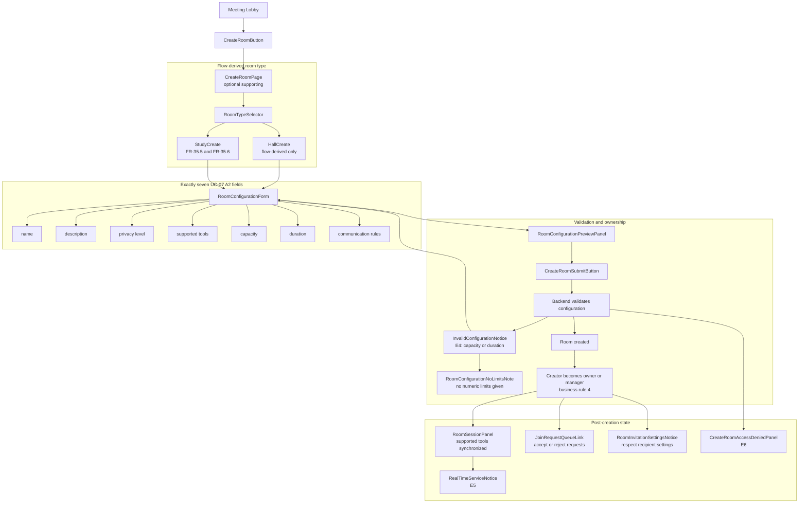

# Create Room Page Specification

> **Status:** UI/UX recommendation derived from the proposal documents in `requirements/proposals/`.
>
> **Scope:** This document describes the **Create Room** flow and recommends UI component names, displayed information, and the user action supported by each component. Meeting rooms are **optional supporting features**; the **University Forum is the primary collaboration space**.
>
> **Main sources:** [`screen_flow.md`](screen_flow.md), [`feature_flow.md`](feature_flow.md), [`overview.md`](overview.md), [`functional_requirement.md`](functional_requirement.md), [`userstory.md`](userstory.md), [`use_cases_description.md`](use_cases_description.md), [`use_cases_model/UC-07-join-create-study-room.md`](use_cases_model/UC-07-join-create-study-room.md), [`non_functional_requirement.md`](non_functional_requirement.md).
>
> **Note:** The creation field list is **exactly** the seven fields in `UC-07` A2: name, description, privacy level, supported tools, capacity, duration, and communication rules. **`E4` requires validation of invalid capacity or duration, but no numeric limits, minimums, maximums, or default values are given in the proposal**; none are invented here. **Hall** creation is flow-derived only (`feature_flow.md:171`); the explicit creation requirements `FR-35.5`/`AC-35.4` and `FR-35.6`/`AC-35.5` are written for study rooms. [`API.md`](API.md) and [`response_code.md`](response_code.md) contain no room endpoints, room fields, or room error codes, so any room API shape is **unspecified** and no endpoints or codes are invented here. Older PA2 hall/study details (tables, seats, invite codes, 30-minute teardown) are **not** current requirements and are not used.

---

## 1. Purpose of the Create Room Page

The **Create Room** page lets an authenticated student set up an optional live study room and become its owner or manager. The flow starts from the Meeting Lobby, offers a Hall or Study room target from `feature_flow.md`, and collects only the configuration fields named in `UC-07` A2. Validation rejects invalid capacity or duration values per `E4`, and the creator receives owner/manager controls for join requests and configuration.

### 1.1 Core purposes

| Purpose | What the user achieves | Requirement basis |
| --- | --- | --- |
| Start creation from the Lobby | Open Create after reviewing rooms in the Lobby. | `feature_flow.md:169–172`, `UC-07` A2 |
| Choose a room type | Select the flow-derived **HallCreate** or **StudyCreate** target. | `feature_flow.md:171–172`; recommendation |
| Enter required configuration | Provide name, description, privacy level, supported tools, capacity, duration, and communication rules. | `UC-07` A2, `FR-35.5`, `FR-35.6`, `AC-35.4`, `AC-35.5` |
| Select privacy | Control whether the room is public or private/custom for joining. | `FR-35.5`, `AC-35.4`, `UC-07` business rule 3 |
| Select supported tools | Choose which shared study tools the room supports. | `FR-35.5`, `AC-35.4`, `FR-36.1`–`FR-36.3` |
| Configure policies | Set capacity, duration, and communication rules as manager. | `FR-35.6`, `AC-35.5`, `UC-07` business rule 5 |
| Validate configuration | Reject invalid capacity or duration without creating the room. | `UC-07` E4 |
| Become owner/manager | Gain ownership/management rights on successful creation. | `UC-07` A2, business rule 4 |
| Enter the new room | Open the room session with supported tools after creation. | `UC-07` A2, I-08 |
| Respect user controls | Ensure invitations and participation honor communication/privacy settings. | `FR-38.3`, `AC-38.4`, `FR-39.1`–`FR-39.5`, `NFR-PRIV-6` |

### 1.2 Place in the screen flow

`screen_flow.md` defines:

```text
Home -> Meeting
Meeting -> Hall Room
Meeting -> Study Room
```

### 1.3 Place in the feature flow and UC-07

`feature_flow.md:169–172` defines the creation entry:

```text
Lobby -> Create
Create -> HallCreate
Create -> StudyCreate
```

`UC-07` A2 defines the creation scenario:

```text
Select Create Room -> enter name, description, privacy level, supported tools,
capacity, duration, and communication rules -> submit ->
backend validates configuration -> create room ->
assign creator as owner or manager -> open room
```

**Flow-derived only:** the room-type labels **HallCreate** and **StudyCreate** come from `feature_flow.md` and have no dedicated FR or AC; the requirement-level creation behavior is generic room creation.

---

## 2. Recommended page identity and naming

| Item | Suggested name | Notes |
| --- | --- | --- |
| Page group | `MeetingGroupPage` | Matches the supporting group in `screen_flow.md`. |
| Main page | `CreateRoomPage` | Matches the `Create Room` label in `UC-07` A2. |
| Suggested route | `/meeting/create` or `/meeting/rooms/new` | Recommended route; not specified in the proposal. |
| Type-specific states | `HallCreatePage`, `StudyCreatePage` | Match `HallCreate` / `StudyCreate` in `feature_flow.md:171–172`. |
| Page title | **Create Room** | Uses the `UC-07` label. |
| Primary action | **Create Room** or **Submit** | `UC-07` A2 uses “submits”; `feature_flow.md` uses Create. |
| Main object | `RoomConfiguration` | Recommended object for the seven-field form. |
| Result object | `RoomSession` | Created room session entered via I-08. |

### 2.1 Naming convention recommendation

- Prefix form components with `Room` or `CreateRoom`.
- Prefix selection components with `RoomType`, `Privacy`, or `SupportedTools`.
- Prefix validation components with `RoomConfiguration`.
- Use PascalCase, e.g. `RoomTypeSelector`, `CommunicationRulesInput`, `InvalidConfigurationNotice`.

---

## 3. Target users and user goals

| User type | Main goal on Create Room | Components used most |
| --- | --- | --- |
| Student starting a study group | Create an optional room for classmates. | `CreateRoomPage`, `CreateRoomSubmitButton` |
| Student choosing a room type | Pick the Hall or Study creation path. | `RoomTypeSelector`, `HallTypeOption`, `StudyTypeOption` |
| Student defining a public room | Set privacy so others can join with available capacity. | `RoomPrivacySelect`, `RoomCapacityInput` |
| Student defining a private/custom room | Set privacy so requests go to the owner/manager. | `RoomPrivacySelect`, `CommunicationRulesInput` |
| Student selecting tools | Enable whiteboard, notes, or timer support. | `SupportedToolsSelector` |
| Manager configuring policies | Set duration and communication rules. | `RoomDurationInput`, `CommunicationRulesInput` |
| Student with an invalid configuration | Correct capacity or duration values. | `InvalidConfigurationNotice`, field-level errors |
| New room owner/manager | Enter the created room and manage join requests. | `RoomSessionPanel`, `JoinRequestQueueLink` |

---

## 4. Recommended information architecture

| View/section | Suggested state/route | Purpose | Main components |
| --- | --- | --- | --- |
| Entry | Lobby → Create | Starts creation from the optional Meeting Lobby. | `CreateRoomButton`, `CreateRoomPage` |
| Room type | Top of form | Chooses Hall or Study room creation. | `RoomTypeSelector`, `HallTypeOption`, `StudyTypeOption` |
| Identity | Form section | Captures name and description. | `RoomNameInput`, `RoomDescriptionInput` |
| Access | Form section | Captures privacy level and communication rules. | `RoomPrivacySelect`, `CommunicationRulesInput` |
| Tools | Form section | Selects supported tools. | `SupportedToolsSelector` |
| Policies | Form section | Captures capacity and duration. | `RoomCapacityInput`, `RoomDurationInput` |
| Validation | Action area | Reports invalid capacity/duration and other invalid values. | `RoomConfigurationValidationSummary`, `InvalidConfigurationNotice` |
| Submission | Action area | Creates the room, assigns owner/manager, and opens the session. | `CreateRoomSubmitButton`, `CreateRoomSuccessNotice` |

---

## 5. Recommended UI components

### 5.1 Page shell and room type

| Suggested name | UI type | Information shown | Meaning / action | Requirement basis |
| --- | --- | --- | --- | --- |
| `CreateRoomPage` | Page container | Heading **Create Room**, type selector, form, validation, submit/cancel. | Root container for the creation flow. | `UC-07` A2, `feature_flow.md:169–172` |
| `CreateRoomButton` | Primary button | Label **Create Room**. | Opens Create from the Meeting Lobby. | `feature_flow.md:169`, `UC-07` A2 |
| `RoomTypeSelector` | Segmented control/card selector | **Hall** and **Study Room** options. | Chooses the flow-derived creation target. | `feature_flow.md:171–172`; recommendation |
| `HallTypeOption` | Selectable card/radio | Label **Hall**, description “Create a hall room.” | Opens the HallCreate flow. | `feature_flow.md:171`; flow-derived only |
| `StudyTypeOption` | Selectable card/radio | Label **Study Room**, description “Create a study room.” | Opens the StudyCreate flow. | `feature_flow.md:172`, `FR-35.5`, `AC-35.4` |
| `CreateBreadcrumb` | Breadcrumb | `Home > Meeting > Lobby > Create` | Shows the supporting-flow location. | Recommendation; supports `NFR-USE-4` |
| `CancelCreateRoomButton` | Secondary button | Label **Cancel**. | Leaves creation without creating a room. | Recommendation |
| `CreateRoomSubmitButton` | Primary submit button | Label **Create Room** or **Submit**. | Submits the validated configuration. | `UC-07` A2 |

### 5.2 Creation form fields from UC-07 A2

| Suggested name | UI type | Information shown | Meaning / action | Requirement basis |
| --- | --- | --- | --- | --- |
| `RoomNameInput` | Required textbox | Label **Name**. | User enters the room name. | `UC-07` A2, `FR-35.5`, `AC-35.4` |
| `RoomDescriptionInput` | Textarea | Label **Description**. | User explains the room's purpose. | `UC-07` A2, `FR-35.5`, `AC-35.4` |
| `RoomPrivacySelect` | Radio group/dropdown | Label **Privacy level**; public/private/custom choice. | Controls joining behavior and request requirement. | `UC-07` A2, `FR-35.5`, `AC-35.4`, `UC-07` business rule 3 |
| `SupportedToolsSelector` | Checkbox group | Label **Supported tools**; whiteboard, notes, timer. | Selects tools available to participants. | `UC-07` A2, `FR-35.5`, `AC-35.4`, `FR-36.1`–`FR-36.3` |
| `RoomCapacityInput` | Number input | Label **Capacity**; no numeric limits displayed. | Sets available capacity for joining. | `UC-07` A2, `FR-35.6`, `AC-35.5`, `UC-07` E4 |
| `RoomDurationInput` | Duration input | Label **Duration**; no numeric limits displayed. | Sets the configured session duration. | `UC-07` A2, `FR-35.6`, `AC-35.5`, `UC-07` E4 |
| `CommunicationRulesInput` | Textarea/structured control | Label **Communication rules**. | Sets manager-defined communication rules. | `UC-07` A2, `FR-35.6`, `AC-35.5`, `UC-07` business rule 5 |
| `RoomConfigurationForm` | Form container | Exactly the seven `UC-07` A2 fields. | Groups creation inputs into one submission. | `UC-07` A2 |
| `RoomConfigurationPreviewPanel` | Preview card | Name, description, privacy, tools, capacity, duration, rules. | Lets the creator verify configuration before submit. | Recommendation; supports `NFR-USE-4` |

### 5.3 Validation, ownership, and results

| Suggested name | UI type | Information shown | Meaning / action | Requirement basis |
| --- | --- | --- | --- | --- |
| `RoomConfigurationValidationSummary` | Alert/list | Invalid or missing configuration fields. | Gives one place to fix errors before submit. | `UC-07` E4 |
| `InvalidConfigurationNotice` | Alert | “Invalid capacity or duration. Room was not created.” | Highlights invalid values named in `E4`. | `UC-07` E4 |
| `CapacityValidationText` | Inline error text | Unsupported capacity value; no numeric range shown. | Explains that capacity was rejected. | `UC-07` E4 |
| `DurationValidationText` | Inline error text | Unsupported duration value; no numeric range shown. | Explains that duration was rejected. | `UC-07` E4 |
| `RoomConfigurationNoLimitsNote` | Informational note | “No numeric limits are specified for capacity or duration.” | Avoids inventing bounds not present in the proposal. | Gap in `UC-07` A2/E4 and `FR-35.6` |
| `OwnerManagerAssignmentNotice` | Informational notice | “You will be the room owner or manager.” | Explains the creation postcondition. | `UC-07` A2, business rule 4 |
| `CreateRoomSuccessNotice` | Toast | “Room created.” with open-room action. | Confirms creation and next step. | `UC-07` A2, business rule 4 |
| `JoinRequestQueueLink` | Link | Label **Review join requests**. | Opens owner/manager decision queue after creation. | `FR-35.4`, `AC-35.3` |
| `RoomInvitationSettingsNotice` | Informational note | “Invitations respect recipient settings.” | Explains invitation restrictions. | `FR-38.3`, `AC-38.4`, `FR-39.3`, `FR-39.5`, `NFR-PRIV-6` |
| `CreateRoomFailureAlert` | Alert | “Room could not be created.” with retry. | Handles backend failure without a partial room. | Recommendation; supported by `UC-07` E4 failure pattern |
| `RealTimeServiceNotice` | Alert | “Live collaboration service is unavailable.” | Warns that a created room may not open a session. | `UC-07` precondition 2, E5 |
| `CreateRoomAccessDeniedPanel` | Error state | “You are not permitted to create a room.” | Handles authorization failure. | `UC-07` precondition 4, `NFR-SEC-1`, `NFR-SEC-6` |

---

## 6. Recommended information displayed

### 6.1 Room configuration fields

| Field | Suggested label | Where shown | Purpose |
| --- | --- | --- | --- |
| `name` | **Name** | Form, preview, success notice | Identifies the new room. |
| `description` | **Description** | Form, preview | Explains the room's academic purpose. |
| `privacyLevel` | **Privacy level** | Form, preview | Determines public join or private/custom request. |
| `supportedTools` | **Supported tools** | Form, preview | Selects whiteboard, notes, and timer support. |
| `capacity` | **Capacity** | Form, preview, validation | Sets joining capacity; numeric limits unspecified. |
| `duration` | **Duration** | Form, preview, validation | Sets session duration; numeric limits unspecified. |
| `communicationRules` | **Communication rules** | Form, preview | Manager-defined participation rules. |

### 6.2 Creation result information

| Field | Suggested label | Where shown | Purpose |
| --- | --- | --- | --- |
| `roomType` | **Room type** | Type selector, success notice | Flow-derived Hall or Study room target. |
| `creatorRole` | **Your role** | Ownership notice | Shows owner/manager assignment. |
| `roomStatus` | **Status** | Success/failure notice | Shows created, validation-failed, or denied. |
| `invalidFields` | Hidden/internal | Validation summary | Identifies invalid capacity, duration, or other values. |
| `sessionAvailability` | **Live session** | Real-time notice | Reflects availability of the collaboration service. |

---

## 7. Recommended interaction flows

### 7.1 Create a room

1. User opens the Meeting Lobby and clicks `CreateRoomButton`.
2. `RoomTypeSelector` offers **Hall** and **Study Room** from `feature_flow.md:171–172`.
3. User completes exactly the seven `UC-07` A2 fields: name, description, privacy level, supported tools, capacity, duration, communication rules.
4. `RoomConfigurationPreviewPanel` reflects the entered values.
5. User clicks `CreateRoomSubmitButton`.
6. Backend validates the configuration as in `UC-07` A2.
7. On success, the room is created, the creator is assigned owner/manager, and the room session opens with the supported tools.
8. `CreateRoomSuccessNotice` confirms creation and offers the join-request queue.

### 7.2 Invalid configuration

1. User enters an unsupported capacity or duration value.
2. `RoomConfigurationValidationSummary` lists the invalid fields.
3. `InvalidConfigurationNotice` explains that the room was not created, matching `UC-07` E4.
4. `CapacityValidationText` and `DurationValidationText` identify the exact fields.
5. `RoomConfigurationNoLimitsNote` avoids implying bounds the proposal does not define.
6. User corrects the values and resubmits.

### 7.3 Create a hall room

1. User selects `HallTypeOption`.
2. The same generic form collects the seven `UC-07` A2 fields.
3. Validation and ownership rules are identical to the study-room path.
4. This target is **flow-derived only**; no hall-specific FR or AC modifies the form.

### 7.4 Create a study room and manage it

1. User selects `StudyTypeOption`.
2. `RoomPrivacySelect` determines whether others join directly or request access.
3. `SupportedToolsSelector` enables whiteboard, notes, and timer support.
4. `CommunicationRulesInput` and `RoomDurationInput` capture manager policies.
5. After creation, the creator is owner/manager and can accept or reject requests through `JoinRequestQueueLink`.

### 7.5 Authorization, failure, and invitations

1. If the user is not permitted to create a room, `CreateRoomAccessDeniedPanel` explains the restriction.
2. If the real-time collaboration service is unavailable, `RealTimeServiceNotice` warns that the session may not open.
3. If creation fails, `CreateRoomFailureAlert` offers retry without a partial room.
4. `RoomInvitationSettingsNotice` reminds the creator that invitations respect recipient notification and communication settings.

---

## 8. Business rules and UI states

| Rule/state | Recommended UI behavior | Requirement basis |
| --- | --- | --- |
| Meeting rooms are optional supporting features. | Keep the forum primary in navigation and copy. | `UC-07` business rule 1, `feature_flow.md` note |
| Creation starts from the Lobby. | Reach Create only through the Meeting flow. | `feature_flow.md:169–172` |
| Hall and Study creation targets are flow-derived. | Show both options but apply the same generic form. | `feature_flow.md:171–172`; no hall-specific FR/AC |
| Creation fields are exactly the seven `UC-07` A2 fields. | Do not add other fields such as invite codes or fixed seats. | `UC-07` A2 |
| Room creator becomes owner or manager. | Show `OwnerManagerAssignmentNotice` and manager controls after creation. | `UC-07` A2, business rule 4 |
| Managers configure capacity, duration, and communication rules. | Provide `RoomCapacityInput`, `RoomDurationInput`, `CommunicationRulesInput`. | `FR-35.6`, `AC-35.5`, business rule 5 |
| Managers also configure privacy level and supported tools. | Provide `RoomPrivacySelect` and `SupportedToolsSelector`. | `FR-35.5`, `AC-35.4`, business rule 5 |
| Invalid configuration must not create a room. | Block submit and show `InvalidConfigurationNotice`. | `UC-07` E4 |
| Invalid capacity or duration is highlighted. | Show field-level errors without inventing numeric limits. | `UC-07` E4 |
| No numeric limits are given for capacity or duration. | Use unconstrained-labeled inputs and avoid fixed defaults in copy. | Gap in `UC-07` A2/E4, `FR-35.6` |
| Private/custom rooms require owner or manager decisions. | After creation, expose `JoinRequestQueueLink`. | `FR-35.4`, `AC-35.3`, business rule 3 |
| Shared tools are synchronized in the room. | Select tools knowing they will be synchronized for participants. | `FR-36.4`, `AC-36.4`, `NFR-PERF-7` (≤ 1 second) |
| Invitations only when enabled. | Explain that invitations are suppressed when notifications are off. | `FR-38.3`, `AC-38.4` |
| Communication and privacy settings must be respected. | Backend must enforce restrictions; UI explains them. | `FR-39.1`–`FR-39.5`, `AC-39.1`–`AC-39.3`, `NFR-PRIV-6` |
| Authentication and server-side authorization are required. | Deny creation for unauthenticated or blocked users. | `UC-07` preconditions 1 and 4, `NFR-SEC-1`, `NFR-SEC-6` |
| Sensitive traffic uses TLS. | Serve the creation flow over TLS. | `NFR-SEC-3` |
| At least 100 concurrent rooms must be supported. | Treat creation as one of many concurrent rooms. | `NFR-SCAL-6` |
| Layouts must work from 320 px upward. | Use a responsive form with clear labels. | `NFR-USE-2`, `NFR-USE-4`, `NFR-USE-5` |
| Room API shape is unspecified. | Do not infer endpoints, fields, or error codes from forum APIs. | `API.md`, `response_code.md` contain no room definitions |
| Older PA2 details are excluded. | Do not show fixed tables, seat assignments, invite codes, or 30-minute teardown. | PA2 details are not current requirements |

---

## 9. Requirements traceability

| Requirement/source | Covered by |
| --- | --- |
| `screen_flow.md`: Home → Meeting → Hall/Study Room | Entry context for creation |
| `feature_flow.md:169–172`: Lobby → Create → HallCreate / StudyCreate | `CreateRoomButton`, `RoomTypeSelector`, type-specific states |
| `UC-07` A2 | Exact seven-field `RoomConfigurationForm`, validation, owner/manager assignment, room opening |
| `UC-07` E4 | `InvalidConfigurationNotice`, capacity/duration field errors |
| `UC-07` business rules 1–8 | Optional supporting status, privacy/request rules, creator ownership, manager policies, synchronized tools |
| `UC-07` preconditions 1–4 and E5/E6 | Authentication, service availability, permission checks, real-time and access states |
| `I-08 Enter Room Session`, `G-04 Create Study Room` | Post-creation session entry and creation specialization |
| `US-35`, `FR-35.5`, `AC-35.4` | Name, description, privacy level, supported tools |
| `US-35`, `FR-35.6`, `AC-35.5` | Capacity, duration, communication rules |
| `FR-35.4`, `AC-35.3` | Post-creation join-request management for owner/manager |
| `US-34`, `FR-34.1`–`FR-34.4`, `AC-34.1`–`AC-34.3`; `FR-09.4`, `AC-09.4` | Created rooms can later appear in Lobby recommendations with availability/capacity |
| `US-36`, `FR-36.1`–`FR-36.6`, `AC-36.1`–`AC-36.6` | Supported tools are synchronized; notes survive reconnection in the created room |
| `US-37`, `FR-37.1`–`FR-37.6`, `AC-37.1`–`AC-37.6` | Help requests are available to participants after the room opens |
| `FR-38.3`, `AC-38.4`, `FR-38.4` | Room invitations only when enabled |
| `FR-39.1`–`FR-39.5`, `AC-39.1`–`AC-39.3`, `NFR-PRIV-4`, `NFR-PRIV-6`, `NFR-PRIV-7` | Communication/privacy restrictions applied to invitations and participation |
| `NFR-SEC-1`, `NFR-SEC-3`, `NFR-SEC-6`, `NFR-SEC-9` | Authentication, TLS, server-side authorization, rate limits |
| `NFR-PERF-7`, `NFR-SCAL-6` | Tool latency ≤ 1 second and at least 100 concurrent rooms |
| `NFR-USE-2`, `NFR-USE-4`, `NFR-USE-5` | Responsive form layout and clear action labels |
| No numeric limits in `UC-07` A2/E4 or `FR-35.6` | `RoomConfigurationNoLimitsNote`; no capacity/duration bounds invented |
| `API.md`, `response_code.md` | No room endpoints, room fields, or room error codes; room API shape is unspecified |
| Older PA2 hall/study details | Tables, seats, invite codes, and 30-minute teardown are excluded |

---

## 10. Summary diagram


