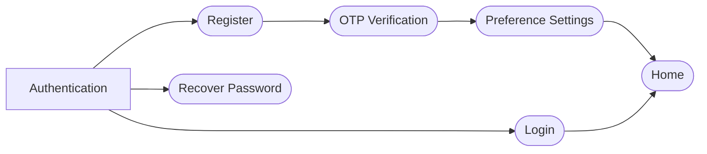
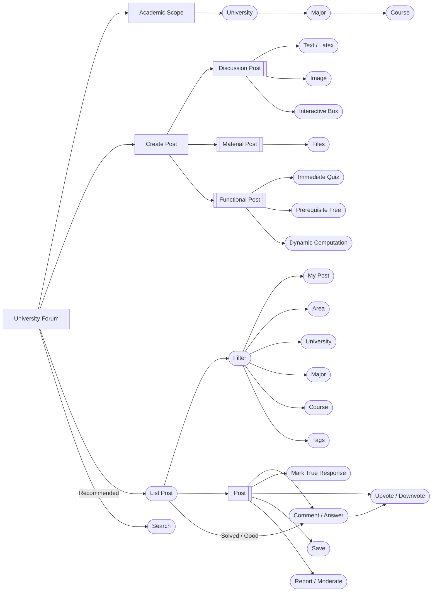
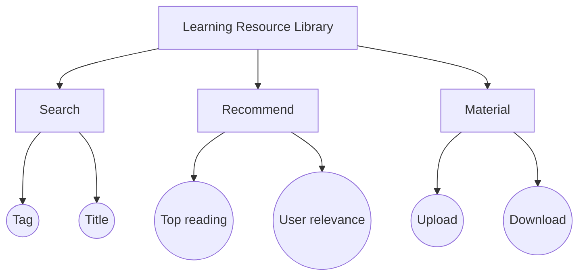
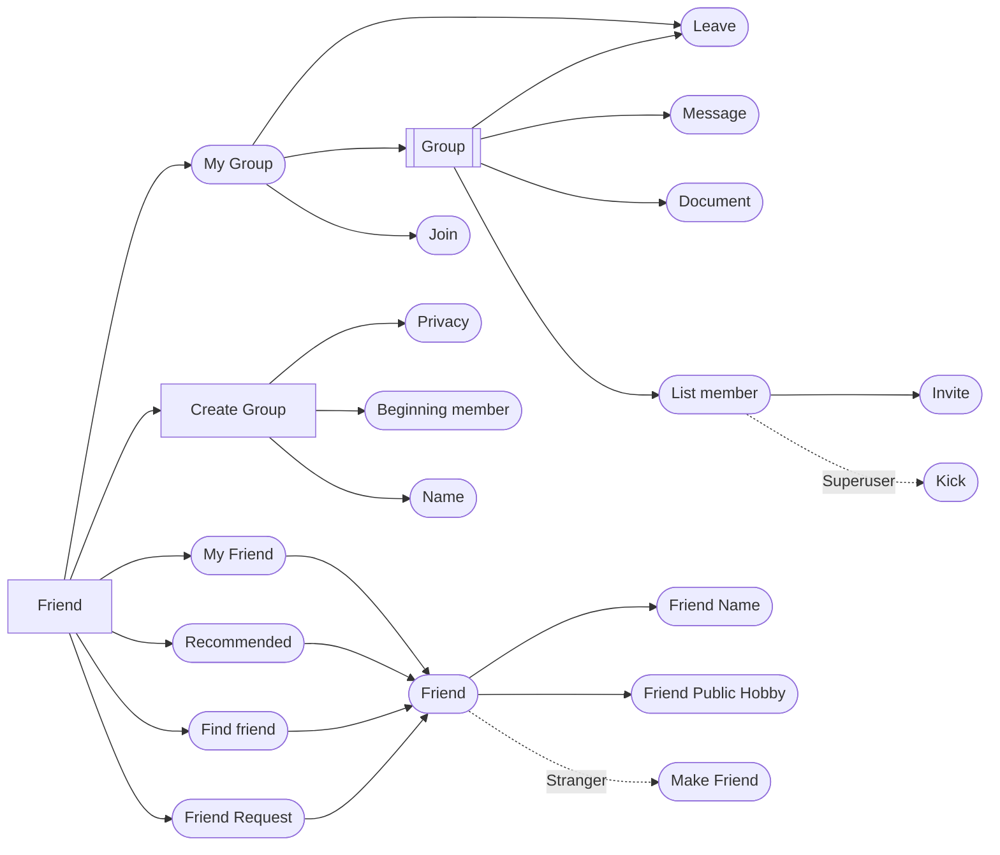
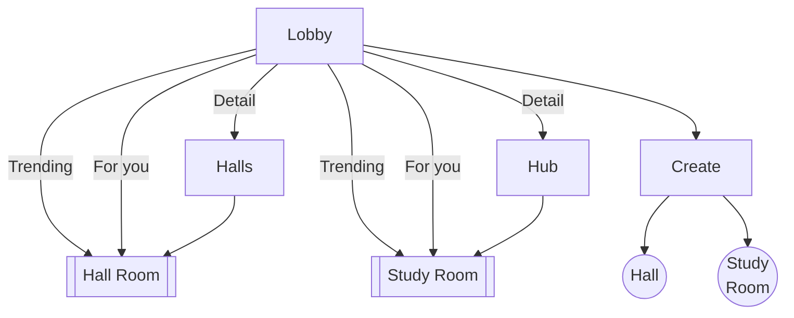

# Feature flow

**Version:** `1.0`

**Performed by:** [Nguyen Le Quoc Huy] | **Edited by:** [Nguyen Le Quoc Huy]
> The Forum is the primary feature group of Studitopia. Meeting-room features are supporting capabilities and are shown last.

## Authentication Group

## Forum Group (Primary)

## Post Management

```mermaid
flowchart TD
			Posts[["Post"]]
			Posts --> Delete(["Delete / Hide"])
			Posts --> Upvote(["Upvote"])
			Posts --> Downvote(["Downvote"])
			Posts --> Save(["Save"])
			Posts --> Owner(["Owner"])
			Posts --> Time(["Time"])
			Posts --> Comment(["Comment"]) --> |See / Make| TrueResponse(["True Response"])

			Posts --> DiscussPost[["Discussion Post"]]
			Posts --> MaterialPost[["Material Post"]]
			Posts --> FunctionalPost[["Functional Post"]]

			FunctionalPost --> Quiz(["Quiz"]) --> DoQuiz(["Do"])
			FunctionalPost --> PrerequisiteTree(["Prerequisite Tree"])
			PrerequisiteTree --> AutoApply(["Auto apply"])
			PrerequisiteTree --> Simulate(["Simulate by click"])

			CreatePost(["Create Post"]) --> CDiscussPost[["Discussion Post"]]
			CDiscussPost --> CText(["Text"]) --> CLatex(["Latex"])
			CDiscussPost --> CImage(["Image"])
			CDiscussPost --> CTitle(["Title"])
			CDiscussPost --> InteractiveBox(["Interactive Box"])

			CreatePost --> CMaterial[["Material Post"]]
			CMaterial --> CFiles(["Files"])
			CMaterial --> CMTitle(["Title"])
			CMaterial --> Description(["Description"])

			CreatePost --> CFunctional[["Functional Post"]]
			CFunctional --> FTitle(["Title"])
			CFunctional --> CQuiz(["Quiz"])
			CFunctional --> CPrerequisiteTree(["Prerequisite Tree"])

			CDiscussPost & CMaterial & CFunctional ==> SubmitButton(["Submit"])
```

## Library Group

## Friend Group

# Lobby Group (Supporting)

> Meeting rooms are optional and support the forum. They are not the primary feature group.

