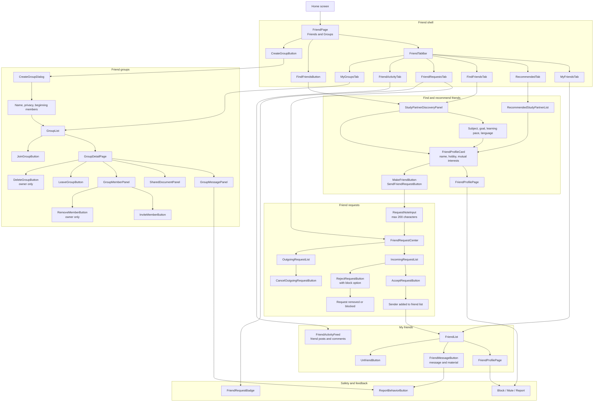

# Friend Page Specification

> **Status:** UI/UX recommendation derived from the proposal documents in `requirements/proposals/`.
>
> **Scope:** This document describes the **Friend Group** page, also called **Friends and Groups**, and recommends UI component names, displayed information, and the user action supported by each component.
>
> **Main sources:** [`screen_flow.md`](screen_flow.md), [`feature_flow.md`](feature_flow.md), [`overview.md`](overview.md), [`functional_requirement.md`](functional_requirement.md), [`userstory.md`](userstory.md).
>
> **Note:** The selected PA3 use cases do not include a dedicated friend/group use case. Therefore, the main requirement basis for this page is `US-30`–`US-33`, the friend flows in `feature_flow.md`/`screen_flow.md`, and the social safety requirements in `US-38`–`US-40`.

---

## 1. Purpose of the Friend Page

The **Friend Page** is the social and academic-connection area of Studitopia. Its purpose is to help university students **find compatible study partners, send and manage friend requests, maintain a friend list, create private or public friend groups, and collaborate through messages, materials, and group documents**.

The forum remains the primary collaboration space, but the Friend Page supports it by turning shared university, major, course, subject, goal, and interest context into durable academic connections.

### 1.1 Core purposes

| Purpose | What the user achieves | Requirement basis |
| --- | --- | --- |
| Find study partners | Search the member directory by subject, learning goal, learning pace, and language; see concise profile cards with mutual academic interests. | `US-30`, `FR-30.1`–`FR-30.4`, `AC-30.1`–`AC-30.3` |
| Discover recommended peers | See peers with similar courses, subjects, interests, and mutual connections. | `feature_flow.md`, `AC-30.2`, `AC-30.3` |
| Send friend requests | Send a request from a profile card or member list, optionally with a short note. | `US-31`, `FR-31.1`, `FR-31.3`, `AC-31.1`, `AC-31.3` |
| Prevent duplicate requests | Show a clear “Request sent” state and prevent repeated requests between the same users. | `FR-31.2`, `AC-31.2` |
| Manage incoming requests | Accept or reject incoming requests from a centralized request center. | `US-32`, `FR-32.1`–`FR-32.3`, `AC-32.1`, `AC-32.2` |
| Control future requests | Block future requests from a rejected sender. | `FR-32.4`, `AC-32.3` |
| Maintain friends | View friends, open profiles, message friends, share material, or unfriend. | `overview.md`, `feature_flow.md` |
| Create groups | Create private or public groups with a name, privacy setting, and beginning members. | `US-33`, `FR-33.1`, `FR-33.2`, `AC-33.1`, `feature_flow.md` |
| Collaborate in groups | Send messages, share documents/materials, view members, invite members, and leave groups. | `FR-33.3`, `FR-33.4`, `FR-33.6`, `AC-33.2`, `AC-33.3`, `AC-33.5` |
| Manage group members | Let the group owner remove members when necessary. | `FR-33.5`, `AC-33.4`, `feature_flow.md` |
| See friend activity | View friend posts and comments from the forum when available. | `overview.md` |
| Stay safe and in control | Receive social notifications, configure communication/privacy settings, mute/block users, and report inappropriate behavior. | `FR-38.2`, `FR-38.4`, `FR-39.1`–`FR-39.5`, `FR-40.1`–`FR-40.4` |

### 1.2 Place in the screen flow

`screen_flow.md` defines:

```text
Home -> Friend Group
Friend Group -> Find friend
Friend Group -> Recommend
Friend Group -> Friend Request
Friend Group -> Create Group
```

`feature_flow.md` expands the group into:

```text
Friend -> My Group / My Friend / Recommended / Find friend / Friend Request / Create Group
My Friend -> Friend item
Friend item -> Friend Name / Friend Public Hobby / Make Friend
My Group -> Group / Leave / Join
Group -> Message / Document / List member / Leave
Member -> Invite / Kick by superuser
Create Group -> Privacy / Beginning member / Name
```

`overview.md` adds:

```text
Friend -> Friend / Unfriend
Friend -> Friend Post and Comment
Friend / Group -> Message / Material
Friend -> Create / Delete Group (Private | Public)
```

Therefore, the recommended page should keep **Find friend**, **Recommend**, **Friend Request**, and **Create Group** as first-class entry points, while adding practical management views for friend profiles, friend lists, group detail, messaging, documents, and member management.

---

## 2. Recommended page identity and naming

| Item | Suggested name | Notes |
| --- | --- | --- |
| Page group | `FriendGroupPage` | Matches the name used in `screen_flow.md`. |
| Main page | `FriendsAndGroupsPage` | Clearer product-facing name that covers both friends and groups. |
| Suggested route | `/friends` | Recommended route; not specified in the proposal. |
| Page title | **Friends & Groups** | Friendly title for the whole group. |
| Short navigation label | **Friend** | Matches the side-panel label in `screen_flow.md`. |
| Primary actions | **Find Friends**, **Create Group** | Match the named flows in the proposal. |
| Main objects | `FriendUser`, `FriendRequest`, `FriendGroup`, `GroupMessage`, `SharedDocument` | Recommended object names for UI implementation. |

### 2.1 Naming convention recommendation

- Prefix person-discovery components with `Friend` or `Partner`.
- Prefix request components with `FriendRequest`.
- Prefix group components with `Group` or `MyGroup`.
- Prefix safety components with `Block`, `Mute`, or `Report`.
- Use PascalCase, e.g. `FriendProfileCard`, `CreateGroupDialog`, `GroupMemberPanel`.

---

## 3. Target users and user goals

| User type | Main goal on the Friend Page | Components used most |
| --- | --- | --- |
| University student looking for study partners | Find peers with similar courses, goals, pace, and language. | `StudyPartnerDiscoveryPanel`, `PartnerSearchInput`, `FriendProfileCard` |
| Student sending a friend request | Contact a peer with a short academic introduction. | `SendFriendRequestButton`, `RequestNoteInput`, `OutgoingRequestList` |
| Request recipient | Decide whether to accept, reject, or block future requests. | `FriendRequestCenter`, `AcceptRequestButton`, `RejectRequestButton` |
| Friend-list user | View friend profiles, message friends, share material, or unfriend. | `MyFriendsPanel`, `FriendProfilePage`, `FriendMessageButton` |
| Group owner | Create a private/public group and manage members. | `CreateGroupDialog`, `GroupMemberPanel`, `RemoveMemberButton` |
| Group member | Message the group, share documents, invite members, or leave. | `GroupMessagePanel`, `SharedDocumentPanel`, `InviteMemberButton`, `LeaveGroupButton` |
| Safety-conscious user | Mute, block, restrict, or report unwanted communication. | `BlockUserButton`, `MuteUserButton`, `ReportBehaviorButton`, `CommunicationSettingsLink` |

---

## 4. Recommended information architecture

| View/section | Suggested route or state | Purpose | Main components |
| --- | --- | --- | --- |
| Friend home | `/friends` | Main entry point for social and group features. | `FriendPage`, `FriendTabBar`, `FriendTopBar` |
| My friends | `/friends/my-friends` | Shows accepted friends and quick actions. | `MyFriendsPanel`, `FriendList`, `FriendListItem` |
| Recommended | `/friends/recommended` | Shows suggested study partners. | `RecommendedStudyPartnerList`, `FriendProfileCard` |
| Find friends | `/friends/find` | Searches the member directory. | `StudyPartnerDiscoveryPanel`, `PartnerSearchInput`, filters |
| Friend requests | `/friends/requests` | Centralized request center. | `FriendRequestCenter`, `IncomingRequestList`, `OutgoingRequestList` |
| Friend profile | `/friends/users/:userId` | Shows one user's academic profile and actions. | `FriendProfilePage`, `FriendAcademicContextPanel`, `MutualInterestText` |
| Friend activity | `/friends/activity` | Shows friend posts and comments from the forum. | `FriendActivityFeed`, `FriendActivityItem` |
| My groups | `/friends/groups` | Shows joined or owned groups and public groups to join. | `MyGroupsPanel`, `GroupList`, `GroupCard` |
| Group detail | `/friends/groups/:groupId` | Group messaging, shared documents, and members. | `GroupDetailPage`, `GroupMessagePanel`, `SharedDocumentPanel`, `GroupMemberPanel` |
| Create group | `/friends/groups/new` or modal | Creates a private/public group. | `CreateGroupDialog`, `GroupNameInput`, `GroupPrivacySelect`, `BeginningMemberPicker` |
| Conversation | `/friends/messages/:conversationId` | Direct friend messaging and material sharing. | `FriendConversationPanel`, `DirectMessageInput`, `MaterialShareButton` |

---

## 5. Recommended UI components

### 5.1 Page shell and navigation

| Suggested component name | UI component type | Information shown | Meaning / user action | Requirement basis |
| --- | --- | --- | --- | --- |
| `FriendPage` | Page container | Page heading **Friends & Groups** and short subtitle such as “Find study partners and collaborate with classmates.” | Root container for all friend and group content. | `screen_flow.md`, `overview.md` |
| `FriendSidebarNavItem` | Sidebar navigation link | Label **Friend** and friend icon; optional unread request count. | Lets the user navigate from Home to the Friend Group. | `screen_flow.md`, `FR-38.4` |
| `FriendTopBar` | Header bar | Page title, `FindFriendsButton`, `CreateGroupButton`, notification shortcut. | Gives consistent access to primary friend actions. | Recommendation |
| `FriendBreadcrumb` | Breadcrumb | `Home > Friend > Find Friends`, `Home > Friend > Group`, etc. | Shows current location and helps the user go back. | Recommendation |
| `FriendTabBar` | Tab bar | **My Friends**, **Recommended**, **Find Friends**, **Friend Requests**, **Friend Activity**, **My Groups**. | Switches between major friend-page views. | `screen_flow.md`, `feature_flow.md` |
| `MyFriendsTab` | Tab | Label **My Friends** and friend count. | Opens the accepted friend list. | `feature_flow.md`, `overview.md` |
| `RecommendedTab` | Tab | Label **Recommended**. | Opens suggested study partners. | `screen_flow.md`, `feature_flow.md` |
| `FindFriendsTab` | Tab | Label **Find Friends**. | Opens the member directory search. | `screen_flow.md` |
| `FriendRequestsTab` | Tab with badge | Label **Friend Requests** and pending count. | Opens the centralized request center. | `FR-32.1`, `AC-32.1` |
| `FriendActivityTab` | Tab | Label **Friend Activity**. | Opens friend posts/comments from the forum. | `overview.md` |
| `MyGroupsTab` | Tab | Label **My Groups** and group count. | Opens joined/owned groups. | `feature_flow.md` |
| `FindFriendsButton` | Secondary button | Label **Find Friends**. | Starts the study-partner discovery flow. | `screen_flow.md` |
| `CreateGroupButton` | Primary button | Label **Create Group**. | Starts group creation. | `screen_flow.md`, `FR-33.1` |
| `FriendRequestBadge` | Badge | Number of pending incoming requests. | Alerts the user that requests need attention. | `FR-38.2`, `FR-38.4` |

---

### 5.2 Find friends and recommendations

The discovery area should support search and filtering by **subject, goal, learning pace, and language** (`FR-30.2`) and display profile cards with mutual academic interests (`FR-30.3`).

| Suggested component name | UI component type | Information shown | Meaning / user action | Requirement basis |
| --- | --- | --- | --- | --- |
| `StudyPartnerDiscoveryPanel` | Search section/card | Heading **Find study partners**, search input, filters, result count. | Groups all discovery controls in one place. | `US-30` |
| `PartnerSearchInput` | Textbox/search input | Placeholder “Search by name, subject, course, or goal.” | User enters keywords to find potential study partners. | `FR-30.1`, `AC-30.1` |
| `PartnerSubjectFilter` | Dropdown/tag filter | Subjects such as Calculus, Database, Physics. | Limits results by academic subject. | `FR-30.2`, `AC-30.1` |
| `PartnerGoalFilter` | Dropdown | Learning goals such as “exam prep”, “project partner”, “homework help”. | Limits results by study goal. | `FR-30.2`, `AC-30.1` |
| `PartnerLearningPaceFilter` | Dropdown | Values such as Slow, Moderate, Fast. | Limits results by preferred learning pace. | `FR-30.2`, `AC-30.1` |
| `PartnerLanguageFilter` | Dropdown | Languages used for study communication. | Limits results by preferred language. | `FR-30.2`, `AC-30.1` |
| `PartnerAcademicContextFilter` | Cascading select | University, Major, Course. | Limits results to the relevant academic context. | `FR-30.1`, `AC-30.3` |
| `PartnerFilterChipList` | Chip list | Active filters such as `Goal: exam prep`. | Shows current filters and lets users remove them. | Recommendation |
| `ClearPartnerFiltersButton` | Text button | Label **Clear filters**. | Resets discovery filters. | Recommendation |
| `RecommendedStudyPartnerList` | Card list/grid | Suggested peers with mutual interests and shared context. | Helps the user discover useful academic connections. | `feature_flow.md`, `AC-30.2`, `AC-30.3` |
| `RecommendationReasonText` | Supporting text | “Shares CS101 and Database” or “3 mutual friends.” | Explains why a peer is recommended. | `AC-30.2`, `AC-30.3` |
| `PartnerResultCountText` | Text | Example: “18 students found.” | Tells the user how many matches were found. | Recommendation |
| `PartnerNoResultsState` | Empty state | “No study partners found” and suggestions to change filters. | Helps the user recover from overly narrow filters. | Recommendation |

---

### 5.3 Friend profile card and profile page

`feature_flow.md` explicitly lists **Friend Name** and **Friend Public Hobby** on a friend item, and **Make Friend** for a stranger.

| Suggested component name | UI component type | Information shown | Meaning / user action | Requirement basis |
| --- | --- | --- | --- | --- |
| `FriendProfileCard` | Card | Avatar, friend name, university/major, shared courses, public hobby, mutual interests, mutual friends, relationship state. | Summarizes a user so the viewer can decide whether to connect. | `FR-30.3`, `FR-30.4`, `feature_flow.md` |
| `FriendAvatar` | Image/avatar | Profile image or initials. | Provides a visual identity for the user. | Recommendation |
| `FriendNameText` | Text | Display name. | Shows the user's name. | `feature_flow.md` |
| `PublicHobbyText` | Text | Public hobby or interests. | Helps users find personal/common-ground context. | `feature_flow.md` |
| `FriendAcademicContextPanel` | Info card | University, major, courses, subjects, learning goals. | Shows academic relevance. | `FR-30.1`, `FR-30.3` |
| `MutualInterestText` | Supporting text | Shared subjects, goals, courses, or forum contexts. | Explains academic common ground. | `FR-30.3`, `FR-30.4`, `AC-30.2` |
| `MutualConnectionText` | Supporting text | Mutual friends or shared forum context. | Builds trust by showing known connections. | `FR-30.4`, `AC-30.3` |
| `ProfileSummaryText` | Text | Short public bio. | Gives a quick introduction before connecting. | Recommendation |
| `ViewFriendProfileButton` | Button | Label **View profile**. | Opens the full friend profile page. | Recommendation |
| `FriendProfilePage` | Page/modal | Full profile information, academic context, mutual interests, activity, and actions. | Lets the user evaluate and interact with another student. | `AC-31.1` |
| `SendFriendRequestButton` | Primary button | Label **Add friend** or **Send friend request**. | Starts the friend-request flow from a profile card or profile page. | `FR-31.1`, `AC-31.1` |
| `MakeFriendButton` | Button for strangers | Label **Make Friend**. | Proposal-specific label for sending a request from a friend item. | `feature_flow.md` |
| `MessageFriendButton` | Secondary button | Label **Message**. | Opens direct messaging with a confirmed friend; may be restricted by privacy settings. | `overview.md`, `FR-39.4` |
| `MaterialShareButton` | Button/attachment action | Label **Share material**. | Lets the user send a learning resource in a friend conversation. | `overview.md` |
| `FriendPostsAndCommentsList` | List | Friend forum posts and comments. | Lets the user see recent academic activity and open the source post. | `overview.md` |
| `UnfriendButton` | Danger/text button | Label **Unfriend**. | Removes an existing friend connection. | `overview.md` |
| `BlockUserButton` | Danger/menu item | Label **Block user**. | Prevents future interaction where supported. | `FR-32.4`, `FR-39.3` |
| `MuteUserButton` | Menu item | Label **Mute**. | Suppresses messages or notifications from that user. | `FR-39.3` |
| `ReportBehaviorButton` | Menu item | Label **Report**. | Reports inappropriate profile or message behavior for moderation. | `FR-40.1`, `FR-40.2` |

---

### 5.4 Friend request components

| Suggested component name | UI component type | Information shown | Meaning / user action | Requirement basis |
| --- | --- | --- | --- | --- |
| `FriendRequestCenter` | Page/section | Heading **Friend Requests**, incoming and outgoing lists. | Centralized place to manage friend requests. | `FR-32.1`, `AC-32.1` |
| `IncomingRequestList` | List | Requests received by the current user. | Lets the user review who wants to connect. | `FR-32.1` |
| `OutgoingRequestList` | List | Requests sent by the current user. | Lets the user track pending requests and cancel them. | Recommendation |
| `FriendRequestCard` | Card/list item | Sender avatar/name, academic context, note, sent time, status. | Shows enough context to accept, reject, or cancel. | `FR-31.3`, `FR-32.1` |
| `RequestNoteText` | Text block | Introductory note, maximum 200 characters. | Helps the recipient understand why the sender wants to connect. | `FR-31.3`, `AC-31.3` |
| `RequestNoteInput` | Textarea with counter | Label **Message**, placeholder “Introduce yourself”, `0/200` counter. | Lets the sender write a short note before sending. | `FR-31.3`, `AC-31.3` |
| `SendRequestDialog` | Modal | Recipient summary and note input. | Focuses the user on composing the friend request. | `FR-31.1`, `FR-31.3` |
| `SubmitFriendRequestButton` | Primary button | Label **Send request**. | Submits the request. | `FR-31.1` |
| `CancelFriendRequestButton` | Secondary button | Label **Cancel**. | Closes the dialog without sending. | Recommendation |
| `CancelOutgoingRequestButton` | Text button | Label **Cancel request**. | Withdraws a pending outgoing request. | Recommendation |
| `AcceptRequestButton` | Primary button | Label **Accept**. | Adds the sender to the current user's friend list. | `FR-32.2`, `AC-32.2` |
| `RejectRequestButton` | Secondary button | Label **Decline**. | Rejects and removes the pending request. | `FR-32.3`, `AC-32.2` |
| `BlockFutureRequestsToggle` | Checkbox/toggle | Label **Block future requests from this user**. | Prevents repeat requests from a rejected sender. | `FR-32.4`, `AC-32.3` |
| `RequestStatusBadge` | Badge | `Pending`, `Accepted`, `Declined`, `Blocked`. | Shows request state. | `FR-32`, `FR-31.2` |
| `DuplicateRequestState` | Disabled button/message | “Friend request already sent.” | Prevents duplicate requests between the same users. | `FR-31.2`, `AC-31.2` |
| `RequestNotificationBadge` | Badge/toast | “Your friend request was accepted/declined.” | Informs the sender of the outcome. | `FR-31.4`, `FR-32.5` |

---

### 5.5 My Friends components

| Suggested component name | UI component type | Information shown | Meaning / user action | Requirement basis |
| --- | --- | --- | --- | --- |
| `MyFriendsPanel` | Page/section | Heading **My Friends**, friend list, friend search. | Shows accepted connections. | `feature_flow.md`, `overview.md` |
| `FriendSearchInput` | Textbox | Placeholder “Search my friends.” | Finds a friend by name or academic context. | Recommendation |
| `FriendList` | List | Accepted friends with profile summary and relationship state. | Lets the user browse friends quickly. | `feature_flow.md` |
| `FriendListItem` | List item | Avatar, name, university/major, shared courses, public hobby. | Represents one friend and provides quick actions. | `feature_flow.md` |
| `FriendOnlineStatusBadge` | Badge | Online/away/offline if available. | Shows current availability for messaging. | Recommendation |
| `FriendMessageButton` | Button | Label **Message**. | Opens direct conversation with the friend. | `overview.md` |
| `FriendMaterialShareButton` | Button | Label **Share material**. | Opens material/file sharing in the conversation. | `overview.md` |
| `ViewFriendProfileFromListButton` | Link | Label **View profile**. | Opens the friend's full profile. | Recommendation |
| `UnfriendFromListButton` | Menu action | Label **Unfriend**. | Removes the friend connection from the list. | `overview.md` |
| `MyFriendsEmptyState` | Empty state | “You have not added any friends yet.” | Encourages the user to find or accept requests. | Recommendation |
| `FriendActivityFeed` | Feed/list section | Friend post/comment activity from the forum. | Lets the user see what friends are discussing academically. | `overview.md` |
| `FriendActivityItem` | Feed item | Friend name, post title, comment snippet, timestamp, source forum link. | Shows one activity and opens the original forum content. | `overview.md` |

---

### 5.6 Friend group list and creation

| Suggested component name | UI component type | Information shown | Meaning / user action | Requirement basis |
| --- | --- | --- | --- | --- |
| `MyGroupsPanel` | Page/section | Joined groups, owned groups, and discoverable public groups. | Central place for group participation. | `feature_flow.md`, `US-33` |
| `GroupList` | Grid/list | Group cards with name, privacy, member count, owner, last activity. | Lets the user browse available groups. | Recommendation |
| `GroupCard` | Card | Group name, privacy badge, member count, short description, join/open action. | Represents one group and provides entry to detail. | `FR-33.1`, `FR-33.2` |
| `GroupPrivacyBadge` | Badge | `Private` or `Public`. | Shows joining/visibility rules. | `FR-33.1`, `AC-33.1` |
| `GroupOwnerBadge` | Badge | `Owner` or `Superuser`. | Shows who has member-removal privileges. | `FR-33.5`, `feature_flow.md` |
| `JoinGroupButton` | Button | Label **Join group**. | Joins a public or permitted group. | `feature_flow.md` |
| `LeaveGroupButton` | Secondary/danger button | Label **Leave group**. | Removes the current user from the group. | `FR-33.6`, `AC-33.5`, `feature_flow.md` |
| `DeleteGroupButton` | Danger button | Label **Delete group**. | Lets the owner permanently delete a group. | `overview.md` |
| `DeleteGroupConfirmDialog` | Confirmation dialog | “Delete `<group>`? Messages and documents may be removed.” with Cancel/Delete. | Prevents accidental group deletion. | Recommendation based on `overview.md` |
| `CreateGroupDialog` | Modal/page | Group creation form. | Focuses the user on setting up a new group. | `FR-33.1`, `FR-33.2` |
| `GroupNameInput` | Required textbox | Label **Group name**. | User names the group. | `FR-33.2`, `AC-33.1`, `feature_flow.md` |
| `GroupDescriptionInput` | Textarea | Label **Description**. | User explains the group's academic purpose. | Recommendation |
| `GroupPrivacySelect` | Radio group/dropdown | `Private`, `Public`. | User controls group visibility and joining behavior. | `FR-33.1`, `FR-33.2`, `AC-33.1` |
| `BeginningMemberPicker` | Multi-select/search | Searchable friend list with selected member chips. | User invites initial members during creation. | `FR-33.2`, `AC-33.1`, `feature_flow.md` |
| `CreateGroupSubmitButton` | Primary button | Label **Create group**. | Submits the new group. | `FR-33.1` |
| `CancelGroupCreationButton` | Secondary button | Label **Cancel**. | Closes creation without creating a group. | Recommendation |
| `MyGroupsEmptyState` | Empty state | “You are not in any groups yet.” | Encourages joining or creating a group. | Recommendation |

---

### 5.7 Group detail, messaging, documents, and members

| Suggested component name | UI component type | Information shown | Meaning / user action | Requirement basis |
| --- | --- | --- | --- | --- |
| `GroupDetailPage` | Page/modal | Group name, privacy, description, owner, member count, messages, documents, members. | Main collaboration space for one group. | `feature_flow.md`, `FR-33.3` |
| `GroupHeader` | Header | Group name, privacy badge, member count, owner, leave action. | Identifies the group and exposes top-level actions. | `FR-33.1`, `FR-33.2` |
| `GroupMessagePanel` | Message thread | Messages with sender, text, time, and attachments. | Lets members discuss coursework privately. | `FR-33.3`, `AC-33.2` |
| `GroupMessageInput` | Textbox | Placeholder “Message the group”. | User writes a group message. | `FR-33.3` |
| `GroupSendMessageButton` | Button | Label **Send**. | Sends the message to group members. | `FR-33.3` |
| `MessageAttachmentButton` | Button | Label **Attach**. | Attaches a learning material or file to a message. | `overview.md` |
| `GroupMaterialShareButton` | Button | Label **Share material**. | Shares a resource/link with the group. | `overview.md` |
| `SharedDocumentPanel` | File list/card | Group documents with name, uploader, type, size, date. | Lets members find and open shared files. | `feature_flow.md`, `FR-33.3` |
| `UploadGroupDocumentButton` | Button | Label **Upload document**. | Uploads a document into the group. | `FR-33.3` |
| `SharedDocumentList` | List/table | Document rows with download/open actions. | Shows all shared group documents. | `feature_flow.md` |
| `DownloadGroupDocumentButton` | Button/icon | Label **Download**. | Downloads a shared document. | `feature_flow.md` |
| `GroupMemberPanel` | Side panel/section | Member list with roles and invite/remove controls. | Lets members see who is in the group. | `FR-33.4`, `AC-33.3`, `feature_flow.md` |
| `GroupMemberList` | List | Member avatar, name, academic context, role. | Shows current group membership. | `FR-33.4`, `AC-33.3` |
| `GroupMemberRoleBadge` | Badge | `Owner`, `Superuser`, `Member`. | Clarifies permissions, especially removal rights. | `FR-33.5`, `feature_flow.md` |
| `InviteMemberButton` | Button | Label **Invite member**. | Lets a member invite another user into the group. | `FR-33.4`, `AC-33.3`, `feature_flow.md` |
| `InviteMemberPicker` | Searchable multi-select | Searchable friends/users with selected chips. | Chooses who to invite. | `FR-33.4` |
| `RemoveMemberButton` | Danger button/menu item | Label **Remove from group**. | Lets the owner/superuser remove a member. | `FR-33.5`, `AC-33.4`, `feature_flow.md` |
| `RemoveMemberConfirmDialog` | Confirmation dialog | “Remove `<name>` from `<group>`?” with Cancel/Remove. | Prevents accidental member removal. | Recommendation |
| `GroupEmptyState` | Empty state | “No messages yet” or “No documents shared yet.” | Guides the first collaboration action. | Recommendation |
| `GroupAccessDeniedPanel` | Error state | “This group is private.” | Explains why a non-member cannot view group content. | `FR-33.1`, `FR-39.5` |

---

### 5.8 Direct conversation components

`overview.md` mentions friend messages and material sharing. The direct conversation area can reuse many group message components but is recommended as a separate view.

| Suggested component name | UI component type | Information shown | Meaning / user action | Requirement basis |
| --- | --- | --- | --- | --- |
| `FriendConversationPanel` | Message thread panel | Friend name, messages, attachments, timestamps. | Lets two confirmed friends communicate directly. | `overview.md`, `FR-39.4` |
| `DirectMessageInput` | Textbox | Placeholder “Write a message”. | User types a direct message. | `overview.md` |
| `DirectSendMessageButton` | Button | Label **Send**. | Sends the direct message. | `overview.md` |
| `DirectMaterialShareButton` | Button | Label **Share material**. | Sends a learning resource/file in the conversation. | `overview.md` |
| `ConversationRestrictionNotice` | Alert | “Direct messages are limited to confirmed friends.” | Explains communication restrictions. | `FR-39.4`, `FR-39.5` |

---

### 5.9 Notifications, safety, and feedback components

| Suggested component name | UI component type | Information shown | Meaning / user action | Requirement basis |
| --- | --- | --- | --- | --- |
| `SocialNotificationCenterLink` | Link/icon | Bell icon with unread count. | Opens notifications for friend requests, messages, group invitations, and outcomes. | `FR-38.2`, `FR-38.4` |
| `FriendNotificationCard` | Notification item | Notification type, sender, timestamp, related action link. | Lets the user jump to the relevant request/message/group. | `FR-38.2`, `FR-38.4` |
| `MarkSocialNotificationReadButton` | Button | Label **Mark as read**. | Marks the notification as read. | `FR-38.6` |
| `CommunicationSettingsLink` | Link | Label **Communication settings**. | Opens settings for allowed interactions. | `FR-39.1`, `FR-39.5` |
| `PrivacySettingsLink` | Link | Label **Privacy settings**. | Opens privacy controls. | `FR-39.2` |
| `MuteUserMenu` | Context menu | **Mute this user**. | Suppresses unwanted communication from a user. | `FR-39.3` |
| `BlockUserMenu` | Context menu | **Block this user**. | Blocks messaging, requests, or invitations where supported. | `FR-39.3` |
| `ReportBehaviorDialog` | Modal | Category, description, context, submit/cancel. | Reports inappropriate behavior from profiles, messages, or group activity. | `FR-40.1`–`FR-40.4` |
| `FriendLoadingSkeleton` | Skeleton/loader | Placeholder cards, lists, and messages. | Shows that friend/group data is loading. | Recommendation |
| `FriendErrorBanner` | Alert | “Unable to load friends or groups.” with Retry. | Recovers from loading/action errors. | Recommendation |
| `FriendToastHost` | Toast container | Success/error messages for requests, groups, messages, blocks, and removals. | Gives immediate feedback. | Recommendation |
| `FriendEmptyState` | Empty state | Generic “Nothing here yet” message with suggested next action. | Keeps empty pages actionable. | Recommendation |

---

## 6. Recommended information displayed

### 6.1 Person / friend profile information

| Field | Suggested label | Where shown | Purpose |
| --- | --- | --- | --- |
| `userId` | Hidden/internal | All user components | Identifies the user for profile, request, message, and block actions. |
| `displayName` | **Name** | Profile card, friend list, request, messages | Primary identity. |
| `avatarUrl` | Profile image | Profile card, list, messages | Visual identity. |
| `university` | **University** | Profile card, profile page | Confirms academic community. |
| `major` | **Major** | Profile card, profile page | Shows field of study. |
| `courses` | **Courses** | Profile card, profile page | Shows shared course context. |
| `subjects` | **Subjects** | Discovery filters, profile page | Supports study-partner matching. |
| `learningGoals` | **Learning goals** | Discovery filters, profile card | Helps users find compatible partners. |
| `learningPace` | **Learning pace** | Discovery filters, profile page | Supports compatibility filtering. |
| `language` | **Language** | Discovery filters, profile page | Supports communication compatibility. |
| `publicHobby` | **Public hobby** | Friend item, profile page | Shows personal context explicitly listed in `feature_flow.md`. |
| `mutualInterests` | **Mutual interests** | Recommendation card | Explains academic similarity. |
| `mutualFriends` | **Mutual friends** | Recommendation card/profile | Builds trust through shared connections. |
| `sharedForumContexts` | **Shared forum context** | Recommendation card/profile | Shows common university/major/course discussions. |
| `relationshipStatus` | Relationship state | Profile/card/list | Controls available actions such as Add friend, Message, or Unfriend. |

### 6.2 Friend request information

| Field | Suggested label | Where shown | Purpose |
| --- | --- | --- | --- |
| `requestId` | Hidden/internal | Request center | Identifies the request. |
| `sender` | **From** | Request card | Shows who sent the request. |
| `recipient` | **To** | Outgoing request card | Shows who received the request. |
| `note` | **Message** | Request card/dialog | Short introduction, maximum 200 characters. |
| `status` | **Status** | Request card | Shows Pending, Accepted, Declined, or Blocked. |
| `sentAt` | **Sent** | Request card | Shows request age. |
| `notificationState` | Unread/read | Notification center | Shows whether the user has seen the request/outcome. |

### 6.3 Group information

| Field | Suggested label | Where shown | Purpose |
| --- | --- | --- | --- |
| `groupId` | Hidden/internal | All group components | Identifies the group. |
| `name` | **Group name** | Group card/detail/form | Primary group identity. |
| `description` | **Description** | Group card/detail/form | Explains the group purpose. |
| `privacy` | **Privacy** | Group card/detail/form | Shows Private or Public rules. |
| `owner` | **Owner** | Group detail/member list | Shows who can remove members. |
| `memberCount` | **Members** | Group card/detail | Shows group size. |
| `members` | **Member list** | Group member panel | Shows current participants and roles. |
| `createdAt` | **Created** | Group detail | Shows group age. |
| `lastActivityAt` | **Last activity** | Group card | Helps users find active groups. |
| `documentCount` | **Documents** | Group card/detail | Shows shared material volume. |

### 6.4 Message and document information

| Field | Suggested label | Where shown | Purpose |
| --- | --- | --- | --- |
| `messageId` | Hidden/internal | Message panels | Identifies a message. |
| `sender` | **From** | Message bubble/list | Shows who wrote the message. |
| `messageText` | Message body | Message bubble/list | Main conversation content. |
| `sentAt` | **Time** | Message bubble/list | Shows chronology. |
| `attachment` | Attachment card | Message item | Shows shared file/material. |
| `documentId` | Hidden/internal | Document list | Identifies a shared document. |
| `documentName` | **File name** | Document list | Shows the document identity. |
| `documentType` | **Type** | Document list | Shows file type/category. |
| `documentSize` | **Size** | Document list | Shows file size. |
| `uploader` | **Shared by** | Document list | Shows contributor. |
| `uploadedAt` | **Uploaded** | Document list | Shows when it was shared. |

---

## 7. Recommended interaction flows

### 7.1 Find and add a study partner

1. User opens `FriendPage` from `FriendSidebarNavItem`.
2. User selects `FindFriendsTab` or `FindFriendsButton`.
3. User enters keywords and selects subject, goal, learning pace, language, or academic-context filters.
4. `FriendProfileCard` items display profile summaries, mutual interests, and mutual connections.
5. User opens `FriendProfilePage` for more detail, or clicks `SendFriendRequestButton`/`MakeFriendButton`.
6. `SendRequestDialog` opens with `RequestNoteInput`.
7. User submits the request.
8. The recipient is notified, and the sender sees the request in `OutgoingRequestList`.
9. Duplicate requests are prevented by showing `DuplicateRequestState`.

### 7.2 Manage an incoming friend request

1. User opens `FriendRequestsTab`.
2. `FriendRequestCenter` displays incoming requests with profile details and notes.
3. User clicks `AcceptRequestButton` to add the sender to `FriendList`, or `RejectRequestButton` to decline.
4. If declining, user may enable `BlockFutureRequestsToggle`.
5. The sender receives a notification of acceptance or rejection.
6. `FriendToastHost` confirms the result.

### 7.3 Create a friend group

1. User clicks `CreateGroupButton`.
2. `CreateGroupDialog` opens.
3. User enters `GroupNameInput`, optional `GroupDescriptionInput`, selects `GroupPrivacySelect`, and chooses beginning members through `BeginningMemberPicker`.
4. User clicks `CreateGroupSubmitButton`.
5. The new group is created and appears in `GroupList` and `MyGroupsPanel`.
6. The user opens `GroupDetailPage` to message, upload documents, or invite more members.

### 7.4 Collaborate in a group

1. User opens `MyGroupsTab`.
2. User selects a group card to open `GroupDetailPage`.
3. User reads or sends messages with `GroupMessagePanel`, `GroupMessageInput`, and `GroupSendMessageButton`.
4. User uploads or downloads materials through `SharedDocumentPanel`.
5. User opens `GroupMemberPanel` to view members.
6. Members can invite others with `InviteMemberButton`.
7. The owner/superuser can remove a member with `RemoveMemberButton` and confirm in `RemoveMemberConfirmDialog`.
8. Any member can leave with `LeaveGroupButton`.

### 7.5 Control communication and safety

1. User opens a friend profile, message, or group member menu.
2. User can `MuteUserButton`, `BlockUserButton`, or open `ReportBehaviorDialog`.
3. User can open `CommunicationSettingsLink` or `PrivacySettingsLink` to control permitted interactions.
4. If direct messages are restricted to confirmed friends, `ConversationRestrictionNotice` explains the restriction.
5. Reports are routed to moderation through the backend.

---

## 8. Business rules and UI states

| Rule/state | Recommended UI behavior |
| --- | --- |
| Friend discovery is based on academic compatibility. | Show subjects, goals, pace, language, shared courses, and mutual interests on profile cards. |
| Duplicate friend requests are not allowed. | Disable the send action and show `DuplicateRequestState` when a pending request exists. |
| Friend request notes are limited to 200 characters. | Show a live counter in `RequestNoteInput` and block submission over the limit. |
| Recipients are notified of friend requests. | Show `FriendRequestBadge` and `SocialNotificationCenterLink` unread indicators. |
| Accepting adds the sender to the friend list. | Move the accepted user into `FriendList` and show success feedback. |
| Rejecting removes the pending request. | Hide the request from the active list and show a declined status/outcome. |
| Users can block future requests after rejection. | Show `BlockFutureRequestsToggle` in the decline flow. |
| Group creation supports private or public privacy. | Require `GroupPrivacySelect` and show the selected value in `GroupPrivacyBadge`. |
| Group setup includes name, privacy, and initial members. | Require `GroupNameInput`; show selected members from `BeginningMemberPicker`. |
| Members can message, share documents, view members, and invite. | Show the corresponding group-detail panels to members only. |
| Only the owner/superuser can remove members. | Show `RemoveMemberButton` only for the owner/superuser; others do not see it. |
| Members can leave a group. | Show `LeaveGroupButton` for members and confirm if needed. |
| Owners can delete groups. | Show `DeleteGroupButton` only for the owner and require `DeleteGroupConfirmDialog`. |
| Communication/privacy settings control interactions. | Hide or disable blocked actions and show `ConversationRestrictionNotice` or `GroupAccessDeniedPanel` when needed. |
| Inappropriate behavior can be reported. | Provide `ReportBehaviorButton` on profiles, messages, and group activity. |
| Friend posts/comments may appear on the Friend Page. | Show `FriendPostsAndCommentsList` with links to the original forum content. |

---

## 9. Requirements traceability

| Requirement/source | Covered by |
| --- | --- |
| `screen_flow.md`: Friend → Find friend / Recommend / Friend Request / Create Group | `FriendSidebarNavItem`, `FindFriendsButton`, `RecommendedTab`, `FriendRequestsTab`, `CreateGroupButton` |
| `feature_flow.md`: Friend → My Friend / Recommended / Find friend / Friend Request | `MyFriendsPanel`, `RecommendedStudyPartnerList`, `StudyPartnerDiscoveryPanel`, `FriendRequestCenter` |
| `feature_flow.md`: Friend item → Friend Name / Friend Public Hobby / Make Friend | `FriendNameText`, `PublicHobbyText`, `MakeFriendButton` |
| `feature_flow.md`: My Group → Group / Leave / Join | `GroupList`, `GroupDetailPage`, `LeaveGroupButton`, `JoinGroupButton` |
| `feature_flow.md`: Group → Message / Document / List member / Leave | `GroupMessagePanel`, `SharedDocumentPanel`, `GroupMemberPanel`, `LeaveGroupButton` |
| `feature_flow.md`: Member → Invite / Kick by superuser | `InviteMemberButton`, `RemoveMemberButton`, `GroupMemberRoleBadge` |
| `feature_flow.md`: Create Group → Privacy / Beginning member / Name | `GroupPrivacySelect`, `BeginningMemberPicker`, `GroupNameInput` |
| `overview.md`: Friend / Unfriend | `SendFriendRequestButton`, `FriendList`, `UnfriendButton` |
| `overview.md`: Friend Post and Comment | `FriendActivityFeed`, `FriendPostsAndCommentsList` |
| `overview.md`: Message / Material | `FriendConversationPanel`, `DirectMaterialShareButton`, `GroupMaterialShareButton` |
| `overview.md`: Create / Delete Group (Private / Public) | `CreateGroupDialog`, `GroupPrivacySelect`, `DeleteGroupButton`, `DeleteGroupConfirmDialog`, group management actions |
| `US-30`, `FR-30.1`–`FR-30.4` | Discovery filters, profile cards, mutual interests, mutual connections |
| `US-31`, `FR-31.1`–`FR-31.4` | Send request, duplicate prevention, note input, notifications |
| `US-32`, `FR-32.1`–`FR-32.5` | Request center, accept, reject, block future requests, sender notification |
| `US-33`, `FR-33.1`–`FR-33.6` | Group creation, setup, messaging/documents, member list/invite, owner removal, leave |
| `FR-38.2`, `FR-38.4`, `FR-38.6` | Social notifications, unread indicators, mark as read |
| `FR-39.1`–`FR-39.5` | Communication settings, privacy settings, mute/block, direct-message restriction |
| `FR-40.1`–`FR-40.4` | Report behavior from profiles/messages and moderation routing |

---

## 10. Summary diagram


