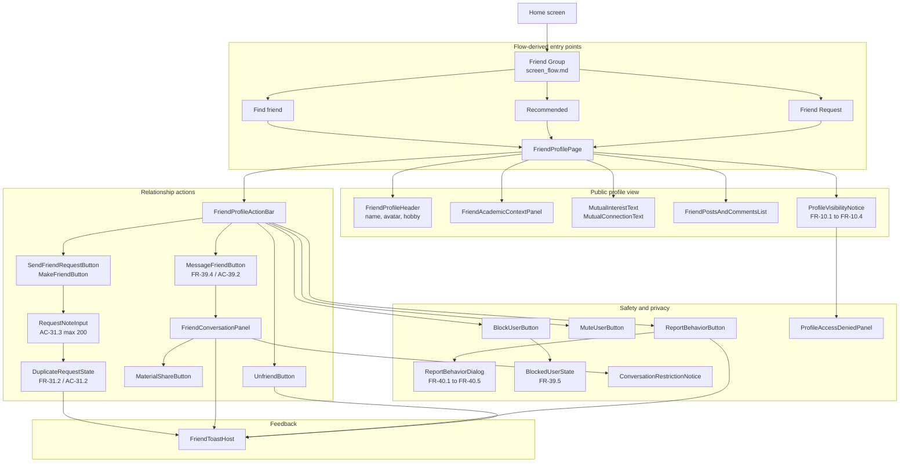

# Friend Profile Page Specification

> **Status:** UI/UX recommendation derived from the proposal documents in `docs/requirements/proposals/`.
>
> **Scope:** This document describes the **Friend Profile** view of another member, reached from the Friend Group area. It recommends UI component names, displayed information, and the user action supported by each component. It is a UI specification, not a backend design.
>
> **Main sources:** [`screen_flow.md`](screen_flow.md), [`feature_flow.md`](feature_flow.md), [`overview.md`](overview.md), [`functional_requirement.md`](functional_requirement.md), [`userstory.md`](userstory.md), [`non_functional_requirement.md`](non_functional_requirement.md), [`friend.md`](friend.md), [`settings.md`](settings.md).
>
> **Note:** The selected PA3 use cases in [`use_cases_description.md`](use_cases_description.md) and [`use_cases_model/`](use_cases_model/) contain **no dedicated PA3 friend/group UC**. This page is therefore derived from `US-08`–`US-10`, `US-30`–`US-32`, and `US-38`–`US-40` plus the friend flows.
>
> **Note:** There is **no friend/profile API contract and no friend/group error-code contract** in [`API.md`](API.md) or [`response_code.md`](response_code.md). Routes, states, and error handling below are recommended UI only; no endpoint or status code is asserted.

---

## 1. Purpose of the Friend Profile Page

The **Friend Profile Page** is the detail view for one other member. Its purpose is to let a university student inspect a peer's **public academic and interest context**, understand **mutual interests and mutual connections**, and decide whether to **send a friend request, message or share material where permitted, review friend activity, or manage the relationship** through unfriend, mute, block, and report actions.

The forum remains the primary collaboration space. This page supports it by turning public profile, preference, and forum-context data into a trustworthy basis for an academic connection, while privacy and communication settings remain authoritative for what is visible and what interactions are allowed.

### 1.1 Core purposes

| Purpose | What the user achieves | Requirement basis |
| --- | --- | --- |
| View public identity | See display name, username, avatar, short bio, university, major, and academic year that the member allows others to see. | `US-08`, `FR-08.1`–`FR-08.6`, `AC-08.1`–`AC-08.6`, `FR-08.6`, `AC-08.6` |
| View academic and interest context | See courses, subjects, interests, learning goals, and study preferences used for academic relevance. | `US-09`, `FR-09.1`–`FR-09.5` |
| Understand common ground | See mutual academic interests and mutual friends/shared forum context when available. | `FR-30.3`, `FR-30.4`, `AC-30.2`, `AC-30.3` |
| Respect privacy boundaries | See only fields allowed by the viewed member's visibility, search, online-status, and enforcement settings. | `US-10`, `FR-10.1`–`FR-10.4`, `NFR-PRIV-1`–`NFR-PRIV-7` |
| Send a friend request | Start a request from the profile, optionally with a short note, and see the request state. | `FR-31.1`, `FR-31.3`, `AC-31.1`, `AC-31.3` |
| Prevent duplicate requests | Show a clear pending/sent state rather than offering another request action. | `FR-31.2`, `AC-31.2` |
| Receive request outcomes | Notify the sender when a request is accepted or rejected. | `FR-31.4`, `AC-31.4`, `FR-38.2` |
| Manage incoming requests | Accept or decline a request and optionally block future requests from the sender. | `FR-32.1`–`FR-32.5`, `AC-32.1`–`AC-32.3` |
| Message and share material | Open a direct conversation and share learning material when the relationship and settings permit it. | `overview.md`, `friend.md`, `FR-39.4`, `FR-39.5`, `NFR-PRIV-5`, `NFR-PRIV-6` |
| See friend activity | View friend posts and comments from the forum and open the source content. | `overview.md`, `friend.md` |
| Manage the relationship | Unfriend, mute, block, or report inappropriate profile/message behavior. | `overview.md`, `FR-39.1`–`FR-39.5`, `FR-40.1`–`FR-40.5`, `AC-40.1`–`AC-40.4` |

### 1.2 Place in the screen flow

`screen_flow.md` defines the Friend Group entries:

```text
Home -> Friend Group
Friend Group -> Find friend
Friend Group -> Recommend
Friend Group -> Friend Request
Friend Group -> Create Group
```

`feature_flow.md` defines the profile-related path (**flow-derived**):

```text
Friend -> My Friend / Recommended / Find friend / Friend Request
Friend item -> Friend Name / Friend Public Hobby
Friend item -> Stranger -> Make Friend
```

`overview.md` adds the relationship and activity paths:

```text
Friend -> Friend / Unfriend
Friend -> Friend Post and Comment
Friend -> Message / Material
```

The **recommended UI extension** is a single `FriendProfilePage` reached from any friend item, request card, member list, or forum author link. It keeps the proposal's **Friend Name**, **Friend Public Hobby**, and **Make Friend** language while adding the practical profile, safety, and privacy views required by the linked user stories.

---

## 2. Recommended page identity and naming

| Item | Suggested name | Notes |
| --- | --- | --- |
| Parent page group | `FriendGroupPage` | Matches `friend.md` and `screen_flow.md`. |
| Main page | `FriendProfilePage` | Reuses the component name from `friend.md`. |
| Suggested route | `/friends/users/:userId` | Recommended route from `friend.md`; not specified in the proposal. |
| Page title | **Friend Profile** | Product-facing title for another member's profile. |
| Short navigation label | **Profile** | Appears in breadcrumbs and back links. |
| Primary action for a stranger | **Make Friend** / **Add friend** | `Make Friend` is the proposal label; `SendFriendRequestButton` is the recommended component. |
| Primary action for a friend | **Message** | Reuses `MessageFriendButton` from `friend.md`. |
| Main objects | `FriendUser`, `FriendRequest`, `PublicProfileContext`, `FriendActivityItem` | Recommended UI object names; no backend schema is defined. |

### 2.1 Naming convention recommendation

- Reuse names from `friend.md` for shared components: `FriendProfilePage`, `FriendAcademicContextPanel`, `MutualInterestText`, `SendFriendRequestButton`, `MessageFriendButton`, `BlockUserButton`, `ReportBehaviorButton`.
- Prefix privacy/safety components with `Profile`, `Privacy`, `Block`, `Mute`, or `Report`.
- Use PascalCase for component names and explicit state names such as `DuplicateRequestState`.
- Mark all routes and all UI states not named in the proposal as **recommended**; do not treat them as API contracts.

---

## 3. Target users and user goals

| User type | Main goal on the Friend Profile Page | Components used most |
| --- | --- | --- |
| Student evaluating a potential study partner | Check public academic background, interests, and mutual context before connecting. | `FriendProfilePage`, `FriendAcademicContextPanel`, `MutualInterestText`, `MutualConnectionText` |
| Stranger sending a friend request | Send a request with a short academic introduction. | `SendFriendRequestButton`, `MakeFriendButton`, `RequestNoteInput`, `DuplicateRequestState` |
| Request sender awaiting outcome | Track pending state and receive acceptance/decline feedback. | `RequestStatusBadge`, `RequestNotificationBadge` |
| Confirmed friend | Message the member, share material, or view friend posts/comments. | `MessageFriendButton`, `MaterialShareButton`, `FriendPostsAndCommentsList` |
| Request recipient | Accept, decline, or block future requests from the sender. | `AcceptRequestButton`, `RejectRequestButton`, `BlockFutureRequestsToggle` |
| Privacy-conscious viewer | Understand why a field is hidden and open privacy/communication controls. | `ProfileVisibilityNotice`, `PrivacySettingsLink`, `CommunicationSettingsLink` |
| User experiencing unwanted contact | Mute, block, or report the member. | `MuteUserButton`, `BlockUserButton`, `ReportBehaviorButton`, `ReportBehaviorDialog` |

---

## 4. Recommended information architecture

| View/section | Suggested route or state | Purpose | Main components |
| --- | --- | --- | --- |
| Profile home | `/friends/users/:userId` | Shows public identity, academic context, mutual context, and relationship actions. | `FriendProfilePage`, `FriendProfileHeader`, `FriendProfileActionBar` |
| Academic context | In-page section | Shows university, major, academic year, courses, subjects, and interests the member permits. | `FriendAcademicContextPanel`, `PublicHobbyText`, `LearningPreferenceSummary` |
| Mutual context | In-page section | Explains why the member is relevant. | `MutualInterestText`, `MutualConnectionText` |
| Request composer | `/friends/users/:userId/request` or modal | Composes a request with a short note. | `SendRequestDialog`, `RequestNoteInput`, `SubmitFriendRequestButton` |
| Request status | In-page state | Shows `None`, `Pending`, `Accepted`, `Declined`, or `Blocked`. | `RequestStatusBadge`, `DuplicateRequestState` |
| Conversation | `/friends/messages/:conversationId` | Direct messaging and material sharing when permitted. | `FriendConversationPanel`, `DirectMessageInput`, `MaterialShareButton` |
| Friend activity | In-page tab | Shows friend forum posts and comments. | `FriendPostsAndCommentsList`, `FriendActivityItem` |
| Relationship management | In-page menu | Unfriend, mute, block, or report. | `UnfriendButton`, `MuteUserButton`, `BlockUserButton`, `ReportBehaviorButton` |
| Restricted profile | State: `ProfileAccessDeniedPanel` | Explains that the profile or a field is not available. | `ProfileAccessDeniedPanel`, `PrivacySettingsLink` |

---

## 5. Recommended UI components

All component names below are **recommended UI**. Labels such as **flow-derived** identify components taken directly from `feature_flow.md`/`screen_flow.md`; labels such as **recommended** identify UI added to make the linked requirements usable.

### 5.1 Profile shell and public identity

| Suggested name | UI type | Information shown | Meaning / action | Requirement basis |
| --- | --- | --- | --- | --- |
| `FriendProfilePage` | Page/modal container | Full public profile, academic context, mutual context, activity, and action bar. | Root view for evaluating another member. | Reused from `friend.md`; `AC-31.1`, `FR-08.6` |
| `FriendBreadcrumb` | Breadcrumb | `Home > Friend > Find Friends > Profile`. | Shows location and returns to the prior friend view. | Recommended; supports `screen_flow.md` |
| `FriendProfileHeader` | Header | Avatar, display name, relationship state, privacy notice. | Identifies the viewed member and current relationship. | `FR-08.2`, `FR-08.6`, `AC-08.1` |
| `FriendAvatar` | Image/avatar | Profile image or initials. | Shows the avatar created through validated profile settings; no upload occurs on this page. | `FR-08.4`, `AC-08.5`, `FR-08.2` |
| `FriendNameText` | Text | Display name shown to other members. | Shows the member's name; subject to profanity filtering from profile settings. | `FR-08.2`, `AC-08.6`, `feature_flow.md` |
| `ProfileSummaryText` | Text | Short bio allowed by the member. | Gives an introduction before connecting. | `FR-08.2`, `AC-08.1`, `FR-10.1` |
| `PublicHobbyText` | Text | Public hobby/interest value. | Shows the **Friend Public Hobby** surface named in the flow. | Flow-derived from `feature_flow.md`; `FR-09.2` |
| `FriendAcademicContextPanel` | Info card | University, major, academic year, courses, subjects, interests, learning goals. | Shows academic relevance and shared course context. | `FR-08.3`, `FR-08.6`, `FR-09.1`–`FR-09.4`, `AC-08.2` |
| `LearningPreferenceSummary` | Summary list | Subjects, interests, goals, and preferred study times where visible. | Explains recommendation and study-partner context. | `FR-09.1`, `FR-09.2`, `FR-09.3`, `FR-09.5` |
| `MutualInterestText` | Supporting text | Shared subjects, courses, goals, or forum contexts. | Explains academic common ground. | `FR-30.3`, `AC-30.2` |
| `MutualConnectionText` | Supporting text | Mutual friends or shared forum context when available. | Builds trust through known connections. | `FR-30.4`, `AC-30.3` |
| `ProfileVisibilityNotice` | Informational note | “Some information is hidden by this member's privacy settings.” | Explains missing fields without exposing hidden data. | `FR-10.1`, `FR-10.4`, `NFR-PRIV-3`, `NFR-PRIV-7` |

### 5.2 Friend request flow

| Suggested name | UI type | Information shown | Meaning / action | Requirement basis |
| --- | --- | --- | --- | --- |
| `FriendProfileActionBar` | Action bar | Relationship-dependent actions: request, message, more options. | Keeps valid actions together and hides invalid ones. | Recommended; `FR-31.1`, `FR-39.5` |
| `SendFriendRequestButton` | Primary button | Label **Add friend** or **Send friend request**. | Starts the friend-request flow from the profile. | Reused from `friend.md`; `FR-31.1`, `AC-31.1` |
| `MakeFriendButton` | Button for strangers | Label **Make Friend**. | Proposal-specific label for requesting from a friend item. | Flow-derived from `feature_flow.md` |
| `SendRequestDialog` | Modal | Recipient summary, note input, send/cancel actions. | Focuses the user on composing the request. | `FR-31.1`, `FR-31.3`, `AC-31.1` |
| `RequestNoteInput` | Textarea with counter | Label **Message**, placeholder “Introduce yourself”, `0/200` counter. | Lets the sender write a short note of **at most 200 characters**. | `FR-31.3`, `AC-31.3` |
| `RequestNoteText` | Text block | Note shown to the recipient. | Helps the recipient understand the request. | `FR-31.3`, `AC-31.3` |
| `SubmitFriendRequestButton` | Primary button | Label **Send request**. | Submits the request when validation passes. | `FR-31.1`, `AC-31.3` |
| `CancelFriendRequestButton` | Secondary button | Label **Cancel**. | Closes the dialog without sending. | Recommended |
| `DuplicateRequestState` | Disabled button/message | “Friend request already sent.” | Prevents duplicate requests between the same users. | `FR-31.2`, `AC-31.2` |
| `RequestStatusBadge` | Badge | `None`, `Pending`, `Accepted`, `Declined`, `Blocked`. | Shows the current request relationship. | `FR-32.1`, `FR-32.2`, `FR-31.2` |
| `RequestNotificationBadge` | Badge/toast | “Friend request accepted/declined.” | Informs the sender of the outcome. | `FR-31.4`, `AC-31.4`, `FR-32.5` |
| `BlockFutureRequestsToggle` | Checkbox/toggle | “Block future requests from this user.” | Offered when declining an incoming request. | `FR-32.4`, `AC-32.3` |

### 5.3 Messaging and material sharing

| Suggested name | UI type | Information shown | Meaning / action | Requirement basis |
| --- | --- | --- | --- | --- |
| `MessageFriendButton` | Secondary button | Label **Message**. | Opens direct messaging with a confirmed friend where permitted. | Reused from `friend.md`; `overview.md`, `FR-39.4` |
| `FriendConversationPanel` | Message thread panel | Friend name, messages, attachments, timestamps. | Lets permitted users communicate directly. | `overview.md`, `FR-39.5` |
| `DirectMessageInput` | Textbox | Placeholder “Write a message”. | User types a direct message. | Recommended from `overview.md` |
| `DirectSendMessageButton` | Button | Label **Send**. | Sends the direct message. | Recommended from `overview.md` |
| `MaterialShareButton` | Button/attachment action | Label **Share material**. | Sends a learning resource in the conversation. | `overview.md`, `NFR-PRIV-5` |
| `FriendMaterialShareButton` | Button | Label **Share material**. | Friend-list variant of material sharing. | Reused from `friend.md`; `overview.md` |
| `ConversationRestrictionNotice` | Alert | “Direct messages may be limited to confirmed friends.” | Explains why messaging is unavailable. | `FR-39.4`, `AC-39.2`, `FR-39.5` |
| `CommunicationSettingsLink` | Link | Label **Communication settings**. | Opens the controls that permit or restrict contact. | `FR-39.1`, `FR-39.3`, `AC-39.3` |

### 5.4 Friend posts and comments

| Suggested name | UI type | Information shown | Meaning / action | Requirement basis |
| --- | --- | --- | --- | --- |
| `FriendPostsAndCommentsList` | List | Friend forum posts and comments visible under privacy rules. | Lets the user see recent academic activity. | Reused from `friend.md`; `overview.md`, `FR-10.4`, `NFR-PRIV-7` |
| `FriendActivityItem` | List item | Post title, comment snippet, timestamp, source link. | Opens the original forum content. | `overview.md` |
| `FriendActivityEmptyState` | Empty state | “No visible friend activity yet.” | Avoids implying content exists behind privacy settings. | Recommended; `FR-10.4` |

### 5.5 Relationship management

| Suggested name | UI type | Information shown | Meaning / action | Requirement basis |
| --- | --- | --- | --- | --- |
| `UnfriendButton` | Danger/text button | Label **Unfriend**. | Removes an existing friend connection. | Reused from `friend.md`; `overview.md` |
| `UnfriendConfirmDialog` | Confirmation dialog | “Remove `<name>` from your friends?” with Cancel/Unfriend. | Recommended safeguard for a destructive relationship action. | Recommended; `overview.md` |
| `RelationshipStateText` | Supporting text | “Friends”, “Request pending”, or “Not connected”. | Makes the available action predictable. | `FR-31.2`, `FR-32.2` |

### 5.6 Safety, blocking, muting, and reporting

| Suggested name | UI type | Information shown | Meaning / action | Requirement basis |
| --- | --- | --- | --- | --- |
| `BlockUserButton` | Danger button/menu item | Label **Block user**. | Prevents permitted interactions where supported. | Reused from `friend.md`; `FR-39.3`, `AC-39.1` |
| `MuteUserButton` | Menu item | Label **Mute**. | Suppresses messages or notifications from the member. | Reused from `friend.md`; `FR-39.3`, `AC-39.1` |
| `BlockedUserState` | Restricted state | “You cannot interact with this member.” | Explains disabled actions after a block. | `FR-39.3`, `FR-39.5`, `NFR-SEC-6` |
| `ReportBehaviorButton` | Menu item | Label **Report**. | Reports inappropriate profile or message behavior. | Reused from `friend.md`; `FR-40.1`, `FR-40.2`, `AC-40.1` |
| `ReportBehaviorDialog` | Modal | Category, description, context, submit/cancel. | Captures context and routes the report to moderation. | `FR-40.2`, `FR-40.3`, `FR-40.4`, `AC-40.2`, `AC-40.3` |
| `ReportSubmittedNotice` | Toast/notice | “Report submitted for review.” | Confirms submission without promising a moderator outcome. | `FR-40.4`, `AC-40.3`, `AC-40.4` |
| `PrivacySettingsLink` | Link | Label **Privacy settings**. | Opens visibility and discovery controls. | `FR-10.2`, `FR-39.2`, `AC-39.3` |
| `ProfileAccessDeniedPanel` | Error/restricted state | “This profile is not available to you.” | Explains blocked or private profile access. | `FR-10.1`, `FR-10.2`, `FR-39.5`, `NFR-PRIV-1` |

### 5.7 Feedback and loading

| Suggested name | UI type | Information shown | Meaning / action | Requirement basis |
| --- | --- | --- | --- | --- |
| `FriendLoadingSkeleton` | Skeleton/loader | Placeholder header, context panel, and activity list. | Shows that profile data is loading. | Reused from `friend.md`; Recommendation |
| `FriendErrorBanner` | Alert | “Unable to load this profile.” with Retry. | Recovers from loading/action failure; no API code is assumed. | Reused from `friend.md`; Recommendation |
| `FriendToastHost` | Toast container | Success/error feedback for requests, messages, unfriend, block, mute, and report. | Gives immediate feedback without blocking the page. | Reused from `friend.md`; Recommendation |

---

## 6. Recommended information displayed

Not every field must appear everywhere. Show only fields the viewed member's settings permit, and never expose hidden values through badges, counters, or supporting text.

| Field | Suggested label | Where shown | Purpose |
| --- | --- | --- | --- |
| `userId` | Hidden/internal | All profile actions | Identifies the member for request, message, block, mute, and report actions. |
| `displayName` | **Name** | Header, request, messages | Primary identity; subject to `AC-08.6` moderation. |
| `username` | **Username** | Header when visible | Secondary identity from profile settings. |
| `avatarUrl` | Profile image | Header, request, messages | Visual identity from validated profile data. |
| `shortBio` | **About** | Profile summary | Public introduction when visible. |
| `university` | **University** | Academic context | Confirms academic community. |
| `major` | **Major** | Academic context | Shows field of study. |
| `academicYear` | **Academic year** | Academic context | Shows study stage. |
| `courses` | **Courses** | Academic context, mutual text | Shows shared course context. |
| `subjects` | **Subjects** | Academic context, mutual text | Supports study-partner relevance. |
| `interests` | **Interests** | Academic context, hobby text | Supports common-ground discovery. |
| `learningGoals` | **Learning goals** | Academic context, mutual text | Helps users find compatible partners. |
| `learningPace` | **Learning pace** | Academic context when visible | Supports compatibility awareness. |
| `language` | **Language** | Academic context when visible | Supports communication compatibility. |
| `preferredStudyTimes` | **Usually free** | Academic context when visible | Describes study availability. |
| `publicHobby` | **Public hobby** | Header, academic context | Shows the flow-named **Friend Public Hobby** value. |
| `mutualInterests` | **Mutual interests** | Mutual context | Explains academic similarity. |
| `mutualFriends` | **Mutual friends** | Mutual context | Builds trust through shared connections. |
| `sharedForumContexts` | **Shared forum context** | Mutual context | Shows common course/forum discussions. |
| `relationshipStatus` | Relationship state | Header, action bar | Controls request/message/unfriend actions. |
| `requestNote` | **Message** | Request card/dialog | Short introduction, maximum 200 characters. |
| `visibilityState` | Hidden/internal | Visibility notice, access panel | Drives which fields are shown or hidden. |
| `reportContext` | Hidden/internal | Report dialog | Captures profile/message context for moderation. |

---

## 7. Recommended interaction flows

### 7.1 Open another member's profile

1. User opens the Friend Group from `Home` (flow-derived from `screen_flow.md`).
2. User selects a friend item, request card, recommended card, or forum author link.
3. `FriendProfilePage` opens with the name, hobby, academic context, and mutual context the member allows.
4. Hidden fields are omitted; `ProfileVisibilityNotice` explains that privacy settings apply.
5. `FriendProfileActionBar` shows only actions valid for the current relationship and settings.

### 7.2 Send a friend request

1. User clicks `SendFriendRequestButton` or the flow-derived `MakeFriendButton`.
2. `SendRequestDialog` opens with `RequestNoteInput`.
3. User types an optional note; the live counter enforces the **`AC-31.3` limit of 200 characters**.
4. If a pending request already exists, `DuplicateRequestState` is shown and sending is blocked (**`FR-31.2` / `AC-31.2`**).
5. User clicks `SubmitFriendRequestButton`.
6. The recipient is notified (`FR-31.4`, `AC-31.4`, `FR-38.2`), and the sender sees `RequestStatusBadge` as `Pending`.

### 7.3 Handle an incoming request from the profile

1. Recipient opens the request or the sender's profile.
2. `AcceptRequestButton` adds the sender to the friend list (`FR-32.2`, `AC-32.2`).
3. `RejectRequestButton` declines and removes the pending request (`FR-32.3`, `AC-32.2`).
4. The recipient may enable `BlockFutureRequestsToggle` when declining (**`FR-32.4` / `AC-32.3`**).
5. The sender receives the accepted/declined notification (`FR-32.5`, `FR-31.4`, `AC-31.4`).

### 7.4 Message or share material where permitted

1. A confirmed friend clicks `MessageFriendButton` to open `FriendConversationPanel`.
2. If the viewed member restricts direct messages to confirmed friends (`FR-39.4`, `AC-39.2`), non-friends see `ConversationRestrictionNotice` instead of an input.
3. Permitted users send messages with `DirectMessageInput` and `DirectSendMessageButton`.
4. Permitted users attach learning material with `MaterialShareButton` or `FriendMaterialShareButton`; backend authorization and privacy settings decide access (`FR-39.5`, `NFR-PRIV-5`, `NFR-PRIV-6`).
5. Blocked or restricted users see `BlockedUserState` with no active contact controls.

### 7.5 View friend posts and comments

1. User opens the activity section of `FriendProfilePage`.
2. `FriendPostsAndCommentsList` shows posts/comments visible under `FR-10.4` and `NFR-PRIV-7`.
3. `FriendActivityItem` opens the original forum content; hidden content is not represented.

### 7.6 Unfriend, mute, block, or report

1. User opens the profile action menu.
2. `UnfriendButton` removes an existing friend connection (`overview.md`).
3. `MuteUserButton` suppresses communication/notifications and `BlockUserButton` prevents permitted interactions (`FR-39.3`, `AC-39.1`).
4. `ReportBehaviorButton` opens `ReportBehaviorDialog` with category, description, and profile/message context.
5. The report is routed to moderation; `ReportSubmittedNotice` confirms submission only (`FR-40.3`, `FR-40.4`, `AC-40.3`).

### 7.7 Privacy enforcement on the viewed profile

1. System authenticates the viewer before showing a protected profile (`NFR-SEC-1`).
2. System applies the viewed member's profile, academic-info, search, and online-status visibility choices (`FR-10.1`, `FR-10.2`, `FR-10.3`, `FR-10.4`).
3. System applies privacy consistently to profile data, posts/comments, and mutual context (`NFR-PRIV-1`, `NFR-PRIV-2`, `NFR-PRIV-3`, `NFR-PRIV-4`, `NFR-PRIV-7`).
4. System enforces authorization server-side, not only by hiding UI controls (`NFR-SEC-4`, `NFR-SEC-6`).
5. Transport is protected (`NFR-SEC-3`), uploaded avatars/files follow validation policy (`NFR-SEC-5`), and report spam is rate-limited (`NFR-SEC-9`).

---

## 8. Business rules and UI states

| Rule/state | Recommended UI behavior | Requirement basis |
| --- | --- | --- |
| Public academic profile fields come from profile settings. | Show name, avatar, bio, university, major, and academic year only as the member permits. | `FR-08.1`, `FR-08.2`, `FR-08.3`, `FR-08.6`, `AC-08.1`, `AC-08.2`, `AC-08.6` |
| Profile changes persist across active sessions. | Refresh the viewed profile after a successful profile update elsewhere; do not cache hidden values. | `FR-08.5`, `AC-08.4` |
| Avatar validation is an upload rule, not a viewer rule. | Display the stored avatar only; do not offer avatar upload on another member's profile. | `FR-08.4`, `AC-08.5`, `NFR-SEC-5` |
| Interests and goals support relevance. | Show visible subjects, interests, goals, and study-time context with mutual interests. | `FR-09.1`, `FR-09.2`, `FR-09.3`, `FR-09.4`, `FR-09.5` |
| Request notes are limited to **200 characters**. | Show a live `0/200` counter and block submission over the limit. | `AC-31.3` (also `FR-31.3`) |
| Duplicate requests are prevented. | Disable the request action and show `DuplicateRequestState` for a pending pair. | `FR-31.2` / `AC-31.2` |
| Requests can be sent from profile cards or member lists. | Keep `SendFriendRequestButton`/`MakeFriendButton` available on the appropriate surfaces. | `FR-31.1`, `AC-31.1` |
| Recipient is notified; sender is notified of the outcome. | Show request badges/toasts without exposing private profile details. | `FR-31.4`, `AC-31.4`, `FR-32.5`, `FR-38.2` |
| Accepting adds the sender to the friend list; declining removes the request. | Update `RequestStatusBadge` and the available actions immediately. | `FR-32.1`, `FR-32.2`, `FR-32.3`, `AC-32.1`, `AC-32.2` |
| Rejecting can block future requests from the sender. | Offer `BlockFutureRequestsToggle` in the decline path only. | `FR-32.4` / `AC-32.3` |
| Direct messages may be limited to confirmed friends. | Restrict `MessageFriendButton`/`FriendConversationPanel` and explain with `ConversationRestrictionNotice`. | `FR-39.4` / `AC-39.2` |
| Communication and privacy settings prevent disallowed interactions. | Hide or disable actions in the UI and enforce the same rule on the backend. | `FR-39.1`, `FR-39.2`, `FR-39.5`, `AC-39.3`, `NFR-SEC-6` |
| Users can mute or block specific members. | Show `MuteUserButton` and `BlockUserButton` and reflect the result in `BlockedUserState`. | `FR-39.3`, `AC-39.1` |
| Viewed profile data is privacy-controlled. | Omit hidden fields, honor search and online-status opt-outs, and apply rules to activity too. | `FR-10.1`, `FR-10.2`, `FR-10.3`, `FR-10.4`, `NFR-PRIV-1`, `NFR-PRIV-2`, `NFR-PRIV-3`, `NFR-PRIV-4`, `NFR-PRIV-7` |
| Shared material access follows owner/resource privacy. | Permit `MaterialShareButton` only where the backend will enforce access. | `NFR-PRIV-5`, `NFR-PRIV-6`, `FR-39.5` |
| Inappropriate behavior can be reported. | Show `ReportBehaviorButton` on profiles and messages; capture context and categories. | `FR-40.1`, `FR-40.2`, `FR-40.3`, `AC-40.1`, `AC-40.2`, `AC-40.3` |
| Reports route to moderation and can be reviewed. | Do not promise an outcome in the reporter UI; reviewer actions are outside this page. | `FR-40.4`, `FR-40.5`, `AC-40.4` |
| Protected profiles require authentication and safe transport. | Redirect unauthenticated users; use secure transport and server-side checks. | `NFR-SEC-1`, `NFR-SEC-3`, `NFR-SEC-4`, `NFR-SEC-6`, `NFR-SEC-8` |
| `Loading` | Show `FriendLoadingSkeleton`; no actions are active. | Recommended |
| `Public profile available` | Show permitted fields and valid actions. | Recommended UI state |
| `Restricted / private` | Show `ProfileVisibilityNotice` or `ProfileAccessDeniedPanel`. | `FR-10.1`, `FR-10.2`, `NFR-PRIV-1` |
| `Request pending` | Show `DuplicateRequestState` and disable resend. | `FR-31.2`, `AC-31.2` |
| `Friends` | Show `MessageFriendButton`, `MaterialShareButton`, and `UnfriendButton`. | `overview.md`, `FR-39.4` |
| `Blocked` | Show `BlockedUserState`; disable request/message actions. | `FR-39.3`, `FR-39.5` |
| `Error` | Show `FriendErrorBanner` with Retry; do not invent an API error code. | Recommended; no API contract |

> **Source limits:** No dedicated PA3 friend/group UC, no friend/profile API contract, and no friend/group error codes are defined. Request/message/unfriend/block states above are **recommended UI states**, not backend guarantees.

---

## 9. Requirements traceability

| Requirement/source | Covered by |
| --- | --- |
| `screen_flow.md`: Home → Friend Group → Find friend / Recommend / Friend Request | `FriendBreadcrumb`, `FriendProfilePage`, request entry from friend views |
| `feature_flow.md`: Friend item → Friend Name / Friend Public Hobby / Make Friend | `FriendNameText`, `PublicHobbyText`, `MakeFriendButton` (flow-derived) |
| `overview.md`: Friend / Unfriend, Friend Post and Comment, Message / Material | `UnfriendButton`, `FriendPostsAndCommentsList`, `MessageFriendButton`, `MaterialShareButton` |
| `FR-08.1`, `FR-08.2`, `FR-08.3`, `FR-08.4`, `FR-08.5`, `FR-08.6` | Public profile fields, avatar display only, persistence-aware refresh |
| `AC-08.1`, `AC-08.2`, `AC-08.3`, `AC-08.4`, `AC-08.5`, `AC-08.6` | Profile detail fields, catalog context, preview-derived visibility, persistence, validated avatar display, moderated text |
| `FR-09.1`, `FR-09.2`, `FR-09.3`, `FR-09.4`, `FR-09.5` | `FriendAcademicContextPanel`, `LearningPreferenceSummary`, `MutualInterestText` |
| `FR-10.1`, `FR-10.2`, `FR-10.3`, `FR-10.4` | `ProfileVisibilityNotice`, hidden fields, search/status opt-outs, activity enforcement |
| `FR-30.1`, `FR-30.2`, `FR-30.3`, `FR-30.4` | Academic context and mutual context on the viewed profile |
| `AC-30.1`, `AC-30.2`, `AC-30.3` | Profile summary, mutual interests, mutual friends/shared forum context |
| `FR-31.1`, `FR-31.2`, `FR-31.3`, `FR-31.4` | Send request, duplicate prevention, note, recipient notification |
| `AC-31.1`, `AC-31.2`, `AC-31.3`, `AC-31.4` | Profile/member-list trigger, duplicate state, `<=200` character note, sender feedback |
| `FR-32.1`, `FR-32.2`, `FR-32.3`, `FR-32.4`, `FR-32.5` | Request center linkage, accept, reject, block future requests, sender notification |
| `FR-38.2` | Social notifications for requests and messages |
| `FR-39.1`, `FR-39.2`, `FR-39.3`, `FR-39.4`, `FR-39.5` | Communication/privacy links, mute/block, direct-message restriction, interaction prevention |
| `FR-40.1`, `FR-40.2`, `FR-40.3`, `FR-40.4`, `FR-40.5` | Report action, surfaces, context, moderation routing, safe-environment goal |
| `AC-40.1`, `AC-40.2`, `AC-40.3`, `AC-40.4` | Report flow, categories, routing, moderator review boundary |
| `NFR-PRIV-1`, `NFR-PRIV-2`, `NFR-PRIV-3`, `NFR-PRIV-4`, `NFR-PRIV-5`, `NFR-PRIV-6`, `NFR-PRIV-7` | Visibility levels, request permission, academic info, online status, document/message access, consistent enforcement |
| `NFR-SEC-1`, `NFR-SEC-3`, `NFR-SEC-4`, `NFR-SEC-5`, `NFR-SEC-6`, `NFR-SEC-8`, `NFR-SEC-9` | Authentication, TLS, private content authorization, upload validation, server-side checks, common web vulnerabilities, report rate limiting |
| No dedicated PA3 friend/group UC | UI derived from the linked stories/flows; no UC step is claimed |
| No friend/group API contract | No endpoint, payload, or error code is defined in this document |

---

## 10. Summary diagram


