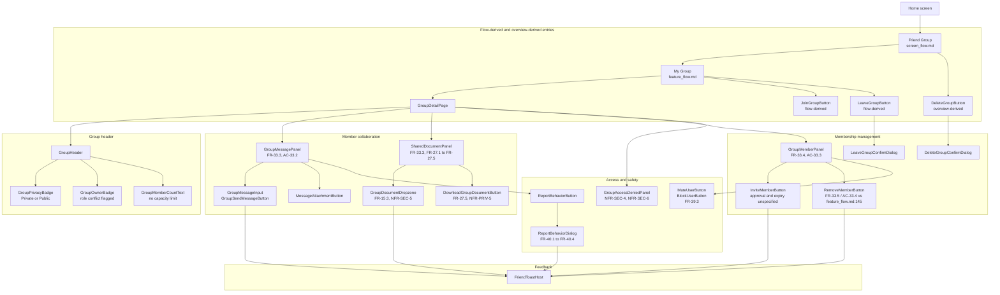

# Group Detail Page Specification

**Version:** `1.0`

**Performed by:** [Nguyen Chi Bao] | **Edited by:** [Nguyen Chi Bao]
> **Status:** UI/UX recommendation derived from the proposal documents in `docs/requirements/proposals/`.
>
> **Scope:** This document describes the **Group Detail** page for one friend group: header and privacy badge, chat, shared documents, member list, invitation, removal, leave, and the recommended flow-derived join and overview-derived delete entry points. It recommends UI component names, displayed information, and user actions; it does not define backend implementation.
>
> **Main sources:** [`screen_flow.md`](screen_flow.md), [`feature_flow.md`](feature_flow.md), [`overview.md`](overview.md), [`functional_requirement.md`](functional_requirement.md), [`userstory.md`](userstory.md), [`non_functional_requirement.md`](non_functional_requirement.md), [`API.md`](API.md), [`friend.md`](friend.md), [`library.md`](library.md).
>
> **Note:** The selected PA3 use cases in [`use_cases_description.md`](use_cases_description.md) and [`use_cases_model/`](use_cases_model/) contain **no dedicated PA3 friend/group UC**. This page is derived from `US-33`, the friend/group flows, `US-27`-related document rules, and the social safety requirements in `US-39`–`US-40`.
>
> **Note:** There are **no group API endpoints and no group error codes in [`API.md`](API.md)** (and no group codes in [`response_code.md`](response_code.md)). Routes, states, and error displays below are recommended UI only; no endpoint or status code is asserted. Meeting-room rules are **not** copied into groups.

---

## 1. Purpose of the Group Detail Page

The **Group Detail Page** is the collaboration space for a single private or public friend group. Its purpose is to let members **discuss coursework in group chat, share documents and learning material, see who is in the group, invite others, remove members where authorized, and leave the group**, while keeping private-group content accessible only to authorized users.

The forum remains the primary collaboration space. This page supports focused study groups and project teams with a smaller, privacy-bounded workspace, reusing the naming and structure established in `friend.md`.

### 1.1 Core purposes

| Purpose | What the user achieves | Requirement basis |
| --- | --- | --- |
| Identify the group | See the group name, privacy setting, description, owner, and member count. | `FR-33.1`, `FR-33.2`, `AC-33.1` |
| Chat with members | Send group messages and see message history. | `FR-33.3`, `AC-33.2` |
| Share documents | Upload, list, open, and download group documents. | `FR-33.3`, `FR-27.1`–`FR-27.5`, `FR-15.5`, `FR-15.6` |
| Validate shared files | Reject invalid files before they enter the group. | `FR-15.3`, `FR-27.3`, `NFR-SEC-5` |
| View and invite members | See the member list and invite new members. | `FR-33.4`, `AC-33.3` |
| Remove a member | Let the authorized role remove a member. | `FR-33.5`, `AC-33.4`, `feature_flow.md:145` (conflicting role term) |
| Leave the group | Let a member leave. | `FR-33.6`, `AC-33.5` |
| Join a group | Let a user enter a permitted group. | Flow-derived from `feature_flow.md`: `My Group -> Join` |
| Delete a group | Let the owner start group deletion. | Overview-derived from `overview.md`: `Create / Delete Group (Private | Public)` |
| Enforce access | Prevent non-members/unauthorized users from viewing private-group content. | `FR-33.1`, `NFR-SEC-4`, `NFR-SEC-6`, `NFR-PRIV-7` |
| Report behavior | Report inappropriate group chat or member behavior. | `FR-40.1`–`FR-40.4`, `FR-39.3` |
| Receive social notifications | Surface group invitations and group-related social activity. | `FR-38.2` |

### 1.2 Place in the screen flow

`screen_flow.md` defines the Friend Group entries:

```text
Home -> Friend Group
Friend Group -> Find friend
Friend Group -> Recommend
Friend Group -> Friend Request
Friend Group -> Create Group
```

`feature_flow.md` expands the group area:

```text
Friend -> My Group / My Friend / Recommended / Find friend / Friend Request / Create Group
My Group -> Group / Leave / Join
Group -> Message / Document / List member / Leave
Member -> Invite / Kick by superuser
Create Group -> Privacy / Beginning member / Name
```

`overview.md` adds group management behavior:

```text
Friend -> Create / Delete Group (Private | Public)
Friend / Group -> Message / Material
```

Therefore, `GroupDetailPage` is the recommended detail view reached from a group card. **Join** is flow-derived from `feature_flow.md`, **Delete group** is overview-derived from `overview.md`, and all dialogs, badges, and error panels are **recommended UI** because the proposal defines no group API contract.

---

## 2. Recommended page identity and naming

| Item | Suggested name | Notes |
| --- | --- | --- |
| Parent page group | `FriendGroupPage` | Reuses `friend.md` naming. |
| Main page | `GroupDetailPage` | Reuses the name from `friend.md`/`feature_flow.md` group detail area. |
| Suggested route | `/friends/groups/:groupId` | Recommended route from `friend.md`; not specified in the proposal. |
| Page title | **Group** / group name | `feature_flow.md` labels the detail node **Group**. |
| Short navigation label | **My Group** | Matches `feature_flow.md`. |
| Primary actions | **Message**, **Upload document**, **Invite member**, **Leave group** | Derived from `FR-33.3`, `FR-33.4`, `FR-33.6`, `feature_flow.md`. |
| Main objects | `FriendGroup`, `GroupMessage`, `SharedDocument`, `GroupMember` | Recommended UI object names; no backend schema is defined. |

### 2.1 Naming convention recommendation

- Reuse component names from `friend.md` for shared surfaces: `GroupDetailPage`, `GroupHeader`, `GroupPrivacyBadge`, `GroupMessagePanel`, `SharedDocumentPanel`, `GroupMemberPanel`, `InviteMemberButton`, `RemoveMemberButton`, `LeaveGroupButton`, `DeleteGroupButton`.
- Prefix join/delete/access components with `Join`, `Delete`, or `GroupAccess`.
- Use PascalCase and explicit state names such as `GroupAccessDeniedPanel`.
- Label every route, dialog, and state not named in the proposal as **recommended**; do not treat it as an API contract or hard rule.

---

## 3. Target users and user goals

| User type | Main goal on the Group Detail Page | Components used most |
| --- | --- | --- |
| Group member | Chat, share documents, view members, invite others, or leave. | `GroupMessagePanel`, `SharedDocumentPanel`, `GroupMemberPanel`, `LeaveGroupButton` |
| Group owner | Manage membership and optionally delete the group. | `RemoveMemberButton`, `DeleteGroupButton`, `DeleteGroupConfirmDialog` |
| Authorized remover | Remove a member under the product's resolved role rule. | `GroupMemberRoleBadge`, `RemoveMemberButton`, `RemoveMemberConfirmDialog` |
| Non-member or blocked user | Understand why the group cannot be viewed and find a permitted way forward. | `GroupAccessDeniedPanel`, `JoinGroupButton` when allowed |
| Document uploader | Upload group material and see validation feedback. | `UploadGroupDocumentButton`, `FileValidationErrorText`, `SharedDocumentList` |
| Safety-conscious member | Mute, block, or report inappropriate behavior in the group. | `MuteUserButton`, `BlockUserButton`, `ReportBehaviorButton`, `ReportBehaviorDialog` |

---

## 4. Recommended information architecture

| View/section | Suggested route or state | Purpose | Main components |
| --- | --- | --- | --- |
| Group home | `/friends/groups/:groupId` | Shows header and entry to all group sections. | `GroupDetailPage`, `GroupHeader`, `GroupPrivacyBadge` |
| Chat | In-page tab/section | Group messages and attachments. | `GroupMessagePanel`, `GroupMessageInput`, `GroupSendMessageButton` |
| Shared documents | In-page tab/section | Uploaded group files and download actions. | `SharedDocumentPanel`, `SharedDocumentList`, `UploadGroupDocumentButton` |
| Members | In-page side panel | Member list, roles, invite, and removal. | `GroupMemberPanel`, `GroupMemberList`, `InviteMemberButton`, `RemoveMemberButton` |
| Join | State: `JoinGroupButton` | Flow-derived entry for permitted users. | `JoinGroupButton`, `JoinGroupNotice` |
| Leave | Action with recommended confirmation | Removes the current user from the group. | `LeaveGroupButton`, `LeaveGroupConfirmDialog` |
| Delete group | Owner action with recommended confirmation | Overview-derived group deletion entry. | `DeleteGroupButton`, `DeleteGroupConfirmDialog` |
| Access denied | State: `GroupAccessDeniedPanel` | Explains why private-group content is unavailable. | `GroupAccessDeniedPanel`, `GroupPrivacyBadge` |
| Report | Modal | Reports group chat or member behavior. | `ReportBehaviorButton`, `ReportBehaviorDialog` |

---

## 5. Recommended UI components

All component names below are **recommended UI**. **Flow-derived** marks an action or label taken directly from `feature_flow.md`; **overview-derived** marks one taken from `overview.md`; **recommended** marks UI added to make the linked requirements usable.

### 5.1 Group header and privacy

| Suggested name | UI type | Information shown | Meaning / action | Requirement basis |
| --- | --- | --- | --- | --- |
| `GroupDetailPage` | Page/modal container | Group name, privacy, messages, documents, members, and top-level actions. | Root collaboration view for one group. | Reused from `friend.md`; `FR-33.1`, `FR-33.3` |
| `GroupBreadcrumb` | Breadcrumb | `Home > Friend > My Group > <group name>`. | Shows location and returns to the group list. | Recommended; `feature_flow.md` |
| `GroupHeader` | Header | Group name, description, owner, member count, privacy badge. | Identifies the group and exposes leave/delete actions. | `FR-33.1`, `FR-33.2`, `AC-33.1` |
| `GroupPrivacyBadge` | Badge | `Private` or `Public`. | Shows group visibility/joining rule without inventing more levels. | `FR-33.1`, `AC-33.1` |
| `GroupOwnerBadge` | Badge | `Owner`, `Superuser`, or `Member`. | Shows the role shown by current proposal sources; role conflict is flagged in section 8. | `FR-33.5`, `AC-33.4`, `feature_flow.md:145` |
| `GroupDescriptionText` | Supporting text | Group purpose/description. | Explains why the group exists. | Recommended; `FR-33.2` |
| `GroupMemberCountText` | Text | Current member count. | Shows group size; no capacity limit is defined. | `FR-33.4`, `AC-33.3` |

### 5.2 Group chat

| Suggested name | UI type | Information shown | Meaning / action | Requirement basis |
| --- | --- | --- | --- | --- |
| `GroupMessagePanel` | Message thread | Messages with sender, text, time, and attachments. | Lets members discuss coursework in the group. | `FR-33.3`, `AC-33.2` |
| `GroupMessageInput` | Textbox | Placeholder “Message the group”. | User writes a group message. | `FR-33.3` |
| `GroupSendMessageButton` | Button | Label **Send**. | Sends the message to group members. | `FR-33.3`, `AC-33.2` |
| `MessageAttachmentButton` | Button | Label **Attach**. | Attaches a learning material/file to a message. | `overview.md` (`Message / Material`), `FR-33.3` |
| `GroupMaterialShareButton` | Button | Label **Share material**. | Shares a resource/link with the group. | Reused from `friend.md`; `overview.md` |
| `GroupEmptyState` | Empty state | “No messages yet.” | Guides the first collaboration action. | Recommended |
| `GroupMessageReportButton` | Menu item | Label **Report message**. | Starts reporting for inappropriate group chat. | `FR-40.2`, `AC-40.1` |

> No message edit, delete, reaction, or read-receipt rule is defined for groups. Do not add such controls as if they were requirements.

### 5.3 Shared documents

| Suggested name | UI type | Information shown | Meaning / action | Requirement basis |
| --- | --- | --- | --- | --- |
| `SharedDocumentPanel` | File list/card | Group documents with name, uploader, type, size, and date. | Lets members find and open shared files. | `FR-33.3`, `FR-27.4` |
| `SharedDocumentList` | List/table | Document rows with open/download actions. | Shows available group documents. | `FR-33.3`, `FR-27.4` |
| `UploadGroupDocumentButton` | Button | Label **Upload document**. | Starts a group file upload. | `FR-33.3`, `FR-27.1` |
| `GroupDocumentDropzone` | File upload/dropzone | “Choose a file or drag it here” with accepted type/size hint. | Lets a member select a file; exact limits are not specified. | `FR-27.3`, `FR-15.3`, `NFR-SEC-5` |
| `GroupDocumentPreviewPanel` | File preview row | Name, size, type, replace/remove actions. | Confirms the pending file before upload. | Recommended; `FR-27.3` |
| `DownloadGroupDocumentButton` | Button/icon | Label **Download**. | Downloads a document when privacy rules allow. | `FR-27.5`, `FR-15.5`, `NFR-PRIV-5` |
| `GroupDocumentPrivacyNotice` | Informational note | “Access follows the privacy set by the person who shared this file.” | Explains access before download. | `FR-27.5`, `NFR-PRIV-5`, `NFR-PRIV-7` |
| `FileValidationErrorText` | Inline error text | “Unsupported file type” or “File does not meet size policy.” | Helps the user correct the file; no numeric limit is asserted. | `FR-27.3`, `FR-15.3`, `NFR-SEC-5` |
| `GroupLibraryListingNotice` | Informational note | “This material may also appear in the Learning Resource Library.” | Reuses the library listing rule where applicable. | `FR-15.6`, `FR-27.4` |

### 5.4 Member list, invitation, and removal

| Suggested name | UI type | Information shown | Meaning / action | Requirement basis |
| --- | --- | --- | --- | --- |
| `GroupMemberPanel` | Side panel/section | Member list with roles and invite/remove controls. | Lets members see who is in the group. | `FR-33.4`, `AC-33.3` |
| `GroupMemberList` | List | Avatar, name, academic context, role. | Shows current membership. | `FR-33.4`, `AC-33.3`, `NFR-PRIV-7` |
| `GroupMemberRoleBadge` | Badge | `Owner`, `Superuser`, `Member`. | Clarifies the removal-right conflict instead of hiding it. | `FR-33.5`, `AC-33.4`, `feature_flow.md:145` |
| `InviteMemberButton` | Button | Label **Invite member**. | Lets a member invite another user. | Flow-derived from `feature_flow.md`; `FR-33.4`, `AC-33.3` |
| `InviteMemberPicker` | Searchable multi-select | Searchable friends/users with selected chips. | Chooses invitees. | `FR-33.4` |
| `InviteMemberDialog` | Modal | Recipient summary, optional message, send/cancel. | Recommended container for the invite action. | Recommended; `FR-33.4`, `FR-38.2` |
| `InviteStatusNotice` | Notice | “Invitation sent.” | Confirms the action; no approval/expiry behavior is asserted. | Recommended; `FR-38.2` |
| `RemoveMemberButton` | Danger button/menu item | Label **Remove from group**. | Lets the authorized role remove a member. | `FR-33.5`, `AC-33.4`, `feature_flow.md:145` |
| `RemoveMemberConfirmDialog` | Confirmation dialog | “Remove `<name>` from `<group>`?” with Cancel/Remove. | Prevents accidental removal. | Recommended; `FR-33.5` |
| `MuteUserButton` | Menu item | Label **Mute**. | Mutes a group member's communication where supported. | `FR-39.3` |
| `BlockUserButton` | Danger/menu item | Label **Block user**. | Blocks permitted interactions with a member. | Reused from `friend.md`; `FR-39.3` |

### 5.5 Join, leave, and delete

| Suggested name | UI type | Information shown | Meaning / action | Requirement basis |
| --- | --- | --- | --- | --- |
| `JoinGroupButton` | Button | Label **Join group**. | Flow-derived entry for a permitted user. | Flow-derived from `feature_flow.md`: `My Group -> Join` |
| `JoinGroupNotice` | Informational note | “Joining depends on the group's privacy setting.” | Explains that eligibility rules are not specified beyond privacy. | Recommended; `FR-33.1`, `AC-33.1` |
| `LeaveGroupButton` | Secondary/danger button | Label **Leave group**. | Removes the current user from the group. | `FR-33.6`, `AC-33.5`, `feature_flow.md` |
| `LeaveGroupConfirmDialog` | Confirmation dialog | “Leave `<group>`?” with Cancel/Leave. | Recommended safeguard for leaving. | Recommended; `FR-33.6` |
| `DeleteGroupButton` | Danger button | Label **Delete group**. | Overview-derived owner deletion entry. | Overview-derived from `overview.md` |
| `DeleteGroupConfirmDialog` | Confirmation dialog | “Delete `<group>`? Messages and documents may be removed.” with Cancel/Delete. | Prevents accidental deletion; consequences are recommended wording, not an API rule. | Recommended from `overview.md` |

### 5.6 Access denied and reporting

| Suggested name | UI type | Information shown | Meaning / action | Requirement basis |
| --- | --- | --- | --- | --- |
| `GroupAccessDeniedPanel` | Error/restricted state | “This group is private or you are not authorized to view it.” | Explains denied access without revealing group content. | `FR-33.1`, `NFR-SEC-4`, `NFR-SEC-6` |
| `GroupPrivateNotice` | Informational note | “Private group content is visible to authorized members only.” | Explains privacy before/after access. | `NFR-SEC-4`, `NFR-PRIV-7` |
| `ReportBehaviorButton` | Menu item | Label **Report**. | Reports inappropriate group behavior or a member. | Reused from `friend.md`; `FR-40.1`, `AC-40.1` |
| `ReportBehaviorDialog` | Modal | Category, description, context, submit/cancel. | Captures context and routes to moderation. | `FR-40.2`, `FR-40.3`, `FR-40.4`, `AC-40.2`, `AC-40.3` |
| `ReportSubmittedNotice` | Toast/notice | “Report submitted for review.” | Confirms submission; reviewer actions are outside this page. | `FR-40.4`, `AC-40.4` |

### 5.7 Feedback and loading

| Suggested name | UI type | Information shown | Meaning / action | Requirement basis |
| --- | --- | --- | --- | --- |
| `FriendLoadingSkeleton` | Skeleton/loader | Placeholder header, messages, documents, and members. | Shows that group data is loading. | Reused from `friend.md`; Recommendation |
| `FriendErrorBanner` | Alert | “Unable to load this group.” with Retry. | Recovers from failure; no group error code is assumed. | Reused from `friend.md`; Recommendation |
| `FriendToastHost` | Toast container | Success/error feedback for messages, uploads, invite, removal, leave, and delete. | Gives immediate feedback without blocking the page. | Reused from `friend.md`; Recommendation |

---

## 6. Recommended information displayed

Only show fields the current user is authorized to see. Private-group fields must not leak through badges, counts, previews, or error text.

| Field | Suggested label | Where shown | Purpose |
| --- | --- | --- | --- |
| `groupId` | Hidden/internal | All group components | Identifies the group for UI actions; no API path is asserted. |
| `name` | **Group name** | Header, breadcrumb | Primary group identity. |
| `description` | **Description** | Header | Explains group purpose. |
| `privacy` | **Privacy** | Header badge, join notice | Shows `Private` or `Public` only. |
| `owner` | **Owner** | Header, member panel | Shows the role named by `FR-33.5`/`AC-33.4`. |
| `memberCount` | **Members** | Header | Shows group size; no capacity limit exists in the proposal. |
| `members` | **Member list** | Member panel | Shows participants with roles. |
| `role` | Role badge | Member panel | Shows `Owner`, `Superuser`, or `Member`; conflict flagged in section 8. |
| `createdAt` | **Created** | Header/detail when available | Shows group age; recommended field. |
| `lastActivityAt` | **Last activity** | Group list/detail when available | Recommended field. |
| `messageId` | Hidden/internal | Message thread | Identifies a group message for display/report context. |
| `messageText` | Message body | Message thread | Main chat content. |
| `messageSender` | **From** | Message thread | Shows who wrote a message. |
| `messageTime` | **Time** | Message thread | Shows chronology. |
| `documentId` | Hidden/internal | Document list | Identifies a shared document. |
| `documentName` | **File name** | Document list | Shows document identity. |
| `documentType` | **Type** | Document list | Shows file type/category. |
| `documentSize` | **Size** | Document list/validation | Shows size without asserting a hard limit. |
| `uploader` | **Shared by** | Document list | Shows contributor. |
| `uploadedAt` | **Uploaded** | Document list | Shows when the file was shared. |
| `inviteState` | Invitation feedback | Invite notice | Confirms invite action; no approval/expiry state is defined. |
| `reportContext` | Hidden/internal | Report dialog | Captures group/message context for moderation. |

---

## 7. Recommended interaction flows

### 7.1 Open a group

1. User opens the Friend Group and selects **My Group** (flow-derived from `feature_flow.md`).
2. User selects a group card to open `GroupDetailPage`.
3. `GroupHeader` shows name, privacy badge, owner, and member count.
4. If the user is not authorized, `GroupAccessDeniedPanel` replaces group content.

### 7.2 Join a group (flow-derived)

1. A permitted user selects `JoinGroupButton` from the group list/detail.
2. `JoinGroupNotice` explains that eligibility depends on the group's privacy setting.
3. The user joins if the backend permits it; no approval or expiry rule is assumed.
4. On success, chat, documents, and member list become available.

### 7.3 Chat in the group

1. Member opens the chat section of `GroupDetailPage`.
2. Member types in `GroupMessageInput` and clicks `GroupSendMessageButton`.
3. `GroupMessagePanel` displays sender, text, time, and attachments.
4. Member may attach material with `MessageAttachmentButton` or `GroupMaterialShareButton`.
5. Inappropriate messages can be reported with `GroupMessageReportButton` → `ReportBehaviorDialog`.

### 7.4 Share and access documents

1. Member clicks `UploadGroupDocumentButton`.
2. `GroupDocumentDropzone` accepts a file; type and size are validated before upload (`FR-27.3`, `FR-15.3`, `NFR-SEC-5`).
3. Invalid files show `FileValidationErrorText` and are not accepted.
4. Valid files appear in `SharedDocumentPanel`/`SharedDocumentList`.
5. `DownloadGroupDocumentButton` is available only when privacy rules allow access (`FR-27.5`, `FR-15.5`, `NFR-PRIV-5`, `NFR-PRIV-7`).
6. `GroupLibraryListingNotice` explains possible library listing where applicable (`FR-15.6`).

### 7.5 Invite a member

1. Member clicks `InviteMemberButton`.
2. `InviteMemberPicker` selects one or more users.
3. `InviteMemberDialog` sends the invitations.
4. `InviteStatusNotice` confirms the action, and social notification behavior follows `FR-38.2`.
5. No invite approval step, expiration period, or automatic acceptance is asserted.

### 7.6 Remove a member

1. The authorized role opens the member menu and clicks `RemoveMemberButton`.
2. `RemoveMemberConfirmDialog` asks for confirmation.
3. On confirmation, the member is removed from `GroupMemberList`.
4. The UI uses `GroupMemberRoleBadge` to show the role on which the action depends; see the conflict in section 8.

### 7.7 Leave the group

1. Member clicks `LeaveGroupButton`.
2. `LeaveGroupConfirmDialog` asks for confirmation.
3. On confirmation, the user returns to the group list and group content is no longer shown.

### 7.8 Delete the group (overview-derived)

1. Owner clicks `DeleteGroupButton`.
2. `DeleteGroupConfirmDialog` explains that messages and documents may be removed.
3. On confirmation, the group is removed from the user's group list; no API response or error code is assumed.

### 7.9 Denied access and reporting

1. Unauthorized user opens a private group and sees `GroupAccessDeniedPanel`.
2. `GroupPrivateNotice` explains that content is limited to authorized members.
3. Authorized member can mute/block a member (`FR-39.3`) or open `ReportBehaviorDialog` from chat or the member list.
4. Reports are routed to moderation; `ReportSubmittedNotice` confirms submission only.

---

## 8. Business rules and UI states

### 8.1 Rules supported by sources

| Rule/state | Recommended UI behavior | Requirement basis |
| --- | --- | --- |
| Groups are private or public. | Show `GroupPrivacyBadge` with only `Private` or `Public`; enforce access server-side. | `FR-33.1`, `FR-33.2`, `AC-33.1`, `NFR-SEC-4`, `NFR-SEC-6` |
| Group setup includes name, privacy, and initial members. | Show those values in `GroupHeader` and `GroupMemberPanel`. | `FR-33.2`, `AC-33.1` |
| Members can message and share documents. | Show chat and document panels to authorized members only. | `FR-33.3`, `AC-33.2` |
| Members can view the member list and invite new members. | Show `GroupMemberPanel` and `InviteMemberButton`. | `FR-33.4`, `AC-33.3` |
| An authorized role can remove members. | Show `RemoveMemberButton` only to that role and require confirmation. | `FR-33.5`, `AC-33.4` |
| Members can leave. | Show `LeaveGroupButton` with recommended confirmation. | `FR-33.6`, `AC-33.5` |
| Uploaded files must pass type and size validation. | Validate before acceptance and show `FileValidationErrorText`; do not state a numeric limit. | `FR-27.3`, `FR-15.3`, `NFR-SEC-5` |
| Published/shared resources follow privacy settings. | Show `GroupDocumentPrivacyNotice`; allow download only when access is permitted. | `FR-27.5`, `FR-15.5`, `NFR-PRIV-5` |
| Privacy applies consistently to member lists and shared content. | Apply the same visibility rules to members, documents, and posts/materials. | `NFR-PRIV-7`, `FR-10.4`-style enforcement scope |
| Material may also appear in the library. | Show `GroupLibraryListingNotice` where applicable. | `FR-15.6`, `FR-27.4` |
| Social events produce notifications. | Show invite/outcome feedback through `FriendToastHost` and social notification surfaces. | `FR-38.2` |
| Users can mute/block specific members. | Show `MuteUserButton` and `BlockUserButton` in member/message menus. | `FR-39.3` |
| Inappropriate behavior can be reported. | Show `ReportBehaviorButton` for group chat/members and capture context. | `FR-40.1`, `FR-40.2`, `FR-40.3`, `AC-40.1`, `AC-40.2`, `AC-40.3` |
| Reports route to moderation and may be reviewed. | Do not promise an outcome; moderator review is outside this page. | `FR-40.4`, `AC-40.4` |
| `Loading` | Show `FriendLoadingSkeleton`. | Recommended |
| `Loaded` | Show header, chat, documents, and members. | Recommended |
| `GroupAccessDenied` | Show `GroupAccessDeniedPanel` without leaking private content. | `NFR-SEC-4`, `NFR-SEC-6` |
| `Empty` | Show `GroupEmptyState` for chat/documents. | Recommended |
| `ConfirmationRequired` | Show confirm dialogs for removal, leave, and delete. | Recommended |
| `Error` | Show `FriendErrorBanner` with Retry; no group error code is defined. | Recommended |

### 8.2 Explicit gaps and conflicts

| Gap/conflict | UI consequence |
| --- | --- |
| **No group API contract:** `API.md` defines no group endpoints and no group error codes; `response_code.md` defines none either. | Never render a specific group error code or endpoint-derived message. All error displays are recommended generic UI. |
| **No group capacity limit:** no requirement states a maximum member count. | Do not show, enforce, or hint at a member limit. |
| **No message edit/delete rules:** `FR-33.3`/`AC-33.2` cover sending only. | Do not add group message edit, delete, reaction, or read-receipt actions. |
| **Invite approval/expiry unspecified:** `FR-33.4`/`AC-33.3` state invitation only. | Do not invent an approval step, expiration timer, or auto-accept behavior. |
| **Superuser assignment unspecified:** `feature_flow.md:145` names a Superuser for Kick but no source says how that role is granted. | Show `GroupMemberRoleBadge`, but do not add role-assignment controls or rules. |
| **Removal-right terminology conflict:** `FR-33.5` and `AC-33.4` say the **group owner** removes members; `feature_flow.md:145` says **Superuser** kicks. | Treat `FR-33.5`/`AC-33.4` as the written requirement, expose `RemoveMemberButton` conservatively, and flag the conflict for a product decision. Do not silently merge the two roles. |
| **No group delete rule beyond `overview.md`:** delete is overview-derived only. | Keep `DeleteGroupButton` owner-scoped as a recommendation and require confirmation; do not assert backend behavior or effects on messages/documents beyond the warning text. |
| **Meeting-room rules do not apply:** room creation, room configuration, room requests, tools, and hand-wave behavior belong to the supporting Lobby Group. | Do not copy meeting-room rules, states, or components into `GroupDetailPage`. |

---

## 9. Requirements traceability

| Requirement/source | Covered by |
| --- | --- |
| `screen_flow.md`: Home → Friend Group → Create Group | Parent `FriendGroupPage`, `GroupBreadcrumb`, group list linkage |
| `feature_flow.md`: My Group → Group / Leave / Join | `GroupDetailPage`, `LeaveGroupButton`, `JoinGroupButton` (flow-derived) |
| `feature_flow.md`: Group → Message / Document / List member / Leave | `GroupMessagePanel`, `SharedDocumentPanel`, `GroupMemberPanel`, `LeaveGroupButton` |
| `feature_flow.md`: Member → Invite / Kick by superuser (`feature_flow.md:145`) | `InviteMemberButton`, `RemoveMemberButton`, `GroupMemberRoleBadge`, conflict in section 8.2 |
| `overview.md`: Create / Delete Group (Private | Public) | `GroupPrivacyBadge`, `DeleteGroupButton`, `DeleteGroupConfirmDialog` (overview-derived) |
| `overview.md`: Friend / Group → Message / Material | `GroupMessagePanel`, `MessageAttachmentButton`, `GroupMaterialShareButton` |
| `FR-33.1`, `FR-33.2`, `FR-33.3`, `FR-33.4`, `FR-33.5`, `FR-33.6` | Group creation/setup display, chat/documents, member list/invite, removal, leave |
| `AC-33.1`, `AC-33.2`, `AC-33.3`, `AC-33.4`, `AC-33.5` | Name/privacy/initial members, sharing, member management, owner controls, leave |
| `FR-27.1`, `FR-27.2`, `FR-27.3`, `FR-27.4`, `FR-27.5` | Upload control, metadata, file validation, availability/listing notices, access notice |
| `FR-15.3`, `FR-15.5`, `FR-15.6` | File validation, material access for permitted viewers, library listing notice |
| `FR-38.2` | Invite and social activity feedback |
| `FR-39.3` | Mute/block actions from group member/menu surfaces |
| `FR-40.1`, `FR-40.2`, `FR-40.3`, `FR-40.4` | Report button, surfaces, context capture, moderation routing/review boundary |
| `NFR-SEC-4` | Private-group content restricted to authorized users |
| `NFR-SEC-5` | File type/size validation before accepting uploads |
| `NFR-SEC-6` | Server-side authorization checks for group content/actions |
| `NFR-PRIV-5` | Access control for documents/resources shared in the group |
| `NFR-PRIV-7` | Consistent privacy enforcement across member lists and shared content |
| No dedicated PA3 friend/group UC | UI derived from flows, user stories, and NFRs; no UC step is claimed |
| No group API/error codes | No endpoint, payload, status code, or code-derived message is defined |

---

## 10. Summary diagram


