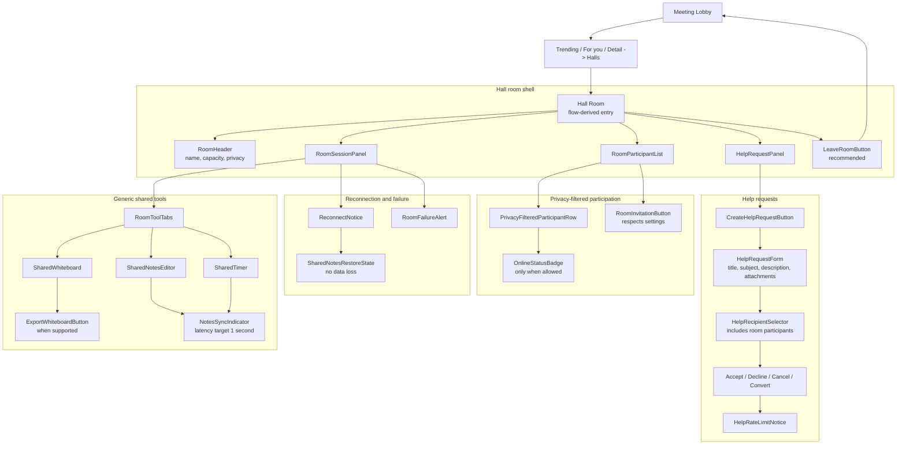

# Hall Room Page Specification

> **Status:** UI/UX recommendation derived from the proposal documents in `requirements/proposals/`.
>
> **Scope:** This document describes the **Hall Room** page and recommends UI component names, displayed information, and the user action supported by each component. Meeting rooms are **optional supporting features**; the **University Forum is the primary collaboration space**.
>
> **Main sources:** [`screen_flow.md`](screen_flow.md), [`feature_flow.md`](feature_flow.md), [`overview.md`](overview.md), [`functional_requirement.md`](functional_requirement.md), [`userstory.md`](userstory.md), [`use_cases_description.md`](use_cases_description.md), [`use_cases_model/UC-07-join-create-study-room.md`](use_cases_model/UC-07-join-create-study-room.md), [`non_functional_requirement.md`](non_functional_requirement.md).
>
> **Note:** **No hall-specific FR or AC exists in the current proposal.** Hall Room is named only in `screen_flow.md`, `feature_flow.md:156–165`, and `overview.md`. All functional behavior described here is the **generic room** behavior of `US-34`–`US-37` and `UC-07`, applied to the Hall Room entry; component names and layout are **recommendations**. [`API.md`](API.md) and [`response_code.md`](response_code.md) contain no room endpoints, room fields, or room error codes, so any room API shape is **unspecified** and no endpoints or codes are invented here. Older PA2 hall/study details (tables, seats, invite codes, 30-minute teardown) are **not** current requirements and are not used.

---

## 1. Purpose of the Hall Room

The **Hall Room** is one of the two room destinations reached from the optional Meeting Lobby. Its purpose is to give participants the same generic live-study space defined by `UC-07`: enter a session after a successful join, use shared whiteboard/notes/timer tools, request help, restore notes after reconnection, and leave when finished. The Hall-specific identity is **flow-derived only**; there is no separate Hall Room requirement set.

### 1.1 Core purposes

| Purpose | What the user achieves | Requirement basis |
| --- | --- | --- |
| Enter from the Lobby | Reach Hall Room through the Trending, For you, or Detail → Halls path. | `screen_flow.md`, `feature_flow.md:162–164` |
| Join a supported session | Enter a room with available capacity and see supported tools. | `UC-07` steps 3–7, `FR-35.2`, `AC-35.1` |
| Use shared tools | Work with a shared whiteboard, shared notes, and a shared timer. | `US-36`, `FR-36.1`–`FR-36.3`, `AC-36.1`–`AC-36.3` |
| See synchronized updates | Receive tool updates synchronized for all participants. | `FR-36.4`, `AC-36.4`, `NFR-PERF-7` |
| Export whiteboard | Export whiteboard content where the tool supports it. | `FR-36.5`, `AC-36.5` |
| Preserve notes on reconnect | Restore shared notes without data loss after interruption. | `FR-36.6`, `AC-36.6`, `UC-07` A6 |
| Request learning help | Send a help request to room participants and receive responses. | `US-37`, `FR-37.1`–`FR-37.6`, `AC-37.1`–`AC-37.6` |
| See other participants | View a roster filtered by privacy and communication settings. | `NFR-PRIV-4`, `NFR-PRIV-7`, `FR-39.1`–`FR-39.5` |
| Leave the room | End participation and return to the Lobby. | Recommendation; no explicit leave FR/AC for rooms |
| Respect settings | Invitations and participation follow notification, communication, and privacy choices. | `FR-38.3`, `AC-38.4`, `FR-39.1`–`FR-39.5`, `NFR-PRIV-6` |

### 1.2 Place in the screen flow

`screen_flow.md` defines:

```text
Home -> Meeting
Meeting -> Hall Room
```

### 1.3 Place in the feature flow

`feature_flow.md:162–164` defines the Hall paths; `UC-07` defines the session behavior after entry:

```text
Lobby -> Trending -> HallRoom
Lobby -> For you -> HallRoom
Lobby -> Detail -> Halls -> HallRoom

UC-07: open Meeting Lobby -> select room -> verify room and capacity ->
enter room session -> use shared tools -> leave or reconnect
```

**Flow-derived only:** **Halls** is a directory label in `feature_flow.md`; it has no dedicated FR or AC. No Hall-only tool, layout, or lifecycle rule is defined in the proposal.

---

## 2. Recommended page identity and naming

| Item | Suggested name | Notes |
| --- | --- | --- |
| Page group | `MeetingGroupPage` | Matches the supporting group in `screen_flow.md`. |
| Main page | `HallRoomPage` | Matches the `Hall Room` flow label. |
| Suggested route | `/meeting/hall/:roomId` or `/meeting/halls/:roomId` | Recommended route; not specified in the proposal. |
| Page title | **Hall Room** | Uses the proposal label exactly. |
| Primary actions | **Leave Room**, **Request Help**, **Export Whiteboard** | Leave is a recommendation; help/export are backed by `US-37`/`FR-36.5`. |
| Main objects | `RoomSession`, `RoomParticipant`, `SharedWhiteboard`, `SharedNotes`, `SharedTimer`, `HelpRequest` | Recommended object names based on `UC-07`, `US-36`, `US-37`. |
| Hall-specific object | None | No hall-specific FR/AC or data model exists. |

### 2.1 Naming convention recommendation

- Prefix session components with `Room` rather than `Hall` unless the label is purely visual.
- Prefix tool components with `Whiteboard`, `Notes`, or `Timer`.
- Prefix help components with `HelpRequest`.
- Use PascalCase, e.g. `RoomParticipantList`, `SharedNotesEditor`, `ReconnectNotice`.

---

## 3. Target users and user goals

| User type | Main goal in Hall Room | Components used most |
| --- | --- | --- |
| Participant who joined from the Lobby | Enter the session and see the supported tools. | `RoomHeader`, `RoomToolTabs`, `RoomSessionPanel` |
| Student collaborating on a problem | Draw, write, and time a shared study session. | `SharedWhiteboard`, `SharedNotesEditor`, `SharedTimer` |
| Student reconnecting after interruption | Recover the session and keep notes intact. | `ReconnectNotice`, `SharedNotesRestoreState` |
| Student needing help | Send a help request to room participants. | `CreateHelpRequestButton`, `HelpRequestForm` |
| Help responder | Accept or decline a help request. | `IncomingHelpRequestList`, `AcceptHelpButton`, `DeclineHelpButton` |
| Privacy-conscious participant | See only participant information that is permitted. | `RoomParticipantList`, `PrivacyFilteredParticipantRow` |
| Participant finishing a session | Leave the room and return to the Lobby. | `LeaveRoomButton` |

---

## 4. Recommended information architecture

| View/section | Suggested state/route | Purpose | Main components |
| --- | --- | --- | --- |
| Room shell | `HallRoomPage` | Hosts the session header, tools, roster, and help area. | `RoomHeader`, `RoomSessionPanel` |
| Session header | Top bar | Shows room name, type label, capacity, and leave action. | `RoomHeader`, `RoomCapacityBadge`, `LeaveRoomButton` |
| Tool area | Main pane | Hosts whiteboard, notes, and timer. | `RoomToolTabs`, `SharedWhiteboard`, `SharedNotesEditor`, `SharedTimer` |
| Participant roster | Side panel | Shows privacy-filtered participants. | `RoomParticipantList`, `PrivacyFilteredParticipantRow` |
| Help area | Side panel/section | Creates, tracks, and answers help requests. | `HelpRequestPanel`, `IncomingHelpRequestList` |
| Reconnection | Overlay/banner | Restores session and notes after interruption. | `ReconnectNotice`, `SharedNotesRestoreState` |
| Exit | Action | Returns the participant to the Lobby. | `LeaveRoomButton` |

---

## 5. Recommended UI components

### 5.1 Room shell and session

| Suggested name | UI type | Information shown | Meaning / action | Requirement basis |
| --- | --- | --- | --- | --- |
| `HallRoomPage` | Page container | Room name, Hall label, tools, roster, help requests, leave action. | Root container for the Hall Room session. | `screen_flow.md`, `feature_flow.md:162–164`, `UC-07` step 6 |
| `RoomHeader` | Header bar | Room name, flow-derived Hall label, capacity, privacy badge. | Identifies the active room. | `FR-34.3`, `FR-35.5`, `UC-07` step 6 |
| `RoomSessionPanel` | Main content area | Active shared tool and session status. | Hosts the supported collaboration workspace. | `I-08 Enter Room Session`, `UC-07` steps 5–7 |
| `RoomCapacityBadge` | Badge | Current occupancy and configured capacity. | Confirms capacity state after entry. | `FR-34.3`, `AC-34.2`, `FR-35.6` |
| `RoomToolTabs` | Tab bar | **Whiteboard**, **Notes**, **Timer**. | Switches between generic shared tools. | `FR-36.1`–`FR-36.3`, `AC-36.1`–`AC-36.3` |
| `LeaveRoomButton` | Secondary button | Label **Leave Room**. | Ends participation and returns to the Lobby. | Recommendation; no explicit room-leave FR/AC |
| `RoomFailureAlert` | Alert | “The live room is unavailable.” with retry/return to Lobby. | Handles real-time service failure. | `UC-07` E5 |

### 5.2 Shared study tools

| Suggested name | UI type | Information shown | Meaning / action | Requirement basis |
| --- | --- | --- | --- | --- |
| `SharedWhiteboard` | Canvas | Drawing surface with synchronized strokes. | Lets participants collaborate visually in real time. | `FR-36.1`, `AC-36.1`, `FR-36.4`, `AC-36.4` |
| `WhiteboardToolbar` | Toolbar | Pen, shapes, text, erase, clear controls. | Controls whiteboard editing. | Recommendation; supports `FR-36.1` |
| `ExportWhiteboardButton` | Button | Label **Export whiteboard**. | Exports content when the tool supports export. | `FR-36.5`, `AC-36.5` |
| `WhiteboardExportUnavailableNotice` | Informational note | “Export is not supported for this room.” | Explains a missing capability without implying an error. | `FR-36.5` (“when supported”) |
| `SharedNotesEditor` | Rich text editor | Shared notes with participant edits. | Lets participants write and revise shared notes. | `FR-36.2`, `AC-36.2`, `FR-36.6`, `AC-36.6` |
| `NotesSyncIndicator` | Status indicator | Synced / reconnecting state. | Shows synchronization status for notes and tools. | `FR-36.4`, `AC-36.4`, `NFR-PERF-7` |
| `SharedTimer` | Timer control | Start/pause/reset, remaining time, synchronized state. | Provides a shared timer for the session. | `FR-36.3`, `AC-36.3`, `FR-36.4`, `AC-36.4` |
| `ReconnectNotice` | Banner/overlay | “Connection interrupted. Restoring session…” | Explains reconnection while recovery is attempted. | `UC-07` A6, `FR-36.6`, `AC-36.6` |
| `SharedNotesRestoreState` | Status row | “Shared notes restored.” | Confirms notes survived reconnection without data loss. | `FR-36.6`, `AC-36.6`, `UC-07` business rule 7 |
| `RoomToolSyncLatencyNote` | Technical note (implementation) | Update target ≤ 1 second. | Keeps synchronized tool updates within the requirement. | `NFR-PERF-7` |

### 5.3 Participants and privacy

| Suggested name | UI type | Information shown | Meaning / action | Requirement basis |
| --- | --- | --- | --- | --- |
| `RoomParticipantList` | Side panel/list | Participants permitted to be visible. | Shows who is in the session. | `FR-39.1`, `NFR-PRIV-7` |
| `PrivacyFilteredParticipantRow` | List row | Display name and only permitted profile fields. | Applies privacy rules to member information. | `NFR-PRIV-4`, `NFR-PRIV-7`, `FR-39.2`, `FR-39.5` |
| `OnlineStatusBadge` | Badge | Online status where the user allows it. | Shows presence only when visible under privacy settings. | `NFR-PRIV-4`, `FR-39.5` |
| `ParticipantRestrictionNotice` | Alert | “Some participants are hidden by privacy settings.” | Explains filtered roster content. | `NFR-PRIV-7`, `FR-39.5` |
| `RoomInvitationButton` | Button | Label **Invite to room**. | Invites permitted users; respects invitation controls. | `FR-39.1`, `FR-39.3`, `FR-39.5`, `NFR-PRIV-6` |
| `RoomInvitationSuppressedNotice` | Informational note | “Invitations are disabled by the recipient's settings.” | Explains a suppressed invitation. | `FR-38.3`, `AC-38.4`, `FR-39.5` |

### 5.4 Help requests

| Suggested name | UI type | Information shown | Meaning / action | Requirement basis |
| --- | --- | --- | --- | --- |
| `HelpRequestPanel` | Section | Create help request, outgoing requests, responses. | Central place for in-room help. | `US-37`, `FR-37.1`–`FR-37.6` |
| `CreateHelpRequestButton` | Primary button | Label **Request Help**. | Opens the help-request form. | `FR-37.1`, `AC-37.1` |
| `HelpRequestForm` | Form | Title, subject, description, attachments. | Captures the required help-request content. | `FR-37.1`, `AC-37.1` |
| `HelpRecipientSelector` | Multi-select | Friends, room participants, concept learners. | Chooses recipients, including room participants. | `FR-37.2`, `AC-37.2` |
| `SubmitHelpRequestButton` | Primary button | Label **Send request**. | Sends the request to chosen recipients. | `FR-37.1`, `FR-37.2` |
| `OutgoingHelpRequestList` | List | Request summary, recipients, status. | Lets the requester track responses. | `FR-37.3`, `FR-37.4`, `AC-37.3`, `AC-37.4` |
| `IncomingHelpRequestList` | List | Help requests addressed to the participant. | Lets a participant respond to requests. | `FR-37.3`, `AC-37.3` |
| `AcceptHelpButton` | Primary button | Label **Accept**. | Accepts a help request. | `FR-37.3`, `AC-37.3` |
| `DeclineHelpButton` | Secondary button | Label **Decline**. | Declines a help request. | `FR-37.3`, `AC-37.3` |
| `CancelHelpRequestButton` | Text button | Label **Cancel request**. | Cancels an outgoing request. | `FR-37.4`, `AC-37.4` |
| `ConvertToForumPostButton` | Button | Label **Convert to forum post**. | Converts a help request into asynchronous forum discussion. | `FR-37.5`, `AC-37.5`; forum is primary |
| `HelpRateLimitNotice` | Alert | “Too many help requests. Try again later.” | Explains rate-limit rejection. | `FR-37.6`, `AC-37.6`, `NFR-SEC-9` |

---

## 6. Recommended information displayed

### 6.1 Session information

| Field | Suggested label | Where shown | Purpose |
| --- | --- | --- | --- |
| `roomId` | Hidden/internal | Room header and session | Identifies the active room. |
| `roomName` | **Room name** | Room header | Identifies the Hall Room for the participant. |
| `roomTypeLabel` | **Hall Room** | Room header | Flow-derived label from `screen_flow.md`. |
| `capacity` | **Capacity** | Header/capacity badge | Shows configured capacity. |
| `currentOccupancy` | **Current size** | Header/capacity badge | Shows occupancy within capacity. |
| `privacyLevel` | **Privacy** | Header | Shows public/private/custom rules. |
| `supportedTools` | **Supported tools** | Tool tabs | Shows whiteboard, notes, and timer availability. |
| `sessionState` | **Session status** | Session panel | Shows active, reconnecting, or failed state. |

### 6.2 Participant information

| Field | Suggested label | Where shown | Purpose |
| --- | --- | --- | --- |
| `participantId` | Hidden/internal | Roster | Identifies a participant internally. |
| `displayName` | **Name** | Roster row | Shows permitted identity information. |
| `onlineStatus` | **Status** | Roster row | Shown only when the user allows it. |
| `role` | **Role** | Roster row | Distinguishes participants, owner, or manager where applicable. |
| `visibilityScope` | Hidden/internal | Roster | Enforces privacy filtering. |

### 6.3 Tool and help information

| Field | Suggested label | Where shown | Purpose |
| --- | --- | --- | --- |
| `whiteboardState` | Hidden/internal | Whiteboard | Holds synchronized drawing content. |
| `notesContent` | **Shared notes** | Notes editor | Shared content that must survive reconnection. |
| `timerState` | **Timer** | Timer control | Synchronized start/pause/reset state. |
| `syncState` | **Sync status** | Sync indicator | Shows synchronization/reconnecting status. |
| `helpRequestId` | Hidden/internal | Help lists | Identifies a help request. |
| `helpTitle` | **Title** | Help form/list | Required help-request title. |
| `helpSubject` | **Subject** | Help form/list | Required subject classification. |
| `helpDescription` | **Description** | Help form/list | Required explanation of the problem. |
| `attachments` | **Attachments** | Help form/list | Files attached to the request. |
| `recipients` | **Recipients** | Help form/list | Friends, room participants, or concept learners. |
| `helpStatus` | **Status** | Help lists | Pending, accepted, declined, cancelled, or converted. |

---

## 7. Recommended interaction flows

### 7.1 Enter Hall Room from the Lobby

1. User opens the Meeting Lobby from Home → Meeting.
2. User takes a Hall path from `feature_flow.md`: **Trending**, **For you**, or **Detail → Halls**.
3. After a successful join, the backend establishes the room session as in `UC-07` steps 4–6.
4. `HallRoomPage` opens with the supported shared tools from `FR-36.1`–`FR-36.3`.
5. If entry fails because the room is full, closed, or unauthorized, the Lobby state components explain the reason.

### 7.2 Use shared tools

1. User selects a tab in `RoomToolTabs`.
2. Edits to `SharedWhiteboard`, `SharedNotesEditor`, or `SharedTimer` are synchronized for all participants.
3. Tool updates target the ≤ 1 second latency constraint in `NFR-PERF-7`.
4. If export is supported, user clicks `ExportWhiteboardButton`; otherwise `WhiteboardExportUnavailableNotice` is shown.

### 7.3 Reconnect and restore notes

1. Connection is interrupted during the session.
2. `ReconnectNotice` appears while the session restore is attempted.
3. `SharedNotesRestoreState` confirms that shared notes were preserved without data loss.
4. If recovery cannot complete, `RoomFailureAlert` reports the failure and offers a return to the Lobby.

### 7.4 Request and answer help

1. User clicks `CreateHelpRequestButton`.
2. `HelpRequestForm` collects title, subject, description, and attachments.
3. `HelpRecipientSelector` includes room participants along with friends and concept learners.
4. User submits; `OutgoingHelpRequestList` tracks the request.
5. Other learners accept or decline from `IncomingHelpRequestList`.
6. The requester may cancel or convert the request into a forum post; rate limits are explained by `HelpRateLimitNotice`.

### 7.5 View participants and respect privacy

1. User opens `RoomParticipantList`.
2. `PrivacyFilteredParticipantRow` shows only fields permitted by privacy settings.
3. `OnlineStatusBadge` appears only when the participant allows online status to be shown.
4. Invitations to the room are suppressed when recipient settings disallow them.

### 7.6 Leave the room

1. User clicks `LeaveRoomButton`.
2. The session ends for that participant and the user returns to the Meeting Lobby.
3. Shared notes remain part of the room session according to `FR-36.6` and are not treated as deleted by leaving.

---

## 8. Business rules and UI states

| Rule/state | Recommended UI behavior | Requirement basis |
| --- | --- | --- |
| No hall-specific FR/AC exists. | Label all Hall behaviors as generic room behavior; do not invent hall-only rules. | `functional_requirement.md`, `userstory.md`, `use_cases_description.md` |
| Hall Room is flow-derived. | Show the Hall label from the flow but keep the room shell generic. | `screen_flow.md`, `feature_flow.md:162–164` |
| Meeting rooms are optional supporting features. | Keep forum access and content primary in navigation and copy. | `UC-07` business rule 1, `feature_flow.md` note |
| Shared tools must be available to participants. | Provide whiteboard, notes, and timer as supported tools. | `FR-36.1`–`FR-36.3`, `AC-36.1`–`AC-36.3` |
| Tool updates must be synchronized. | Show synced state and propagate updates to all participants. | `FR-36.4`, `AC-36.4`, `NFR-PERF-7` (≤ 1 second) |
| Whiteboard export only when supported. | Conditionally render `ExportWhiteboardButton`. | `FR-36.5`, `AC-36.5` |
| Notes must survive reconnection. | Restore notes and show confirmation after reconnect. | `FR-36.6`, `AC-36.6`, `UC-07` A6, business rule 7 |
| Help requests require title, subject, description, attachments. | Validate all fields in `HelpRequestForm`. | `AC-37.1` |
| Help recipients include room participants. | Include room participants in `HelpRecipientSelector`. | `FR-37.2`, `AC-37.2` |
| Help requests can be answered, cancelled, and converted. | Provide accept/decline, cancel, and convert actions. | `FR-37.3`–`FR-37.5`, `AC-37.3`–`AC-37.5` |
| Help requests are rate-limited. | Show `HelpRateLimitNotice` on rejection. | `FR-37.6`, `AC-37.6`, `NFR-SEC-9` |
| Roster must respect privacy. | Filter participant fields and online status. | `NFR-PRIV-4`, `NFR-PRIV-7`, `FR-39.5` |
| Invitations only when enabled. | Suppress room invitations when notifications are off. | `FR-38.3`, `AC-38.4` |
| Unauthorized or blocked participants are denied. | Show `RoomFailureAlert` and prevent room entry or participation. | `UC-07` E6, `NFR-SEC-1`, `NFR-SEC-6` |
| At least 100 concurrent rooms must be supported. | Treat the room shell as one of many concurrent sessions. | `NFR-SCAL-6` |
| Layouts must work from 320 px upward. | Use responsive tool and roster layout with clear labels. | `NFR-USE-2`, `NFR-USE-4`, `NFR-USE-5` |
| Room API shape is unspecified. | Do not infer endpoints, fields, or error codes from forum APIs. | `API.md`, `response_code.md` contain no room definitions |
| Older PA2 details are excluded. | Do not show fixed tables, seat assignments, invite codes, or 30-minute teardown. | PA2 details are not current requirements |

---

## 9. Requirements traceability

| Requirement/source | Covered by |
| --- | --- |
| `screen_flow.md`: Home → Meeting → Hall Room | `HallRoomPage`, `RoomHeader` Hall label |
| `feature_flow.md:162–164`: Lobby → Trending/For you/Detail → Halls → HallRoom | Lobby entry paths and Hall Room shell |
| `overview.md`: Meeting Room → Hall Room → Room → Tool | `RoomSessionPanel`, `RoomToolTabs` |
| No hall-specific FR/AC | All Hall behaviors mapped to generic room requirements below |
| `UC-07` steps 3–7, I-08, E-08 | Room entry, session, and optional shared tools |
| `FR-35.2`, `AC-35.1`, `UC-07` A4/E2/E6 | Capacity and blocked-entry states inherited from the Lobby join |
| `US-36`, `FR-36.1`–`FR-36.6`, `AC-36.1`–`AC-36.6` | Whiteboard, notes, timer, synchronization, export, reconnection |
| `US-37`, `FR-37.1`–`FR-37.6`, `AC-37.1`–`AC-37.6` | Help request form, recipients, responses, cancel, forum conversion, rate limit |
| `US-34`, `FR-34.1`–`FR-34.4`, `AC-34.1`–`AC-34.3`; `FR-09.4`, `AC-09.4` | Recommendations and availability originate in the Lobby, not in this room |
| `FR-38.3`, `AC-38.4`, `FR-38.4` | Room invitations shown only when enabled |
| `FR-39.1`–`FR-39.5`, `AC-39.1`–`AC-39.3`, `NFR-PRIV-4`, `NFR-PRIV-6`, `NFR-PRIV-7` | Privacy-filtered roster and invitation/participation restrictions |
| `NFR-SEC-1`, `NFR-SEC-3`, `NFR-SEC-6`, `NFR-SEC-9` | Authentication, TLS, server-side authorization, and rate limits |
| `NFR-PERF-7`, `NFR-SCAL-6` | Tool update latency ≤ 1 second and at least 100 concurrent rooms |
| `NFR-USE-2`, `NFR-USE-4`, `NFR-USE-5` | Responsive room layout and clear action labels |
| `API.md`, `response_code.md` | No room endpoints, room fields, or room error codes; room API shape is unspecified |
| Older PA2 hall/study details | Tables, seats, invite codes, and 30-minute teardown are excluded |

---

## 10. Summary diagram


