# Library Group Page Specification

> **Status:** UI/UX recommendation derived from the proposal documents in `requirements/proposals/`.
>
> **Scope:** This document describes the **Library Group** page, also called the **Learning Resource Library**, and recommends UI component names, displayed information, and the user action supported by each component.
>
> **Main sources:** [`screen_flow.md`](screen_flow.md), [`feature_flow.md`](feature_flow.md), [`overview.md`](overview.md), [`functional_requirement.md`](functional_requirement.md), [`userstory.md`](userstory.md), [`use_cases_description.md`](use_cases_description.md), [`use_cases_model/UC-06-share-learning-resource.md`](use_cases_model/UC-06-share-learning-resource.md).

---

## 1. Purpose of the Library Group

The **Library Group** is the learning-resource area of Studitopia. Its purpose is to give university students one place to **find, discover, publish, access, and manage academic learning resources** related to their university, major, courses, subjects, and interests.

In the product hierarchy, the forum remains the primary feature, while the library reinforces it by preserving and reusing academic material. Material posts created in the forum may also appear in the library when applicable (`FR-15.6`).

### 1.1 Core purposes

| Purpose | What the user achieves | Requirement basis |
| --- | --- | --- |
| Find learning resources | Search books, notes, exams, slides, and other materials by keyword, title, author, tag, or description. | `US-25`, `FR-25.1`–`FR-25.5`, `AC-25.1`–`AC-25.4` |
| Filter and compare resources | Narrow results by resource format, subject field, tags, and academic context, then compare ratings and review counts. | `FR-25.3`, `FR-25.4`, `AC-25.2`, `AC-25.3` |
| Receive recommendations | Discover resources from top reading, personal academic relevance, course progress, and curated starter content. | `US-26`, `FR-26.1`–`FR-26.4`, `AC-26.1`–`AC-26.3` |
| Save useful resources | Bookmark recommended or searched resources into a personal list for later study. | `FR-26.3`, `AC-26.2` |
| Share resources | Publish a resource with title, description, subject tags, course tags, file upload, and privacy setting. | `UC-06`, `US-27`, `FR-27.1`–`FR-27.5` |
| Download/access resources | Open or download material when the resource privacy setting permits access. | `feature_flow.md`, `FR-27.5`, `E-07` |
| Manage own storage | See published resources, publication status/date, views, and access counts. | `US-28`, `FR-28.1`–`FR-28.3`, `AC-28.1`–`AC-28.3` |
| Delete own resources | Remove a published resource after confirmation so it is no longer searchable or accessible. | `US-29`, `FR-29.1`–`FR-29.4`, `AC-29.1`–`AC-29.4` |

### 1.2 Place in the screen flow

`screen_flow.md` defines:

```text
Home -> Library Group
Library Group -> Exam
Library Group -> Book
```

`feature_flow.md` expands the group into:

```text
Library -> Search -> Tag / Title
Library -> Recommend -> Top reading / User relevance
Library -> Material -> Upload / Download
```

`overview.md` adds course-progress relevance:

```text
Library -> Recommend -> Top reading / User relevance / Course progressing
```

Therefore, the recommended page should keep **Book** and **Exam** as first-class resource categories, while adding search, recommendation, sharing, and personal storage as practical UI sections.

---

## 2. Recommended page identity and naming

| Item | Suggested name | Notes |
| --- | --- | --- |
| Page group | `LibraryGroupPage` | Matches the name used in `screen_flow.md`. |
| Main page | `LearningResourceLibraryPage` | Clearer product-facing name. |
| Suggested route | `/library` | Recommended route; not specified in the proposal. |
| Page title | **Learning Resource Library** | Exact term used in the proposal. |
| Short navigation label | **Library** | Matches the side-panel label in `screen_flow.md`. |
| Primary action | **Share Resource** | Exact label used in `UC-06`. |
| Main object | `Resource` / `LearningResource` | Generic object covering books, exams, notes, slides, and uploaded files. |

### 2.1 Naming convention recommendation

- Prefix page-level components with `Library`.
- Prefix resource object components with `Resource`.
- Prefix owner-management components with `MyResource` or `MyStorage`.
- Use PascalCase for component names, e.g. `ResourceSearchPanel`, `ShareResourceDialog`.

---

## 3. Target users and user goals

| User type | Main goal in the Library Group | Components they use most |
| --- | --- | --- |
| University student searching for study material | Find relevant resources quickly and download or save them. | `ResourceSearchPanel`, `ResourceResultGrid`, `ResourceDetailPage`, `ResourceDownloadButton` |
| Student discovering new material | Find recommended books/materials connected to courses and interests. | `RecommendationPanel`, `SaveResourceButton`, `RecommendationReasonText` |
| Student sharing material | Publish notes, exams, slides, or books for other students. | `ShareResourceButton`, `ShareResourceDialog`, `PublishResourceButton` |
| Resource owner | Track views/accesses and delete unwanted material. | `MyStoragePanel`, `MyPublishedResourcesTable`, `DeleteResourceConfirmDialog` |
| New user with little history | Receive foundational resources before enough behavior data exists. | `CuratedStarterResourceList` |

---

## 4. Recommended information architecture

| View/section | Suggested route or state | Purpose | Main components |
| --- | --- | --- | --- |
| Library home | `/library` | Main discovery and search landing page. | `LibraryPage`, `LibraryTabBar`, `ResourceSearchPanel`, `RecommendationPanel`, `ResourceResultGrid` |
| All resources | `/library/all` | Shows all visible resources matching current filters. | `ResourceCatalogPanel`, `ResourceCard` |
| Books | `/library/books` | Shows book-type learning resources. | `BookTab`, `BookResourceCard`, `ResourceDetailPage` |
| Exams | `/library/exams` | Shows past exams and exam-preparation materials. | `ExamTab`, `ExamResourceCard`, `ResourceDetailPage` |
| Recommended | `/library/recommended` | Shows top reading, personal relevance, course progress, and starter resources. | `RecommendationPanel`, `TopReadingResourceList`, `UserRelevanceResourceList`, `CourseProgressResourceList` |
| Saved resources | `/library/saved` | Shows resources the user bookmarked. | `SavedResourceList`, `ResourceCard` |
| Resource detail | `/library/resources/:resourceId` | Shows full metadata, preview, save, and download actions. | `ResourceDetailPage`, `ResourceMetadataPanel`, `ResourcePreviewPane` |
| Share resource | `/library/share` or modal | Creates a new published resource. | `ShareResourceDialog`, `ShareResourceForm` |
| My storage | `/library/my-storage` | Shows the current user's published resources and statistics. | `MyStoragePanel`, `MyPublishedResourcesTable`, `DeleteResourceConfirmDialog` |

---

## 5. Recommended UI components

### 5.1 Page shell and navigation

| Suggested component name | UI component type | Information shown | Meaning / user action | Requirement basis |
| --- | --- | --- | --- | --- |
| `LibraryPage` | Page container | Page heading **Learning Resource Library**, short subtitle such as “Find, share, and manage course-relevant study resources.” | Acts as the root container for all library content. | `screen_flow.md`, `overview.md` |
| `LibrarySidebarNavItem` | Sidebar navigation link | Label **Library** and library icon. | Lets the user navigate from Home to the Library Group. | `screen_flow.md` |
| `LibraryTopBar` | Header bar | Page title, global search shortcut, `ShareResourceButton`. | Gives consistent access to primary library actions. | Recommendation |
| `LibraryBreadcrumb` | Breadcrumb | `Home > Library > Book`, `Home > Library > Exam`, or `Home > Library > Resource title`. | Shows current location and lets the user return to parent views. | Recommendation |
| `LibraryTabBar` | Tab bar | **All**, **Books**, **Exams**, **Recommended**, **Saved**, **My Storage**. | Switches between major library views without leaving the group. | `screen_flow.md`, `feature_flow.md` |
| `BookTab` | Tab | Label **Books** and optional count. | Opens book-type learning resources. | `screen_flow.md` |
| `ExamTab` | Tab | Label **Exams** and optional count. | Opens past exams and exam-preparation resources. | `screen_flow.md` |
| `RecommendedTab` | Tab | Label **Recommended**. | Opens personalized and trending resources. | `feature_flow.md`, `overview.md` |
| `MyStorageTab` | Tab | Label **My Storage**. | Opens the user's published resources. | `US-28` |
| `ShareResourceButton` | Primary button | Label **Share Resource** with upload/share icon. | Starts the publish-resource flow. | `UC-06` step 1 |
| `LibraryBackButton` | Secondary button | Label **Back to Library**. | Returns from detail/share/storage views to the library home. | Recommendation |

---

### 5.2 Search and filter components

The search area should support keyword search by **title, author, subject tag, and description** (`FR-25.2`) and filtering by **format and subject field** (`FR-25.3`).

| Suggested component name | UI component type | Information shown | Meaning / user action | Requirement basis |
| --- | --- | --- | --- | --- |
| `ResourceSearchPanel` | Search section/card | Heading **Find a resource**, search input, filters, sort, result count. | Groups all discovery controls in one place. | `US-25` |
| `ResourceKeywordSearchInput` | Textbox/search input | Placeholder: “Search title, author, tag, or description.” | User enters keywords to find matching resources. | `FR-25.1`, `FR-25.2`, `AC-25.1` |
| `ResourceSearchSubmitButton` | Button | Label **Search** and search icon. | Submits the keyword query. | `FR-25.1` |
| `ResourceAdvancedSearchToggle` | Toggle button/link | Label **Advanced filters**. | Expands field-specific filters. | Recommendation based on `FR-25.2` |
| `ResourceTitleFilterInput` | Textbox | Label **Title**. | Limits results to titles containing the entered text. | `FR-25.2` |
| `ResourceAuthorFilterInput` | Textbox | Label **Author**. | Limits results by source author or uploader name. | `FR-25.2` |
| `ResourceTagFilterInput` | Tag input / multi-select | Subject-tag chips, e.g. `Calculus`, `Database`, `Physics`. | Limits results by subject tags. | `feature_flow.md`, `FR-25.2` |
| `ResourceDescriptionKeywordInput` | Textbox | Label **Description contains**. | Finds resources whose description contains the keyword. | `FR-25.2` |
| `ResourceFormatFilter` | Dropdown / checkbox group | Formats such as PDF, slides, notes, past exam, document, video. | Limits results by resource format. | `FR-25.3`, `AC-25.2` |
| `ResourceSubjectFieldFilter` | Dropdown / checkbox group | Subject fields connected to the student's major/courses. | Limits results by academic subject field. | `FR-25.3`, `FR-25.5` |
| `ResourceCourseTagFilter` | Multi-select | Course tags such as `CS101`, `MATH202`. | Finds resources tagged for specific courses. | `FR-27.2`, `overview.md` |
| `ResourceAcademicScopeFilter` | Cascading select | University, Major, Course. | Limits results to the selected academic context. | `FR-25.5`, `AC-25.4` |
| `ResourceSortSelect` | Dropdown | **Relevance**, **Top rated**, **Most accessed**, **Newest**. | Controls result ordering. | Recommendation |
| `ActiveFilterChipList` | Chip list | Active filters such as `Format: PDF`, `Course: CS101`. | Shows current filters and lets users remove them individually. | Recommendation |
| `ClearAllFiltersButton` | Text button | Label **Clear all filters**. | Resets search and filters. | Recommendation |
| `ResultCountText` | Text | Example: “24 resources found.” | Tells the user how many resources match. | Recommendation |
| `NoResultsState` | Empty state | Message “No resources found” and suggested actions. | Helps the user broaden filters or share a resource. | Recommendation |

---

### 5.3 Recommendation components

The recommendation area should display resources related to **subjects, courses, interests, university/major/course context, top reading, and course progress**. New users should receive curated foundational resources (`FR-26.4`).

| Suggested component name | UI component type | Information shown | Meaning / user action | Requirement basis |
| --- | --- | --- | --- | --- |
| `RecommendationPanel` | Section/card | Heading **Recommended for your studies**. | Groups discovery suggestions in one area. | `FR-26.2`, `AC-26.1` |
| `RecommendationSegmentControl` | Segmented tabs | **For you**, **Top reading**, **Course progress**, **Starter set**. | Lets the user switch recommendation type. | `feature_flow.md`, `overview.md`, `FR-26.1` |
| `UserRelevanceResourceList` | Horizontal card list | Resources relevant to the user's university, major, courses, and interests. | Helps the user discover resources tailored to their academic profile. | `FR-25.5`, `FR-26.1`, `AC-25.4` |
| `TopReadingResourceList` | Horizontal card list | Popular/high-rated resources with rating and access counts. | Helps the user see what other students find useful. | `feature_flow.md`, `FR-25.4` |
| `CourseProgressResourceList` | Horizontal card list | Resources connected to current courses or prerequisite progress. | Helps the user choose material relevant to current study stage. | `overview.md` |
| `CuratedStarterResourceList` | Horizontal card list | Foundational resources for new users or users with little history. | Solves cold start and gives useful default content. | `FR-26.4`, `AC-26.3` |
| `RecommendationReasonText` | Supporting text | Example: “Recommended because you are enrolled in CS101.” | Explains why the resource appears, increasing trust. | Recommendation based on `FR-26.1` |
| `SaveRecommendationButton` | Icon button/bookmark toggle | Bookmark icon with label **Save**. | Saves the recommendation to the user's personal list. | `FR-26.3`, `AC-26.2` |
| `DismissRecommendationButton` | Icon button/menu item | Label **Not relevant**. | Hides an irrelevant recommendation. | Recommended extension, analogous to `FR-24.4` |
| `RefreshRecommendationsButton` | Button | Label **Refresh suggestions**. | Requests a new recommendation set. | Recommendation |
| `SavedResourceList` | List/grid | Saved resources with title, type, tags, and rating. | Lets the user revisit bookmarked resources quickly. | `FR-26.3`, `AC-26.2` |

---

### 5.4 Resource catalog and cards

The proposal explicitly includes **Book** and **Exam** screens. The recommended implementation treats them as resource categories inside a shared catalog.

| Suggested component name | UI component type | Information shown | Meaning / user action | Requirement basis |
| --- | --- | --- | --- | --- |
| `ResourceCatalogPanel` | Content section | Heading such as **All resources**, **Books**, or **Exams**. | Contains filtered resource results. | `screen_flow.md` |
| `ResourceResultGrid` | Responsive grid/list | Resource cards after search/filter. | Lets users scan and select resources. | `US-25` |
| `ResourceCard` | Card | Thumbnail/icon, title, author/uploader, type badge, tags, description snippet, rating, review count, access badge. | Represents one resource; clicking opens detail. | `FR-25.4`, `AC-25.3` |
| `BookResourceCard` | Specialized card | Book title, author, edition/year if available, subject tags, rating. | Shows book-type resources. | `screen_flow.md`, `FR-25.2` |
| `ExamResourceCard` | Specialized card | Exam title, course, year/semester if available, resource format, rating. | Shows past exams and exam-preparation material. | `screen_flow.md`, `FR-25.3` |
| `ResourceTypeBadge` | Badge | `Book`, `Exam`, `Notes`, `Slides`, or `Material`. | Helps users identify the resource kind at a glance. | Recommendation |
| `ResourceTagChipList` | Chip list | Subject tags and course tags. | Shows academic relevance and supports tag-based discovery. | `FR-25.2`, `FR-27.2` |
| `ResourceRatingDisplay` | Rating text/icon | Star rating and review count, e.g. `4.6 (28 reviews)`. | Helps users judge usefulness and compare resources. | `FR-25.4`, `AC-25.3` |
| `ResourceAccessBadge` | Badge | `Public`, `University`, `Course`, or `Restricted`. | Shows whether the current user can access the file. | `FR-27.5`, `E-07` |
| `ForumMaterialBadge` | Badge/link | `From forum` and linked forum post title. | Shows that a material post also appears in the library. | `FR-15.6` |
| `ResourceOpenDetailButton` | Button/card click target | Label **View details**. | Opens the full resource detail view. | Recommendation |
| `ResourceDownloadButton` | Button | Label **Download** with download icon. | Downloads the file if privacy rules allow access. | `feature_flow.md`, `FR-27.5` |
| `ResourceSaveButton` | Icon button | Bookmark icon with **Save**/**Saved** state. | Adds/removes the resource from the personal saved list. | `FR-26.3` |

---

### 5.5 Resource detail components

| Suggested component name | UI component type | Information shown | Meaning / user action | Requirement basis |
| --- | --- | --- | --- | --- |
| `ResourceDetailPage` | Page or modal | Full information for one selected resource. | Lets the user inspect a resource before downloading or saving it. | Recommendation |
| `ResourceDetailHeader` | Header | Resource title, type badge, rating, access badge. | Gives the main identity and quality/access signal. | `FR-25.4`, `FR-27.5` |
| `ResourceMetadataPanel` | Description list/card | Author, uploader, university, major, course, subject tags, course tags, format, file size, publication date, privacy, views, accesses. | Explains what the resource is and whether it is relevant and accessible. | `FR-25.2`, `FR-27.2`, `FR-28.2`, `FR-28.3` |
| `ResourceDescriptionText` | Paragraph | Resource description provided by the publisher. | Helps the user understand the content before opening/downloading. | `FR-27.2` |
| `ResourcePreviewPane` | Document preview area | Preview of PDF/document/image if supported; otherwise file icon. | Lets the user verify the resource before downloading. | Recommendation |
| `ResourceFileInfoPanel` | Info list | File name, file type, file size, accepted format note. | Shows technical file information. | `FR-27.3` |
| `ResourcePrivacyNotice` | Alert/text | Example: “This resource is available to students in CS101 only.” | Explains access restrictions before the user tries to download. | `FR-27.5`, `E-07` |
| `ResourceAccessDeniedPanel` | Empty/error state | Message explaining why the file cannot be accessed. | Prevents confusion when privacy settings block access. | `A3`, `E-07` |
| `RelatedResourceList` | Card list | Related resources by tag, course, subject, or academic context. | Encourages continued discovery. | `FR-25.5`, `FR-26.1` |
| `ResourceBackButton` | Secondary button | Label **Back to results**. | Returns the user to the previous result list. | Recommendation |

---

### 5.6 Share Resource form components

`UC-06` states that the user selects **Share Resource** from the library, then provides title, description, subject tags, course tags, and file upload before validation and publication.

| Suggested component name | UI component type | Information shown | Meaning / user action | Requirement basis |
| --- | --- | --- | --- | --- |
| `ShareResourceDialog` | Modal/page | Form heading **Share a learning resource**. | Contains all publish inputs in one focused flow. | `UC-06` steps 1–2 |
| `ResourceTitleInput` | Required textbox | Label **Title**, helper “Required”. | User enters the resource title. | `FR-27.2`, `UC-06` business rule 1 |
| `ResourceDescriptionInput` | Textarea | Label **Description**. | User explains the resource content and usefulness. | `FR-27.2` |
| `ResourceSubjectTagInput` | Tag input | Subject tags with add/remove chips. | User adds searchable subject tags. | `FR-27.2`, `A1`, `feature_flow.md` |
| `ResourceCourseTagInput` | Tag input/multi-select | Course tags such as `CS101`, `STAT201`. | User links the resource to relevant courses. | `FR-27.2`, `A1` |
| `ResourceAcademicContextSelector` | Cascading select | University, Major, Course. | User sets the academic scope used for relevance and privacy. | `FR-25.5`, `FR-27.5`, `overview.md` |
| `ResourceFileDropzone` | File upload/dropzone | “Choose a file or drag it here”, accepted types, maximum size. | User selects the file to publish. | `FR-27.3`, `UC-06` step 3 |
| `ResourceFilePreviewPanel` | File preview row | File name, size, type, replace/remove actions. | Lets the user confirm or replace the pending file. | `A2`, `FR-27.3` |
| `ResourcePrivacySelect` | Dropdown/radio group | `Public`, `University`, `Course`, `Private`. | User controls who can view and download the file. | `FR-27.5`, `E-07`, `NFR-PRIV-5` |
| `ResourceValidationSummary` | Alert/list | Missing fields, unsupported file type, oversized file, failed safety check. | Tells the user what must be fixed before publishing. | `E1`, `E2`, `E3`, `FR-27.3` |
| `PublishResourceButton` | Primary submit button | Label **Publish resource**. | Submits the resource for validation, storage, indexing, and publication. | `FR-27.1`, `UC-06` steps 5–8 |
| `CancelPublishButton` | Secondary button | Label **Cancel**. | Closes the form without publishing. | `A4` |
| `RetryPublishButton` | Button shown on failure | Label **Retry**. | Retries after a storage/database failure without creating partial data. | `E4` |
| `PublishSuccessToast` | Toast/alert | Message “Resource published. It is now searchable in the library.” | Confirms publication and links to detail or My Storage. | `UC-06` step 9, `FR-27.4` |

#### Recommended privacy meanings

| Privacy value | Meaning | Result |
| --- | --- | --- |
| `Public` | Any authenticated Studitopia user can view and access the resource. | Maximum reuse and discoverability. |
| `University` | Only users from the owner's university can access the file. | Keeps material within one university community. |
| `Course` | Only members of the selected course can access the file. | Best for lecture notes, past exams, and class-specific material. |
| `Private` | Only the owner can access the file. | Keeps the resource in My Storage without sharing it. |

> The exact privacy labels can be adjusted to match backend authorization rules. The key requirement is that access follows the owner's privacy setting (`FR-27.5`, business rule 5 of `UC-06`).

---

### 5.7 My Storage components

| Suggested component name | UI component type | Information shown | Meaning / user action | Requirement basis |
| --- | --- | --- | --- | --- |
| `MyStoragePanel` | Page/section | Heading **My Storage** and list of published resources. | Lets the user track their shared resources and performance. | `US-28`, `FR-28.1` |
| `MyStorageSummaryStrip` | Summary cards | Total published resources, total views, total accesses/downloads. | Gives a quick overview of contribution and usage. | `FR-28.2` |
| `MyPublishedResourcesTable` | Table | One row per published resource. | Allows scanning and managing owned resources. | `FR-28.1` |
| `MyResourceTitleCell` | Table cell/link | Resource title and type. | Opens the resource detail view. | Recommendation |
| `MyResourceStatusCell` | Status badge | `Published`, `Restricted`, or `Unavailable`. | Shows current publication status. | `FR-28.3`, `E6` |
| `MyResourcePublishedDateCell` | Table cell | Publication date and time. | Shows when the resource became available. | `FR-28.3`, `AC-28.3` |
| `MyResourceViewsCell` | Table cell | Number of views. | Shows how often the resource was viewed. | `FR-28.2`, `AC-28.2` |
| `MyResourceAccessesCell` | Table cell | Number of downloads/accesses. | Shows how often the file was accessed. | `FR-28.2`, `AC-28.2` |
| `MyResourcePrivacyCell` | Table cell/badge | Current privacy setting. | Reminds the owner who can access the resource. | `FR-27.5` |
| `MyResourceOpenButton` | Button | Label **View**. | Opens the resource detail page. | Recommendation |
| `DeleteMyResourceButton` | Danger button | Label **Delete**, trash icon. | Starts deletion of the owner's resource. | `FR-29.1`, `AC-29.1` |
| `DeleteResourceConfirmDialog` | Confirmation dialog | Message: “Delete `<title>`? It will be removed from search and library listings.” Buttons **Cancel** and **Delete resource**. | Prevents accidental deletion. | `FR-29.2`, `AC-29.2` |
| `MyStorageEmptyState` | Empty state | “You have not published any resources yet.” | Encourages the user to share the first resource. | Recommendation |
| `StorageRetryButton` | Button | Label **Retry**. | Reloads storage data after an error. | Recommendation |

---

### 5.8 Feedback, loading, and error components

| Suggested component name | UI component type | Information shown | Meaning / user action | Requirement basis |
| --- | --- | --- | --- | --- |
| `LibraryLoadingSkeleton` | Skeleton/loader | Placeholder cards and table rows. | Shows that resources are loading. | Recommendation |
| `LibraryErrorBanner` | Alert | Message such as “Unable to load resources.” and **Retry**. | Recovers from loading/search errors. | Recommendation |
| `LibraryToastHost` | Toast container | Success, warning, and error messages. | Gives immediate feedback after save, publish, delete, or failure. | `UC-06` exception flows |
| `FileValidationErrorText` | Inline error text | “Unsupported file type” or “File exceeds maximum size.” | Helps the user correct the file before publishing. | `E2`, `FR-27.3` |
| `AccessDeniedState` | Empty/error state | “You do not have permission to access this resource.” | Communicates privacy restriction clearly. | `FR-27.5`, `E-07` |
| `InvalidMetadataSummary` | Inline validation alert | Missing title or required metadata. | Keeps the form open and prevents invalid publication. | `E1` |
| `StorageFailureAlert` | Alert | “Resource could not be saved. Please retry.” | Prevents orphaned or partially published resources. | `E4` |

---

## 6. Recommended information displayed for a resource

The following fields should be available for cards, detail views, or storage management. Not all fields must appear everywhere; show the most relevant fields in each location.

| Field | Suggested label | Where shown | Purpose |
| --- | --- | --- | --- |
| `resourceId` | Hidden/internal | All views | Identifies the resource for detail, download, save, and delete actions. |
| `title` | **Title** | Card, detail, form, storage | Primary identifying information; required for publication. |
| `description` | **Description** | Card snippet, detail, form | Explains content and usefulness. |
| `resourceType` | **Type** | Card, detail, form | Identifies Book, Exam, Notes, Slides, or generic Material. |
| `author` | **Author** | Card, detail, search filter | Shows the source author when available. |
| `uploader` | **Shared by** | Card, detail, storage | Shows the student who published the resource. |
| `subjectTags` | **Subject tags** | Card, detail, form, filter | Supports tag-based search and relevance. |
| `courseTags` | **Course tags** | Card, detail, form, filter | Connects the resource to specific courses. |
| `academicContext` | **University / Major / Course** | Detail, form, filter | Supports academic relevance and privacy. |
| `format` | **Format** | Card, detail, form, filter | Shows file type/category such as PDF or slides. |
| `fileName` | **File name** | Detail, file preview | Identifies the uploaded file. |
| `fileSize` | **File size** | Detail, file preview, validation message | Shows size and helps explain upload limits. |
| `privacy` | **Access** | Card badge, detail, form, storage | Shows who may view or download the resource. |
| `rating` | **Rating** | Card, detail | Shows aggregate quality signal when available. |
| `reviewCount` | **Reviews** | Card, detail | Shows how many ratings/reviews contributed. |
| `views` | **Views** | Detail, My Storage | Shows resource visibility/usage. |
| `accesses` | **Accesses / Downloads** | Detail, My Storage | Shows how often the file was accessed. |
| `status` | **Status** | Storage, detail | Shows Published, Restricted, or Unavailable. |
| `publishedAt` | **Published date** | Detail, storage | Shows when the resource was published. |
| `sourceForumPostId` | **From forum** | Card/detail when applicable | Links library resources to forum material posts. |
| `recommendationReason` | **Why recommended** | Recommendation cards | Explains personalization or trending basis. |

---

## 7. Recommended interaction flows

### 7.1 Find and access a resource

1. User opens `LibraryPage` from `LibrarySidebarNavItem`.
2. User enters keywords in `ResourceKeywordSearchInput` or opens advanced filters.
3. User selects format, subject, course, or academic-scope filters.
4. `ResourceResultGrid` displays matching `ResourceCard` items and a `ResultCountText`.
5. User opens `ResourceDetailPage` through `ResourceOpenDetailButton`.
6. User checks description, metadata, rating, privacy notice, and preview.
7. If access is allowed, user clicks `ResourceDownloadButton`; otherwise `ResourceAccessDeniedPanel` explains why.
8. User may click `ResourceSaveButton` to keep the resource for later.

### 7.2 Discover recommendations

1. User opens `RecommendedTab` or `RecommendationPanel`.
2. User chooses `For you`, `Top reading`, `Course progress`, or `Starter set`.
3. The system displays resources with `RecommendationReasonText`.
4. User saves useful items with `SaveRecommendationButton`.
5. User can dismiss irrelevant items or refresh suggestions.
6. Saved items become available through `SavedResourceList`.

### 7.3 Share a resource

1. User clicks `ShareResourceButton`.
2. `ShareResourceDialog` opens.
3. User enters title, description, subject tags, course tags, academic context, and privacy selection.
4. User uploads a file through `ResourceFileDropzone`.
5. Frontend validates required fields, file type, and file size.
6. Backend verifies permission, validates metadata/file, performs file-safety checks, stores the file, and indexes the resource.
7. On success, `PublishSuccessToast` appears and the resource becomes searchable in `ResourceResultGrid`.
8. The resource also appears in `MyStoragePanel`.
9. On failure, the appropriate validation, permission, or retry message is shown.

### 7.4 Manage and delete own resources

1. User opens `MyStorageTab`.
2. `MyPublishedResourcesTable` lists owned resources with status, publication date, views, and accesses.
3. User opens a resource detail or clicks `DeleteMyResourceButton`.
4. `DeleteResourceConfirmDialog` asks for confirmation.
5. After confirmation, the resource is removed from search and library listings and blocked from further access.
6. `LibraryToastHost` confirms deletion.

---

## 8. Business rules and UI states

| Rule/state | Recommended UI behavior |
| --- | --- |
| Only authenticated and authorized users can publish resources. | If permission is missing, hide or disable `ShareResourceButton` and show an explanation if the user tries. |
| A resource must include required metadata such as title. | Highlight invalid fields with `InvalidMetadataSummary`; keep the form open. |
| Uploaded files must pass type and size validation. | Show `FileValidationErrorText` and allow the user to choose another file. |
| Published resources must become searchable. | Show success only after publication/indexing succeeds. |
| Access must follow owner privacy settings. | Show `ResourcePrivacyNotice`; disable/hide download when access is denied. |
| Deleted resources must be removed from listings and blocked from access. | Require `DeleteResourceConfirmDialog`, then refresh lists and remove detail access. |
| Ratings and reviews are displayed when available. | Show `ResourceRatingDisplay` only when rating data exists, or show “Not yet rated.” |
| New users need starter content. | Show `CuratedStarterResourceList` when history is limited. |
| Material posts may appear in the library. | Show `ForumMaterialBadge` and a link back to the source forum post when applicable. |
| Storage/database failure must not leave partial resources. | Show `StorageFailureAlert` with `RetryPublishButton`. |

---

## 9. Requirements traceability

| Requirement/source | Covered by |
| --- | --- |
| `screen_flow.md`: Home → Library → Exam/Book | `LibrarySidebarNavItem`, `LibraryPage`, `BookTab`, `ExamTab` |
| `feature_flow.md`: Library → Search → Tag/Title | `ResourceSearchPanel`, `ResourceKeywordSearchInput`, `ResourceTagFilterInput`, `ResourceTitleFilterInput` |
| `feature_flow.md`: Library → Recommend → Top reading/User relevance | `RecommendationPanel`, `TopReadingResourceList`, `UserRelevanceResourceList` |
| `overview.md`: Course progressing recommendation | `CourseProgressResourceList` |
| `feature_flow.md`: Library → Material → Upload/Download | `ShareResourceDialog`, `ResourceFileDropzone`, `ResourceDownloadButton` |
| `US-25`, `FR-25.1`–`FR-25.5` | Search inputs, filters, ratings, academic relevance components |
| `US-26`, `FR-26.1`–`FR-26.4` | Recommendation lists, save buttons, cold-start starter list |
| `US-27`, `FR-27.1`–`FR-27.5` | Share form, file validation, privacy selection, publication feedback |
| `US-28`, `FR-28.1`–`FR-28.3` | `MyStoragePanel`, summary strip, resource table, statistics, status/date cells |
| `US-29`, `FR-29.1`–`FR-29.4` | `DeleteMyResourceButton`, `DeleteResourceConfirmDialog`, removal feedback |
| `UC-06` main success scenario | End-to-end share flow and publish-success feedback |
| `UC-06` alternative/exception flows | Replace file, cancel, restricted access, validation errors, file-safety errors, retry, storage view |
| `NFR-PRIV-5` | `ResourcePrivacySelect`, `ResourceAccessBadge`, `ResourcePrivacyNotice` |
| `FR-15.6` | `ForumMaterialBadge` and source forum post link |

---

## 10. Summary diagram

```mermaid
flowchart TB
    Home["Home screen"] --> Library["LibraryPage<br/>Learning Resource Library"]

    subgraph Shell["Library shell"]
        Library --> TabBar["LibraryTabBar"]
        TabBar --> Books["BookTab"]
        TabBar --> Exams["ExamTab"]
        TabBar --> AllResources["All resources"]
        TabBar --> RecommendedTab["RecommendedTab"]
        TabBar --> SavedTab["Saved resources"]
        TabBar --> StorageTab["MyStorageTab"]
        Library --> ShareButton["ShareResourceButton"]
    end

    subgraph SearchArea["Find resources"]
        AllResources --> SearchPanel["ResourceSearchPanel"]
        Books --> SearchPanel
        Exams --> SearchPanel
        SearchPanel --> Keyword["Keyword: title, author, tag, description"]
        SearchPanel --> Filters["Filters: format, subject, course, academic scope"]
        Keyword --> Results["ResourceResultGrid"]
        Filters --> Results
    end

    subgraph Discovery["Recommendations"]
        RecommendedTab --> RecPanel["RecommendationPanel"]
        RecPanel --> ForYou["For you: university, major, course, interests"]
        RecPanel --> TopReading["Top reading"]
        RecPanel --> CourseProgress["Course progress"]
        RecPanel --> Starter["Curated starter resources"]
        ForYou --> Results
        TopReading --> Results
        CourseProgress --> Results
        Starter --> Results
        Results --> Save["SaveResourceButton<br/>Saved resources"]
        Save --> SavedTab
    end

    subgraph ResourceView["Resource detail and access"]
        Results --> Card["ResourceCard<br/>title, author, tags, rating, access"]
        Card --> Detail["ResourceDetailPage"]
        Detail --> Preview["ResourcePreviewPane<br/>description and metadata"]
        Detail --> Download["ResourceDownloadButton<br/>allowed by privacy"]
        Detail --> Related["RelatedResourceList"]
        Detail --> AccessDenied["AccessDeniedState<br/>blocked by privacy"]
    end

    subgraph Publishing["Publish resource"]
        ShareButton --> ShareDialog["ShareResourceDialog"]
        ShareDialog --> FormFields["Title, description, subject tags, course tags<br/>file upload, privacy, academic context"]
        FormFields --> Validate["Validate metadata, file type, file size"]
        Validate --> Publish["PublishResourceButton"]
        Publish --> Indexed["Published and searchable resource"]
        Indexed --> Results
    end

    subgraph Owner["My Storage"]
        StorageTab --> StoragePanel["MyStoragePanel"]
        Indexed --> StoragePanel
        StoragePanel --> Stats["Views, accesses, status, published date"]
        StoragePanel --> Delete["DeleteMyResourceButton"]
        Delete --> Confirm["DeleteResourceConfirmDialog"]
        Confirm --> Removed["Removed from search and listings"]
    end
```


