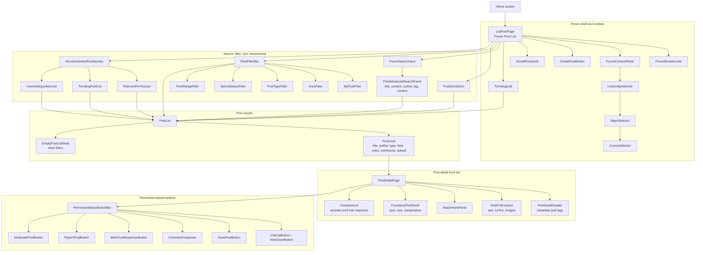

# List Post Page Specification

**Version:** `1.0`

**Performed by:** [Nguyen Le Quoc Huy] | **Edited by:** [Nguyen Le Quoc Huy]
> **Status:** UI/UX recommendation derived from the proposal documents in `requirements/proposals/`.
>
> **Scope:** This document describes the **List Post** page/flow of the University Forum and recommends UI component names, displayed information, and the user action supported by each component.
>
> **Main sources:** [`screen_flow.md`](screen_flow.md), [`feature_flow.md`](feature_flow.md), [`overview.md`](overview.md), [`functional_requirement.md`](functional_requirement.md), [`userstory.md`](userstory.md), [`use_cases_description.md`](use_cases_description.md), [`use_cases_model/UC-03-browse-search-forum.md`](use_cases_model/UC-03-browse-search-forum.md), [`API.md`](API.md).
>
> **Note:** The List Post page is the discovery surface of the primary forum. Post detail is included here as the immediate destination when a user opens a post from the list, because `UC-03`, `FR-17`, and the feature flow connect these views.

---

## 1. Purpose of the List Post Page

The **List Post** page lets a university student discover academic discussions, materials, and functional posts within a selected **University → Major → Course** forum context. The page shows concise post summaries, supports filtering/sorting/search/recommendation, and lets the user open a post to read the full content and use permitted actions.

It is the primary browsing surface of Studitopia. It turns the academic hierarchy into a relevant post feed and helps students find discussions, answers, uploaded material, and interactive tools connected to their university, major, courses, tags, and interests.

### 1.1 Core purposes

| Purpose | What the user achieves | Requirement basis |
| --- | --- | --- |
| Browse forum hierarchy | Move from University to Major to Course and view posts relevant to the selected level. | `US-11`, `US-12`, `FR-11.1`–`FR-11.4`, `FR-12.1`–`FR-12.6`, `AC-12.1`–`AC-12.5` |
| Display post summaries | See title, author, post type, timestamp, vote score, comment count, and solved status. | `US-13`, `FR-13.1`, `FR-13.2`, `AC-13.1`, `AC-13.2`, `UC-03` step 6 |
| Filter posts | Filter by My Post, area, university, major, course, tags, and post type. | `FR-13.3`, `AC-13.3`, `feature_flow.md` |
| Sort posts | Sort by newest, top trending, most voted, and most discussed. | `FR-13.4`, `AC-13.4` |
| Search posts | Search by keyword, tags, title, content, author, university, major, and course. | `US-23`, `FR-23.1`–`FR-23.5` |
| Filter search results | Filter by post type, solved status, and time range; rank by relevance and engagement. | `FR-23.3`, `FR-23.4` |
| Receive recommendations | Discover relevant posts, trending posts, and unsolved questions. | `US-24`, `FR-24.1`–`FR-24.5`, `feature_flow.md` |
| Open a post | View full content, metadata, comments, answers, true response, attachments, and tools. | `US-17`, `FR-17.1`–`FR-17.5`, `UC-03` steps 10–12 |
| Use post actions | Vote, comment, save, report, or mark a true response according to permissions. | `FR-19`, `FR-20`, `FR-21`, `FR-22`, `FR-17.4` |
| Recover from empty/error states | Clear filters, retry failed loads, or handle unavailable/restricted posts. | `AC-13.5`, `FR-23.5`, `UC-03` `A3`, `E1`–`E4` |

### 1.2 Place in the screen and feature flows

`screen_flow.md` defines:

```text
Forum -> University -> Major -> Course -> Post
Trending -> Post
Trending -> Related -> Post
```

`feature_flow.md` defines:

```text
Forum -> Recommended -> List Post
Forum -> Search
List Post -> Filter -> My Post / Area / University / Major / Course / Tags
List Post -> Post
List Post -> Solved / Good -> Comment / Answer
Post -> Comment / Mark True Response / Upvote / Downvote / Save / Report / Moderate
```

`UC-03` confirms the browsing/search flow:

```text
Open Forum -> default university forum -> select major/course -> view post summaries ->
apply filters/sorting -> optionally search -> open post -> view detail and permitted actions
```

---

## 2. Recommended page identity and naming

| Item | Suggested name | Notes |
| --- | --- | --- |
| Page group | `ListPostPage` | Matches the flow label **List Post**. |
| Main page | `ForumPostListPage` | Clearer implementation name. |
| Suggested route | `/forum` or `/forum/:universityId/:majorId/:courseId` | Recommended route; not specified in the proposal. |
| Page title | **Forum Posts** or **Posts** | Should reflect the active forum level. |
| Short navigation label | **Forum** | Matches the main navigation entry. |
| Primary action | **Create Post** | Primary contribution path from the list. |
| Main object | `ForumPostSummary` | Used for cards/rows in the list. |
| Detail object | `ForumPostDetail` | Used when a post is opened. |

### 2.1 Naming convention recommendation

- Prefix browsing components with `Forum` or `PostList`.
- Prefix filter/search components with `Post` or `Forum`.
- Prefix result components with `PostCard`.
- Prefix detail components with `PostDetail`.
- Use PascalCase, e.g. `PostFilterBar`, `PostSolvedBadge`, `PermissionBasedActionBar`.

---

## 3. Target users and user goals

| User type | Main goal on List Post | Components used most |
| --- | --- | --- |
| Student browsing the forum | Find discussions relevant to the selected university, major, or course. | `ForumContextPanel`, `PostList`, `PostCard` |
| Student searching for a specific topic | Search by keyword, title, content, tag, or author. | `ForumSearchInput`, `PostAdvancedSearchPanel` |
| Student filtering feed | Narrow by My Post, area, post type, solved status, tags, or time range. | `PostFilterBar`, `PostTypeFilter`, `SolvedStatusFilter` |
| Student discovering popular content | View recommended, trending, or unsolved posts. | `RecommendedPostSection`, `TrendingPostList`, `UnsolvedQuestionList` |
| Student evaluating a post | Compare title, type, votes, comments, solved status, and author. | `PostCard`, `PostVoteScoreText`, `PostCommentCountText`, `PostSolvedBadge` |
| Post author | Find own posts and manage them. | `MyPostFilter`, `OpenPostButton`, `ModeratePostButton` |
| Moderator | Report/hide/delete inappropriate content. | `ReportPostButton`, `ModeratePostButton` |

---

## 4. Recommended information architecture

| View/section | Suggested route or state | Purpose | Main components |
| --- | --- | --- | --- |
| Forum home | `/forum` | Default university forum with post list. | `ListPostPage`, `ForumContextPanel`, `PostList` |
| University forum | `/forum/universities/:universityId` | Posts for one university. | `UniversitySelector`, `PostList` |
| Major forum | `/forum/majors/:majorId` | Posts for one major. | `MajorSelector`, `PostList` |
| Course forum | `/forum/courses/:courseId` | Posts for one course. | `CourseSelector`, `PostList` |
| Search results | `?q=` and filter query state | Ranked search results. | `ForumSearchInput`, `PostAdvancedSearchPanel`, `PostList` |
| Recommended posts | Recommended tab/section | Relevant, trending, and unsolved posts. | `RecommendedPostSection` |
| My posts | `/forum/my-posts` or `My Post` filter | Shows posts authored by the current user. | `MyPostFilter`, `PostList` |
| Saved posts | `/forum/saved` | Shows saved posts across forum contexts. | `SavedPostsLink`, `SavedPostList` |
| Post detail | `/forum/posts/:postId` | Full post content and actions. | `PostDetailPage`, `PermissionBasedActionBar` |

---

## 5. Recommended UI components

### 5.1 Page shell and forum context

| Suggested component name | UI component type | Information shown | Meaning / user action | Requirement basis |
| --- | --- | --- | --- | --- |
| `ListPostPage` | Page container | Heading reflecting active forum, context panel, search/filter bar, recommendation section, post list. | Root container for browsing posts. | `US-13`, `UC-03` |
| `ForumSidebarNavItem` | Sidebar navigation link | Label **Forum** and forum icon. | Navigates from Home to the primary forum. | `FR-11.2`, `AC-11.2` |
| `ForumBreadcrumb` | Breadcrumb | `Forum > University > Major > Course`. | Shows current academic context and enables back navigation. | `FR-12.4`, `AC-12.4` |
| `ForumContextPanel` | Header/card | Active university, major, course, and forum level. | Shows which post set the user is viewing. | `FR-12.5`, `AC-12.5` |
| `UniversitySelector` | Dropdown/list | Available universities; own university highlighted as default. | User selects a university forum. | `FR-11.2`, `FR-11.3`, `FR-12.2` |
| `MajorSelector` | Dropdown/list | Majors offered by the selected university. | User selects a major forum. | `FR-12.2`, `AC-12.1` |
| `CourseSelector` | Dropdown/list | Courses associated with the selected major. | User selects a course forum. | `FR-12.3`, `AC-12.2` |
| `ForumContextSwitcher` | Tab/dropdown group | University / Major / Course switcher. | Lets the user switch forum level easily. | `FR-12.6`, `AC-12.4` |
| `CreatePostButton` | Primary button | Label **Create Post**. | Opens the Create Post flow in the current context. | `screen_flow.md`, `feature_flow.md` |
| `TrendingLink` | Link/tab | Label **Trending**. | Opens trending posts in the current academic context. | `screen_flow.md`, `FR-24.2` |
| `SavedPostsLink` | Link/tab | Label **Saved Posts**. | Opens the user's saved post list. | `FR-21.2`, `FR-21.4` |
| `MyPostsLink` | Link/tab | Label **My Posts**. | Opens posts authored by the user. | `userstory.md` profile flow, `My Post` filter |

---

### 5.2 Search, filter, and sort components

| Suggested component name | UI component type | Information shown | Meaning / user action | Requirement basis |
| --- | --- | --- | --- | --- |
| `ForumSearchInput` | Search input | Placeholder “Search posts”. | User enters a keyword search query. | `FR-23.1` |
| `ForumSearchButton` | Button | Label **Search**. | Submits the keyword query. | `FR-23.1` |
| `PostAdvancedSearchToggle` | Link/button | Label **Advanced search**. | Expands field-specific search controls. | `FR-23.2` |
| `PostAdvancedSearchPanel` | Expandable panel | Title, content, author, tag, university, major, course search fields. | User searches specific post fields. | `FR-23.2`, `UC-03` step 8 |
| `PostTitleSearchInput` | Textbox | Label **Title contains**. | Limits results by title text. | `FR-23.2` |
| `PostContentSearchInput` | Textbox | Label **Content contains**. | Limits results by post body text. | `FR-23.2` |
| `PostAuthorSearchInput` | Textbox | Label **Author**. | Limits results by author name. | `FR-23.2` |
| `PostTagSearchInput` | Tag input | Tag chips or text input for tags. | Limits results by tags. | `FR-23.2`, `FR-13.3` |
| `SearchUniversityFilter` | Dropdown | University filter for search results. | Limits search to a university. | `FR-23.2` |
| `SearchMajorFilter` | Dropdown | Major filter for search results. | Limits search to a major. | `FR-23.2` |
| `SearchCourseFilter` | Dropdown | Course filter for search results. | Limits search to a course. | `FR-23.2` |
| `PostFilterBar` | Filter toolbar | Filter controls, active chips, clear action. | Groups post-list filters. | `FR-13.3`, `feature_flow.md` |
| `MyPostFilter` | Toggle/checkbox | Label **My Post**. | Shows only posts authored by the current user. | `FR-13.3`, `feature_flow.md` |
| `AreaFilter` | Dropdown | Area values such as All Areas or current academic area. | Narrows posts by area. | `feature_flow.md` |
| `UniversityFilter` | Dropdown | University values. | Filters post list by university. | `FR-13.3` |
| `MajorFilter` | Dropdown | Major values. | Filters post list by major. | `FR-13.3` |
| `CourseFilter` | Dropdown | Course values. | Filters post list by course. | `FR-13.3` |
| `PostTypeFilter` | Dropdown/checkbox group | **Discussion**, **Material**, **Functional**. | Limits results by post type. | `FR-13.3`, `FR-23.3` |
| `SolvedStatusFilter` | Dropdown/toggle | **All**, **Solved**, **Unsolved**. | Filters question posts by solved status. | `FR-23.3` |
| `TimeRangeFilter` | Dropdown | Today, 7 days, 30 days, All time. | Limits results by creation time. | `FR-23.3` |
| `ActivePostFilterChips` | Chip list | Current filters with remove buttons. | Shows and removes active filters. | Recommendation |
| `ClearPostFiltersButton` | Text button | Label **Clear filters**. | Resets filters and search state. | `AC-13.5`, `UC-03` `A3` |
| `PostSortSelect` | Dropdown | **Newest**, **Top Trending**, **Most Voted**, **Most Discussed**. | Controls result order; search mode may use relevance/engagement rank. | `FR-13.4`, `FR-23.4` |
| `PostResultCountText` | Text | Example: “42 posts.” | Shows how many posts match. | Recommendation |

---

### 5.3 Recommendation components

| Suggested component name | UI component type | Information shown | Meaning / user action | Requirement basis |
| --- | --- | --- | --- | --- |
| `RecommendedPostSection` | Section/card | Heading **Recommended for you**. | Groups recommended posts before the general list. | `FR-24.1` |
| `RelevantForYouList` | Horizontal card list | Posts relevant to university, major, courses, and interests. | Helps the user find discussions tailored to them. | `FR-24.1`, `FR-09.4` |
| `TrendingPostList` | Horizontal card list | High-engagement posts in the current context. | Helps the user see active discussions. | `FR-24.2`, `screen_flow.md` |
| `UnsolvedQuestionList` | Horizontal card list | Unsolved questions the user may answer. | Helps the user contribute help. | `FR-24.3` |
| `RelatedPostList` | Horizontal card list | Posts related to the currently viewed context or post. | Supports related discovery. | `screen_flow.md` |
| `RecommendationReasonText` | Supporting text | “Related to CS101” or “Trending in your major.” | Explains why a post is recommended. | Recommendation based on `FR-24.1`–`FR-24.3` |
| `DismissRecommendationButton` | Icon/menu item | Label **Not relevant**. | Hides an irrelevant recommendation. | `FR-24.4` |
| `RefreshRecommendationsButton` | Button | Label **Refresh**. | Requests updated recommendations after preferences/context change. | `FR-24.5` |

---

### 5.4 Post list and post card components

| Suggested component name | UI component type | Information shown | Meaning / user action | Requirement basis |
| --- | --- | --- | --- | --- |
| `PostList` | List/feed | Ordered collection of post cards/rows. | Main result surface for browsing/search/filtering. | `FR-13.1`, `AC-13.1` |
| `PostCard` | Card/list item | Title, author, post type, timestamp, vote score, comment count, solved status, tags. | Represents one post summary; opens detail. | `FR-13.2`, `AC-13.2`, `UC-03` step 6 |
| `PostTitleLink` | Link | Post title. | Opens `PostDetailPage`. | `FR-13.5`, `AC-13.2` |
| `PostTypeBadge` | Badge | `Discussion`, `Material`, or `Functional`. | Shows what kind of post it is. | `FR-13.2`, `overview.md` |
| `PostAuthorText` | Text | Author display name and optional avatar. | Shows who created the post. | `FR-13.2`, `FR-17.2` |
| `PostTimestampText` | Text | Creation time or relative time. | Shows post age. | `FR-13.2`, `API.md` `created_at` |
| `PostVoteScoreText` | Text with icons | Current vote score. | Helps users judge usefulness; updates after voting. | `FR-13.2`, `FR-19.5` |
| `PostCommentCountText` | Text with icon | Number of comments/answers. | Shows discussion activity. | `FR-13.2`, `API.md` `comment_count` |
| `PostSolvedBadge` | Badge | `Solved` or `Unsolved` for question posts. | Shows whether a true response was accepted. | `FR-13.2`, `FR-20.2`, `API.md` `solved` |
| `PostTagChipList` | Chip list | Post tags. | Shows topic context and enables tag filtering. | `FR-13.3`, `FR-23.2` |
| `ForumContextBadge` | Badge | University, major, or course context. | Shows where the post belongs. | `FR-17.2`, `FR-23.2` |
| `PostAttachmentIndicator` | Icon/badge | Paperclip icon and attachment count. | Shows that a material post has files. | `FR-17.5` |
| `PostToolIndicator` | Badge | `Quiz`, `Prerequisite Tree`, or `Computation`. | Shows that a functional post contains an interactive tool. | `FR-17.5` |
| `OpenPostButton` | Button/link | Label **Open post**. | Opens the full post detail. | `FR-13.5` |
| `VoteUpButton` | Icon button | Up arrow. | Upvotes the post where permitted. | `FR-19.1`, `FR-19.3`, `FR-19.4` |
| `VoteDownButton` | Icon button | Down arrow. | Downvotes the post where permitted. | `FR-19.1`, `FR-19.3`, `FR-19.4` |
| `SavePostButton` | Icon/bookmark button | **Save**/**Saved** state. | Saves/removes the post from the saved list. | `FR-21.1`–`FR-21.4` |
| `ReportPostButton` | Menu item/button | Label **Report**. | Opens report flow with categories such as spam, harassment, inappropriate content, academic dishonesty. | `FR-22.1`, `FR-22.2` |
| `ModeratePostButton` | Button shown to moderators | **Hide**, **Delete**, **Restore**, or **Ban** actions. | Lets moderators apply permitted moderation actions. | `FR-22.4` |
| `EmptyPostListState` | Empty state | “No posts match your filters.” with clear/change filter action. | Helps user recover from empty results. | `AC-13.5`, `FR-23.5`, `UC-03` `A3` |

---

### 5.5 Post detail components reached from the list

| Suggested component name | UI component type | Information shown | Meaning / user action | Requirement basis |
| --- | --- | --- | --- | --- |
| `PostDetailPage` | Page/modal | Full selected post with metadata, content, comments, tools, and actions. | Lets the user read and interact with one post. | `FR-17.1`, `UC-03` steps 10–12 |
| `PostDetailHeader` | Header | Title, author, post type, forum context, timestamp, vote score, tags, solved status. | Provides post identity and status. | `FR-17.2`, `UC-03` step 11 |
| `PostFullContent` | Content area | Full text, LaTeX-rendered content, and images. | Lets the user read the complete discussion. | `FR-17.1`, `FR-14.2` |
| `PostMetadataPanel` | Info panel | University, major, course, author, created time, tags, post type. | Shows academic context and metadata. | `FR-17.2` |
| `AttachmentPanel` | File list/preview | Material files with open/download actions. | Lets users access shared learning material. | `FR-17.5`, `FR-15.5` |
| `FunctionalToolPanel` | Container | Hosts the interactive tool attached to a functional post. | Lets users interact with the published tool. | `FR-16.6`, `FR-17.5` |
| `QuizRunner` | Interactive quiz | Questions, options, answer submission, score result. | Lets users take the quiz. | `FR-16.3`, `AC-16.4` |
| `PrerequisiteTreeViewer` | Diagram viewer | Nodes/edges with click simulation and auto-apply behavior where configured. | Lets users explore prerequisites. | `FR-16.4`, `AC-16.4` |
| `DynamicComputationRunner` | Interactive calculator | Input fields and computed output. | Lets users run the dynamic computation. | `FR-16.5`, `AC-16.4` |
| `TrueResponsePanel` | Highlighted answer card | Accepted answer/comment and answer author. | Helps users find the accepted solution quickly. | `FR-20.3` |
| `CommentList` | Thread/list | Comments, answers, nested replies, comment votes. | Lets users read the discussion. | `FR-18.3`, `FR-18.5`, `FR-17.3` |
| `CommentComposer` | Textarea + button | Comment/answer input and submit button. | Lets users comment or answer if permitted. | `FR-18.1`, `FR-18.2` |
| `MarkTrueResponseButton` | Button shown to question author | Label **Mark as true response**. | Lets the post author accept one answer. | `FR-20.1`, `FR-20.2`, `FR-20.4` |
| `PermissionBasedActionBar` | Action bar | Vote, save, report, moderate, comment, and true-response actions according to permissions. | Prevents unauthorized actions. | `FR-17.4`, `FR-39.5` |

---

### 5.6 Feedback and error components

| Suggested component name | UI component type | Information shown | Meaning / user action | Requirement basis |
| --- | --- | --- | --- | --- |
| `ForumLoadingSkeleton` | Skeleton/loader | Placeholder context, filters, and post cards. | Shows that posts are loading. | Recommendation |
| `ForumErrorBanner` | Alert | “Unable to load posts.” with **Retry**. | Recovers from forum-load failures. | `UC-03` `E1` |
| `PostUnavailableState` | Error state | “This post is no longer available.” with return-to-list action. | Handles deleted or unavailable posts. | `UC-03` `E2` |
| `ForumAccessDeniedState` | Error state | “You do not have permission to view this forum/post.” | Handles private/restricted content. | `UC-03` `E3`, `FR-11.3` |
| `InvalidFilterState` | Validation alert | Invalid filter/search combination message. | Preserves usable query parts and asks user to correct the rest. | `UC-03` `E4` |
| `ReportPostDialog` | Modal | Category, description, context, Submit/Cancel. | Reports a post with required context. | `FR-22.1`–`FR-22.3` |
| `ListToastHost` | Toast container | Success/error messages for vote, save, report, and moderation actions. | Gives immediate feedback. | Recommendation |

---

## 6. Recommended post summary information

| Field | Suggested label | Where shown | Purpose |
| --- | --- | --- | --- |
| `postId` | Hidden/internal | Post card, detail link | Identifies the post. |
| `title` | **Title** | Post card, detail, search | Main post identity and click target. |
| `author` | **Author** | Post card, detail | Shows who published the post. |
| `postType` | **Type** | Post card/detail badge | Shows Discussion, Material, or Functional. |
| `createdAt` | **Posted** | Post card/detail | Shows post age and supports newest sort. |
| `voteScore` | **Votes** | Post card/detail | Shows current score and supports most-voted sort. |
| `commentCount` | **Comments** | Post card/detail | Shows activity and supports most-discussed sort. |
| `solved` | **Solved** | Post card/detail badge | Shows whether a true response was accepted. |
| `tags` | **Tags** | Post card/detail/search | Shows topics and supports tag filtering. |
| `university` | **University** | Context badge/filter | Shows university forum association. |
| `major` | **Major** | Context badge/filter | Shows major forum association. |
| `course` | **Course** | Context badge/filter | Shows course forum association. |
| `area` | **Area** | Filter/card context | Supports area filtering from the feature flow. |
| `attachmentCount` | **Attachments** | Post card indicator | Shows material files are present. |
| `toolType` | **Interactive tool** | Post card badge | Shows quiz/tree/computation is present. |
| `saved` | Saved state | Save button | Shows whether current user saved the post. |
| `userVote` | Vote state | Vote buttons | Shows current user's upvote/downvote state. |
| `trueResponseId` | True response | Detail panel | Identifies accepted answer. |
| `moderationStatus` | Hidden/admin state | Moderator controls | Supports hide/delete/restore actions. |

---

## 7. Recommended interaction flows

### 7.1 Browse by forum hierarchy

1. User opens `ForumSidebarNavItem`.
2. `ListPostPage` loads the default university forum.
3. User selects a university, then a major, then a course using the selectors.
4. `ForumContextPanel` updates and `PostList` displays posts relevant to the selected level.
5. User opens a post with `PostTitleLink` or `OpenPostButton`.
6. `PostDetailPage` displays the full post and permitted actions.

### 7.2 Search and filter posts

1. User enters a keyword in `ForumSearchInput`.
2. User optionally opens `PostAdvancedSearchPanel` and enters title, content, author, tag, university, major, or course values.
3. User applies `PostFilterBar` filters such as My Post, area, post type, solved status, time range, and tags.
4. User selects a sort order with `PostSortSelect`.
5. `PostList` updates with ranked/filtered results and `PostResultCountText`.
6. If nothing matches, `EmptyPostListState` offers `ClearPostFiltersButton`.

### 7.3 Discover recommendations

1. User opens `RecommendedPostSection`.
2. User selects relevant, trending, unsolved, or related suggestions.
3. `RecommendationReasonText` explains why each post appears.
4. User can dismiss irrelevant posts with `DismissRecommendationButton` or refresh with `RefreshRecommendationsButton`.
5. User opens a recommended post from `PostCard`.

### 7.4 Use post actions

1. User opens a post from the list.
2. `PermissionBasedActionBar` displays only allowed actions.
3. User can upvote/downvote with single-vote and change-vote behavior.
4. User can save/unsave with `SavePostButton`.
5. User can comment/answer with `CommentComposer`.
6. If the user is the question author, `MarkTrueResponseButton` appears on answers.
7. User can report with `ReportPostDialog`; moderators can use `ModeratePostButton`.
8. Toast feedback confirms the result.

---

## 8. Business rules and UI states

| Rule/state | Recommended UI behavior |
| --- | --- |
| Forum content is organized by University, Major, and Course. | Use hierarchical selectors and breadcrumb; show only relevant posts. |
| The student's own university is the default forum context. | Highlight own university in `UniversitySelector` and load it by default. |
| Other university forums are available only when permitted. | Show `ForumAccessDeniedState` when access is denied. |
| Post summaries must include required summary fields. | `PostCard` always shows title, author, type, timestamp, vote score, comment count, and solved status. |
| Filters include My Post, area, university, major, course, tags, and post type. | Provide all filters in `PostFilterBar` and show active chips. |
| Sorting supports newest, trending, most voted, and most discussed. | Provide all options in `PostSortSelect`; search mode may rank by relevance/engagement. |
| Search supports tags, title, content, author, university, major, and course. | Provide `PostAdvancedSearchPanel` fields. |
| Search results can be filtered by solved status and time range. | Provide `SolvedStatusFilter` and `TimeRangeFilter`. |
| Empty results show an empty state. | Show `EmptyPostListState` and `ClearPostFiltersButton`. |
| Post detail shows full content, metadata, discussion, true response, attachments, and tools. | Provide the detail components in section 5.5. |
| Available actions depend on permissions. | Render `PermissionBasedActionBar` conditionally. |
| A user can have only one active vote per post/comment and may change/remove it. | Show `userVote` state and update `PostVoteScoreText` after voting. |
| Saved posts persist across forum context changes. | Keep `SavePostButton` state tied to the user, not the current forum. |
| Reported or moderated content must be routed correctly. | Use `ReportPostDialog` and moderator-only controls. |

---

## 9. Requirements traceability

| Requirement/source | Covered by |
| --- | --- |
| `screen_flow.md`: Forum → University → Major → Course → Post | `ForumContextPanel`, selectors, `PostList`, `PostDetailPage` |
| `screen_flow.md`: Trending → Post / Related → Post | `TrendingPostList`, `RelatedPostList` |
| `feature_flow.md`: Forum → Recommended → List Post | `RecommendedPostSection`, `PostList` |
| `feature_flow.md`: Forum → Search | `ForumSearchInput`, `PostAdvancedSearchPanel` |
| `feature_flow.md`: List Post → Filter → My Post / Area / University / Major / Course / Tags | `PostFilterBar` and filter components |
| `feature_flow.md`: List Post → Post → Comment / Solved / Vote / Save / Report / Moderate | `PostCard`, `PostDetailPage`, action components |
| `overview.md`: university, major, course forum hierarchy | `UniversitySelector`, `MajorSelector`, `CourseSelector` |
| `US-11`, `FR-11.1`–`FR-11.4` | Forum entry, own university default, other university permissions |
| `US-12`, `FR-12.1`–`FR-12.6`, `AC-12.1`–`AC-12.5` | Forum hierarchy and context switching |
| `US-13`, `FR-13.1`–`FR-13.5`, `AC-13.1`–`AC-13.5` | Post list, summary fields, filters, sorting, open post, empty state |
| `US-17`, `FR-17.1`–`FR-17.5`, `AC-17.1`–`AC-17.5` | Post detail content, metadata, discussion, permissions, attachments/tools |
| `US-19`, `FR-19.1`–`FR-19.5` | Upvote/downvote, duplicate prevention, change vote, score update |
| `US-20`, `FR-20.1`–`FR-20.5` | True response marking and solved status |
| `US-21`, `FR-21.1`–`FR-21.4` | Save post, saved list, remove saved, persistence |
| `US-22`, `FR-22.1`–`FR-22.6` | Report content and moderation actions |
| `US-23`, `FR-23.1`–`FR-23.5` | Keyword search, search fields, filters, ranking, empty state |
| `US-24`, `FR-24.1`–`FR-24.5` | Relevant/trending/unsolved recommendations, dismiss, refresh |
| `UC-03` main success scenario | End-to-end browse/search/open-detail flow |
| `UC-03` alternative/exception flows | Other university, context switch, no matches, filter-only search, load error, unavailable post, access denied, invalid filter |
| `I-04 Load Forum Post List` | `PostList` and context-driven loading |
| `E-03 Search Forum` | `ForumSearchInput`, `PostAdvancedSearchPanel`, ranking/filtering |
| `E-04 View Post Detail` | `PostDetailPage` and detail subcomponents |
| `API.md` `list_forum_posts` | Summary fields: `post_id`, `title`, `post_type`, `author_id`, `vote_score`, `comment_count`, `solved`, `created_at` |

---

## 10. Summary diagram


