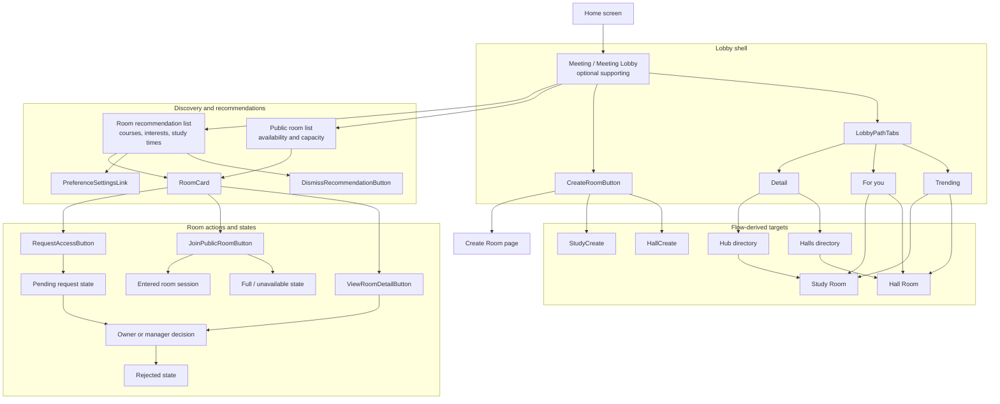

# Meeting Lobby Page Specification

**Version:** `1.0`

**Performed by:** [Tran Nguyen Khanh Binh] | **Edited by:** [Tran Nguyen Khanh Binh]
>
> **Main sources:** [`screen_flow.md`](screen_flow.md), [`feature_flow.md`](feature_flow.md), [`overview.md`](overview.md), [`functional_requirement.md`](functional_requirement.md), [`userstory.md`](userstory.md), [`use_cases_description.md`](use_cases_description.md), [`use_cases_model/UC-07-join-create-study-room.md`](use_cases_model/UC-07-join-create-study-room.md), [`non_functional_requirement.md`](non_functional_requirement.md).
>
> **Note:** The explicit room requirements are `US-34`–`US-37` and `UC-07`. Routes, page names, cards, directories, and visual states are **recommendations** unless a requirement is cited. [`API.md`](API.md) and [`response_code.md`](response_code.md) contain no room endpoints, room fields, or room error codes, so any room API shape is **unspecified** and no endpoints or codes are invented here. Older PA2 hall/study details (tables, seats, invite codes, 30-minute teardown) are **not** current requirements and are not used.

---

## 1. Purpose of the Meeting Lobby

The **Meeting Lobby** is the discovery hub for optional study rooms. It lets a student browse public rooms, review preference-based suggestions, inspect room detail before joining, join a public room with available capacity, request access to a private or custom room, and start room creation. It is a supporting destination after Home and never replaces the forum as the primary collaboration space.

### 1.1 Core purposes

| Purpose | What the user achieves | Requirement basis |
| --- | --- | --- |
| Browse public rooms | See available public study rooms with availability and capacity. | `FR-35.1`, `AC-35.1`, `UC-07` steps 1–2 |
| Receive optional recommendations | See study-room suggestions based on courses, interests, and preferred study times. | `US-34`, `FR-34.1`, `FR-34.2`, `AC-34.1`, `FR-09.4`, `AC-09.4` |
| Understand room availability | Read availability and capacity before choosing a room. | `FR-34.3`, `AC-34.2`, `UC-07` step 2 |
| Dismiss irrelevant suggestions | Remove a room recommendation that is not useful. | `FR-34.4`, `AC-34.3` |
| Follow Trending / For you / Detail paths | Reach Hall Room or Study Room through the named flow paths. | `feature_flow.md:156–173` |
| Review room detail before joining | Check description, capacity, and configuration before joining or requesting. | `UC-07` A3 |
| Join a public room | Enter a public room when capacity is available. | `FR-35.2`, `AC-35.1`, `UC-07` main success scenario |
| Request private/custom access | Send a join request routed to a room owner or manager. | `FR-35.3`, `AC-35.2`, `UC-07` A1 |
| Start room creation | Open the Create flow for a Hall or Study room. | `feature_flow.md:169–172`, `UC-07` A2 |
| Handle blocked states | Understand full, closed, unavailable, and pending-request outcomes. | `UC-07` A4, E1, E2, E3, business rules 2–3 |
| Respect user controls | Room invitations and participation honor notification and communication settings. | `FR-38.3`, `AC-38.4`, `FR-39.1`–`FR-39.5`, `NFR-PRIV-6`, `NFR-PRIV-7` |

### 1.2 Place in the screen flow

`screen_flow.md` defines:

```text
Home -> Meeting
Meeting -> Hall Room
Meeting -> Study Room
```

### 1.3 Place in the feature flow

`feature_flow.md:156–173` defines the Lobby Group (Supporting):

```text
Lobby -> Trending -> HallRoom
Lobby -> For you -> HallRoom
Lobby -> Detail -> Halls -> HallRoom
Lobby -> Trending -> StudyRoom
Lobby -> For you -> StudyRoom
Lobby -> Detail -> Hub -> StudyRoom
Lobby -> Create -> HallCreate / StudyCreate
```

**Flow-derived only:** the **Halls** and **Hub** directories and the **HallCreate** / **StudyCreate** labels appear in this flow but have no dedicated FR or AC. They are treated as recommended UI groupings, not as explicit requirement objects.

---

## 2. Recommended page identity and naming

| Item | Suggested name | Notes |
| --- | --- | --- |
| Page group | `MeetingGroupPage` | Matches the **Meeting Group (Supporting)** label in `screen_flow.md`. |
| Main page | `MeetingLobbyPage` | Product-facing name matching `UC-07` step 1 (“opens the Meeting Lobby”). |
| Suggested route | `/meeting` or `/meeting/lobby` | Recommended route; not specified in the proposal. |
| Page title | **Meeting Lobby** | Uses the `UC-07` label. |
| Primary actions | **Join Room**, **Request Access**, **View Detail**, **Create Room** | Match `FR-35.1`–`FR-35.5` and `UC-07` A1–A3. |
| Main objects | `RoomListing`, `RoomRecommendation`, `JoinRequest`, `RoomDetail` | Recommended object names for UI implementation. |
| Directory objects | `HallsDirectory`, `HubDirectory` | Flow-derived from `feature_flow.md:164,168`; not requirement-defined. |

### 2.1 Naming convention recommendation

- Prefix discovery/recommendation components with `Lobby` or `Room`.
- Prefix action components with `Join`, `Request`, or `ViewRoom`.
- Prefix empty/error states with `Lobby`.
- Use PascalCase, e.g. `RoomRecommendationCard`, `DismissRecommendationButton`, `LobbyFullRoomNotice`.

---

## 3. Target users and user goals

| User type | Main goal in the Lobby | Components used most |
| --- | --- | --- |
| Student looking for live collaboration | Find a public room with room to join. | `LobbyRoomList`, `RoomCard`, `JoinPublicRoomButton` |
| Student following recommendations | Use courses, interests, and study-time preferences to find a relevant room. | `RoomRecommendationList`, `RecommendationReasonText` |
| Student who finds a suggestion irrelevant | Remove it from the suggestion list. | `DismissRecommendationButton` |
| Student evaluating a room | Review description, capacity, and configuration before committing. | `ViewRoomDetailButton`, `RoomDetailPreviewPanel` |
| Student seeking a private/custom room | Request access and track the pending decision. | `RequestAccessButton`, `PendingRequestState` |
| Room owner or manager | Review and decide incoming join requests. | `JoinRequestQueueLink`, `RequestDecisionBadge` |
| Room creator | Start Hall or Study room creation. | `CreateRoomButton`, `RoomTypeEntry` |
| Privacy-conscious student | Avoid room invitations and interactions that are not permitted. | `RoomInvitationNotice`, `CommunicationSettingsLink` |

---

## 4. Recommended information architecture

| View/section | Suggested state/route | Purpose | Main components |
| --- | --- | --- | --- |
| Lobby home | `/meeting/lobby` | Entry point for optional room discovery. | `MeetingLobbyPage`, `LobbyHeader` |
| Entry paths | Tabs or cards | Expose Trending, For you, and Detail paths from `feature_flow.md`. | `LobbyPathTabs`, `TrendingPathTab`, `ForYouPathTab`, `DetailPathTab` |
| Halls directory | `Halls` state | Flow-derived grouping that leads to Hall Room. | `HallsDirectoryPanel`, `RoomCard` |
| Hub directory | `Hub` state | Flow-derived grouping that leads to Study Room. | `HubDirectoryPanel`, `RoomCard` |
| Public rooms | List/grid | Browse public rooms with availability and capacity. | `LobbyRoomList`, `RoomCard`, `RoomCapacityBadge` |
| Recommendations | Side section/tab | Show optional preference-based suggestions. | `RoomRecommendationList`, `RecommendationReasonText` |
| Room detail | Detail preview/modal | Review capacity, description, and configuration before joining. | `RoomDetailPreviewPanel`, `ViewRoomDetailButton` |
| Requests | Request state | Send private/custom requests and see pending outcomes. | `RequestAccessButton`, `PendingRequestState`, `RequestOutcomeNotice` |
| Create entry | Action | Start Hall or Study room creation. | `CreateRoomButton`, `RoomTypeEntry` |
| Feedback | Global overlays | Explain full, closed, unavailable, or restricted rooms. | `LobbyFullRoomNotice`, `LobbyUnavailableNotice`, `LobbyErrorBanner` |

---

## 5. Recommended UI components

### 5.1 Lobby shell and flow entry

| Suggested name | UI type | Information shown | Meaning / action | Requirement basis |
| --- | --- | --- | --- | --- |
| `MeetingLobbyPage` | Page container | Heading **Meeting Lobby**, path tabs, room lists, recommendations, create action. | Root container for optional room discovery. | `UC-07` step 1, `feature_flow.md:156–173` |
| `LobbyHeader` | Header bar | Page title and short note that rooms are optional. | Sets expectations that the forum is primary. | `functional_requirement.md` supporting-room note; recommendation |
| `LobbyPathTabs` | Tab bar | **Trending**, **For you**, **Detail**. | Switches between the three flow entry paths. | `feature_flow.md:162–168` |
| `TrendingPathTab` | Tab | Label **Trending**. | Opens trending rooms and leads toward Hall/Study rooms. | `feature_flow.md:162,166` |
| `ForYouPathTab` | Tab | Label **For you**. | Opens rooms relevant to the current user. | `feature_flow.md:163,167`, `FR-34.2` |
| `DetailPathTab` | Tab | Label **Detail**. | Opens directory detail before entering a room. | `feature_flow.md:164,168`, `UC-07` A3 |
| `HallsDirectoryPanel` | Directory panel | Hall-room entries grouped by the flow-derived **Halls** directory. | Leads to Hall Room after a detail path. | `feature_flow.md:164`; recommendation |
| `HubDirectoryPanel` | Directory panel | Study-room entries grouped by the flow-derived **Hub** directory. | Leads to Study Room after a detail path. | `feature_flow.md:168`; recommendation |
| `LobbyBreadcrumb` | Breadcrumb | `Home > Meeting > Lobby > <path>` | Shows location and supports going back. | Recommendation; supports `NFR-USE-4` |
| `RoomDirectorySearchInput` | Search box | Placeholder “Search rooms”. | Filters room listings by name or topic. | Recommendation; no explicit FR |
| `LobbyLoadingSkeleton` | Skeleton/loader | Placeholder cards and panels. | Shows that room data is loading. | Recommendation; supports `NFR-USE-4` |

### 5.2 Public room discovery

| Suggested name | UI type | Information shown | Meaning / action | Requirement basis |
| --- | --- | --- | --- | --- |
| `LobbyRoomList` | Card list/grid | Public rooms with availability and capacity. | Lets the user browse available public rooms. | `FR-35.1`, `AC-35.1`, `UC-07` steps 1–2 |
| `RoomCard` | Card | Room name, description summary, privacy badge, capacity, availability, supported tools. | Represents one room and exposes join/request/detail actions. | `FR-34.3`, `FR-35.1`, `FR-35.5`, `UC-07` step 2 |
| `RoomPrivacyBadge` | Badge | **Public**, **Private**, or **Custom**. | Shows whether join or request applies. | `FR-35.2`, `FR-35.3`, `AC-35.1`, `AC-35.2` |
| `RoomAvailabilityBadge` | Badge | Available or full state derived from capacity. | Helps the user avoid a blocked join. | `FR-34.3`, `AC-34.2`, `UC-07` step 2, A4 |
| `RoomCapacityText` | Supporting text | Current occupancy and configured capacity. | Displays required availability/capacity information. | `FR-34.3`, `AC-34.2`, `FR-35.6`, `AC-35.5` |
| `RoomToolList` | Chip list | Supported tools such as whiteboard, notes, timer. | Shows what collaboration tools a room supports. | `FR-36.1`–`FR-36.3`, `FR-35.5`, `AC-35.4` |
| `JoinPublicRoomButton` | Primary button | Label **Join Room**. | Joins a public room with available capacity. | `FR-35.2`, `AC-35.1`, `UC-07` steps 3–7 |
| `RequestAccessButton` | Secondary button | Label **Request Access**. | Creates a join request for a private or custom room. | `FR-35.3`, `AC-35.2`, `UC-07` A1 |
| `ViewRoomDetailButton` | Link/button | Label **View Detail**. | Opens room detail before joining or requesting. | `UC-07` A3 |
| `RoomDetailPreviewPanel` | Modal/side panel | Description, capacity, privacy, supported tools, configuration. | Supports informed join/request decisions. | `UC-07` A3, `FR-35.5`, `FR-35.6` |
| `LobbyEmptyState` | Empty state | “No rooms are available right now.” | Keeps an empty lobby actionable. | Recommendation |

### 5.3 Recommendations

| Suggested name | UI type | Information shown | Meaning / action | Requirement basis |
| --- | --- | --- | --- | --- |
| `RoomRecommendationPanel` | Section/card | Heading **Recommended for you** with optional suggestions. | Groups optional room recommendations. | `US-34`, `FR-34.1`, `AC-34.1` |
| `RoomRecommendationList` | Card list | Suggested rooms with capacity and availability. | Shows relevant rooms without making them mandatory. | `FR-34.1`, `FR-34.3`, `AC-34.1`, `AC-34.2` |
| `RecommendationReasonText` | Supporting text | Shared courses, interests, or preferred study times. | Explains why a room was suggested. | `FR-34.2`, `AC-34.1`, `FR-09.4`, `AC-09.4` |
| `DismissRecommendationButton` | Icon/text button | Label **Dismiss**. | Removes an irrelevant suggestion. | `FR-34.4`, `AC-34.3` |
| `RecommendationDismissalNotice` | Toast | “Suggestion dismissed.” | Confirms the dismissal without leaving the lobby. | Recommendation based on `FR-34.4` |
| `PreferenceSettingsLink` | Link | Label **Update preferences**. | Opens Settings so course, interest, and study-time inputs can improve relevance. | `FR-09.4`, `AC-09.4`, `FR-09.5` |
| `RecommendationOptInNotice` | Informational note | “Room recommendations are optional.” | Makes clear that suggestions do not gate forum use. | `FR-34.1`, supporting-room status in `functional_requirement.md` |

### 5.4 Requests, creation, and states

| Suggested name | UI type | Information shown | Meaning / action | Requirement basis |
| --- | --- | --- | --- | --- |
| `CreateRoomButton` | Primary button | Label **Create Room**. | Starts the Create flow to HallCreate or StudyCreate. | `feature_flow.md:169–172`, `UC-07` A2, `FR-35.5` |
| `RoomTypeEntry` | Card/radio selector | **Hall** and **Study Room** creation entries. | Chooses the flow-derived creation target. | `feature_flow.md:171–172`; recommendation |
| `JoinRequestQueueLink` | Link | Label **Review join requests** with pending count. | Takes an owner/manager to the decision queue. | `FR-35.4`, `AC-35.3`, `UC-07` A1 |
| `RequestDecisionBadge` | Badge | `Pending`, `Accepted`, or `Rejected`. | Shows request state in the lobby. | `FR-35.4`, `AC-35.3`, `UC-07` A1, E1 |
| `PendingRequestState` | Status row | Requested room, time, **Pending** label. | Explains that an owner/manager decision is outstanding. | `UC-07` A1, business rule 3 |
| `RequestOutcomeNotice` | Toast/alert | Accepted or rejected decision with next step. | Informs the student of the outcome. | `UC-07` A1, E1, `FR-38.3`, `FR-38.4` |
| `LobbyFullRoomNotice` | Alert | “This room is full.” | Prevents join and returns the student to the lobby. | `UC-07` A4, E3, business rule 2 |
| `LobbyUnavailableNotice` | Alert | “This room is no longer available or has closed.” | Refreshes the lobby after a stale listing. | `UC-07` E2 |
| `RoomInvitationNotice` | Notification card | Room invitation with accept/decline or open action. | Shows invitations only when room notifications are enabled. | `FR-38.3`, `AC-38.4`, `FR-38.4` |
| `CommunicationSettingsLink` | Link | Label **Communication settings**. | Opens controls for room invitations and blocked users. | `FR-39.1`, `FR-39.3`, `FR-39.5`, `NFR-PRIV-6` |
| `LobbyAccessDeniedPanel` | Error state | “You cannot access this room.” | Explains unauthorized or blocked participation. | `UC-07` E6, `NFR-SEC-1`, `NFR-SEC-6` |
| `LobbyErrorBanner` | Alert | “Unable to load rooms.” with retry. | Recovers from loading or real-time failures. | `UC-07` E5; recommendation |

---

## 6. Recommended information displayed

### 6.1 Room listing information

| Field | Suggested label | Where shown | Purpose |
| --- | --- | --- | --- |
| `roomName` | **Room name** | Room card, detail, directory | Identifies the room. |
| `description` | **Description** | Room card summary, detail | Explains the room's academic purpose. |
| `privacyLevel` | **Privacy** | Room card, detail | Distinguishes public join from private/custom request. |
| `availability` | **Availability** | Room card, recommendation | Shows whether the room can be joined now. |
| `capacity` | **Capacity** | Room card, detail | Displays configured capacity required by `FR-34.3`/`AC-34.2`. |
| `currentOccupancy` | **Current size** | Room card, detail | Combined with capacity to explain availability. |
| `supportedTools` | **Supported tools** | Room card, detail | Shows whiteboard, notes, and timer support. |
| `roomType` | **Room type** | Directory, card | Flow-derived Hall or Study room grouping. |
| `configurationSummary` | **Configuration** | Detail preview | Shows duration and communication rules for review. |

### 6.2 Recommendation information

| Field | Suggested label | Where shown | Purpose |
| --- | --- | --- | --- |
| `recommendationReason` | **Why this room** | Recommendation card | Shows course, interest, or study-time match. |
| `matchedCourses` | **Shared courses** | Recommendation card | Explains course-based relevance. |
| `matchedInterests` | **Shared interests** | Recommendation card | Explains interest-based relevance. |
| `matchedStudyTimes` | **Preferred study times** | Recommendation card | Explains availability-based relevance. |
| `dismissState` | Hidden/internal | Recommendation list | Prevents a dismissed suggestion from reappearing immediately. |

### 6.3 Request and state information

| Field | Suggested label | Where shown | Purpose |
| --- | --- | --- | --- |
| `requestStatus` | **Status** | Request row, outcome notice | Shows pending, accepted, or rejected state. |
| `requestedAt` | **Requested** | Request row | Shows how long a decision has been pending. |
| `decisionBy` | **Decided by** | Outcome notice | Identifies the owner/manager decision. |
| `blockedReason` | **Reason** | Access denied panel | Explains full, closed, or unauthorized access. |
| `notificationEnabled` | Hidden/internal | Invitation notice | Ensures invitations are shown only when enabled. |

---

## 7. Recommended interaction flows

### 7.1 Join a public room from the Lobby

1. User opens the Lobby from Home → Meeting.
2. `LobbyRoomList` displays public rooms with availability and capacity.
3. User may switch to `TrendingPathTab`, `ForYouPathTab`, or `DetailPathTab` from `feature_flow.md`.
4. User reviews `RoomCard` and optionally opens `RoomDetailPreviewPanel`.
5. User clicks `JoinPublicRoomButton`.
6. The backend verifies that the room still exists, is public, and has capacity, as in `UC-07` steps 4–5.
7. On success, the room session opens with the supported shared tools; on failure, `LobbyFullRoomNotice`, `LobbyUnavailableNotice`, or `LobbyAccessDeniedPanel` is shown.

### 7.2 Use a recommendation

1. `RoomRecommendationPanel` shows optional suggestions based on courses, interests, and preferred study times.
2. `RecommendationReasonText` explains each suggestion.
3. User opens room detail, joins, or requests access as appropriate.
4. If the suggestion is irrelevant, user clicks `DismissRecommendationButton`.
5. `RecommendationDismissalNotice` confirms removal; `PreferenceSettingsLink` offers a way to improve future relevance.

### 7.3 Request access to a private or custom room

1. User selects a room marked **Private** or **Custom** on `RoomCard`.
2. User opens detail with `ViewRoomDetailButton` to review configuration.
3. User clicks `RequestAccessButton`.
4. The request is routed to a room owner or manager, matching `UC-07` A1 and business rule 3.
5. `PendingRequestState` remains visible until a decision arrives.
6. `RequestOutcomeNotice` shows acceptance or rejection; a rejection leaves the user in the Lobby.

### 7.4 Follow the Detail directory paths

1. User selects `DetailPathTab`.
2. `HallsDirectoryPanel` or `HubDirectoryPanel` appears as the flow-derived directory.
3. User opens a room entry from the directory.
4. `RoomDetailPreviewPanel` shows description, capacity, privacy, and configuration before any join or request.
5. User chooses join, request, or back to the Lobby.

### 7.5 Start creation or handle invitation settings

1. User clicks `CreateRoomButton`.
2. `RoomTypeEntry` offers the flow-derived **Hall** and **Study Room** targets from `feature_flow.md:171–172`.
3. A user who wants fewer room prompts opens `CommunicationSettingsLink` and adjusts room invitation/communication settings.
4. `RoomInvitationNotice` is shown only when room notifications are enabled.

---

## 8. Business rules and UI states

| Rule/state | Recommended UI behavior | Requirement basis |
| --- | --- | --- |
| Meeting rooms are optional supporting features. | Keep the Lobby secondary to the forum in navigation and wording. | `functional_requirement.md` supporting-room note, `screen_flow.md`, `UC-07` business rule 1 |
| Public rooms can be joined when capacity is available. | Enable `JoinPublicRoomButton` only with available capacity. | `FR-35.2`, `AC-35.1`, `UC-07` business rule 2 |
| Private/custom rooms require an owner or manager decision. | Show `RequestAccessButton` and `PendingRequestState`, never direct entry. | `FR-35.3`, `FR-35.4`, `AC-35.2`, `AC-35.3`, `UC-07` business rule 3 |
| Recommendations are optional and preference-based. | Label suggestions as optional and show courses/interests/study times. | `FR-34.1`, `FR-34.2`, `AC-34.1`, `FR-09.4`, `AC-09.4` |
| Availability and capacity must be displayed. | Show `RoomAvailabilityBadge` and `RoomCapacityText` on cards and recommendations. | `FR-34.3`, `AC-34.2` |
| Irrelevant suggestions can be dismissed. | Provide `DismissRecommendationButton` on each suggestion. | `FR-34.4`, `AC-34.3` |
| Full room / capacity race | Show `LobbyFullRoomNotice` and keep the user in the Lobby. | `UC-07` A4, E3 |
| Room gone or closed | Show `LobbyUnavailableNotice` and refresh the listing. | `UC-07` E2 |
| Request rejected | Show `RequestOutcomeNotice` and `RequestDecisionBadge` set to rejected. | `UC-07` E1 |
| Unauthorized or blocked participant | Show `LobbyAccessDeniedPanel`; do not expose room entry. | `UC-07` E6, `NFR-SEC-1`, `NFR-SEC-6` |
| Room invitations only when enabled | Render `RoomInvitationNotice` only when room notifications are enabled. | `FR-38.3`, `AC-38.4` |
| Communication and privacy settings must be honored. | Respect muted/blocked users and invitation rules; explain restrictions with `CommunicationSettingsLink`. | `FR-39.1`–`FR-39.5`, `AC-39.1`–`AC-39.3`, `NFR-PRIV-6`, `NFR-PRIV-7` |
| Shared tool updates are latency-sensitive when a room is in use. | Treat room tool latency as a supporting-service constraint, not a lobby listing constraint. | `NFR-PERF-7` (≤ 1 second) |
| At least 100 concurrent rooms must be supported. | Design listings and refresh behavior for many concurrent rooms. | `NFR-SCAL-6` |
| Layouts must work on small and large screens. | Use responsive cards and clear action labels from 320 px upward. | `NFR-USE-2`, `NFR-USE-4`, `NFR-USE-5` |
| Room API shape is unspecified. | Do not infer endpoints, field names, or error codes from forum APIs. | `API.md`, `response_code.md` contain no room definitions |

---

## 9. Requirements traceability

| Requirement/source | Covered by |
| --- | --- |
| `screen_flow.md`: Home → Meeting → Hall Room / Study Room | `MeetingLobbyPage`, `HallsDirectoryPanel`, `HubDirectoryPanel`, room entry actions |
| `feature_flow.md:156–173`: Lobby → Trending/For you/Detail → HallRoom | `TrendingPathTab`, `ForYouPathTab`, `DetailPathTab`, `HallsDirectoryPanel` |
| `feature_flow.md:156–173`: Lobby → Trending/For you/Detail → Hub → StudyRoom | `DetailPathTab`, `HubDirectoryPanel`, study-room room cards |
| `feature_flow.md:169–172`: Lobby → Create → HallCreate / StudyCreate | `CreateRoomButton`, `RoomTypeEntry` |
| `US-34`, `FR-34.1`–`FR-34.4`, `AC-34.1`–`AC-34.3` | `RoomRecommendationPanel`, `RecommendationReasonText`, `DismissRecommendationButton`, availability display |
| `FR-09.4`, `AC-09.4` | Preference-based recommendation reasons and `PreferenceSettingsLink` |
| `US-35`, `FR-35.1`–`FR-35.6`, `AC-35.1`–`AC-35.5` | Public browsing, join, private request, owner decision, creation entry, configuration review |
| `US-36`, `FR-36.1`–`FR-36.6`, `AC-36.1`–`AC-36.6` | `RoomToolList` and detail preview of supported tools; synchronization/reconnection handled in-room |
| `US-37`, `FR-37.1`–`FR-37.6`, `AC-37.1`–`AC-37.6` | Help requests are created inside rooms; the Lobby only exposes room entry |
| `UC-07` main success scenario and A1–A6 | Lobby discovery, public join, private request, detail preview, tool entry, reconnect path |
| `UC-07` E1–E6, business rules 1–8 | Rejected, closed, full, capacity-race, invalid-configuration, real-time failure, and access states |
| `FR-38.3`, `AC-38.4`, `FR-38.4` | `RoomInvitationNotice` shown only when room notifications are enabled |
| `FR-39.1`–`FR-39.5`, `AC-39.1`–`AC-39.3`, `NFR-PRIV-6`, `NFR-PRIV-7` | `CommunicationSettingsLink`, invitation restrictions, privacy-filtered participation |
| `NFR-SEC-1`, `NFR-SEC-3`, `NFR-SEC-6`, `NFR-SEC-9` | Authentication, TLS, server-side authorization, and rate limits for room-related requests |
| `NFR-PERF-7`, `NFR-SCAL-6` | Tool latency ≤ 1 second and at least 100 concurrent rooms |
| `NFR-USE-2`, `NFR-USE-4`, `NFR-USE-5` | Responsive, clearly labeled room cards and actions |
| `API.md`, `response_code.md` | No room endpoints, room fields, or room error codes; room API shape is unspecified |
| Older PA2 hall/study details | Tables, seats, invite codes, and 30-minute teardown are excluded from current requirements |

---

## 10. Summary diagram


