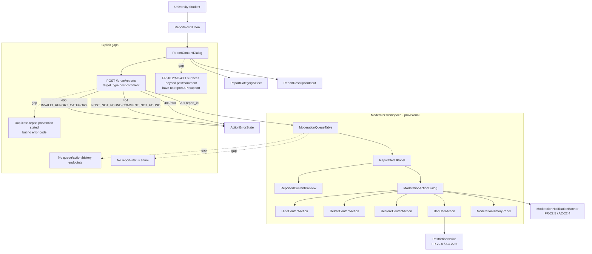

# Moderation Queue Specification

**Version:** `1.0`

**Performed by:** [Nguyen Le Quoc Huy] | **Edited by:** [Nguyen Le Quoc Huy]
> **Status:** UI/UX recommendation derived from the proposal documents in `requirements/proposals/`.
>
> **Scope:** This document describes the **Moderation Queue** and related reporting/moderation surfaces for forum content. It covers report creation, report context, queue review, moderator actions (hide/delete/restore/ban), action records/notifications, restriction enforcement, rate limits, and permission controls.
>
> **Main sources:** [`screen_flow.md`](screen_flow.md), [`feature_flow.md`](feature_flow.md), [`overview.md`](overview.md), [`functional_requirement.md`](functional_requirement.md), [`userstory.md`](userstory.md), [`use_cases_description.md`](use_cases_description.md), [`API.md`](API.md), [`response_code.md`](response_code.md), [`non_functional_requirement.md`](non_functional_requirement.md).
>
> **Note:** This is a recommendation/specification document. It does not invent missing endpoints, numeric limits, or error codes. `API.md` defines only `POST /forum/reports`; there are no queue/action/history endpoints, no report-status enum, and no dedicated moderation use case. Report surfaces beyond post/comment are requirements in `FR-40.2`/`AC-40.1` but have no report API support in `API.md`.

---

## 1. Purpose of Moderation Queue

The **Moderation Queue** is the review surface where authorized moderators handle reports and apply policy actions to keep the university forum safe, academically useful, and compliant with platform rules.

### 1.1 Core purposes

| Purpose | What the user achieves | Requirement basis |
| --- | --- | --- |
| Report inappropriate content | Submit a report against post/comment content with category and context. | `FR-22.1`–`FR-22.3`, `FR-40.1`–`FR-40.4`, `AC-22.1`–`AC-22.2`, `AC-40.1`–`AC-40.3` |
| Review report context | Inspect target, category, description, and contextual information before acting. | `FR-22.3`, `FR-40.3`, `AC-22.2`, `AC-40.3` |
| Apply moderation actions | Hide, delete, restore, or ban content/users according to policy. | `FR-22.4`, `AC-22.3` |
| Record and notify | Keep moderation records and notify affected users when appropriate. | `FR-22.5`, `AC-22.4` |
| Enforce restrictions | Prevent moderated users from bypassing restrictions. | `FR-22.6`, `AC-22.5` |
| Protect platform safety | Maintain a safe and supportive university learning environment. | `FR-40.5`, `NFR-SEC-1`, `NFR-SEC-6`, `NFR-SEC-9`, `NFR-SEC-10`, `NFR-USE-6`, `NFR-PRIV-7` |

### 1.2 Place in the screen and feature flows

`feature_flow.md` and `userstory.md` place moderation after report/review triggers:

```text
Post -> Report / Moderate
Report Content -> Moderation Queue -> Moderator Action -> Record / Notify / Enforce Restriction
```

There is no dedicated moderation use-case model in the cited use-case files. The queue is therefore specified as a requirements-driven UI surface with explicit API gaps.

---

## 2. Recommended page identity and naming

| Item | Suggested name | Notes |
| --- | --- | --- |
| Page group | `ModerationQueuePage` | Recommended moderator-facing page. |
| Queue table | `ModerationQueueTable` | Lists reports awaiting or under review. |
| Detail panel | `ReportDetailPanel` | Shows selected report and target context. |
| Action dialog | `ModerationActionDialog` | Confirms hide/delete/restore/ban actions. |
| Suggested route | `/moderation/queue` | Recommended route; not specified in proposals. |
| Main objects | `Report`, `ModerationActionRecord` | `ModerationActionRecord` is recommended; no API schema exists. |

### 2.1 Naming convention recommendation

- Use `Moderation*` for moderator-only queue/action components.
- Use `Report*` for user-facing report submission components.
- Use PascalCase names consistent with existing specs, e.g. `ModerationQueueTable`, `ReportDetailPanel`, `ModerationActionDialog`.

---

## 3. Target users and user goals

| User type | Main goal on Moderation Queue | Components used most |
| --- | --- | --- |
| Reporting user | Report inappropriate content quickly and safely. | `ReportPostButton`, `ReportContentDialog`, `ReportCategorySelect` |
| Moderator | Review reports and take appropriate action. | `ModerationQueueTable`, `ReportDetailPanel`, `ModerationActionDialog` |
| Affected user | Understand moderation outcome and restrictions. | `ModerationNotificationBanner`, `ActionErrorState` |
| Administrator/policy owner | Ensure actions are authorized, recorded, and auditable. | `ModerationActionDialog`, `ModerationHistoryPanel` |

---

## 4. Recommended information architecture

| View/section | Suggested route or state | Purpose | Main components |
| --- | --- | --- | --- |
| Report entry points | Post/comment/profile/message surfaces | Start a report. | `ReportPostButton`, `ReportContentDialog` |
| Moderation queue | `/moderation/queue` | Review pending reports. | `ModerationQueueTable`, `QueueFilterBar` |
| Report detail | Queue row selection / detail route | Inspect report context and target. | `ReportDetailPanel`, `ReportedContentPreview` |
| Action confirmation | Modal/dialog | Apply hide/delete/restore/ban with reason. | `ModerationActionDialog` |
| History/audit | Detail subpanel | View past actions and notifications. | `ModerationHistoryPanel` |

---

## 5. Recommended UI components

### 5.1 Report creation components

| Suggested name | UI type | Information shown | Meaning / action | Requirement basis |
| --- | --- | --- | --- | --- |
| `ReportPostButton` | Button/menu item | Label **Report**. | Opens report dialog from post/comment surfaces. | `FR-22.1`, `AC-22.1`, `NFR-USE-6` |
| `ReportContentDialog` | Modal form | Target type/id context, category, description, submit/cancel. | Captures and submits report. | `FR-22.1`–`FR-22.3`, `FR-40.1`–`FR-40.3` |
| `ReportCategorySelect` | Select/radio group | Spam, harassment, inappropriate content, academic dishonesty. | Chooses report category. | `FR-22.2`, `AC-22.1`, `AC-40.2` |
| `ReportDescriptionInput` | Textarea | Optional description. | Adds reporter context. | `API.md` `description?` |
| `ReportContextSummary` | Read-only summary | Target type, target id/title excerpt, reporter-visible context. | Confirms what is being reported. | `FR-22.3`, `FR-40.3`, `AC-22.2`, `AC-40.3` |
| `ReportSubmitButton` | Primary button | Label **Submit report**. | Sends report to backend. | `FR-22.1`, `FR-40.1` |
| `ReportSuccessToast` | Toast | Confirmation that report was submitted. | Confirms queue routing intent. | `FR-22.3`, `FR-40.4` |

### 5.2 Queue review components

| Suggested name | UI type | Information shown | Meaning / action | Requirement basis |
| --- | --- | --- | --- | --- |
| `ModerationQueuePage` | Page container | Queue table, filters, detail panel, action history. | Moderator workspace for reports. | `FR-22.3`, `FR-40.4`, `AC-22.2`, `AC-40.3` |
| `ModerationQueueTable` | Table/list | Report rows with target, category, reporter/context summary, created time. | Lets moderator select report to review. | `FR-22.3`, `FR-40.4`, recommendation; no queue API |
| `QueueFilterBar` | Filter toolbar | Category, target type, date/status filters. | Narrows queue. | Recommendation; status enum is gap |
| `ReportDetailPanel` | Side panel/detail view | Full report context, target preview, related metadata. | Supports moderator decision. | `FR-22.3`, `FR-40.3`, `AC-22.2`, `AC-40.3` |
| `ReportedContentPreview` | Content preview | Post/comment excerpt, author, forum context, visibility state. | Shows reported target before action. | `FR-22.4`, recommendation |
| `ModerationHistoryPanel` | Timeline/table | Previous actions, actor, reason, time, notification state. | Audits moderation decisions. | `FR-22.5`, `AC-22.4`, recommendation; no history API |
| `EmptyModerationQueueState` | Empty state | "No reports to review." | Handles empty queue. | Recommendation |

### 5.3 Moderation action components

| Suggested name | UI type | Information shown | Meaning / action | Requirement basis |
| --- | --- | --- | --- | --- |
| `ModerationActionDialog` | Modal dialog | Action type, reason, affected target, confirm/cancel. | Confirms moderation action. | `FR-22.4`, `AC-22.3` |
| `HideContentAction` | Action option/button | Hide target content. | Removes content from normal visibility per policy. | `FR-22.4`, `AC-22.3` |
| `DeleteContentAction` | Action option/button | Delete target content. | Permanently/removably deletes per policy. | `FR-22.4`, `AC-22.3` |
| `RestoreContentAction` | Action option/button | Restore previously hidden/deleted content if supported. | Reverses moderation action. | `FR-22.4`, `AC-22.3` |
| `BanUserAction` | Action option/button | Ban or restrict user per policy. | Applies user-level restriction. | `FR-22.4`, `AC-22.3` |
| `RestrictionNotice` | Alert/banner | User is restricted from posting/commenting/interacting. | Explains enforcement. | `FR-22.6`, `AC-22.5` |
| `ModerationNotificationBanner` | Notification/banner | Action taken, reason/policy reference where appropriate. | Informs affected user. | `FR-22.5`, `AC-22.4` |
| `PermissionDeniedState` | Error state | Moderator/admin authorization required. | Blocks unauthorized moderation access. | `NFR-SEC-10`, `NFR-SEC-6` |

---

## 6. Recommended information displayed / information model

| Object/field | Suggested label | Where shown | Purpose | Source/gap note |
| --- | --- | --- | --- | --- |
| `report_id` | **Report ID** | Queue row/detail | Identifies report. | `API.md` `POST /forum/reports` returns `report_id` |
| `target_type` | **Target type** | Report dialog, queue, detail | Indicates post/comment target. | `API.md` body supports `post` or `comment` |
| `target_id` | **Target ID** | Report dialog/detail | Identifies reported target. | `API.md` |
| `category` | **Category** | Report dialog, queue, detail | Classifies issue. | `FR-22.2`, `API.md` |
| `description` | **Description** | Report dialog/detail | Optional reporter explanation. | `API.md` optional `description?` |
| `reporter_id` | **Reporter** | Detail/history | Audit/context field. | DB function includes `preporter_id`; no UI exposure rule specified |
| `created_at` | **Reported at** | Queue/detail | Prioritizes/reviews report. | Recommendation; no report list API |
| `status` | **Status** | Queue/detail | Pending/reviewed/actioned state. | **Gap:** no report-status enum or endpoint |
| `moderation_action` | **Action** | History/action dialog | Hide/delete/restore/ban. | `FR-22.4`; no action API |
| `action_reason` | **Reason** | Action dialog/history | Supports audit and notification. | Recommendation; no API |
| `affected_user_notified` | **User notified** | History | Tracks notification. | `FR-22.5`; no API |

---

## 7. Recommended interaction flows

### 7.1 Create report

1. User selects `ReportPostButton` on a post/comment surface.
2. `ReportContentDialog` opens with `ReportContextSummary`.
3. User selects `ReportCategorySelect` and optional `ReportDescriptionInput`.
4. Client submits `POST /forum/reports` with `{target_type: 'post' | 'comment', target_id, category, description?}`.
5. On success, API returns `201` with `{report_id}` and UI shows `ReportSuccessToast`.
6. On error, UI maps known responses: `400 INVALID_REPORT_CATEGORY`, `404 POST_NOT_FOUND | COMMENT_NOT_FOUND`, `401`, `500`.

### 7.2 Review queue and act

1. Authorized moderator opens `ModerationQueuePage`.
2. `ModerationQueueTable` loads reports; **gap:** no queue endpoint exists, so data source is unspecified.
3. Moderator selects a report and inspects `ReportDetailPanel`.
4. Moderator opens `ModerationActionDialog` and chooses hide/delete/restore/ban.
5. System applies action, records it, and notifies affected user when appropriate (`FR-22.5`).
6. System enforces restrictions so moderated users cannot bypass them (`FR-22.6`).

### 7.3 Restriction enforcement

1. Moderated user attempts disallowed post/comment/interaction.
2. Backend blocks action per policy.
3. UI shows `RestrictionNotice` or action error.
4. Restriction remains effective across relevant surfaces.

---

## 8. Business rules and UI states

| Rule/state | Recommended UI behavior |
| --- | --- |
| Report categories | UI must offer spam, harassment, inappropriate content, academic dishonesty (`FR-22.2`); API validates category and may return `400 INVALID_REPORT_CATEGORY`. |
| Report targets in API | `POST /forum/reports` supports only `target_type: 'post' | 'comment'`. |
| Report surfaces beyond post/comment | `FR-40.2`/`AC-40.1` require profiles/messages/other users; **gap:** no report API support in `API.md`. Mark as requirements without API support. |
| Duplicate reports | DB requirement says prevent duplicates from same user for same target within a short window, but `API.md` specifies no error code/response. UI should handle generic failure and avoid claiming a specific duplicate code. |
| Queue/action/history endpoints | **Gap:** no queue, action, history, or status endpoints in `API.md`. |
| Report status enum | **Gap:** no status enum defined; do not invent statuses beyond labeling them provisional if needed. |
| Dedicated moderation UC | **Gap:** no dedicated moderation use case in `use_cases_description.md`/`use_cases_model`. |
| Authorization | Moderation actions restricted to authorized moderators/admins (`NFR-SEC-10`); all sensitive checks server-side (`NFR-SEC-6`). |
| Rate limiting | Reporting/posting/commenting/voting/help requests are rate-limited (`NFR-SEC-9`); UI should show generic retry-later feedback if backend enforces it. |
| Reachability | Report/moderation actions should be reachable within at most 2 interactions from a post/comment (`NFR-USE-6`). |
| Privacy consistency | Privacy settings apply consistently to forum posts, comments, member lists, and search results (`NFR-PRIV-7`). |
| Authentication | Protected moderation/report surfaces require authentication (`NFR-SEC-1`). |

---

## 9. Requirements traceability

| Requirement/source | Covered by |
| --- | --- |
| `FR-22.1`–`FR-22.6` | Report dialog, categories, queue routing, moderator actions, records/notifications, restriction enforcement |
| `AC-22.1`–`AC-22.5` | Report flow, queue context, moderator actions, action record/notification, restriction enforcement |
| `FR-40.1`–`FR-40.5` | Report behavior/surfaces/context/routing/safe environment |
| `AC-40.1`–`AC-40.4` | Report flow across surfaces, categories, routing/context, review |
| `NFR-SEC-1` | Auth-required report/moderation access |
| `NFR-SEC-6` | Server-side authorization checks |
| `NFR-SEC-9` | Rate limiting for reporting and related actions |
| `NFR-SEC-10` | Moderator/admin-only moderation actions |
| `NFR-USE-6` | Report action reachable within 2 interactions from post/comment |
| `NFR-PRIV-7` | Privacy settings applied consistently across forum surfaces |
| `API.md` `POST /forum/reports` | Body `{target_type:'post'|'comment', target_id, category, description?}`; response `201 {report_id}`; errors `400 INVALID_REPORT_CATEGORY`, `404 POST_NOT_FOUND | COMMENT_NOT_FOUND`, `401`, `500` |
| `API.md` DB requirement | Duplicate-report prevention stated, but no error code specified |
| Gaps | No queue/action/history endpoints; no report-status enum; no dedicated moderation UC; report surfaces beyond post/comment lack API support |

---

## 10. Summary diagram


