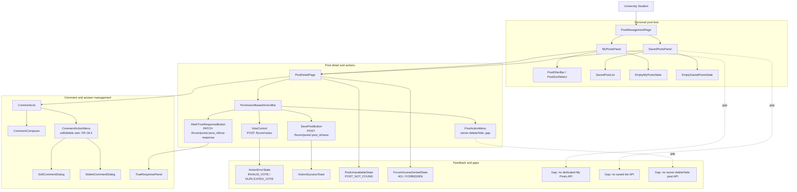

# Post Management Specification

**Version:** `1.0`

**Performed by:** [Nguyen Thanh An] | **Edited by:** [Nguyen Thanh An]
>
> **Main sources:** [`screen_flow.md`](screen_flow.md), [`feature_flow.md`](feature_flow.md), [`overview.md`](overview.md), [`functional_requirement.md`](functional_requirement.md), [`userstory.md`](userstory.md), [`use_cases_description.md`](use_cases_description.md), [`use_cases_model/UC-03-browse-search-forum.md`](use_cases_model/UC-03-browse-search-forum.md), [`use_cases_model/UC-05-comment-answer.md`](use_cases_model/UC-05-comment-answer.md), [`API.md`](API.md), [`response_code.md`](response_code.md).
>
> **Note:** This is a recommendation/specification document. It does not invent missing endpoints, numeric limits, or error codes. Owner delete/hide of an entire post is flow-derived only (`feature_flow.md`, `userstory.md` post-management diagram) and has no FR/AC/API coverage in the cited sources. My Posts and saved-post list APIs are incomplete in `API.md`. `moderationStatus` is a recommended UI/data field, not a source-defined API field.

---

## 1. Purpose of Post Management

The **Post Management** surface lets a university student review and control their forum contributions and saved content. It combines personal post discovery (My Posts and Saved Posts) with post-interaction management: voting, saving, true-response selection, comment/answer maintenance, and permission-aware actions.

### 1.1 Core purposes

| Purpose | What the user achieves | Requirement basis |
| --- | --- | --- |
| View My Posts | Find posts authored by the current user in the forum context. | `FR-13.3`, `AC-13.3`, `userstory.md` profile/list flow, `feature_flow.md` |
| View Saved Posts | Access posts saved for later reading across forum contexts. | `FR-21.1`–`FR-21.4`, `AC-21.1`–`AC-21.4` |
| Manage own comments/answers | Edit or delete own comments and answers. | `FR-18.4`, `AC-18.4` |
| Vote on content | Upvote/downvote posts and comments with single-vote and change behavior. | `FR-19.1`–`FR-19.5`, `AC-19.1`–`AC-19.5` |
| Mark true response | Accept, display, and change the true response for a question post. | `FR-20.1`–`FR-20.5`, `AC-20.1`–`AC-20.5` |
| Save/unsave posts | Keep useful posts in a persistent saved list. | `FR-21.1`–`FR-21.4`, `AC-21.1`–`AC-21.4` |
| Use permission-based actions | See only actions allowed for the current user and target state. | `FR-17.4`, `AC-17.4`, `FR-38.1`–`FR-38.2`, `NFR-PRIV-7` |
| Handle empty/error states | Recover when lists are empty, unavailable, unauthorized, or actions fail. | `AC-13.5`, `UC-03`, `API.md` errors |

### 1.2 Place in the screen and feature flows

`screen_flow.md` and `feature_flow.md` place post management near forum browsing and post detail:

```text
Profile -> My Posts -> Comment
List Post -> Filter -> My Post
List Post -> Post -> Comment / Solved / Vote / Save / Report / Moderate
Post -> Delete / Hide / Upvote / Downvote / Save / Owner / Time / Comment -> True Response
```

`UC-03` supports browsing/opening posts, while `UC-05` covers comment/answer creation and notification behavior:

```text
Browse/Search Forum -> Open Post -> View detail and permitted actions
Comment and Answer -> store comment/answer -> notify post author -> optional nested reply
```

---

## 2. Recommended page identity and naming

| Item | Suggested name | Notes |
| --- | --- | --- |
| Page group | `PostManagementPage` | Recommended container for personal post-management views. |
| My Posts view | `MyPostsPanel` | Matches `My Post` filter and profile flow; exact route not specified. |
| Saved Posts view | `SavedPostsPanel` | Matches saved-post requirement; exact route not specified. |
| Suggested routes | `/forum/my-posts`, `/forum/saved` | Recommended routes; not specified in proposals. |
| Main object | `ManagedPostSummary` | Post summary with owner/action state. |
| Detail/action context | `PostActionContext` | Recommended client-side context for permissions and action state. |

### 2.1 Naming convention recommendation

- Use `MyPosts*` for authored-post list components.
- Use `SavedPosts*` for saved-post list components.
- Use `PostAction*` or action-specific names for vote/save/true-response/comment controls.
- Use PascalCase names consistent with existing specs, e.g. `MyPostsPanel`, `SavedPostsPanel`, `PermissionBasedActionBar`.

---

## 3. Target users and user goals

| User type | Main goal on Post Management | Components used most |
| --- | --- | --- |
| Post author | Review own posts and manage discussion outcomes. | `MyPostsPanel`, `PostActionMenu`, `MarkTrueResponseButton` |
| Student saving references | Return to useful posts later. | `SavedPostsPanel`, `SavePostButton`, `PostCard` |
| Comment/answer author | Edit or delete own contributions. | `CommentList`, `CommentActionMenu`, `EditCommentDialog` |
| Active reader | Vote, save, and follow solved status. | `VoteControl`, `SavePostButton`, `PostSolvedBadge` |
| Restricted/moderated user | Understand why actions are unavailable. | `PermissionBasedActionBar`, `ActionErrorState`, `ForumAccessDeniedState` |

---

## 4. Recommended information architecture

| View/section | Suggested route or state | Purpose | Main components |
| --- | --- | --- | --- |
| My Posts | `/forum/my-posts` or `My Post` filter | Shows posts authored by current user. | `MyPostsPanel`, `PostList`, `PostFilterBar` |
| Saved Posts | `/forum/saved` | Shows posts saved by current user. | `SavedPostsPanel`, `SavedPostList`, `SavePostButton` |
| Post detail actions | `/forum/posts/:postId` | Manage vote/save/report/true-response/comment actions. | `PostDetailPage`, `PermissionBasedActionBar` |
| Comment management | Post detail comment thread | Edit/delete own comments and replies. | `CommentList`, `CommentComposer`, `CommentActionMenu` |
| Empty/error states | Inline/route state | Handle no data, missing post, unauthorized, or failed action. | `EmptyMyPostsState`, `EmptySavedPostsState`, `PostUnavailableState` |

---

## 5. Recommended UI components

### 5.1 Post management containers

| Suggested name | UI type | Information shown | Meaning / action | Requirement basis |
| --- | --- | --- | --- | --- |
| `PostManagementPage` | Page container | Tabs/links for My Posts and Saved Posts, active list, filters. | Root surface for personal post management. | `FR-13.3`, `FR-21.2`, `userstory.md` profile flow |
| `MyPostsPanel` | Panel/list container | Current user's authored posts, filters, empty state. | Lets user review own posts. | `FR-13.3`, `AC-13.3`, `userstory.md` |
| `SavedPostsPanel` | Panel/list container | Saved posts, saved timestamp/context where available, remove action. | Lets user revisit saved posts. | `FR-21.1`–`FR-21.4`, `AC-21.1`–`AC-21.4` |
| `PostFilterBar` | Filter toolbar | My Post/area/context/tag/type filters as applicable. | Narrows managed post lists. | `FR-13.3`, `AC-13.3`, `AC-13.5` |
| `PostSortSelect` | Dropdown | Newest, top trending, most voted, most discussed. | Orders managed post lists. | `FR-13.4`, `AC-13.4` |
| `SavedPostsLink` | Link/tab | Label **Saved Posts**. | Opens saved list. | `FR-21.2`, `AC-21.2` |
| `MyPostsLink` | Link/tab | Label **My Posts**. | Opens authored-post list. | `FR-13.3`, `userstory.md` |

### 5.2 Post summary and action components

| Suggested name | UI type | Information shown | Meaning / action | Requirement basis |
| --- | --- | --- | --- | --- |
| `PostCard` | Card/list item | Title, author, post type, timestamp, vote score, comment count, solved status. | Displays a manageable post summary. | `FR-13.2`, `AC-13.2` |
| `PostSolvedBadge` | Badge | `Solved` / `Unsolved`. | Shows true-response state for question posts. | `FR-20.2`, `AC-20.2`, `FR-13.2` |
| `VoteControl` | Upvote/downvote control | Current score and user's vote state. | User upvotes, downvotes, changes, or removes vote. | `FR-19.1`–`FR-19.5`, `AC-19.1`–`AC-19.5` |
| `SavePostButton` | Icon/bookmark button | Saved/unsaved state. | Saves or removes post from saved list. | `FR-21.1`, `FR-21.3`, `AC-21.1`, `AC-21.3` |
| `MarkTrueResponseButton` | Button | Label **Mark as true response**. | Question author accepts an answer. | `FR-20.1`, `FR-20.4`, `AC-20.1`, `AC-20.4` |
| `TrueResponsePanel` | Highlighted answer panel | Accepted answer/comment and author. | Shows accepted solution prominently. | `FR-20.3`, `AC-20.3` |
| `CommentComposer` | Textarea + submit | Comment/answer input. | Creates comment, answer, or reply. | `FR-18.1`–`FR-18.3`, `AC-18.1`–`AC-18.3`, `UC-05` |
| `CommentList` | Thread/list | Comments, answers, nested replies, vote state. | Displays discussion and management actions. | `FR-17.3`, `FR-18.3`, `FR-18.5`, `AC-18.3`, `AC-18.5` |
| `CommentActionMenu` | Menu | Edit/Delete for own comment or answer. | Manages own comment content. | `FR-18.4`, `AC-18.4` |
| `EditCommentDialog` | Modal/form | Existing comment content, save/cancel. | Edits own comment/answer. | `FR-18.4` |
| `DeleteCommentDialog` | Confirmation dialog | Delete confirmation and consequence text. | Deletes own comment/answer. | `FR-18.4` |
| `PermissionBasedActionBar` | Action bar | Allowed actions only. | Prevents unauthorized or irrelevant actions. | `FR-17.4`, `AC-17.4` |
| `PostActionMenu` | Menu | Contextual actions; owner delete/hide only if product adds it. | Entry point for owner/moderation-related actions. | `feature_flow.md`, `userstory.md` post-management diagram; owner delete/hide is gap |

### 5.3 Feedback and state components

| Suggested name | UI type | Information shown | Meaning / action | Requirement basis |
| --- | --- | --- | --- | --- |
| `EmptyMyPostsState` | Empty state | "No posts yet" with create/filter guidance. | Handles no authored posts. | `AC-13.5`, recommendation |
| `EmptySavedPostsState` | Empty state | "No saved posts" with browse link. | Handles empty saved list. | `FR-21.2`, recommendation |
| `PostUnavailableState` | Error state | "This post is no longer available." | Handles deleted/unavailable post. | `UC-03` E2, `API.md` `POST_NOT_FOUND` |
| `ForumAccessDeniedState` | Error state | Permission denied message. | Handles unauthorized access. | `UC-03` E3, `API.md` `401`/`FORBIDDEN` |
| `ActionErrorState` | Inline alert/toast | Action-specific error and retry where safe. | Handles failed vote/save/comment/true-response actions. | `API.md` error responses |
| `ActionSuccessToast` | Toast | Saved, vote updated, answer accepted, comment updated. | Confirms successful action. | Recommendation |

---

## 6. Recommended information displayed

| Object/field | Suggested label | Where shown | Purpose | Source/gap note |
| --- | --- | --- | --- | --- |
| `post_id` | Hidden/internal | Post card/detail/action calls | Identifies post target. | `API.md` `GET /forum/posts` |
| `title` | **Title** | My Posts, Saved Posts, detail | Primary post identity. | `FR-13.2`, `API.md` |
| `post_type` | **Type** | Post card badge | Distinguishes discussion/material/functional. | `FR-13.2`, `API.md` |
| `author` | **Author** | Post card/detail | Shows ownership/source. | `FR-13.2`, `API.md` |
| `created_at` | **Posted** | Post card/detail | Shows recency. | `FR-13.2`, `API.md` |
| `vote_score` | **Votes** | Post card/detail | Shows usefulness/ranking. | `FR-13.2`, `FR-19.5`, `API.md` |
| `comment_count` | **Comments** | Post card/detail | Shows discussion activity. | `FR-13.2`, `API.md` |
| `solved` | **Solved** | Post card/detail | Shows true-response state. | `FR-13.2`, `FR-20.2`, `API.md` |
| `user_vote` | Vote state | Vote control | Shows current user's vote. | `API.md` `GET /forum/posts/:post_id` returns `-1 | 0 | 1` |
| `saved` | Saved state | Save button | Shows whether post is saved. | `API.md` `GET /forum/posts/:post_id`, save endpoint response |
| `true_response` | **True response** | Detail panel | Shows accepted answer/comment. | `FR-17.3`, `FR-20.3`, `API.md` |
| `comments` | Comments/answers | Detail thread | Shows discussion content. | `FR-17.3`, `FR-18.5`, `API.md` |
| `moderationStatus` | Moderation status | Recommended owner/moderator indicator | Would explain hidden/moderated state. | **Recommendation/gap:** not defined in API/proposal schemas. |
| Owner delete/hide state | **Delete/Hide** | Owner action menu | Would remove/hide own post. | **Gap:** flow-derived only (`feature_flow.md`, `userstory.md`); no FR/AC/API. |

---

## 7. Recommended interaction flows

### 7.1 Manage My Posts

1. User opens `MyPostsPanel` from profile, saved/forum navigation, or My Post filter.
2. System loads authored posts using existing list capability where available; exact My Posts API is not specified.
3. User filters/sorts using `PostFilterBar` and `PostSortSelect`.
4. User opens a post to manage comments, votes, save state, or true response.
5. If no posts match, `EmptyMyPostsState` or `EmptyPostListState` offers filter reset.

### 7.2 Manage Saved Posts

1. User opens `SavedPostsPanel`.
2. System shows saved posts; persistence is required across forum context (`FR-21.4`), but saved-list API is incomplete.
3. User opens a post or removes it with `SavePostButton`.
4. `POST /forum/posts/:post_id/save` returns `{saved: boolean}`; UI updates saved state.
5. If the list is empty, `EmptySavedPostsState` is shown.

### 7.3 Vote, save, and true response

1. User opens post detail from My Posts/Saved Posts/list.
2. `PermissionBasedActionBar` exposes allowed actions.
3. Vote action calls `POST /forum/votes` with `{target_type: 'post' | 'comment', target_id, vote: 1 | 0 | -1}` and expects `{vote_score: number}`.
4. Save action calls `POST /forum/posts/:post_id/save` and expects `{saved: boolean}`.
5. Question author marks true response via `PATCH /forum/posts/:post_id/true-response` with `{comment_id: string}` and expects `{solved: boolean}`.
6. UI updates vote score, saved state, solved badge, and true-response panel.

### 7.4 Manage own comments/answers

1. User opens `CommentList` on a post detail page.
2. User creates comment/answer via `CommentComposer`; nested reply is supported where applicable (`FR-18.3`, UC-05 E-06).
3. User edits/deletes own comment through `CommentActionMenu`.
4. System should restrict edit/delete to own content (`FR-18.4`); no comment edit/delete API is specified in `API.md`.
5. Post author receives notification for new comment/answer (`FR-18.6`, UC-05 includes I-06).

---

## 8. Business rules and UI states

| Rule/state | Recommended UI behavior |
| --- | --- |
| My Posts filter exists | Provide `MyPostFilter`/`MyPostsPanel`; exact dedicated My Posts API is a gap. |
| Saved posts persist across forum context | Keep saved state user-scoped; do not clear on context switch. |
| One active vote per target | `POST /forum/votes` may return `409 DUPLICATED_VOTE`; UI should reflect current vote and allow change/remove via `vote: 0`. |
| True response only by post author | Show `MarkTrueResponseButton` only to question author; handle `403 NOT_POST_OWNER/FORBIDDEN`. |
| Own comment/answer management | Show edit/delete only for own content; backend enforcement required, but endpoint is unspecified. |
| Permission-based actions | Hide/disable actions based on permissions and target state; handle `401`, `403 FORBIDDEN`. |
| Post unavailable | Show `PostUnavailableState` on `404 POST_NOT_FOUND`. |
| Comment unavailable | Show inline error/reload on `404 COMMENT_NOT_FOUND`. |
| Invalid vote | Show validation/error state on `400 INVALID_VOTE`. |
| Owner delete/hide of entire post | **Gap:** flow-derived only; do not implement without new FR/AC/API. |
| My Posts/saved-list API | **Gap:** `API.md` has no dedicated My Posts or saved-list endpoint; UI must be marked provisional. |
| `moderationStatus` | **Recommendation:** display only if backend adds explicit field; no source schema exists. |

---

## 9. Requirements traceability

| Requirement/source | Covered by |
| --- | --- |
| `FR-13.1`–`FR-13.5` | `MyPostsPanel`, `PostList`, `PostCard`, filters/sort, open post, empty states |
| `AC-13.2`–`AC-13.5` | Post summary fields, My Post filter, sorting, empty-state recovery |
| `FR-17.1`–`FR-17.5` | Post detail content/metadata/discussion/actions/attachments-tools context, including `FR-17.2` metadata display |
| `FR-18.4` | `CommentActionMenu`, `EditCommentDialog`, `DeleteCommentDialog` |
| `FR-19.1`–`FR-19.5` | `VoteControl`, vote API behavior, score update |
| `FR-20.1`–`FR-20.5` | `MarkTrueResponseButton`, `TrueResponsePanel`, solved state, change/notification rules |
| `FR-21.1`–`FR-21.4` | `SavePostButton`, `SavedPostsPanel`, remove/persistence behavior |
| `FR-38.1`–`FR-38.2` | Notification-related expectations for comment/answer/true-response/social activity |
| `UC-03` | Browse/open post context and unavailable/access/empty handling |
| `UC-05` | Comment/answer creation, nested reply, post-author notification |
| `API.md` `GET /forum/posts` | List fields: `post_id`, `title`, `post_type`, `author`, `vote_score`, `comment_count`, `solved`, `created_at`, `total` |
| `API.md` `GET /forum/posts/:post_id` | `post`, `comments`, `true_response`, `user_vote`, `saved`; errors `404 POST_NOT_FOUND`, `401`, `500` |
| `API.md` `POST /forum/votes` | Body `{target_type:'post'|'comment', target_id, vote:1|0|-1}`; response `{vote_score}`; errors `400 INVALID_VOTE`, `409 DUPLICATED_VOTE`, `404 POST_NOT_FOUND|COMMENT_NOT_FOUND`, `401`, `500` |
| `API.md` `PATCH /forum/posts/:post_id/true-response` | Body `{comment_id}`; response `{solved}`; errors `404 POST_NOT_FOUND|COMMENT_NOT_FOUND`, `403 NOT_POST_OWNER|FORBIDDEN`, `401`, `500` |
| `API.md` `POST /forum/posts/:post_id/save` | Response `{saved}`; errors `404 POST_NOT_FOUND`, `401`, `500` |

---

## 10. Summary diagram


