# Settings Page Specification

**Version:** `1.0`

**Performed by:** [Tran Canh Anh Tuan] | **Edited by:** [Tran Canh Anh Tuan]
> **Status:** UI/UX recommendation derived from the proposal documents in `docs/requirements/proposals/`.
>
> **Scope:** This document describes the **Settings** area, also called **Settings Group**, and recommends UI component names, displayed information, and user actions. The requested **reference settings** are interpreted as the proposal's **Preference Settings** flow. This specification includes Preference Settings, Profile Settings, Account Settings, Appearance Settings, Privacy Settings, Notification Settings, and Communication Settings.
>
> **Main sources:** [`screen_flow.md`](screen_flow.md), [`feature_flow.md`](feature_flow.md), [`overview.md`](overview.md), [`functional_requirement.md`](functional_requirement.md), [`userstory.md`](userstory.md), [`non_functional_requirement.md`](non_functional_requirement.md), [`API.md`](API.md).
>
> **Note:** No dedicated Settings use case appears in [`use_cases_description.md`](use_cases_description.md) or [`use_cases_model.md`](use_cases_model.md). Settings is treated as an aggregate hub for requirements already defined in authentication, profile, preference, privacy, notification, and communication stories.

---

## 1. Purpose of the Settings area

The **Settings** area is the user-control center of Studitopia. Its purpose is to let a student manage identity, academic context, account security, privacy, communication boundaries, notifications, and presentation preferences without leaving the main product shell.

The forum remains the primary product feature, but Settings supports it by ensuring that recommendations, profile display, moderation boundaries, and social interactions reflect the user's choices.

### 1.1 Core purposes

| Purpose | What the user achieves | Requirement basis |
| --- | --- | --- |
| Manage profile identity | Update display name, avatar, short bio, university, major, academic year, hobbies, and free-time information. | `US-08`, `FR-08.1`–`FR-08.6`, `AC-08.1`–`AC-08.6`, profile settings flow in `userstory.md` |
| Set learning preferences | Specify courses, subjects, interests, learning goals, and preferred study times so recommendations can be personalized. | `US-09`, `FR-09.1`–`FR-09.5`, `AC-09.1`–`AC-09.5` |
| Manage account security | Recover/reset password, log out, handle inactive sessions, and delete the account with OTP re-authentication. | `US-03`–`US-07`, `FR-03.1`–`FR-07.6`, `NFR-SEC-1`–`NFR-SEC-8` |
| Control privacy | Control profile visibility, academic info, contact info, searchability, online status, and last-active time. | `US-10`, `FR-10.1`–`FR-10.4`, `AC-10.1`–`AC-10.4`, `NFR-PRIV-1`–`NFR-PRIV-7` |
| Configure notifications | Choose which forum, social, and room events trigger in-app or audio alerts. | `US-38`, `FR-38.1`–`FR-38.6`, `AC-38.1`–`AC-38.6` |
| Control communication | Restrict direct messages, friend requests, room invitations, and mute/block specific members. | `US-39`, `FR-39.1`–`FR-39.5`, `AC-39.1`–`AC-39.3`, `NFR-PRIV-2`, `NFR-PRIV-6` |
| Configure appearance | Adjust theme, density, text size, language, and motion behavior. | Recommendation only; supports `NFR-USE-2`, `NFR-USE-4`, `NFR-USE-5` |

### 1.2 Place in the screen flow

`screen_flow.md` defines:

```text
Home -> Settings
Settings -> Profile
Settings -> Preferences
Home -> Logout
Register -> OTP -> Preference Settings
```

`userstory.md` expands the profile-related path:

```text
Home -> Settings -> Profile
Profile -> Edit Display Name -> Submit
Profile -> Edit Avatar -> Submit
Profile -> Edit Description -> Submit
Profile -> Edit University / Major -> Submit
Profile -> Edit Hobbies -> Submit
Profile -> Edit Often Free Time
Edit Description -> Privacy (Hidden | Visible)
Edit Hobbies -> Privacy
Privacy -> Submit
```

`overview.md` places Settings under profile/account capability:

```text
Profile Management -> Preference settings
Profile Management -> University, Major info
Authentication -> Logout
```

Therefore, the recommended Settings area should be a **hub page with section navigation**, where Profile and Preferences are first-class sections because they are explicitly named in the proposal, while Account, Appearance, Privacy, Notifications, and Communication are added as practical groupings of existing requirements.

---

## 2. Recommended page identity and naming

| Item | Suggested name | Notes |
| --- | --- | --- |
| Page group | `SettingsGroupPage` | Matches the `SettingsGroup` name in `screen_flow.md`. |
| Main page | `SettingsPage` | Product-facing shell page. |
| Suggested route | `/settings` | Recommended route; not specified in the proposal. |
| Page title | **Settings** | Short, consistent with global navigation. |
| Profile section | `ProfileSettingsPage` / **Profile** | Exact section name used in `userstory.md`. |
| Preference section | `PreferenceSettingsPage` / **Preferences** | Exact section name used in `screen_flow.md` and registration flow. |
| Account section | `AccountSettingsPage` / **Account** | Groups password, sessions, provider, and deletion controls. |
| Appearance section | `AppearanceSettingsPage` / **Appearance** | Recommended extension; not explicitly defined in proposal requirements. |
| Privacy section | `PrivacySettingsPage` / **Privacy** | Backed by `US-10`, `US-39`, and NFR privacy rules. |
| Notification section | `NotificationSettingsPage` / **Notifications** | Backed by `US-38`. |
| Communication section | `CommunicationSettingsPage` / **Communication** | Backed by `US-39`. |

### 2.1 Suggested routes

| Section | Suggested route |
| --- | --- |
| Settings hub | `/settings` |
| Profile | `/settings/profile` |
| Preferences | `/settings/preferences` |
| Account | `/settings/account` |
| Appearance | `/settings/appearance` |
| Privacy | `/settings/privacy` |
| Notifications | `/settings/notifications` |
| Communication | `/settings/communication` |

### 2.2 Naming convention recommendation

- Prefix shell components with `Settings`.
- Prefix section forms with the section name, e.g. `ProfileSettingsForm`, `NotificationSettingsForm`.
- Prefix destructive-confirmation components with the action, e.g. `DeleteAccountConfirmDialog`.
- Use PascalCase for component names.
- Use **Save Changes** for editable forms and **Update** only where the proposal uses that language, e.g. profile and preferences.

---

## 3. Target users and user goals

| User type | Main goal in Settings | Components they use most |
| --- | --- | --- |
| New university student completing onboarding | Set academic preferences after registration so recommendations become relevant. | `PreferenceSettingsForm`, `CourseCatalogMultiSelect`, `SubjectTagSelector`, `UpdatePreferencesButton` |
| Registered student updating identity | Keep profile information accurate and preview how others see it. | `ProfileSettingsForm`, `AvatarUploader`, `ProfilePreviewPane`, `UpdateProfileButton` |
| Security-conscious user | Change/recover password, review active sessions, log out, and delete account safely. | `AccountSettingsPanel`, `ReauthOtpDialog`, `LogoutButton`, `DeleteAccountConfirmDialog` |
| Privacy-focused user | Control who can see personal information and find the user. | `PrivacySettingsForm`, `ProfileVisibilitySelect`, `OnlineStatusToggle`, `PublicDiscoveryOptOutToggle` |
| Student managing distractions | Choose which events produce alerts and whether audio is enabled. | `ForumNotificationToggles`, `SocialNotificationToggles`, `RoomNotificationToggle`, `AudioAlertToggle` |
| Student experiencing unwanted contact | Restrict messages, invitations, and specific members. | `DirectMessageRestrictionSelect`, `MutedUsersList`, `BlockedUsersList`, `BlockUserButton` |
| User customizing workspace | Adjust appearance for comfort and device size. | `ThemeSelector`, `DensitySelector`, `FontSizeSelector`, `AppearancePreviewPane` |

---

## 4. Information architecture

```text
SettingsPage
├── SettingsNavSidebar
│   ├── ProfileSettingsPage
│   ├── PreferenceSettingsPage
│   ├── AccountSettingsPage
│   ├── AppearanceSettingsPage
│   ├── PrivacySettingsPage
│   ├── NotificationSettingsPage
│   └── CommunicationSettingsPage
├── SettingsContentPane
│   ├── SettingsSectionHeader
│   ├── Section-specific form or panel
│   └── SettingsActionBar
└── GlobalAccountActions
    └── LogoutButton
```

### 4.1 Recommended default section order

1. **Profile**
2. **Preferences**
3. **Account**
4. **Appearance**
5. **Privacy**
6. **Notifications**
7. **Communication**

Profile and Preferences should appear first because they are explicitly connected to Settings in `screen_flow.md`. Privacy, Notifications, and Communication should remain easy to reach because they directly affect safety and user control.

---

## 5. UI components

### 5.1 Settings shell components

| Suggested name | UI type | Information shown | Meaning / action | Requirement basis |
| --- | --- | --- | --- | --- |
| `SettingsNavSidebar` | Side navigation | Profile, Preferences, Account, Appearance, Privacy, Notifications, Communication | Moves between settings sections. | `screen_flow.md`, `overview.md`, `FR-39.1`, `FR-39.2` |
| `SettingsSectionHeader` | Header | Section title and short description | Explains what the current section controls. | `NFR-USE-4` |
| `SettingsContentPane` | Content area | Active section form or panel | Displays only the active settings section. | `NFR-USE-3`, `NFR-USE-4` |
| `SettingsSearchInput` | Search box | Placeholder **Search settings** | Filters settings entries and section links. Recommended for larger settings menus. | Recommendation; supports `NFR-USE-4` |
| `SettingsActionBar` | Sticky action bar | Save/discard state, primary action label | Keeps save and discard controls visible while editing. | `FR-08.1`, `FR-09.5`, `FR-38.5`, `FR-39.1` |
| `SaveSettingsButton` | Primary button | Label **Save Changes** | Persists the active section's changes. | `FR-08.1`, `FR-09.5`, `FR-38.5`, `FR-39.1` |
| `DiscardChangesButton` | Secondary button | Label **Discard** | Reverts unsaved edits in the active section. | Recommendation; supports safe editing |
| `UnsavedChangesBanner` | Alert strip | **You have unsaved changes** | Warns before leaving the section with pending edits. | Recommendation; supports `FR-08.5` consistency |
| `SettingsSuccessToast` | Toast | Confirmation such as **Profile updated** | Confirms persistence without blocking the page. | `FR-08.5`, `FR-09.5` |
| `SettingsErrorAlert` | Alert | Validation/server error summary | Explains why the save failed and how to retry. | `FR-01.18`, `FR-08.6`, `FR-10.4`, `FR-39.5` |
| `LogoutButton` | Destructive/secondary button | Label **Log out** | Logs out the current session and clears local/session authentication data. | `US-03`, `screen_flow.md`, `FR-03.1`–`FR-03.3` |

### 5.2 Profile settings components

| Suggested name | UI type | Information shown | Meaning / action | Requirement basis |
| --- | --- | --- | --- | --- |
| `ProfileSettingsForm` | Form container | All editable profile fields | Groups profile identity fields into one save operation. | `FR-08.1`, `AC-08.1`, profile settings flow |
| `DisplayNameInput` | Textbox | Current display name | Updates the name shown on profile, posts, comments, and member lists. | `FR-08.2`, `AC-08.1`, `AC-08.6` |
| `UsernameField` | Read-only text or validated textbox | Current username | Shows the unique username; editable only if backend supports username changes. | `FR-08.2`, `FR-01.8`, `FR-01.15`, `FR-01.45` |
| `AvatarUploader` | Upload control | Current avatar, file picker, accepted format/size hint | Uploads a new avatar image. | `FR-08.4`, `AC-08.5`, `NFR-SEC-5` |
| `AvatarCropper` | 1:1 cropper | Square crop preview | Auto-crops uploaded avatar to a 1:1 aspect ratio. | `AC-08.5` |
| `ShortBioTextarea` | Textarea | Short biography/description | Updates the user's profile description. | `FR-08.2`, `AC-08.1`, `AC-08.6` |
| `UniversitySelect` | Dropdown/search select | Supported university catalog | Selects the user's university from supported catalog data. | `FR-08.3`, `AC-08.2` |
| `MajorSelect` | Dropdown/search select | Supported major catalog | Selects the user's major from supported catalog data. | `FR-08.3`, `AC-08.2` |
| `AcademicYearSelect` | Dropdown | Academic year options | Updates academic year shown on public forum profile. | `FR-08.2`, `FR-08.6` |
| `HobbiesTagInput` | Tag input | Hobby/interest tags | Adds or removes hobbies shown in profile settings flow. | `userstory.md` profile settings flow |
| `OftenFreeTimeInput` | Tag input or multi-select | Common free-time slots | Describes when the user is usually available to study. | `userstory.md` profile settings flow |
| `FieldVisibilitySelect` | Dropdown per sensitive field | **Hidden / Visible** | Controls field-level visibility for description, hobbies, or contact-related information. | `FR-10.1`, `AC-10.1`, profile settings flow, `FR-10.4` |
| `ProfilePreviewPane` | Preview card | Profile as other members see it | Lets the user verify public presentation before saving. | `AC-08.3`, `FR-08.6` |
| `UpdateProfileButton` | Primary button | Label **Update Profile** or **Save Changes** | Persists profile edits and reflects them across active sessions. | `FR-08.1`, `FR-08.5`, `AC-08.4` |

### 5.3 Preference settings components

| Suggested name | UI type | Information shown | Meaning / action | Requirement basis |
| --- | --- | --- | --- | --- |
| `PreferenceSettingsForm` | Form container | Academic and learning preference fields | Groups course, subject, goal, and study-time preferences. | `US-09`, `FR-09.1`–`FR-09.5` |
| `CourseCatalogMultiSelect` | Searchable multi-select | Current courses from supported course catalog | Selects courses used for recommendation relevance. | `FR-09.1`, `AC-09.1` |
| `SubjectTagSelector` | Tag selector | Subjects and topics of interest | Selects subjects/topics as checkboxes or tags. | `FR-09.2`, `AC-09.2` |
| `InterestTagSelector` | Tag selector | Personal learning interests | Adds interests used for content and partner recommendations. | `FR-09.2`, `FR-09.4`, `AC-09.2` |
| `LearningGoalTextarea` | Textarea | Learning goals | Describes what the user wants to achieve. | `FR-09.3`, `AC-09.3` |
| `PreferredStudyTimeSelector` | Multi-select or time-slot chips | Preferred study times | Helps match users, rooms, and recommendations to availability. | `FR-09.3`, `AC-09.3` |
| `RecommendationUseNotice` | Informational note | **Preferences are used for forum posts, materials, study partners, and rooms** | Explains why these preferences matter. | `FR-09.4`, `AC-09.4` |
| `UpdatePreferencesButton` | Primary button | Label **Update Preferences** or **Continue** | Saves preferences; during onboarding it continues to Home. | `FR-09.5`, `FR-01.26`, `AC-09.5` |

### 5.4 Account settings components

| Suggested name | UI type | Information shown | Meaning / action | Requirement basis |
| --- | --- | --- | --- | --- |
| `AccountSettingsPanel` | Section container | Account identity and security controls | Groups account-level actions separately from public profile details. | `overview.md`, `US-01`–`US-06` |
| `AccountIdentifierSummary` | Summary card | Username, email, email verification status, account status | Shows non-sensitive account identity and verification state. | `FR-01.44`, `FR-01.45`, `FR-01.30`, `API.md` |
| `EmailAddressDisplay` | Read-only text | Registered university email | Shows the verified university identity; editing should follow backend policy. | `FR-01.19`, `FR-01.44` |
| `PasswordChangeButton` | Secondary button | Label **Change Password** | Starts an OTP-verified password update flow. Direct change is a recommendation derived from recovery policy. | `FR-05.1`–`FR-05.5`, `NFR-SEC-2` |
| `RecoveryLink` | Link | Label **Recover Password** | Opens the standard password recovery flow. | `US-05`, `FR-05.1`–`FR-05.3` |
| `NewPasswordInput` | Password textbox | New password | Sets a new password during reset/change. | `FR-01.9`, `FR-05.4` |
| `ConfirmPasswordInput` | Password textbox | Confirm new password | Verifies that the new password was entered correctly. | `FR-01.10`, `FR-05.4` |
| `PasswordVisibilityToggle` | Icon button | Show/hide password | Toggles password field visibility. | `FR-01.3` |
| `ReauthOtpDialog` | Modal | 6-digit OTP input, resend control, expiry hint | Re-authenticates sensitive account actions such as password change or deletion. | `FR-06.4`, `FR-07.1`–`FR-07.6` |
| `LinkedProviderPanel` | Summary card | Google-linked status | Shows whether Google login is associated with the account. | `FR-01.35`–`FR-01.43`, `FR-02.4` |
| `SessionSummaryPanel` | Summary card | Current session, inactivity timeout notice | Explains that inactive sessions expire automatically. | `FR-04.1`–`FR-04.4`, `NFR-SEC-7` |
| `LogoutButton` | Secondary button | Label **Log out** | Ends the current session and clears stored authentication data. | `FR-03.1`–`FR-03.3` |
| `DeleteAccountButton` | Destructive button | Label **Delete Account** | Begins permanent account deletion flow. | `FR-06.1`, `FR-06.2` |
| `DeleteAccountConfirmDialog` | Destructive confirmation modal | Consequences of deletion, cancel/confirm actions | Explains that personal information and data will be erased before OTP re-authentication. | `FR-06.2`, `FR-06.3` |
| `DeleteAccountFinalConfirmButton` | Destructive button | Label **Permanently Delete** | Completes deletion only after confirmation and valid OTP. | `FR-06.4`–`FR-06.6` |

### 5.5 Appearance settings components

> Appearance Settings are not explicitly defined in the current proposal requirements. The following components are recommended as a user-facing implementation of general usability goals. They should be treated as configurable implementation choices.

| Suggested name | UI type | Information shown | Meaning / action | Requirement basis |
| --- | --- | --- | --- | --- |
| `AppearanceSettingsForm` | Form container | Display and language preferences | Groups appearance-related controls into one section. | Recommendation; supports `NFR-USE-2`, `NFR-USE-4` |
| `ThemeSelector` | Segmented control or radio group | **Light / Dark / System** | Chooses the color theme. | Recommendation |
| `DensitySelector` | Segmented control | **Comfortable / Compact** | Adjusts spacing and information density. | Recommendation; supports responsive layouts |
| `FontSizeSelector` | Dropdown or slider | Small / Default / Large | Adjusts text size for readability. | Recommendation; supports `NFR-USE-2`, `NFR-USE-5` |
| `LanguageSelect` | Dropdown | Available UI languages | Chooses interface language where localization is supported. | Recommendation; supports study-partner language awareness in `FR-30.2` |
| `ReducedMotionToggle` | Toggle | Enable/disable reduced animations | Reduces nonessential motion for accessibility. | Recommendation |
| `ToastPositionSelect` | Dropdown | Top / Bottom / Inline | Chooses where non-blocking notifications appear. | Recommendation; related to `FR-38.4` |
| `AppearancePreviewPane` | Preview card | Sample forum card, button, and text at current settings | Shows the effect before saving. | Recommendation; supports `AC-08.3`-style preview pattern |
| `ResetAppearanceButton` | Secondary button | Label **Reset to Default** | Restores default appearance values. | Recommendation |
| `SaveAppearanceButton` | Primary button | Label **Save Appearance** | Persists appearance settings locally or to the account profile if backend storage is added. | Recommendation |

### 5.6 Privacy settings components

| Suggested name | UI type | Information shown | Meaning / action | Requirement basis |
| --- | --- | --- | --- | --- |
| `PrivacySettingsForm` | Form container | Visibility and discoverability controls | Groups all privacy choices into one section. | `US-10`, `US-39`, `FR-10.1`–`FR-10.4` |
| `ProfileVisibilitySelect` | Dropdown | **Public / Private** | Controls overall profile visibility. | `FR-10.1`, `NFR-PRIV-1` |
| `AcademicInfoVisibilitySelect` | Dropdown | **Visible / Hidden** | Controls university, major, and academic year visibility. | `FR-10.1`, `FR-10.4`, `NFR-PRIV-3` |
| `ContactInfoVisibilitySelect` | Dropdown | **Visible / Hidden** | Controls contact-information visibility. | `FR-10.1`, `AC-10.1` |
| `StudyHistoryVisibilitySelect` | Dropdown | **Visible / Hidden** | Controls study-history visibility. | `FR-10.1`, `AC-10.1` |
| `HabitsVisibilitySelect` | Dropdown | **Visible / Hidden** | Controls visibility of habits/hobbies-related information. | `FR-10.1`, `AC-10.1`, profile settings flow |
| `OnlineStatusToggle` | Toggle | Show/hide online status | Hides or shows online status. | `FR-10.3`, `AC-10.3`, `NFR-PRIV-4` |
| `LastActiveVisibilityToggle` | Toggle | Show/hide last-active time | Hides or shows last-active time. | `FR-10.3`, `AC-10.3` |
| `PublicDiscoveryOptOutToggle` | Toggle | Appear in public discovery | Opts the user out of public discovery results. | `FR-10.2`, `AC-10.2` |
| `StudyPartnerSearchOptOutToggle` | Toggle | Appear in study-partner search | Opts the user out of study-partner search results. | `FR-10.2`, `AC-10.2` |
| `PrivacyApplyScopeNote` | Informational note | **Applied to posts, comments, member lists, and search results** | Explains where privacy settings are enforced. | `FR-10.4`, `NFR-PRIV-7` |
| `SavePrivacySettingsButton` | Primary button | Label **Save Privacy** | Persists privacy choices and applies them globally. | `FR-10.4`, `FR-39.5` |

### 5.7 Notification settings components

| Suggested name | UI type | Information shown | Meaning / action | Requirement basis |
| --- | --- | --- | --- | --- |
| `NotificationSettingsForm` | Form container | Notification categories and delivery options | Groups notification preferences. | `US-38`, `FR-38.5` |
| `ForumNotificationToggles` | Toggle group | Comments, answers, votes, true-response marks, mentions | Chooses which forum activities trigger alerts. | `FR-38.1`, `AC-38.2`, `FR-38.5` |
| `SocialNotificationToggles` | Toggle group | Friend requests, messages, group invitations, help requests | Chooses which social activities trigger alerts. | `FR-38.2`, `AC-38.3`, `FR-38.5` |
| `RoomNotificationToggle` | Toggle | Optional room invitations | Enables/disables room invitation notifications. | `FR-38.3`, `AC-38.4` |
| `AudioAlertToggle` | Toggle | Audio alerts on/off | Enables/disables sound alerts. | `FR-38.5`, `AC-38.5` |
| `ToastPreview` | Preview component | Example toast with unread indicator | Shows how in-app notifications will appear. | `FR-38.4`, `AC-38.1` |
| `NotificationCenterLink` | Link | Label **Open Notification Center** | Navigates to the notification center with unread indicators. | `FR-38.4`, `FR-38.6` |
| `MarkAllReadButton` | Secondary button | Label **Mark All as Read** | Marks notification-center items as read. | `FR-38.6`, `AC-38.6` |
| `SaveNotificationSettingsButton` | Primary button | Label **Save Notifications** | Persists notification type and audio preferences. | `FR-38.5` |

### 5.8 Communication settings components

| Suggested name | UI type | Information shown | Meaning / action | Requirement basis |
| --- | --- | --- | --- | --- |
| `CommunicationSettingsForm` | Form container | Interaction permissions and member restrictions | Groups controls for permitted communication. | `US-39`, `FR-39.1`–`FR-39.5` |
| `DirectMessageRestrictionSelect` | Dropdown | **Everyone / Confirmed friends only** | Restricts who can send direct messages. | `FR-39.4`, `AC-39.2`, `NFR-PRIV-6` |
| `FriendRequestPermissionSelect` | Dropdown | **Allow / Reject incoming friend requests** | Controls whether others can send friend requests. | `FR-39.1`, `FR-39.5`, `NFR-PRIV-2` |
| `RoomInvitationPermissionSelect` | Dropdown | **Allow / Reject room invitations** | Controls whether others can invite the user to rooms. | `FR-39.1`, `FR-39.5`, `NFR-PRIV-6` |
| `MutedUsersList` | List/table | Muted members and mute scope | Shows users muted from messaging, requests, or invitations. | `FR-39.3`, `AC-39.1` |
| `BlockedUsersList` | List/table | Blocked members | Shows permanently blocked users. | `FR-39.3`, `AC-39.1` |
| `MuteUserButton` | Secondary button | Label **Mute** | Mutes a specific member. | `FR-39.3`, `AC-39.1` |
| `UnmuteUserButton` | Secondary button | Label **Unmute** | Removes a mute restriction. | `FR-39.3`, `AC-39.1` |
| `BlockUserButton` | Destructive button | Label **Block** | Permanently blocks a specific member from permitted interactions. | `FR-39.3`, `AC-39.1` |
| `UnblockUserButton` | Secondary button | Label **Unblock** | Removes a block restriction. | `FR-39.3`, `AC-39.1` |
| `ReportBehaviorLink` | Link | Label **Report inappropriate behavior** | Opens reporting flow for profiles, posts, comments, messages, or users. | `FR-40.1`–`FR-40.4`, `AC-40.1`–`AC-40.4` |
| `SaveCommunicationSettingsButton` | Primary button | Label **Save Communication** | Persists communication restrictions and enforces them backend-side. | `FR-39.1`, `FR-39.5` |

---

## 6. Information model

| Object | Key fields | Displayed in | Notes |
| --- | --- | --- | --- |
| `Profile` | `displayName`, `username`, `avatarUrl`, `shortBio`, `university`, `major`, `academicYear`, `hobbies`, `oftenFreeTime` | Profile Settings, profile preview, public profile | Public academic fields are controlled by privacy settings. |
| `ProfileVisibility` | Field-level values such as `Visible` or `Hidden` for bio, habits, study history, contact info; `onlineStatusVisible`, `lastActiveVisible` | Privacy Settings, Profile Settings | Applied consistently in posts, comments, member lists, and search. |
| `LearningPreference` | `courseIds`, `subjectTags`, `interestTags`, `learningGoals`, `preferredStudyTimes` | Preference Settings | Used to recommend posts, materials, study partners, and optional rooms. |
| `Account` | `userId`, `email`, `emailVerified`, `status`, `linkedProviders` | Account Settings | Password hashes must never be displayed. Status values are defined in `API.md` as inactive, preprofile, active, or suspended. |
| `Session` | `sessionId`, `startedAt`, `lastActivityAt`, `expiresAt` | Session summary, logout/inactivity feedback | Inactivity timing has a requirement conflict; see business rules. |
| `AppearancePreference` | `theme`, `density`, `fontSize`, `language`, `reducedMotion`, `toastPosition` | Appearance Settings | Recommended extension; storage location is implementation-dependent. |
| `NotificationPreference` | `forumEvents`, `socialEvents`, `roomInvitationsEnabled`, `audioAlertsEnabled` | Notification Settings | Must honor `FR-38.3` for room notifications. |
| `CommunicationPreference` | `directMessageRestriction`, `friendRequestsEnabled`, `roomInvitationsEnabled`, `mutedUserIds`, `blockedUserIds` | Communication Settings | Backend enforcement is required by `FR-39.5`. |

---

## 7. Interaction flows

### 7.1 Open Settings

1. User selects **Settings** from the global navigation or user menu.
2. System opens `SettingsPage` on the last visited section or the default **Profile** section.
3. `SettingsNavSidebar` highlights the active section.
4. `SettingsContentPane` loads only the active section form.

### 7.2 Update profile

1. User opens **Profile**.
2. User edits display name, bio, academic information, hobbies, or free time.
3. User uploads or crops an avatar when needed.
4. User chooses **Visible** or **Hidden** for supported profile fields.
5. `ProfilePreviewPane` updates to show the public-facing result.
6. User selects **Update Profile**.
7. System validates image type/size, display name/bio content, and catalog selections.
8. System persists valid changes and reflects them across active sessions.
9. System displays `SettingsSuccessToast`.

### 7.3 Set or update preferences

1. New user reaches Preference Settings after OTP verification, or existing user opens **Preferences**.
2. User selects courses, subjects/interests, learning goals, and preferred study times.
3. System explains that preferences affect recommendations.
4. User selects **Update Preferences** or **Continue**.
5. System persists preferences and returns the user to Home during onboarding, or stays in Settings for later edits.

### 7.4 Change or recover password

1. User opens **Account** and selects **Change Password** or **Recover Password**.
2. System sends a 6-digit OTP to the registered email if re-authentication is required.
3. User submits a valid, unexpired OTP.
4. User enters and confirms a new password.
5. System validates the password policy.
6. System updates the password hash and invalidates all active sessions.
7. System prompts the user to log in again.

### 7.5 Delete account

1. User opens **Account** and selects **Delete Account**.
2. `DeleteAccountConfirmDialog` explains the consequences of deletion.
3. User may cancel or continue.
4. If continuing, system requires email OTP re-authentication.
5. User submits a valid OTP and selects **Permanently Delete**.
6. System deletes or anonymizes personal data according to platform policy.
7. System invalidates all sessions and rejects future access to the deleted account.

### 7.6 Log out and inactivity expiration

1. User selects **Log out** from Settings or global navigation.
2. System clears authentication tokens and temporary user data from local/session storage.
3. System invalidates the active backend session.
4. System redirects to Login.
5. If the user is inactive past the configured timeout, system shows an expiration notice and requires login again.

### 7.7 Update privacy, notifications, or communication

1. User opens the corresponding Settings section.
2. User changes toggles, dropdowns, or blocked/muted member lists.
3. System validates that the selection is supported.
4. User selects **Save**.
5. Backend stores preferences and applies them to relevant reads and interactions.
6. System displays a success toast and, where relevant, a note explaining where the rule applies.

### 7.8 Update appearance

1. User opens **Appearance**.
2. User selects theme, density, text size, language, reduced motion, and toast position.
3. `AppearancePreviewPane` updates immediately.
4. User selects **Save Appearance** or **Reset to Default**.
5. System persists settings locally or to the account if backend support is added.

---

## 8. Business rules and states

| Rule / state | UI behavior | Requirement basis |
| --- | --- | --- |
| Settings pages require authentication. | Redirect unauthenticated users to Login. | `NFR-SEC-1`, `US-02` |
| Display names and bio text must pass profanity filtering. | Block save and show inline validation errors. | `AC-08.6` |
| Avatar files must be PNG, JPG, or WEBP and at most 5MB. | Show accepted format/size hint and block invalid files. | `AC-08.5`, `NFR-SEC-5` |
| Avatars are cropped to 1:1. | Open `AvatarCropper` before save. | `AC-08.5` |
| Username must be alphanumeric and unique. | Show inline format error or duplicate-account error. | `FR-01.8`, `FR-01.15`, `FR-01.45` |
| University and major must come from supported catalogs. | Use controlled selects rather than free text. | `FR-08.3`, `AC-08.2` |
| Profile changes reflect across active sessions. | Show save success and refresh profile-dependent views. | `FR-08.5`, `AC-08.4` |
| Preferences can be updated at any time. | Keep **Update Preferences** available outside onboarding. | `FR-09.5`, `AC-09.5` |
| OTP is 6 digits and expires after 5 minutes. | Show expiry hint, resend control, and invalid/expired OTP errors. | `FR-07.1`–`FR-07.6` |
| Password policy requires at least 8 characters with lowercase, uppercase, number, and special character. | Show password strength/requirement checklist and block weak passwords. | `FR-01.9`, `FR-05.4` |
| Password reset invalidates all sessions. | Prompt re-login after successful reset. | `FR-05.5` |
| Account deletion requires OTP re-authentication and confirmation. | Disable final delete until confirmation and valid OTP are complete. | `FR-06.2`–`FR-06.4` |
| Deleted accounts cannot access protected features. | Reject login/API access and clear sessions. | `FR-06.5`, `FR-06.6` |
| Inactivity timeout policy has a source conflict: `FR-04.1` states 15 minutes, `NFR-SEC-7` states 30 minutes. | Use the stricter 15-minute value unless product explicitly decides otherwise; show expiration notice. | `FR-04.1`–`FR-04.4`, `NFR-SEC-7` |
| Privacy settings apply to posts, comments, member lists, and search results. | Show `PrivacyApplyScopeNote`; backend must enforce on all surfaces. | `FR-10.4`, `NFR-PRIV-7` |
| Users can opt out of public discovery and study-partner search. | Show clear toggles and save feedback. | `FR-10.2`, `AC-10.2` |
| Room notifications are shown only when enabled. | Disable room alerts when `RoomNotificationToggle` is off. | `FR-38.3`, `AC-38.4` |
| Communication settings must prevent disallowed interactions. | Backend must enforce restrictions; UI must explain restrictions. | `FR-39.5`, `NFR-PRIV-6` |
| `Idle` | No unsaved changes; save button may be disabled. | Recommendation |
| `Dirty` | At least one field changed; show `UnsavedChangesBanner`. | Recommendation |
| `Saving` | Disable save controls and show progress. | `NFR-USE-4` |
| `Saved` | Show `SettingsSuccessToast` and return to `Idle`. | `FR-08.5`, `FR-09.5` |
| `ValidationError` | Keep user input, show inline errors, and allow retry. | `FR-01.18`, `FR-08.6` |
| `ReauthRequired` | Show `ReauthOtpDialog` before sensitive account action. | `FR-06.4`, `FR-07.1`–`FR-07.6` |
| `Deleted` | Clear sessions and deny protected access. | `FR-06.5`, `FR-06.6` |

---

## 9. Requirements traceability

| Source | Mapped UI components / flows |
| --- | --- |
| `screen_flow.md` | `SettingsPage`, `SettingsNavSidebar`, Profile and Preference navigation, global `LogoutButton`, onboarding path to Preference Settings |
| `overview.md` | Account and Profile Management module, Notifications module, Profile Management diagram, Authentication/Logout |
| `feature_flow.md` | Registration → OTP → Preference Settings path |
| `US-01`–`US-07`, `FR-01.1`–`FR-07.6` | `AccountSettingsPanel`, account identity summary, password recovery/change, OTP dialog, logout, inactivity notice, deletion flow |
| `US-08`, `FR-08.1`–`FR-08.6`, `AC-08.1`–`AC-08.6` | `ProfileSettingsForm`, profile fields, avatar validation/crop, preview, persistence |
| `US-09`, `FR-09.1`–`FR-09.5`, `AC-09.1`–`AC-09.5` | `PreferenceSettingsForm`, course/subject/interest/goal/time controls, recommendation notice |
| `US-10`, `FR-10.1`–`FR-10.4`, `AC-10.1`–`AC-10.4` | `PrivacySettingsForm`, field-level visibility, search opt-out, online-status controls |
| `US-38`, `FR-38.1`–`FR-38.6`, `AC-38.1`–`AC-38.6` | `NotificationSettingsForm`, forum/social/room toggles, audio alerts, notification center, mark-read |
| `US-39`, `FR-39.1`–`FR-39.5`, `AC-39.1`–`AC-39.3` | `CommunicationSettingsForm`, DM restriction, mute/block lists, request/invitation controls |
| `US-40`, `FR-40.1`–`FR-40.4`, `AC-40.1`–`AC-40.4` | `ReportBehaviorLink` and routing to reporting flow |
| `NFR-SEC-1`–`NFR-SEC-8` | Authentication protection, password hashing, secure transport, session invalidation, uploads, server-side authorization |
| `NFR-PRIV-1`–`NFR-PRIV-7` | Privacy levels, friend requests, academic info, online status, resource/document access, messaging/room invitations, consistent enforcement |
| `NFR-USE-2`–`NFR-USE-5` | Responsive settings layout, consistent navigation, clear labels, minimum width support |
| `API.md` | Account status values: inactive, preprofile, active, suspended |
| No dedicated Settings use case | Settings is a UI grouping only; traceability is derived from the linked user stories and flows above. |

---

## 10. Summary diagram

```mermaid
flowchart TB
    Home["Home screen"] --> Settings["SettingsPage<br/>Settings hub"]

    subgraph Shell["Settings shell"]
        Settings --> Nav["SettingsNavSidebar"]
        Settings --> ActionBar["SettingsActionBar"]
        ActionBar --> Save["SaveSettingsButton"]
        ActionBar --> Discard["DiscardChangesButton"]
        Settings --> Logout["LogoutButton<br/>clear session"]
    end

    subgraph ProfileArea["Profile settings"]
        Nav --> Profile["ProfileSettingsPage"]
        Profile --> ProfileForm["ProfileSettingsForm"]
        ProfileForm --> DisplayName["DisplayNameInput"]
        ProfileForm --> Avatar["AvatarUploader<br/>AvatarCropper"]
        ProfileForm --> Bio["ShortBioTextarea"]
        ProfileForm --> Academic["UniversitySelect<br/>MajorSelect<br/>AcademicYearSelect"]
        ProfileForm --> Habits["HobbiesTagInput<br/>OftenFreeTimeInput"]
        ProfileForm --> FieldVisibility["FieldVisibilitySelect<br/>Hidden or Visible"]
        ProfileForm --> Preview["ProfilePreviewPane"]
        Preview --> UpdateProfile["UpdateProfileButton"]
    end

    subgraph PreferenceArea["Preference settings"]
        Nav --> Preferences["PreferenceSettingsPage"]
        Preferences --> PrefForm["PreferenceSettingsForm"]
        PrefForm --> Courses["CourseCatalogMultiSelect"]
        PrefForm --> Subjects["SubjectTagSelector<br/>InterestTagSelector"]
        PrefForm --> Goals["LearningGoalTextarea<br/>PreferredStudyTimeSelector"]
        Goals --> UpdatePrefs["UpdatePreferencesButton<br/>Continue to Home on onboarding"]
    end

    subgraph AccountArea["Account settings"]
        Nav --> Account["AccountSettingsPage"]
        Account --> AccountSummary["AccountIdentifierSummary<br/>email, verification, status"]
        Account --> Password["PasswordChangeButton<br/>RecoveryLink"]
        Password --> Otp["ReauthOtpDialog"]
        Otp --> NewPassword["NewPasswordInput<br/>ConfirmPasswordInput"]
        NewPassword --> InvalidateSessions["Invalidate active sessions"]
        Account --> Providers["LinkedProviderPanel"]
        Account --> Delete["DeleteAccountButton"]
        Delete --> DeleteConfirm["DeleteAccountConfirmDialog"]
        DeleteConfirm --> DeleteOtp["ReauthOtpDialog"]
        DeleteOtp --> Deleted["Deleted account<br/>sessions rejected"]
    end

    subgraph AppearanceArea["Appearance settings - recommended"]
        Nav --> Appearance["AppearanceSettingsPage"]
        Appearance --> AppearanceForm["AppearanceSettingsForm"]
        AppearanceForm --> Theme["ThemeSelector"]
        AppearanceForm --> Density["DensitySelector"]
        AppearanceForm --> Font["FontSizeSelector"]
        AppearanceForm --> Language["LanguageSelect"]
        AppearanceForm --> Motion["ReducedMotionToggle"]
        Theme --> AppearancePreview["AppearancePreviewPane"]
        Density --> AppearancePreview
        Font --> AppearancePreview
        AppearancePreview --> SaveAppearance["SaveAppearanceButton"]
    end

    subgraph PrivacyArea["Privacy settings"]
        Nav --> Privacy["PrivacySettingsPage"]
        Privacy --> PrivacyForm["PrivacySettingsForm"]
        PrivacyForm --> Visibility["ProfileVisibilitySelect<br/>AcademicInfoVisibilitySelect"]
        PrivacyForm --> Personal["ContactInfoVisibilitySelect<br/>StudyHistoryVisibilitySelect<br/>HabitsVisibilitySelect"]
        PrivacyForm --> Status["OnlineStatusToggle<br/>LastActiveVisibilityToggle"]
        PrivacyForm --> Discovery["PublicDiscoveryOptOutToggle<br/>StudyPartnerSearchOptOutToggle"]
        Discovery --> SavePrivacy["SavePrivacySettingsButton"]
    end

    subgraph NotificationArea["Notification settings"]
        Nav --> Notifications["NotificationSettingsPage"]
        Notifications --> NotificationForm["NotificationSettingsForm"]
        NotificationForm --> ForumToggles["ForumNotificationToggles"]
        NotificationForm --> SocialToggles["SocialNotificationToggles"]
        NotificationForm --> RoomToggle["RoomNotificationToggle"]
        NotificationForm --> AudioToggle["AudioAlertToggle"]
        NotificationForm --> Center["NotificationCenterLink<br/>MarkAllReadButton"]
        AudioToggle --> SaveNotifications["SaveNotificationSettingsButton"]
    end

    subgraph CommunicationArea["Communication settings"]
        Nav --> Communication["CommunicationSettingsPage"]
        Communication --> CommunicationForm["CommunicationSettingsForm"]
        CommunicationForm --> DmRestriction["DirectMessageRestrictionSelect"]
        CommunicationForm --> RequestRules["FriendRequestPermissionSelect<br/>RoomInvitationPermissionSelect"]
        CommunicationForm --> Muted["MutedUsersList<br/>MuteUserButton"]
        CommunicationForm --> Blocked["BlockedUsersList<br/>BlockUserButton"]
        CommunicationForm --> ReportLink["ReportBehaviorLink"]
        Blocked --> SaveCommunication["SaveCommunicationSettingsButton"]
    end

    Save --> Persistence["Persisted settings and active-session refresh"]
    UpdateProfile --> Persistence
    UpdatePrefs --> Persistence
    SavePrivacy --> Persistence
    SaveNotifications --> Persistence
    SaveCommunication --> Persistence
    SaveAppearance --> Persistence
    Persistence --> Success["SettingsSuccessToast"]
```


