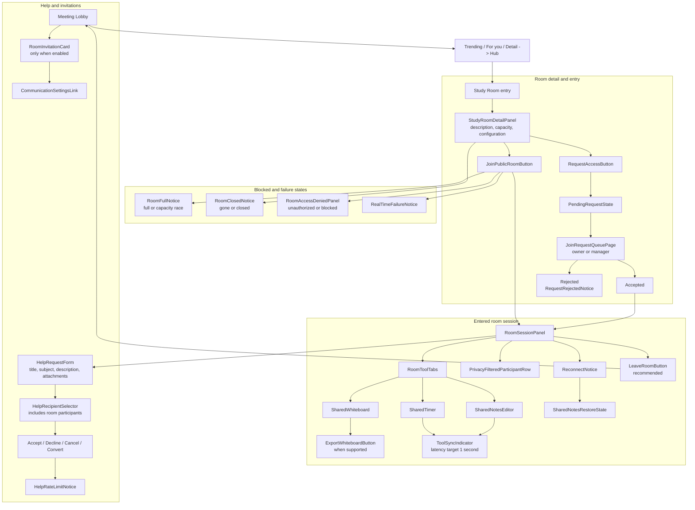

# Study Room Page Specification

**Version:** `1.0`

**Performed by:** [Tran Nguyen Khanh Binh] | **Edited by:** [Tran Nguyen Khanh Binh]
>
> **Main sources:** [`screen_flow.md`](screen_flow.md), [`feature_flow.md`](feature_flow.md), [`overview.md`](overview.md), [`functional_requirement.md`](functional_requirement.md), [`userstory.md`](userstory.md), [`use_cases_description.md`](use_cases_description.md), [`use_cases_model/UC-07-join-create-study-room.md`](use_cases_model/UC-07-join-create-study-room.md), [`non_functional_requirement.md`](non_functional_requirement.md).
>
> **Note:** `UC-07` is the strongest explicit basis here: it defines the public join path, private/custom request path, owner/manager decision, room detail before joining, full/closed/rejected/denied/reconnect states, and shared tools. `US-35`–`US-37` supply the FR/AC detail. **Hub** is a flow-derived directory label, not a requirement-defined object. [`API.md`](API.md) and [`response_code.md`](response_code.md) contain no room endpoints, room fields, or room error codes, so any room API shape is **unspecified** and no endpoints or codes are invented here. Older PA2 hall/study details (tables, seats, invite codes, 30-minute teardown) are **not** current requirements and are not used.

---

## 1. Purpose of the Study Room

The **Study Room** is the primary optional live-study destination in `UC-07`. Its purpose is to let a student enter a room by public join or approved private/custom request, review room detail before joining, collaborate with shared whiteboard/notes/timer tools, ask for help, recover notes after reconnection, and leave. Join requests are routed to a **Room Owner or Manager**, and participation and invitations respect the user's communication and privacy settings.

### 1.1 Core purposes

| Purpose | What the user achieves | Requirement basis |
| --- | --- | --- |
| Follow Lobby paths | Reach Study Room from Trending, For you, or Detail → Hub. | `feature_flow.md:166–168` |
| Join a public room | Enter a public room with available capacity. | `FR-35.2`, `AC-35.1`, `UC-07` main success scenario |
| Request private/custom access | Create a join request for a private or custom room. | `FR-35.3`, `AC-35.2`, `UC-07` A1 |
| Decide on requests | Let an owner/manager accept or reject incoming requests. | `FR-35.4`, `AC-35.3`, `UC-07` A1, business rule 3 |
| Review room detail | Check description, capacity, and configuration before joining. | `UC-07` A3 |
| Handle blocked states | See full, closed, rejected, denied, and capacity-race outcomes. | `UC-07` A4, E1–E3, E6 |
| Use shared tools | Use whiteboard, notes, and timer with synchronized updates. | `US-36`, `FR-36.1`–`FR-36.6`, `AC-36.1`–`AC-36.6` |
| Recover from interruption | Restore the session and preserve notes without data loss. | `UC-07` A6, `FR-36.6`, `AC-36.6` |
| Request help | Send a help request to room participants and respond to others. | `US-37`, `FR-37.1`–`FR-37.6`, `AC-37.1`–`AC-37.6` |
| Honor settings | Respect invitation, communication, and privacy controls. | `FR-38.3`, `AC-38.4`, `FR-39.1`–`FR-39.5`, `NFR-PRIV-6`, `NFR-PRIV-7` |
| Start creation | Reach Create → StudyCreate from the Lobby. | `feature_flow.md:169–172`, `UC-07` A2 |

### 1.2 Place in the screen flow

`screen_flow.md` defines:

```text
Home -> Meeting
Meeting -> Study Room
```

### 1.3 Place in the feature flow and UC-07

`feature_flow.md:166–172` defines the Study paths and creation entry:

```text
Lobby -> Trending -> StudyRoom
Lobby -> For you -> StudyRoom
Lobby -> Detail -> Hub -> StudyRoom
Lobby -> Create -> StudyCreate
```

`UC-07` defines the join behavior:

```text
Open Meeting Lobby -> display public rooms with availability and capacity ->
select room -> verify room exists, is public, and has capacity ->
add participant and establish session -> open room and show tools ->
collaborate -> reconnect or leave

Alternative: select private/custom room -> create join request ->
notify owner or manager -> accepted: join / rejected: notified in lobby
Alternative: view room detail before joining
Exception: full room / room gone or closed / capacity race /
private request rejected / real-time failure / unauthorized or blocked participant
```

**Flow-derived only:** **Hub** is a directory label from `feature_flow.md:168`; it has no dedicated FR or AC.

---

## 2. Recommended page identity and naming

| Item | Suggested name | Notes |
| --- | --- | --- |
| Page group | `MeetingGroupPage` | Matches the supporting group in `screen_flow.md`. |
| Main page | `StudyRoomPage` | Matches the `Study Room` flow label. |
| Suggested route | `/meeting/study/:roomId` or `/meeting/hub/:roomId` | Recommended route; not specified in the proposal. |
| Detail state | `StudyRoomDetailPanel` | Supports `UC-07` A3. |
| Owner/manager queue | `JoinRequestQueuePage` | Supports `FR-35.4` and `UC-07` A1. |
| Primary actions | **Join Room**, **Request Access**, **Accept**, **Decline**, **Request Help** | Match `FR-35.2`–`FR-35.4` and `FR-37.1`. |
| Main objects | `RoomSession`, `JoinRequest`, `RoomParticipant`, `SharedWhiteboard`, `SharedNotes`, `SharedTimer`, `HelpRequest` | Recommended object names based on `UC-07`, `US-35`–`US-37`. |

### 2.1 Naming convention recommendation

- Prefix join/decision components with `JoinRequest`.
- Prefix in-room collaboration components with `Shared`.
- Prefix exception states with `Room`, e.g. `RoomFullNotice`, `RoomClosedNotice`.
- Use PascalCase, e.g. `JoinRequestQueuePage`, `SharedNotesRestoreState`.

---

## 3. Target users and user goals

| User type | Main goal in Study Room | Components used most |
| --- | --- | --- |
| Student joining a public room | Enter quickly when capacity is available. | `JoinPublicRoomButton`, `RoomCapacityText` |
| Student requesting private/custom access | Send a request and track the decision. | `RequestAccessButton`, `PendingRequestState` |
| Room owner or manager | Review and accept or reject join requests. | `JoinRequestQueuePage`, `AcceptJoinRequestButton`, `DeclineJoinRequestButton` |
| Student evaluating a room | Review detail before joining or requesting. | `StudyRoomDetailPanel`, `ViewRoomDetailButton` |
| Participant using tools | Draw, write, and time a shared session. | `SharedWhiteboard`, `SharedNotesEditor`, `SharedTimer` |
| Reconnecting participant | Restore the session and keep notes. | `ReconnectNotice`, `SharedNotesRestoreState` |
| Student needing or giving help | Send, answer, cancel, or convert help requests. | `HelpRequestForm`, `IncomingHelpRequestList` |
| Invited student | Accept a room invitation only when permitted and enabled. | `RoomInvitationCard`, `CommunicationSettingsLink` |

---

## 4. Recommended information architecture

| View/section | Suggested state/route | Purpose | Main components |
| --- | --- | --- | --- |
| Room entry | Lobby → Study Room | Starts the `UC-07` join or request path. | `StudyRoomPage`, `RoomEntryHeader` |
| Room detail | Detail preview/modal | Shows description, capacity, privacy, and configuration before joining. | `StudyRoomDetailPanel`, `ViewRoomDetailButton` |
| Public join | Join state | Verifies room, privacy, and capacity before entry. | `JoinPublicRoomButton`, `RoomCapacityText` |
| Private request | Request state | Creates a join request and shows pending state. | `RequestAccessButton`, `PendingRequestState` |
| Owner/manager queue | `/meeting/requests` | Accepts or rejects join requests. | `JoinRequestQueuePage`, `JoinRequestCard` |
| Session | Entered room | Hosts shared tools and participants. | `RoomSessionPanel`, `RoomToolTabs`, `RoomParticipantList` |
| Help | Help section | Creates and answers help requests. | `HelpRequestPanel`, `HelpRequestForm` |
| Recovery and exit | Overlay/actions | Handles reconnect, failure, and leaving. | `ReconnectNotice`, `RoomFailureAlert`, `LeaveRoomButton` |

---

## 5. Recommended UI components

### 5.1 Entry, detail, and join/request

| Suggested name | UI type | Information shown | Meaning / action | Requirement basis |
| --- | --- | --- | --- | --- |
| `StudyRoomPage` | Page container | Room name, capacity, privacy, tools, join/request actions. | Root container for Study Room entry and session. | `screen_flow.md`, `feature_flow.md:166–168`, `UC-07` |
| `RoomEntryHeader` | Header | Room name, Hub-derived label, privacy badge, capacity. | Identifies the room before entry. | `feature_flow.md:168`, `FR-34.3`, `FR-35.5` |
| `ViewRoomDetailButton` | Link/button | Label **View Detail**. | Opens room detail before joining or requesting. | `UC-07` A3 |
| `StudyRoomDetailPanel` | Modal/side panel | Description, capacity, privacy, supported tools, duration, communication rules. | Supports an informed join/request decision. | `UC-07` A3, `FR-35.5`, `FR-35.6`, `AC-35.4`, `AC-35.5` |
| `RoomCapacityText` | Supporting text | Current occupancy and configured capacity. | Shows availability/capacity required by recommendations and join. | `FR-34.3`, `AC-34.2`, `UC-07` step 2 |
| `JoinPublicRoomButton` | Primary button | Label **Join Room**. | Joins a public room with available capacity. | `FR-35.2`, `AC-35.1`, `UC-07` steps 3–7 |
| `RequestAccessButton` | Secondary button | Label **Request Access**. | Creates a join request for a private/custom room. | `FR-35.3`, `AC-35.2`, `UC-07` A1 |
| `PendingRequestState` | Status row | Requested room, time, **Pending** label. | Shows that an owner/manager decision is outstanding. | `UC-07` A1, business rule 3 |
| `RoomFullNotice` | Alert | “This room is full.” | Blocks join and returns the user to the Lobby. | `UC-07` A4, E3 |
| `RoomClosedNotice` | Alert | “This room no longer exists or is closed.” | Refreshes the Lobby after a stale room. | `UC-07` E2 |
| `RequestRejectedNotice` | Alert | “Your request was rejected.” | Explains a rejected private/custom request. | `UC-07` E1 |
| `RoomAccessDeniedPanel` | Error state | “You are not permitted to join this room.” | Handles unauthorized or blocked participants. | `UC-07` E6, `NFR-SEC-1`, `NFR-SEC-6` |
| `RealTimeFailureNotice` | Alert | “The live room could not be reached.” | Reports real-time service failure. | `UC-07` E5 |
| `CreateRoomLink` | Link | Label **Create a room**. | Leads to Create → StudyCreate. | `feature_flow.md:169–172`, `UC-07` A2 |

### 5.2 Owner/manager decision components

| Suggested name | UI type | Information shown | Meaning / action | Requirement basis |
| --- | --- | --- | --- | --- |
| `JoinRequestQueuePage` | Page/section | Incoming join requests with requester and room context. | Central queue for owners/managers. | `FR-35.4`, `AC-35.3`, `UC-07` A1 |
| `JoinRequestCard` | Card/list item | Requester, room, request time, status. | Shows enough context for a decision. | `FR-35.4`, `UC-07` A1 |
| `AcceptJoinRequestButton` | Primary button | Label **Accept**. | Accepts the request and allows room entry. | `FR-35.4`, `AC-35.3`, `UC-07` A1 |
| `DeclineJoinRequestButton` | Secondary button | Label **Decline**. | Rejects the request and keeps the user in the Lobby. | `FR-35.4`, `AC-35.3`, `UC-07` E1 |
| `JoinRequestDecisionBadge` | Badge | `Pending`, `Accepted`, `Rejected`. | Shows the request outcome. | `FR-35.4`, `AC-35.3` |
| `DecisionNotificationNotice` | Notification card | Request or decision notification with unread indicator. | Routes request and outcome notifications. | `UC-07` supporting actor Notification Service, `FR-38.4`, `AC-38.4` |
| `OwnerManagerOnlyNotice` | Access state | “Only the owner or manager can decide requests.” | Prevents unauthorized decision actions. | `FR-35.4`, `NFR-SEC-6` |

### 5.3 Session and shared tools

| Suggested name | UI type | Information shown | Meaning / action | Requirement basis |
| --- | --- | --- | --- | --- |
| `RoomSessionPanel` | Main content area | Active tool, session status, participant summary. | Hosts the collaboration workspace. | `I-08`, `UC-07` steps 5–7 |
| `RoomToolTabs` | Tab bar | **Whiteboard**, **Notes**, **Timer**. | Switches between supported shared tools. | `FR-36.1`–`FR-36.3`, `AC-36.1`–`AC-36.3` |
| `SharedWhiteboard` | Canvas | Synchronized drawing content. | Lets participants collaborate visually. | `FR-36.1`, `AC-36.1`, `FR-36.4`, `AC-36.4` |
| `ExportWhiteboardButton` | Button | Label **Export whiteboard**. | Exports content when supported. | `FR-36.5`, `AC-36.5` |
| `SharedNotesEditor` | Rich text editor | Shared notes with participant edits. | Lets participants write shared notes. | `FR-36.2`, `AC-36.2`, `FR-36.6`, `AC-36.6` |
| `SharedTimer` | Timer control | Synchronized start/pause/reset and remaining time. | Provides a shared timer. | `FR-36.3`, `AC-36.3`, `FR-36.4`, `AC-36.4` |
| `ToolSyncIndicator` | Status indicator | Synced / reconnecting, latency target ≤ 1 second. | Shows synchronization state to participants. | `FR-36.4`, `AC-36.4`, `NFR-PERF-7` |
| `ReconnectNotice` | Banner/overlay | “Connection interrupted. Restoring session…” | Explains reconnection while recovery runs. | `UC-07` A6 |
| `SharedNotesRestoreState` | Status row | “Shared notes restored.” | Confirms notes survived without data loss. | `FR-36.6`, `AC-36.6`, `UC-07` business rule 7 |
| `LeaveRoomButton` | Secondary button | Label **Leave Room**. | Ends participation and returns to the Lobby. | Recommendation; no explicit room-leave FR/AC |

### 5.4 Participants, invitations, and help

| Suggested name | UI type | Information shown | Meaning / action | Requirement basis |
| --- | --- | --- | --- | --- |
| `RoomParticipantList` | Side panel/list | Participants permitted to be visible. | Shows who is in the room. | `FR-39.1`, `NFR-PRIV-7` |
| `PrivacyFilteredParticipantRow` | List row | Name and permitted fields only. | Applies privacy rules to the roster. | `NFR-PRIV-4`, `NFR-PRIV-7`, `FR-39.5` |
| `RoomInvitationCard` | Notification card | Invitation with room, sender, and accept action. | Shows invitations only when enabled. | `FR-38.3`, `AC-38.4`, `FR-38.4` |
| `RoomInvitationSuppressedNotice` | Informational note | “Invitations are disabled by recipient settings.” | Explains a suppressed invitation. | `FR-39.1`, `FR-39.3`, `FR-39.5`, `NFR-PRIV-6` |
| `CommunicationSettingsLink` | Link | Label **Communication settings**. | Opens controls for invitations and blocked users. | `FR-39.1`, `FR-39.3`, `FR-39.5` |
| `HelpRequestPanel` | Section | Create, track, and answer help requests. | Central place for in-room help. | `US-37`, `FR-37.1`–`FR-37.6` |
| `CreateHelpRequestButton` | Primary button | Label **Request Help**. | Opens the help-request form. | `FR-37.1`, `AC-37.1` |
| `HelpRequestForm` | Form | Title, subject, description, attachments. | Captures required help content. | `AC-37.1` |
| `HelpRecipientSelector` | Multi-select | Friends, room participants, concept learners. | Chooses recipients including room participants. | `FR-37.2`, `AC-37.2` |
| `IncomingHelpRequestList` | List | Help requests received by the participant. | Lets a participant respond. | `FR-37.3`, `AC-37.3` |
| `AcceptHelpButton` | Primary button | Label **Accept**. | Accepts a help request. | `FR-37.3`, `AC-37.3` |
| `DeclineHelpButton` | Secondary button | Label **Decline**. | Declines a help request. | `FR-37.3`, `AC-37.3` |
| `CancelHelpRequestButton` | Text button | Label **Cancel request**. | Cancels an outgoing request. | `FR-37.4`, `AC-37.4` |
| `ConvertToForumPostButton` | Button | Label **Convert to forum post**. | Converts a help request to asynchronous forum discussion. | `FR-37.5`, `AC-37.5`; forum is primary |
| `HelpRateLimitNotice` | Alert | “Too many help requests.” | Explains rate-limit rejection. | `FR-37.6`, `AC-37.6`, `NFR-SEC-9` |

---

## 6. Recommended information displayed

### 6.1 Room and join information

| Field | Suggested label | Where shown | Purpose |
| --- | --- | --- | --- |
| `roomId` | Hidden/internal | Entry and session | Identifies the room. |
| `roomName` | **Room name** | Header, detail, request card | Identifies the Study Room. |
| `description` | **Description** | Detail panel | Explains the room purpose. |
| `privacyLevel` | **Privacy** | Header, detail | Distinguishes public join from private/custom request. |
| `capacity` | **Capacity** | Header, detail | Shows configured capacity. |
| `currentOccupancy` | **Current size** | Header, detail | Combined with capacity to determine availability. |
| `supportedTools` | **Supported tools** | Detail, tool tabs | Shows whiteboard, notes, and timer. |
| `duration` | **Duration** | Detail | Part of manager configuration. |
| `communicationRules` | **Communication rules** | Detail | Part of manager configuration. |
| `requestStatus` | **Status** | Request card, notices | Shows pending, accepted, or rejected. |
| `blockedReason` | **Reason** | Denied/full/closed states | Explains why entry was blocked. |

### 6.2 Session and help information

| Field | Suggested label | Where shown | Purpose |
| --- | --- | --- | --- |
| `sessionState` | **Session status** | Session panel | Shows active, reconnecting, or failed. |
| `notesContent` | **Shared notes** | Notes editor | Content that must survive reconnection. |
| `whiteboardState` | Hidden/internal | Whiteboard | Synchronized drawing content. |
| `timerState` | **Timer** | Timer control | Synchronized timer state. |
| `syncState` | **Sync status** | Sync indicator | Shows synchronization state. |
| `helpRequestId` | Hidden/internal | Help lists | Identifies a help request. |
| `helpTitle` | **Title** | Help form/list | Required help field. |
| `helpSubject` | **Subject** | Help form/list | Required help field. |
| `helpDescription` | **Description** | Help form/list | Required help field. |
| `attachments` | **Attachments** | Help form/list | Attached files. |
| `recipients` | **Recipients** | Help form/list | Friends, room participants, concept learners. |
| `helpStatus` | **Status** | Help lists | Pending, accepted, declined, cancelled, converted. |

---

## 7. Recommended interaction flows

### 7.1 Public join (UC-07 main success scenario)

1. User opens the Meeting Lobby from Home → Meeting.
2. `LobbyRoomList` displays available public rooms with availability and capacity.
3. User selects a Study Room through Trending, For you, or Detail → Hub.
4. User may open `StudyRoomDetailPanel` to review description, capacity, and configuration.
5. User clicks `JoinPublicRoomButton`.
6. Backend verifies that the room exists, is public, and has available capacity.
7. Backend adds the participant and establishes the room session.
8. `StudyRoomPage` opens the room with supported shared tools.
9. User collaborates, then reconnects if needed or leaves.

### 7.2 Private/custom request

1. User selects a private or custom room.
2. `StudyRoomDetailPanel` shows the configuration before the request.
3. User clicks `RequestAccessButton`.
4. A join request is created and routed to a room owner or manager; the Notification Service routes the request.
5. `PendingRequestState` is shown to the requester.
6. Owner/manager reviews `JoinRequestQueuePage` and accepts or declines.
7. On accept, the requester joins the room; on reject, `RequestRejectedNotice` is shown and the user remains in the Lobby.

### 7.3 Full, closed, capacity race, and denied entry

1. If there is no available capacity, `RoomFullNotice` blocks join and returns the user to the Lobby.
2. If another participant takes the last place before join completes, `RoomFullNotice` is shown for the capacity race.
3. If the room no longer exists or is closed, `RoomClosedNotice` appears and the Lobby refreshes.
4. If the backend denies entry because the user is unauthorized or blocked, `RoomAccessDeniedPanel` explains the restriction.
5. If the real-time service is unavailable, `RealTimeFailureNotice` reports the failure.

### 7.4 Shared tools and reconnection

1. User selects a tool in `RoomToolTabs`.
2. Whiteboard, notes, and timer updates are synchronized for all participants.
3. `ToolSyncIndicator` reflects synchronized state and the ≤ 1 second latency target.
4. Whiteboard export is offered when supported.
5. If the connection is interrupted, `ReconnectNotice` appears; `SharedNotesRestoreState` confirms notes are preserved.
6. If recovery fails, notes are preserved where possible and `RealTimeFailureNotice` is shown.

### 7.5 Help requests

1. User clicks `CreateHelpRequestButton` and completes `HelpRequestForm`.
2. `HelpRecipientSelector` includes room participants.
3. Request is sent and tracked in outgoing help requests.
4. Recipients accept or decline through `IncomingHelpRequestList`.
5. Requester may cancel the request or convert it into a forum post.
6. Rate limits are communicated through `HelpRateLimitNotice`.

### 7.6 Invitations and settings

1. A room invitation appears only when room notifications are enabled.
2. `RoomInvitationCard` offers an accept action where permitted.
3. If recipient settings disallow invitations, `RoomInvitationSuppressedNotice` explains why no invitation was delivered.
4. `CommunicationSettingsLink` opens settings for invitations and blocked users.

---

## 8. Business rules and UI states

| Rule/state | Recommended UI behavior | Requirement basis |
| --- | --- | --- |
| Meeting rooms are optional supporting features. | Keep the forum primary in navigation and copy. | `UC-07` business rule 1, `feature_flow.md` note |
| Public room join requires available capacity. | Enable `JoinPublicRoomButton` only with capacity. | `FR-35.2`, `AC-35.1`, `UC-07` business rule 2 |
| Private/custom room requires a request decision. | Route to `JoinRequestQueuePage`; no direct entry. | `FR-35.3`, `FR-35.4`, `AC-35.2`, `AC-35.3`, business rule 3 |
| Creator becomes owner/manager. | Show owner/manager decision controls to the creator. | `UC-07` business rule 4 |
| Managers configure capacity, duration, communication rules, privacy, and tools. | Show configuration in detail and management views. | `FR-35.6`, `AC-35.5`, `UC-07` business rule 5 |
| Room detail is available before joining. | Provide `StudyRoomDetailPanel` before join/request. | `UC-07` A3 |
| Full room / capacity race | Show `RoomFullNotice` and return to Lobby. | `UC-07` A4, E3 |
| Room gone or closed | Show `RoomClosedNotice` and refresh the Lobby. | `UC-07` E2 |
| Request rejected | Show `RequestRejectedNotice`; keep user in Lobby. | `UC-07` E1 |
| Real-time failure | Show `RealTimeFailureNotice`; preserve notes where possible. | `UC-07` E5 |
| Unauthorized or blocked participant | Show `RoomAccessDeniedPanel`; deny entry backend-side. | `UC-07` E6, `NFR-SEC-1`, `NFR-SEC-6` |
| Shared tools must be synchronized. | Propagate updates to all participants within the latency target. | `FR-36.4`, `AC-36.4`, `NFR-PERF-7` (≤ 1 second) |
| Notes must survive reconnection. | Restore notes and confirm with `SharedNotesRestoreState`. | `FR-36.6`, `AC-36.6`, `UC-07` A6, business rule 7 |
| Whiteboard export only when supported. | Conditionally render `ExportWhiteboardButton`. | `FR-36.5`, `AC-36.5` |
| Help requests require title, subject, description, attachments. | Validate `HelpRequestForm`. | `AC-37.1` |
| Help recipients include room participants. | Include them in `HelpRecipientSelector`. | `FR-37.2`, `AC-37.2` |
| Help requests can be accepted, declined, cancelled, converted, and are rate-limited. | Provide corresponding actions and `HelpRateLimitNotice`. | `FR-37.3`–`FR-37.6`, `AC-37.3`–`AC-37.6`, `NFR-SEC-9` |
| Room invitations only when enabled. | Render `RoomInvitationCard` only when notifications are enabled. | `FR-38.3`, `AC-38.4` |
| Participation and invitations respect communication/privacy settings. | Filter roster and suppress disallowed invitations. | `FR-39.1`–`FR-39.5`, `AC-39.1`–`AC-39.3`, `NFR-PRIV-4`, `NFR-PRIV-6`, `NFR-PRIV-7` |
| At least 100 concurrent rooms must be supported. | Design join and session states for many concurrent rooms. | `NFR-SCAL-6` |
| Layouts must work from 320 px upward. | Use responsive detail, roster, and tool layout with clear labels. | `NFR-USE-2`, `NFR-USE-4`, `NFR-USE-5` |
| Room API shape is unspecified. | Do not infer endpoints, fields, or error codes from forum APIs. | `API.md`, `response_code.md` contain no room definitions |
| Older PA2 details are excluded. | Do not show fixed tables, seat assignments, invite codes, or 30-minute teardown. | PA2 details are not current requirements |

---

## 9. Requirements traceability

| Requirement/source | Covered by |
| --- | --- |
| `screen_flow.md`: Home → Meeting → Study Room | `StudyRoomPage`, room entry components |
| `feature_flow.md:166–168`: Lobby → Trending/For you/Detail → Hub → StudyRoom | Entry paths and Hub-derived label |
| `feature_flow.md:169–172`: Lobby → Create → StudyCreate | `CreateRoomLink` to the Create Room flow |
| `overview.md`: Meeting Room → Study Room → Room → Tool | `RoomSessionPanel`, `RoomToolTabs` |
| `UC-07` main success scenario, A1–A6, E1–E6, business rules 1–8 | Public join, private request, detail, full/closed/rejected/denied/reconnect states, tools, settings |
| `UC-07` supporting actors | `JoinRequestQueuePage` for owner/manager; `DecisionNotificationNotice` for Notification Service |
| `I-08 Enter Room Session`, `E-08 Use Shared Study Tools`, `G-03`, `G-04` | Session entry, optional tools, public join specialization, creation specialization |
| `US-34`, `FR-34.1`–`FR-34.4`, `AC-34.1`–`AC-34.3`; `FR-09.4`, `AC-09.4` | Lobby recommendations and displayed availability/capacity feeding room entry |
| `US-35`, `FR-35.1`–`FR-35.6`, `AC-35.1`–`AC-35.5` | Browsing, public join, private request, owner/manager decision, creation fields, configuration |
| `US-36`, `FR-36.1`–`FR-36.6`, `AC-36.1`–`AC-36.6` | Whiteboard, notes, timer, synchronization, export, reconnection |
| `US-37`, `FR-37.1`–`FR-37.6`, `AC-37.1`–`AC-37.6` | Help request creation, recipients, responses, cancel, forum conversion, rate limit |
| `FR-38.3`, `AC-38.4`, `FR-38.4` | Room invitations shown only when enabled |
| `FR-39.1`–`FR-39.5`, `AC-39.1`–`AC-39.3`, `NFR-PRIV-4`, `NFR-PRIV-6`, `NFR-PRIV-7` | Privacy-filtered roster, suppressed invitations, backend enforcement |
| `NFR-SEC-1`, `NFR-SEC-3`, `NFR-SEC-6`, `NFR-SEC-9` | Authentication, TLS, server-side authorization, help-request rate limiting |
| `NFR-PERF-7`, `NFR-SCAL-6` | Tool latency ≤ 1 second and at least 100 concurrent rooms |
| `NFR-USE-2`, `NFR-USE-4`, `NFR-USE-5` | Responsive layouts and clear action labels |
| `API.md`, `response_code.md` | No room endpoints, room fields, or room error codes; room API shape is unspecified |
| Older PA2 hall/study details | Tables, seats, invite codes, and 30-minute teardown are excluded |

---

## 10. Summary diagram


